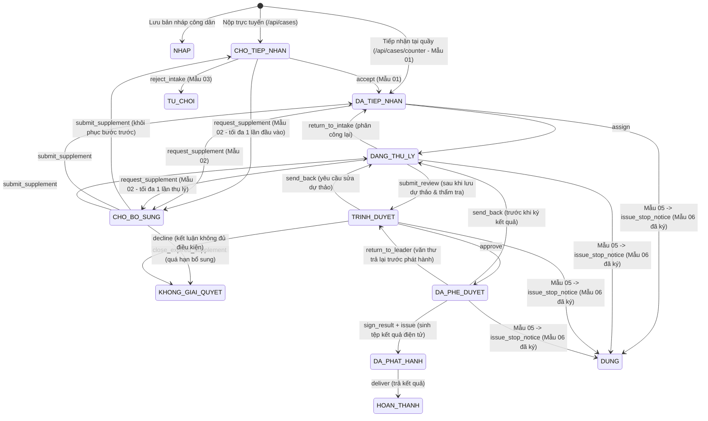

# Đặc tả Use Case và Giao tiếp API hiện hành

Tài liệu này mô tả hệ thống tiếp nhận và giải quyết thủ tục hành chính theo cơ chế một cửa tại thành phố Hà Nội đúng theo mã nguồn thực tế (`app.py`, `citizen_profiles.py`, `citizen_workspace.py`, `workflow_extensions.py`, `procedure_workflows.py`) và hai tệp đặc tả OpenAPI 3.1.0 (`Giao_tiep_OpenAPI.json`, `Giao_tiep_mo_rong_OpenAPI.json`).

---

## 1. Bối cảnh vận hành chính quyền địa phương 2 cấp và ranh giới hệ thống

Hệ thống được thiết kế bám sát mô hình chính quyền địa phương 2 cấp tại Hà Nội:
- **Cấp thành phố:** các Sở, ban, ngành chuyên môn và Trung tâm Phục vụ hành chính công thành phố.
- **Cấp cơ sở:** 126 Ủy ban nhân dân xã, phường sau sắp xếp đơn vị hành chính, mỗi đơn vị có Bộ phận Tiếp nhận và Trả kết quả riêng với phạm vi dữ liệu cô lập theo `agency_scope`.

**Định vị trong hệ sinh thái dịch vụ công:**
- **Cổng Dịch vụ công quốc gia (`dichvucong.gov.vn`):** ứng dụng đối chiếu trực tiếp danh mục 2.075 thủ tục hành chính công bố, phân biệt rõ thủ tục mở biểu mẫu tương tác cục bộ (`2.000908`, `1.004237`), thủ tục nộp theo thành phần công bố và thủ tục chưa đủ điều kiện mở nộp trực tuyến.
- **Định danh điện tử VNeID và ứng dụng iHanoi:** cổng công dân hỗ trợ đăng nhập bằng tài khoản cục bộ và chế độ mô phỏng VNeID (`VNEID_SANDBOX`) để kiểm thử luồng điền sẵn thông tin cá nhân; không kết nối trực tiếp máy chủ định danh Bộ Công an hay kênh thông báo đẩy iHanoi.
- **Thanh toán và chữ ký số:** các bước thu phí, đối soát, hoàn phí kiểm soát 4 mắt và ký kết quả Ed25519 vận hành trọn vẹn trong cơ sở dữ liệu SQLite cục bộ (`LOCAL_SANDBOX`), tách bạch với cổng thanh toán ngân hàng/Kho bạc và chứng thư số công vụ chuyên dùng.

---

## 2. Phân quyền 8 vai trò và nguyên tắc cô lập phạm vi

Mọi truy vấn đọc danh sách, mở chi tiết, tải tệp đính kèm và thực thi thao tác đều kiểm tra đồng thời vai trò tài khoản, thời hạn hiệu lực (`valid_from`, `valid_until`) và phạm vi cơ quan (`agency_scope`):

| STT | Vai trò hệ thống | Phạm vi truy cập và trách nhiệm chính | Giới hạn bảo mật bắt buộc |
| --- | --- | --- | --- |
| 1 | Công dân / Tổ chức (`citizen`) | Khai báo trực tuyến (`applicantType`: `citizen` hoặc `organization`), lưu nháp, nộp bổ sung, gửi Mẫu 05 trực tuyến, khai thanh toán, tải kết quả từ kho tài liệu điện tử, đặt lịch hẹn, gửi PAKN và đánh giá hài lòng. | Chỉ truy cập hồ sơ, bản nháp, lịch hẹn và PAKN thuộc quyền sở hữu tài khoản hoặc khớp khóa tra cứu 64 ký tự hex. |
| 2 | Cán bộ tiếp nhận (`intake`) | Tiếp nhận trực tuyến/tại quầy (Mẫu 01), yêu cầu bổ sung đầu vào (Mẫu 02), từ chối tiếp nhận (Mẫu 03), số hóa giấy tờ, phân công chuyên viên, cấu hình mức thu, lập dự thảo Mẫu 06, xác nhận trả giấy tờ gốc, đóng hồ sơ quá hạn bổ sung và xử lý bàn dịch vụ (lịch hẹn, PAKN). | Chỉ thao tác trên hồ sơ và lịch hẹn thuộc đúng cơ quan `agency_scope` của mình. |
| 3 | Chuyên viên thụ lý (`specialist`) | Đối chiếu sổ gốc/thẩm tra chuyên môn, yêu cầu bổ sung trong quá trình giải quyết (tối đa 01 lần), hoàn trả về bộ phận tiếp nhận khi phân công sai, soạn dự thảo kết quả và trình lãnh đạo duyệt. | Chỉ xử lý hồ sơ thuộc cơ quan mình và được phân công thụ lý. |
| 4 | Lãnh đạo cơ quan (`leader`) | Phê duyệt dự thảo, trả lại chuyên viên chỉnh sửa, kết luận không giải quyết, gia hạn thời hạn giải quyết (Mẫu 04), miễn/điều chỉnh phí, duyệt hoàn phí độc lập; ký kết quả thử nghiệm Ed25519 và ký Mẫu 06 khi được cấp thẩm quyền riêng. | Thẩm quyền ký kết quả (`sandbox_signing_authorities`) và quyền ký Mẫu 06 (`may_sign_stop`) phải được quản trị viên cấp bằng văn bản căn cứ còn hiệu lực. |
| 5 | Cán bộ tài chính (`finance`) | Xem danh sách khoản thu thuộc cơ quan, đối soát chứng từ nộp phí, lập đề nghị hoàn phí, duyệt hoàn phí độc lập (khác người lập) và ghi nhận chứng từ chi hoàn. | Bị ẩn thông tin định danh nhạy cảm, nội dung tờ khai chuyên môn và bị chặn tải tệp thành phần hồ sơ cá nhân. |
| 6 | Văn thư phát hành (`registrar`) | Kiểm tra chữ ký Ed25519 và điều kiện đối soát phí, trả lại lãnh đạo khi cần đính chính trước phát hành, cấp số phát hành sinh tệp kết quả điện tử, ghi nhận trả kết quả và quản lý khóa tra cứu tại quầy. | Không được phát hành khi hồ sơ chưa có chữ ký hợp lệ hoặc khoản thu chưa đối soát/miễn. |
| 7 | Quản lý tài khoản cơ quan (`can_manage_agency_accounts = 1`) | Lập đề nghị cấp mới hoặc điều chỉnh tài khoản cán bộ và xuất danh sách tài khoản trong phạm vi cơ quan được giao. | Không có quyền tự phê duyệt đề nghị; mọi đề nghị đều phải chờ quản trị viên hệ thống xét duyệt. |
| 8 | Quản trị hệ thống (`admin`) | Duyệt đề nghị cấp/thay đổi tài khoản theo nguyên tắc 4 mắt, cấp/thu hồi quyền ký, biên tập danh mục thủ tục - lĩnh vực - tin tức và xem báo cáo tổng hợp toàn thành phố (Bộ chỉ số 766, cân đối kỳ). | Bị chặn tuyệt đối đọc chi tiết hồ sơ cá nhân, tải tệp đính kèm của người dân và xuất CSV danh sách hồ sơ cá nhân. |

---

## 3. Máy trạng thái hồ sơ, Biểu mẫu 01-06 và Quy tắc SLA

### 3.1. Sơ đồ trạng thái không điểm bế tắc (Deadlock-free)

Hệ thống vận hành 12 trạng thái chuẩn kèm kiểm soát đồng thời lạc quan `expectedVersion`:

### 3.2. Trọn bộ biểu mẫu Một cửa (Mẫu 01 đến Mẫu 06) kèm mã QR và Kho tài liệu điện tử

1. **Mẫu số 01 (Giấy tiếp nhận hồ sơ và hẹn trả kết quả):** sinh tự động khi cán bộ tiếp nhận trực tuyến (`accept`) hoặc lập hồ sơ tại quầy (`/api/cases/counter`), gắn mã QR tra cứu tiến độ.
2. **Mẫu số 02 (Phiếu yêu cầu bổ sung, hoàn thiện hồ sơ):** sinh khi `request_supplement`, liệt kê từng thành phần cần bổ sung và căn cứ pháp lý; kiểm soát chặt giới hạn tối đa 01 lần ở bước kiểm tra đầu vào và tối đa 01 lần trong quá trình giải quyết.
3. **Mẫu số 03 (Phiếu từ chối tiếp nhận giải quyết hồ sơ):** sinh khi `reject_intake` đối với hồ sơ không thuộc thẩm quyền hoặc không đủ điều kiện tiếp nhận.
4. **Mẫu số 04 (Phiếu xin lỗi và hẹn lại ngày trả kết quả):** sinh khi lãnh đạo thực hiện `extend_deadline`, ghi rõ lý do chậm/gia hạn và ngày hẹn trả mới, lưu vết trong `deadlineExtension`.
5. **Mẫu số 05 (Phiếu yêu cầu rút/dừng thực hiện thủ tục hành chính):** hỗ trợ người dân gửi trực tuyến ngay trên cổng (`POST /api/public/cases/{code}/actions` với `action = request_withdrawal`) hoặc nộp trực tiếp/qua bưu chính để cán bộ tiếp nhận lập dự thảo (`prepare_stop_notice`).
6. **Mẫu số 06 (Thông báo dừng thực hiện thủ tục hành chính):** hồ sơ giữ nguyên trạng thái đang xử lý trong lúc chờ duyệt dừng (`CHO_KY_PHAT_HANH`) và chỉ chuyển sang `DUNG` sau khi lãnh đạo được cấp quyền `may_sign_stop` ký phát hành (`issue_stop_notice`) hoặc từ chối yêu cầu dừng không hợp lệ (`reject_stop_notice`).
7. **Kết quả điện tử đồng bộ kho công dân:** khi văn thư thực hiện `issue`, hệ thống kiểm tra chữ ký Ed25519 và trạng thái phí (`RECONCILED` hoặc `WAIVED`), cấp số văn bản và tự động tạo tệp kết quả điện tử trong `result.files` để chủ hồ sơ tải về từ Kho tài liệu điện tử (`/api/citizen/documents/{code}/{stored}`).

### 3.3. Cách tính thời hạn giải quyết (SLA), tạm dừng cộng bù và Bộ chỉ số 766

- **Lịch ngày làm việc và giờ cắt trong ngày:** thời hạn giải quyết tính theo lịch ngày làm việc thực tế (`working_calendar.json`, trừ thứ Bảy, Chủ nhật và ngày nghỉ lễ). Riêng thủ tục cấp bản sao trích lục hộ tịch `2.000908` áp dụng quy tắc tiếp nhận trước 15:00 trả kết quả ngay trong ngày làm việc; tiếp nhận từ 15:00 trở đi tính hạn sang ngày làm việc tiếp theo.
- **Tạm dừng và cộng bù thời hạn:** khoảng thời gian hồ sơ chờ người dân nộp bổ sung (`CHO_BO_SUNG`) hoặc chờ hoàn thành nghĩa vụ tài chính được tách khỏi thời gian xử lý của cơ quan; khi người dân hoàn tất bổ sung (`submit_supplement`), hạn giải quyết và các mốc kiểm tra tự động cộng bù đúng số ngày làm việc đã tạm dừng.
- **Bộ chỉ số 766 và cân đối kỳ báo cáo:** API `/api/reporting/summary` tổng hợp trực tiếp 5 nhóm chỉ tiêu theo Quyết định 766/QĐ-TTg (`index766`: công khai minh bạch, tiến độ đúng hạn/quá hạn, tỷ lệ trực tuyến và thanh toán, tỷ lệ số hóa, điểm hài lòng) cùng bảng cân đối kỳ theo Thông tư 09/2026/TT-BTP (`periodBalance`: số kỳ trước chuyển sang + số tiếp nhận trong kỳ = số đã giải quyết + số đang giải quyết cuối kỳ).

---

## 4. Quy ước giao tiếp HTTP, Phiên bảo mật và Mã phản hồi

- **Xác thực tách biệt hai không gian:** cán bộ sử dụng cookie `hni_session`, công dân sử dụng cookie `hni_citizen_session` (`HttpOnly`, `SameSite=Strict`, thời hạn 43.200 giây).
- **Bảo vệ chống giả mạo yêu cầu (CSRF):** mọi yêu cầu `POST` thay đổi dữ liệu của phiên đã đăng nhập bắt buộc gửi kèm tiêu đề `X-CSRF-Token` khớp với mã phiên hiện hành.
- **Tra cứu công khai không lộ thông tin cá nhân:** điểm cuối `GET/POST /api/public/status-check` cho phép kiểm tra tiến độ bằng mã hồ sơ mà không cần đăng nhập, chỉ trả trạng thái, tên thủ tục, cơ quan tiếp nhận và hạn giải quyết, loại bỏ hoàn toàn họ tên, số giấy tờ, điện thoại, địa chỉ và tệp đính kèm.
- **Kiểm soát đồng thời và chống gửi lặp:** các thao tác tạo hồ sơ dùng `submissionKey` (UUID) băm thành `idempotency_key`; các thao tác chuyển bước dùng `expectedVersion` trên bảng `cases` (hoặc `expectedStatus` trên lịch hẹn/PAKN).
- **Quy ước mã trạng thái HTTP:** `200` (xử lý thành công), `201` (khởi tạo bản ghi mới), `401` (chưa đăng nhập hoặc hết hạn phiên), `403` (không đủ quyền vai trò/cơ quan, thiếu quyền ký hoặc sai `X-CSRF-Token`), `404` (không tìm thấy hoặc ngoài phạm vi phân quyền), `409` (xung đột phiên bản đồng thời), `422` (dữ liệu biểu mẫu hoặc điều kiện chuyển trạng thái không hợp lệ), `429` (vượt ngưỡng giới hạn tần suất theo địa chỉ mạng).

---

## 5. Đặc tả 36 Use Case đồng bộ với API thực tế

### Nhóm A. Quản trị tài khoản, phân quyền và danh mục công bố

#### UC01. Quản lý tài khoản cán bộ và phê duyệt độc lập (4 mắt)
- **Tác nhân:** Quản trị hệ thống (`admin`), Quản lý tài khoản cơ quan (`can_manage_agency_accounts = 1`).
- **Điều kiện tiên quyết:** Người lập đề nghị thuộc phạm vi được phép; người phê duyệt là một quản trị viên hệ thống độc lập khác với người lập đề nghị.
- **Luồng xử lý chính:** Người quản lý lập đề nghị cấp mới tài khoản (kèm mật khẩu khởi tạo một lần `must_change_password = 1`) hoặc đề nghị thay đổi vai trò, cơ quan, thời hạn hiệu lực, quyền ký Mẫu 06. Quản trị viên thứ hai kiểm tra căn cứ và phê duyệt hoặc từ chối; khi cần thiết có thể thu hồi tức thời quyền ký Mẫu 06.
- **API hiện hành:** `GET /api/users`, `POST /api/users`, `POST /api/users/access-requests/{id}/approve` (tương thích `/review`), `POST /api/users/{id}/change-requests`, `POST /api/users/change-requests/{id}/approve` (tương thích `/api/users/account-changes/{id}/review`), `POST /api/users/{id}/stop-signing-authority`, `GET /api/export/users.csv`.
- **Hậu điều kiện & Lỗi kiểm soát:** Lưu đầy đủ bản chụp trước/sau trong `staff_access_requests`, `staff_account_changes`, `staff_authority_events`; trả `403` nếu tự phê duyệt đề nghị của chính mình hoặc vượt phạm vi cơ quan.

#### UC02. Quản lý danh mục lĩnh vực và tin tức cổng thông tin
- **Tác nhân:** Quản trị hệ thống (`admin`), Người dân/Cán bộ (tra cứu công khai).
- **Điều kiện tiên quyết:** Có nguồn đối chiếu hợp lệ và lý do cập nhật rõ ràng; thao tác chỉnh sửa kiểm tra `expectedVersion`.
- **Luồng xử lý chính:** Quản trị viên tạo mới lĩnh vực, đổi tên hiển thị, điều chuyển thủ tục giữa các lĩnh vực và biên tập bài viết hướng dẫn (`DRAFT`, `PUBLISHED`, `ARCHIVED`). Mọi thay đổi ghi nhận vào bảng kiểm toán `procedure_category_audit` và `news_audit_log`.
- **API hiện hành:** `GET /api/procedure-categories`, `POST /api/procedure-categories/create`, `POST /api/procedure-categories/edit`, `POST /api/procedure-categories/move`, `GET /api/procedure-categories/history`, `GET /api/public/news`, `GET /api/news`, `POST /api/news`.
- **Hậu điều kiện & Lỗi kiểm soát:** Cổng công khai hiển thị tức thời các mục đã xuất bản; trả `409` khi xung đột phiên bản biên tập.

#### UC03. Biên tập thông tin công bố thủ tục và ghim phiên bản hồ sơ
- **Tác nhân:** Quản trị hệ thống (`admin`).
- **Điều kiện tiên quyết:** Thủ tục tồn tại trong danh mục 2.075 thủ tục; có đường dẫn nguồn công bố và ngày đối chiếu.
- **Luồng xử lý chính:** Quản trị viên cập nhật tên, cấp thực hiện, cơ quan hoặc cấu hình tiếp nhận của thủ tục. Khi công dân hoặc cán bộ lập hồ sơ mới, hệ thống chụp nguyên trạng cấu hình quy trình vào `cases.payload_json.workflow` để các hồ sơ đang giải quyết không bị xáo trộn bởi lần sửa danh mục sau.
- **API hiện hành:** `GET /api/procedures`, `GET /api/procedures/{code}/detail`, `POST /api/procedures/{code}/edit`, `GET /api/procedures/{code}/history`.
- **Hậu điều kiện & Lỗi kiểm soát:** Tăng `version` trong `procedure_catalog_edits` và ghi `procedure_catalog_audit`; hồ sơ cũ giữ nguyên bản chụp quy trình ban đầu.

#### UC04. Kiểm soát máy trạng thái và ma trận quyền chuyển bước
- **Tác nhân:** Hệ thống thực thi tự động (`procedure_workflows.py`, `app.py`).
- **Điều kiện tiên quyết:** Mọi hành động nghiệp vụ đi qua bộ kiểm tra quyền và trạng thái tập trung.
- **Luồng xử lý chính:** Quy tắc chuyển bước được định nghĩa chặt trong mã nguồn kiểm chứng được bằng kiểm thử tự động (thay vì mở màn hình sửa đồ thị tùy ý gây rủi ro sai lệch pháp lý). Máy chủ đối chiếu vai trò, trạng thái hiện hành và điều kiện tiên quyết trước mỗi lần cập nhật.
- **API hiện hành:** Thực thi trực tiếp tại `POST /api/cases/{code}/actions` và `POST /api/public/cases/{code}/actions`; nhãn trạng thái chuẩn cung cấp qua `GET /api/bootstrap`.
- **Hậu điều kiện & Lỗi kiểm soát:** Mọi nhánh đều dẫn tới trạng thái kết thúc hợp lệ (`HOAN_THANH`, `TU_CHOI`, `KHONG_GIAI_QUYET`, `DUNG`); trả `403` hoặc `422` khi thao tác trái quy tắc.

---

### Nhóm B. Không gian công dân số, tiếp nhận và giải quyết hồ sơ Một cửa

#### UC05. Kê khai, lưu nháp và nộp hồ sơ trực tuyến
- **Tác nhân:** Công dân / Tổ chức (`citizen`).
- **Điều kiện tiên quyết:** Đã đăng nhập phiên công dân (`hni_citizen_session`), chọn đúng thủ tục được mở trực tuyến và cơ quan thuộc tuyến tiếp nhận.
- **Luồng xử lý chính:** Người nộp có thể điền sẵn thông tin từ hồ sơ cá nhân (`/api/citizen/profile`), lưu bản nháp nhiều lần, đính kèm tệp thành phần (hoặc khai miễn nộp bản giấy có căn cứ) và gửi hồ sơ kèm `submissionKey`. Hệ thống tạo mã hồ sơ `HN-YYYY-*`, sinh khóa tra cứu 64 ký tự hex lưu vào kho mã hóa Fernet `case_lookup_secrets` và đặt trạng thái `CHO_TIEP_NHAN`.
- **API hiện hành:** `POST /api/citizen/auth/register`, `POST /api/citizen/auth/login`, `GET/POST /api/citizen/profile`, `POST /api/citizen/drafts`, `GET /api/citizen/drafts/{id}`, `POST /api/cases`.
- **Hậu điều kiện & Lỗi kiểm soát:** Hồ sơ gắn quyền sở hữu trong `citizen_record_owners`; gửi lặp cùng `submissionKey` trả lại đúng hồ sơ đã tạo mà không nhân bản dữ liệu.

#### UC06. Luân chuyển và hoàn trả hồ sơ giữa các bộ phận trong cơ quan
- **Tác nhân:** Cán bộ tiếp nhận (`intake`), Chuyên viên (`specialist`), Lãnh đạo (`leader`), Văn thư (`registrar`).
- **Điều kiện tiên quyết:** Người gửi và người nhận thuộc cùng phạm vi `agency_scope`; tài khoản nhận còn hiệu lực.
- **Luồng xử lý chính:** Bộ phận Một cửa phân công hồ sơ cho chuyên viên (`assign`); chuyên viên trả lại Một cửa nếu phân công sai tuyến (`return_to_intake`); chuyên viên trình lãnh đạo (`submit_review`); lãnh đạo trả lại chuyên viên chỉnh sửa (`send_back`); văn thư trả lại lãnh đạo trước khi phát hành nếu cần rà soát lại (`return_to_leader`).
- **API hiện hành:** `POST /api/cases/{code}/actions` (`action`: `assign`, `return_to_intake`, `submit_review`, `send_back`, `return_to_leader`).
- **Hậu điều kiện & Lỗi kiểm soát:** Lưu lịch sử phân công và lý do hoàn trả trong `assignmentHistory` và `case_events` (`audience = internal`).

#### UC07. Thực hiện bước nghiệp vụ có kiểm soát đồng thời lạc quan
- **Tác nhân:** Các vai trò cán bộ nghiệp vụ (`intake`, `specialist`, `leader`, `registrar`).
- **Điều kiện tiên quyết:** Gửi kèm `expectedVersion` khớp với cột `version` hiện tại của hồ sơ trong SQLite.
- **Luồng xử lý chính:** Máy chủ khóa giao dịch an toàn, kiểm tra điều kiện chuyển bước, ghi tệp đính kèm (tự động dọn tệp mới nếu giao dịch lỗi), cập nhật `payload_json`, tăng `version` thêm 1 và ghi nhật ký `case_events`.
- **API hiện hành:** `POST /api/cases/{code}/actions`.
- **Hậu điều kiện & Lỗi kiểm soát:** Trả `409` nếu một phiên làm việc khác vừa cập nhật hồ sơ trước đó, bảo đảm không bao giờ ghi đè mất dữ liệu.

#### UC08. Theo dõi tiến độ hồ sơ (công khai ẩn PII, có khóa tra cứu và nội bộ)
- **Tác nhân:** Người dân không đăng nhập, Chủ hồ sơ (`citizen`), Cán bộ trong phạm vi cơ quan.
- **Điều kiện tiên quyết:** Có mã hồ sơ (tra cứu nhanh), hoặc phiên công dân kèm khóa tra cứu (xem chi tiết), hoặc phiên cán bộ hợp lệ.
- **Luồng xử lý chính:** Người dân kiểm tra nhanh tiến độ tại trang tra cứu công khai mà không lộ dữ liệu cá nhân; chủ hồ sơ đăng nhập xem toàn bộ mốc xử lý, biểu mẫu và thông báo; cán bộ xem thêm nhật ký nội bộ (`audience = internal`).
- **API hiện hành:** `GET/POST /api/public/status-check`, `POST /api/public/cases/lookup`, `GET /api/citizen/cases`, `GET /api/citizen/workspace`, `GET /api/cases/{code}`.
- **Hậu điều kiện & Lỗi kiểm soát:** Tách biệt tuyệt đối sự kiện công khai và sự kiện nội bộ; ẩn thông tin cá nhân với `finance` và trả `404`/`403` với `admin`.

#### UC09. Áp dụng cấu hình quy trình chuẩn hóa theo nhóm thủ tục
- **Tác nhân:** Hệ thống (`procedure_workflows.py`, `official_procedure_policy.py`).
- **Điều kiện tiên quyết:** Mã thủ tục nằm trong danh mục công bố đã đối chiếu.
- **Luồng xử lý chính:** Hệ thống ánh xạ từng thủ tục vào cấu hình quy trình chuẩn (thủ tục hộ tịch trong ngày `2.000908`, thủ tục cung cấp dữ liệu `1.004237` có thẩm tra phí, hoặc nhóm thủ tục nộp theo hồ sơ công bố `PUBLISHED_DOSSIER`) kèm danh sách các mốc kiểm tra `milestones`.
- **API hiện hành:** `GET /api/procedures/{code}/detail` (trả điều kiện quy trình và kênh tiếp nhận), `POST /api/cases`, `POST /api/cases/counter`.
- **Hậu điều kiện & Lỗi kiểm soát:** Chặn nộp trực tuyến ngay từ đầu với các thủ tục pháp luật yêu cầu xuất trình bản chính trực tiếp hoặc chưa mở dịch vụ công trực tuyến.

#### UC10. Ký kết quả giải quyết bằng chữ ký thử nghiệm Ed25519
- **Tác nhân:** Lãnh đạo cơ quan được cấp quyền ký (`leader`).
- **Điều kiện tiên quyết:** Hồ sơ ở trạng thái `DA_PHE_DUYET`, đã hoàn tất đối soát hoặc miễn phí (nếu có khoản thu), tài khoản lãnh đạo có bản ghi hiệu lực trong `sandbox_signing_authorities` thuộc đúng cơ quan.
- **Luồng xử lý chính:** Hệ thống tạo thông điệp chuẩn hóa từ mã hồ sơ, mã thủ tục, nội dung dự thảo đã duyệt và thời điểm phê duyệt, ký bằng khóa Ed25519 cục bộ và lưu giá trị băm SHA-256 cùng chữ ký vào bảng `sandbox_signatures`. Trường hợp cơ quan chỉ có 01 lãnh đạo hoạt động, lãnh đạo đó được phép thực hiện ký sau khi được quản trị viên cấp quyền ký riêng.
- **API hiện hành:** `POST /api/cases/{code}/actions` (`action = sign_result`).
- **Hậu điều kiện & Lỗi kiểm soát:** Mọi sửa đổi dự thảo sau khi ký đều làm mất hiệu lực đối chiếu chữ ký và bị chặn phát hành.

#### UC11. Quản trị thẩm quyền ký kết quả thử nghiệm và khóa mật mã cục bộ
- **Tác nhân:** Quản trị hệ thống (`admin`), Lãnh đạo (`leader`).
- **Điều kiện tiên quyết:** Tài khoản lãnh đạo đang hoạt động và còn thời hạn hiệu lực công tác.
- **Luồng xử lý chính:** Quản trị viên cấp hoặc thu hồi thẩm quyền ký thử nghiệm Ed25519 kèm số quyết định phân công (`authorityRef`) và lý do tối thiểu 12 ký tự; khóa bí mật Ed25519 và khóa Fernet được bảo quản riêng trong thư mục `data/`, tách khỏi cơ sở dữ liệu hồ sơ.
- **API hiện hành:** `GET /api/sandbox-signers`, `POST /api/sandbox-signers`.
- **Hậu điều kiện & Lỗi kiểm soát:** Ghi vết đầy đủ vào `sandbox_signing_authority_events`; hệ thống gắn nhãn rõ đây là chữ ký kiểm tra toàn vẹn cục bộ, chưa kết nối HSM/CA công vụ.

#### UC12. Kiểm tra đầu vào, tiếp nhận hồ sơ (Mẫu 01, Mẫu 03) và lập hồ sơ tại quầy
- **Tác nhân:** Cán bộ tiếp nhận Một cửa (`intake`).
- **Điều kiện tiên quyết:** Hồ sơ trực tuyến ở trạng thái `CHO_TIEP_NHAN` hoặc người dân xuất trình giấy tờ hợp lệ tại quầy.
- **Luồng xử lý chính:** Cán bộ kiểm tra thành phần hồ sơ và chủ thể. Nếu hợp lệ, xác nhận tiếp nhận (`accept` hoặc `/api/cases/counter`) để chuyển sang `DA_TIEP_NHAN`, tính hạn giải quyết theo lịch làm việc và sinh Giấy tiếp nhận và hẹn trả kết quả (**Mẫu 01** có mã QR). Nếu không đủ điều kiện tiếp nhận, lập Phiếu từ chối (**Mẫu 03**, `reject_intake`) chuyển sang `TU_CHOI`.
- **API hiện hành:** `POST /api/cases/{code}/actions` (`action`: `accept`, `reject_intake`), `POST /api/cases/counter`, `GET /api/public/agencies`.
- **Hậu điều kiện & Lỗi kiểm soát:** Ghi thời điểm `acceptedAt`, `deadline` và biểu mẫu tương ứng vào hồ sơ.

#### UC13. Yêu cầu bổ sung (Mẫu 02), nộp bổ sung và xử lý hồ sơ quá hạn bổ sung
- **Tác nhân:** Cán bộ tiếp nhận (`intake`), Chuyên viên (`specialist`), Công dân (`citizen`).
- **Điều kiện tiên quyết:** Hồ sơ ở bước `CHO_TIEP_NHAN`, `DA_TIEP_NHAN` hoặc `DANG_THU_LY`; chưa vượt quá số lần yêu cầu bổ sung tối đa theo quy định.
- **Luồng xử lý chính:** Cán bộ lập Phiếu yêu cầu bổ sung (**Mẫu 02**, `request_supplement`) nêu rõ từng mục thiếu. Khi công dân gửi bổ sung trực tuyến hoặc tại quầy (`submit_supplement`), hệ thống đính kèm tệp mới, cộng bù số ngày làm việc đã tạm dừng vào hạn giải quyết và đưa hồ sơ về đúng trạng thái trước khi tạm dừng. Nếu hết thời hạn bổ sung mà người nộp không hoàn thiện, cán bộ tiếp nhận thực hiện đóng hồ sơ (`close_expired_supplement`) chuyển sang `KHONG_GIAI_QUYET`.
- **API hiện hành:** `POST /api/cases/{code}/actions` (`action`: `request_supplement`, `submit_supplement`, `close_expired_supplement`), `POST /api/public/cases/{code}/actions` (`action = submit_supplement`).
- **Hậu điều kiện & Lỗi kiểm soát:** Chặn yêu cầu bổ sung lần thứ hai trong cùng giai đoạn thụ lý (`422`).

#### UC14. Phân công chuyên viên thụ lý theo cơ quan
- **Tác nhân:** Cán bộ tiếp nhận (`intake`).
- **Điều kiện tiên quyết:** Hồ sơ ở trạng thái `DA_TIEP_NHAN` hoặc `DANG_THU_LY`; chuyên viên nhận thuộc cùng `agency_scope` và đang trong thời hạn hiệu lực quyền.
- **Luồng xử lý chính:** Cán bộ chọn chuyên viên từ danh sách nhân sự hiệu lực của đơn vị để giao thụ lý, cập nhật `assignment` và ghi vào `assignmentHistory`.
- **API hiện hành:** `GET /api/bootstrap` (trả danh sách `staff` cùng cơ quan), `POST /api/cases/{code}/actions` (`action = assign`).
- **Hậu điều kiện & Lỗi kiểm soát:** Hồ sơ chuyển sang `DANG_THU_LY`; chặn giao hồ sơ cho chuyên viên thuộc đơn vị khác.

#### UC15. Thẩm tra chuyên môn, lưu dự thảo và gia hạn thời hạn (Mẫu 04)
- **Tác nhân:** Chuyên viên thụ lý (`specialist`), Lãnh đạo (`leader`).
- **Điều kiện tiên quyết:** Hồ sơ đang ở trạng thái `DANG_THU_LY` (hoặc đang giải quyết khi gia hạn).
- **Luồng xử lý chính:** Chuyên viên thực hiện bước kiểm tra chuyên môn theo loại thủ tục (`verify_original_register` đối chiếu sổ hộ tịch gốc cho `2.000908`, `assess_data_request` thẩm tra yêu cầu dữ liệu và nghĩa vụ phí cho `1.004237`, hoặc `verify_published_procedure`), lưu dự thảo kết quả (`save_draft`) và trình duyệt (`submit_review`). Trường hợp cần kéo dài thời gian xác minh theo quy định, lãnh đạo thực hiện gia hạn (`extend_deadline`) kèm Phiếu xin lỗi và hẹn lại ngày trả kết quả (**Mẫu 04**).
- **API hiện hành:** `POST /api/cases/{code}/actions` (`action`: `verify_original_register`, `assess_data_request`, `verify_published_procedure`, `save_draft`, `submit_review`, `extend_deadline`).
- **Hậu điều kiện & Lỗi kiểm soát:** Chặn trình duyệt khi chưa hoàn tất kết luận thẩm tra bắt buộc hoặc chưa có dự thảo hợp lệ.

#### UC16. Phê duyệt, kết luận không giải quyết và phát hành kết quả điện tử
- **Tác nhân:** Lãnh đạo (`leader`), Văn thư phát hành (`registrar`).
- **Điều kiện tiên quyết:** Hồ sơ ở `TRINH_DUYET` (khi lãnh đạo xem xét) hoặc `DA_PHE_DUYET` đã có chữ ký Ed25519 hợp lệ (khi văn thư phát hành).
- **Luồng xử lý chính:** Lãnh đạo xem xét dự thảo để phê duyệt (`approve` chuyển `DA_PHE_DUYET`), hoặc trả lại chuyên viên sửa (`send_back`), hoặc kết luận không đủ điều kiện giải quyết (`decline` chuyển thẳng sang `KHONG_GIAI_QUYET`, không làm treo quy trình). Sau khi lãnh đạo ký `sign_result`, văn thư thực hiện `issue` cấp số văn bản, chuyển trạng thái sang `DA_PHAT_HANH` và tự động xuất tệp kết quả điện tử vào `result.files`.
- **API hiện hành:** `POST /api/cases/{code}/actions` (`action`: `approve`, `send_back`, `decline`, `sign_result`, `issue`).
- **Hậu điều kiện & Lỗi kiểm soát:** Tệp kết quả điện tử gắn mã băm chữ ký và xuất hiện ngay trong kho tài liệu điện tử của công dân.

#### UC17. Yêu cầu rút/dừng hồ sơ (Mẫu 05 trực tuyến & tại quầy) và phát hành Thông báo dừng (Mẫu 06)
- **Tác nhân:** Công dân (`citizen`), Cán bộ tiếp nhận (`intake`), Lãnh đạo có quyền ký dừng (`leader`).
- **Điều kiện tiên quyết:** Hồ sơ đã được tiếp nhận hợp lệ (`acceptedAt` khác rỗng) và chưa phát hành kết quả giải quyết.
- **Luồng xử lý chính:** Người dân gửi yêu cầu rút/dừng trực tuyến (**Mẫu 05**, `request_withdrawal`) hoặc nộp văn bản tại quầy/bưu chính để cán bộ tiếp nhận lập dự thảo (`prepare_stop_notice`). Trong thời gian chờ ký (`CHO_KY_PHAT_HANH`), hồ sơ giữ nguyên trạng thái gốc và chặn các thao tác xung đột. Lãnh đạo có thẩm quyền `may_sign_stop` kiểm tra để ký phát hành Thông báo dừng (**Mẫu 06**, `issue_stop_notice`, chuyển hồ sơ sang `DUNG`) hoặc từ chối yêu cầu dừng không hợp lệ (`reject_stop_notice`). Sau khi dừng, cán bộ tiếp nhận xác nhận trả lại hồ sơ giấy (`confirm_paper_returned`) và bộ phận tài chính xử lý hoàn phí riêng (nếu có).
- **API hiện hành:** `POST /api/public/cases/{code}/actions` (`action = request_withdrawal`), `POST /api/cases/{code}/actions` (`action`: `prepare_stop_notice`, `issue_stop_notice`, `reject_stop_notice`, `confirm_paper_returned`).
- **Hậu điều kiện & Lỗi kiểm soát:** Không bao giờ chuyển hồ sơ sang `DUNG` khi chưa có Mẫu 06 đã ký phát hành hợp lệ.

#### UC18. Trả kết quả giải quyết và xác nhận giao nhận
- **Tác nhân:** Văn thư (`registrar`), Cán bộ tiếp nhận (`intake`).
- **Điều kiện tiên quyết:** Hồ sơ ở trạng thái `DA_PHAT_HANH`.
- **Luồng xử lý chính:** Cán bộ ghi nhận người nhận kết quả, kênh giao nhận (`TRUC_TIEP`, `BUU_CHINH`, `DIEN_TU_SANDBOX`) và số biên nhận hoặc mã vận đơn (`deliver`), chuyển trạng thái hồ sơ sang `HOAN_THANH`.
- **API hiện hành:** `POST /api/cases/{code}/actions` (`action = deliver`).
- **Hậu điều kiện & Lỗi kiểm soát:** Lưu đầy đủ thông tin `delivery` và mở quyền gửi đánh giá mức độ hài lòng cho chủ hồ sơ.

#### UC19. In biểu mẫu Một cửa (Mẫu 01-06 kèm QR) và tải tệp kết xuất
- **Tác nhân:** Công dân (`citizen`), Cán bộ được phân quyền.
- **Điều kiện tiên quyết:** Người dùng có quyền truy cập hồ sơ tương ứng.
- **Luồng xử lý chính:** Hệ thống cung cấp dữ liệu chuẩn hóa của các biểu mẫu Mẫu 01..06 kèm mã QR tra cứu ngay trên chi tiết hồ sơ để xem bản in chuẩn A4, đồng thời cho phép tải mẫu đơn trống công bố, tệp thành phần và tệp kết quả điện tử hoặc xuất danh sách CSV theo cơ quan.
- **API hiện hành:** `GET /api/procedures/{code}/templates/{attachmentId}`, `GET /api/cases/{code}`, `GET /api/cases/{code}/files/{stored}`, `GET /api/citizen/documents/{code}/{stored}`, `GET /api/export/cases.csv`.
- **Hậu điều kiện & Lỗi kiểm soát:** Phân biệt rõ bản dự thảo nội bộ với kết quả đã phát hành; đính kèm tiêu đề `X-Content-Type-Options: nosniff` cho mọi tệp tải về.

#### UC20. Thông báo biến động hồ sơ và nhắc việc trong ứng dụng
- **Tác nhân:** Công dân (`citizen`), Cán bộ nghiệp vụ.
- **Điều kiện tiên quyết:** Phát sinh sự kiện công khai trên hồ sơ/lịch hẹn/PAKN hoặc hồ sơ sắp đến hạn/quá hạn.
- **Luồng xử lý chính:** Mọi sự kiện `public` trên hồ sơ của công dân tự động tổng hợp thành danh sách thông báo trong không gian công dân số kèm trạng thái đã đọc (`citizen_notification_reads`). Với cán bộ, bàn làm việc phân loại tức thời các hồ sơ chờ xử lý, chờ bổ sung, sắp đến hạn và quá hạn.
- **API hiện hành:** `GET /api/citizen/workspace`, `POST /api/citizen/notifications/read`, `GET /api/bootstrap`.
- **Hậu điều kiện & Lỗi kiểm soát:** Hiển thị chính xác trong hệ thống cục bộ; không phát sinh gửi SMS/email ra mạng ngoài.

---

### Nhóm C. Tra cứu phạm vi, điều hành, thống kê 766 và bàn dịch vụ công

#### UC21. Tra cứu và lọc hồ sơ theo phạm vi phân quyền
- **Tác nhân:** Cán bộ nghiệp vụ (`intake`, `specialist`, `leader`, `registrar`, `finance`).
- **Điều kiện tiên quyết:** Phiên cán bộ hợp lệ và đã đổi mật khẩu khởi tạo.
- **Luồng xử lý chính:** Máy chủ lọc danh sách hồ sơ theo đúng `agency_scope` và vai trò trước khi trả về bàn làm việc hoặc xuất CSV theo bộ lọc cơ quan, trạng thái, từ ngày - đến ngày.
- **API hiện hành:** `GET /api/bootstrap`, `GET /api/cases/{code}`, `GET /api/export/cases.csv`.
- **Hậu điều kiện & Lỗi kiểm soát:** Chặn truy vấn vượt cơ quan (`403`/`404`); tự động xóa cột họ tên người nộp khi xuất CSV dưới vai trò `finance`.

#### UC22. Tra cứu căn cứ thủ tục, mẫu đơn và hướng dẫn thực hiện
- **Tác nhân:** Công dân, Cán bộ tiếp nhận và thụ lý.
- **Điều kiện tiên quyết:** Thủ tục hoặc bài viết hướng dẫn đã được công bố trên hệ thống.
- **Luồng xử lý chính:** Người dùng tra cứu căn cứ pháp lý, trình tự thực hiện, thành phần hồ sơ, mức phí, thời hạn giải quyết của từng thủ tục trong 2.075 thủ tục công bố, tải biểu mẫu gốc và đọc các bài hướng dẫn nghiệp vụ trên cổng.
- **API hiện hành:** `GET /api/procedures`, `GET /api/procedures/{code}/detail`, `GET /api/procedures/{code}/templates/{attachmentId}`, `GET /api/public/news`.
- **Hậu điều kiện & Lỗi kiểm soát:** Luôn hiển thị kèm liên kết nguồn gốc trên Cổng Dịch vụ công quốc gia để đối chiếu.

#### UC23. Tổng hợp báo cáo theo kỳ và cân đối hồ sơ (Thông tư 09/2026/TT-BTP)
- **Tác nhân:** Quản trị hệ thống (`admin`).
- **Điều kiện tiên quyết:** Đăng nhập vai trò `admin`; khoảng ngày lọc hợp lệ (`to >= from`).
- **Luồng xử lý chính:** Hệ thống tổng hợp số liệu hồ sơ theo cơ quan, trạng thái và thủ tục mà không truy xuất thông tin cá nhân người nộp, đồng thời tính toán bảng cân đối kỳ `periodBalance` (`carriedOver + receivedInPeriod = resolvedInPeriod + inProgressEndPeriod`) và hỗ trợ xuất CSV.
- **API hiện hành:** `GET /api/reporting/summary`, `GET /api/reporting/summary.csv`.
- **Hậu điều kiện & Lỗi kiểm soát:** Tách rõ số hồ sơ dữ liệu mẫu mô phỏng (`sampleTotal`) và số hồ sơ phát sinh thực tế (`realTotal`).

#### UC24. Quản lý công thức chỉ tiêu báo cáo chuẩn hóa
- **Tác nhân:** Hệ thống báo cáo nội bộ (`app.py`).
- **Điều kiện tiên quyết:** Dữ liệu trạng thái, thời hạn và đánh giá hài lòng của hồ sơ được lưu chuẩn hóa.
- **Luồng xử lý chính:** Các công thức tính cân đối kỳ (TT 09/2026/TT-BTP) và công thức điểm thành phần Bộ chỉ số 766 (QĐ 766/QĐ-TTg) được cố định nhất quán trong tầng dịch vụ và kiểm chứng bằng kiểm thử tự động để bảo đảm số liệu không sai lệch giữa giao diện và tệp CSV xuất ra.
- **API hiện hành:** `GET /api/reporting/summary`, `GET /api/reporting/summary.csv`.
- **Hậu điều kiện & Lỗi kiểm soát:** Mọi báo cáo xuất ra đều gắn cờ xác định phạm vi vận hành nội bộ, minh bạch công thức tính.

#### UC25. Thống kê Bộ chỉ số 766 phục vụ người dân và doanh nghiệp
- **Tác nhân:** Quản trị hệ thống (`admin`), Lãnh đạo cơ quan (`leader` trong phạm vi đơn vị qua bàn làm việc).
- **Điều kiện tiên quyết:** Có dữ liệu hồ sơ và phản hồi đánh giá trong kỳ thống kê.
- **Luồng xử lý chính:** Hệ thống đo lường tự động các nhóm chỉ tiêu theo Quyết định 766/QĐ-TTg: công khai minh bạch danh mục, tỷ lệ giải quyết trước hạn và đúng hạn, tỷ lệ hồ sơ trực tuyến và giao dịch thanh toán, tỷ lệ số hóa thành phần/kết quả và điểm hài lòng bình quân.
- **API hiện hành:** `GET /api/reporting/summary`, `GET /api/bootstrap`.
- **Hậu điều kiện & Lỗi kiểm soát:** Cho phép lọc theo từng cơ quan trong 126 xã/phường và các Sở/ngành để so sánh chất lượng phục vụ.

#### UC26. Giám sát hồ sơ sắp đến hạn, quá hạn và điều hành tại đơn vị
- **Tác nhân:** Lãnh đạo cơ quan (`leader`), Cán bộ tiếp nhận (`intake`), Chuyên viên (`specialist`).
- **Điều kiện tiên quyết:** Tài khoản thuộc cơ quan giải quyết hồ sơ.
- **Luồng xử lý chính:** Bàn làm việc nội bộ tính toán thời gian còn lại so với `deadline` và các mốc `milestones`, làm nổi bật các hồ sơ sắp đến hạn hoặc quá hạn kèm tên chuyên viên đang phụ trách để lãnh đạo đôn đốc kịp thời.
- **API hiện hành:** `GET /api/bootstrap`, `GET /api/cases/{code}`.
- **Hậu điều kiện & Lỗi kiểm soát:** Cảnh báo điều hành không tự ý thay đổi hạn pháp lý của hồ sơ (việc gia hạn bắt buộc đi qua thao tác `extend_deadline` lập Mẫu 04).

#### UC27. Ghi nhận ý kiến chỉ đạo, phê duyệt và yêu cầu chỉnh sửa
- **Tác nhân:** Lãnh đạo cơ quan (`leader`).
- **Điều kiện tiên quyết:** Hồ sơ thuộc đơn vị quản lý và đang ở bước trình duyệt hoặc phê duyệt.
- **Luồng xử lý chính:** Lãnh đạo ghi rõ ý kiến chỉ đạo chuyên môn khi phê duyệt (`approve`), khi trả lại yêu cầu chỉnh sửa dự thảo (`send_back`) hoặc khi kết luận không giải quyết (`decline`), đồng thời chỉ đạo trả lời phản ánh kiến nghị của đơn vị trên bàn dịch vụ.
- **API hiện hành:** `POST /api/cases/{code}/actions` (`action`: `approve`, `send_back`, `decline`), `POST /api/service-desk/update`, `POST /api/service-desk/pakn-reply`.
- **Hậu điều kiện & Lỗi kiểm soát:** Toàn bộ ý kiến chỉ đạo gắn định danh người ra quyết định và thời điểm thực hiện trong `case_events` / `approvalHistory`.

---

### Nhóm D. Kho tài liệu điện tử, khóa tra cứu, tài chính 4 mắt, số hóa và PAKN

#### UC28. Quản lý kho tài liệu điện tử công dân và kho khóa tra cứu Fernet
- **Tác nhân:** Công dân (`citizen`), Cán bộ tiếp nhận (`intake`), Văn thư (`registrar`).
- **Điều kiện tiên quyết:** Chủ sở hữu tài khoản công dân hoặc cán bộ tiếp nhận/văn thư thuộc đúng cơ quan xử lý hồ sơ.
- **Luồng xử lý chính:** Mọi tệp thành phần người dân nộp, bản quét số hóa tại quầy và tệp kết quả điện tử phát hành đều lưu kèm mã băm `sha256` và phân quyền tải chặt chẽ. Đối với người dân nộp tại quầy hoặc quên khóa tra cứu, cán bộ tiếp nhận/văn thư có thể xem lại (`reveal`) hoặc xoay vòng cấp khóa mới (`rotate`) từ kho mã hóa Fernet `case_lookup_secrets`.
- **API hiện hành:** `GET /api/citizen/workspace`, `GET /api/citizen/documents/{code}/{stored}`, `GET /api/cases/{code}/files/{stored}`, `POST /api/cases/{code}/lookup-key`.
- **Hậu điều kiện & Lỗi kiểm soát:** Nội dung khóa tra cứu không bao giờ ghi ra nhật ký văn bản thuần (`case_events` chỉ ghi hành động xem/cấp lại).

#### UC29. Kế thừa dữ liệu định danh công dân và kho giấy tờ điện tử
- **Tác nhân:** Công dân (`citizen`).
- **Điều kiện tiên quyết:** Đã lưu thông tin tại `/api/citizen/profile` hoặc có tài liệu/kết quả từ các hồ sơ đã giải quyết trong không gian công dân.
- **Luồng xử lý chính:** Khi lập tờ khai mới, hệ thống tự động điền sẵn thông tin định danh và địa chỉ từ hồ sơ công dân đã lưu, đồng thời cho phép tra cứu, tải lại các giấy tờ và kết quả điện tử trong kho tài liệu cá nhân để đối chiếu hoặc đính kèm cho thủ tục tiếp theo.
- **API hiện hành:** `GET /api/citizen/profile`, `GET /api/citizen/workspace`, `GET /api/citizen/documents/{code}/{stored}`.
- **Hậu điều kiện & Lỗi kiểm soát:** Kiểm soát phiên bản `citizen_profiles.version` để tránh ghi đè dữ liệu cá nhân giữa các thẻ trình duyệt.

#### UC30. Tiếp nhận sự kiện liên thông từ hệ thống ngoài (Ranh giới mô phỏng)
- **Tác nhân:** Hạ tầng tích hợp ngoài (chưa kết nối trong phạm vi chạy cục bộ).
- **Hiện trạng thực thi:** Ứng dụng chạy độc lập không mở cổng nhận webhook từ mạng ngoài nhằm bảo đảm an toàn dữ liệu; các thao tác đồng bộ thử nghiệm (`action = sync`) chủ động trả lỗi `403` thông báo rõ chưa cấu hình hợp đồng kết nối ngoài.
- **API hiện hành:** Kiểm soát chặn an toàn tại `POST /api/cases/{code}/actions` (`action = sync`).
- **Hậu điều kiện & Lỗi kiểm soát:** Không giả lập thành công giả tạo đối với các kết nối liên thông chưa có thật.

#### UC31. Đối chiếu danh mục và theo dõi đồng bộ Cổng Dịch vụ công quốc gia
- **Tác nhân:** Hệ thống danh mục (`procedure_details.py`, `official_procedure_policy.py`), Quản trị viên.
- **Điều kiện tiên quyết:** Kho dữ liệu đối chiếu nén `resources/official_catalog_reconciliation.json.gz` sẵn sàng khi khởi động.
- **Luồng xử lý chính:** Hệ thống nạp nhanh dữ liệu đối chiếu 2.075 thủ tục ngay khi khởi động, cung cấp liên kết gốc tới Cổng Dịch vụ công quốc gia trên từng thủ tục và theo dõi hàng đợi trạng thái đồng bộ (`outbox`) trên bàn làm việc nội bộ.
- **API hiện hành:** `GET /api/procedures/{code}/detail`, `GET /api/procedures/{code}/templates/{attachmentId}`, `GET /api/bootstrap`.
- **Hậu điều kiện & Lỗi kiểm soát:** Trả `502` rõ ràng nếu việc tải mẫu đơn trực tiếp từ cổng ngoài gặp sự cố kết nối.

#### UC32. Cấu hình mức thu, miễn phí và khai nộp phí thử nghiệm
- **Tác nhân:** Cán bộ tiếp nhận (`intake`), Lãnh đạo (`leader`), Công dân (`citizen`).
- **Điều kiện tiên quyết:** Hồ sơ đã được tiếp nhận và thủ tục có quy định khoản thu (`FIXED` hoặc `CONDITIONAL`).
- **Luồng xử lý chính:** Cán bộ tiếp nhận cấu hình số tiền và căn cứ thu (`set_fee`); lãnh đạo có thể miễn/điều chỉnh phí có căn cứ trước khi phát sinh giao dịch (`waive_fee`). Người nộp tạo giao dịch thử nghiệm (`create_payment` sinh mã `HN-THU-*`) và khai chứng từ đã nộp (`confirm_payment`, chuyển sang `PAID` chờ kế toán đối soát).
- **API hiện hành:** `POST /api/cases/{code}/actions` (`action`: `set_fee`, `waive_fee`), `POST /api/public/cases/{code}/actions` (`action`: `create_payment`, `confirm_payment`).
- **Hậu điều kiện & Lỗi kiểm soát:** Chặn cấu hình sai mức phí cố định đã công bố và chặn ký/phát hành kết quả khi khoản thu chưa được đối soát hoặc miễn.

#### UC33. Đối soát khoản thu và hoàn phí kiểm soát 4 mắt (2 bước độc lập)
- **Tác nhân:** Cán bộ tài chính (`finance`), Lãnh đạo cơ quan (`leader`).
- **Điều kiện tiên quyết:** Giao dịch ở trạng thái `PAID` (khi đối soát) hoặc `RECONCILED` thuộc hồ sơ đã kết thúc theo diện `DUNG`, `TU_CHOI`, `KHONG_GIAI_QUYET` (khi hoàn phí).
- **Luồng xử lý chính:** Kế toán kiểm tra chứng từ người dân khai để xác nhận đối soát (`reconcile` chuyển `RECONCILED`). Khi phát sinh hoàn trả, quy trình bắt buộc qua 3 mốc tách biệt: (1) lập đề nghị hoàn (`refund-request` -> `PENDING`), (2) một cán bộ tài chính hoặc lãnh đạo khác độc lập xét duyệt (`refund-review` -> `APPROVED` hoặc `REJECTED`, kiểm tra nghiêm ngặt người duyệt khác người lập), và (3) ghi nhận số ủy nhiệm chi/chứng từ chi hoàn thực tế (`refund-execute` -> `EXECUTED`, lúc này giao dịch gốc mới chuyển sang `REFUNDED`).
- **API hiện hành:** `GET /api/payments`, `POST /api/payments/{ref}/reconcile`, `POST /api/payments/{ref}/refund-request`, `POST /api/payments/{ref}/refund-review`, `POST /api/payments/{ref}/refund-execute`.
- **Hậu điều kiện & Lỗi kiểm soát:** Lưu vết bất biến trong `payment_events` và `payment_refunds`; trả `403` nếu người lập đề nghị hoàn tự bấm duyệt.

#### UC34. Số hóa thành phần hồ sơ giấy tại quầy Một cửa
- **Tác nhân:** Cán bộ tiếp nhận (`intake`).
- **Điều kiện tiên quyết:** Hồ sơ nộp trực tiếp (`submissionChannel = TRUC_TIEP`) đang ở trạng thái `DA_TIEP_NHAN` hoặc `DANG_THU_LY`.
- **Luồng xử lý chính:** Cán bộ quét từ 1 đến 8 tệp tài liệu (tối đa 12 MB/lượt), nhập tổng số trang quét và danh mục đối chiếu bản gốc (`digitize_documents`). Hệ thống tính mã băm SHA-256 từng tệp, gắn nhãn thành phần `SOHOA_QUAY` và lưu lịch sử `digitizationHistory`.
- **API hiện hành:** `POST /api/cases/{code}/actions` (`action = digitize_documents`).
- **Hậu điều kiện & Lỗi kiểm soát:** Chặn thao tác số hóa tại quầy đối với hồ sơ nộp thuần trực tuyến hoặc thiếu danh mục kiểm đếm trang.

#### UC35. Đặt lịch hẹn quầy Một cửa, gửi phản ánh kiến nghị (PAKN) và đánh giá hài lòng
- **Tác nhân:** Công dân (`citizen`), Cán bộ tiếp nhận (`intake`), Lãnh đạo (`leader`).
- **Điều kiện tiên quyết:** Công dân đã đăng nhập khi đặt lịch, gửi PAKN hoặc đánh giá hồ sơ đã kết thúc.
- **Luồng xử lý chính:** Công dân đặt lịch hẹn theo ngày làm việc và khung giờ (giới hạn 10 lượt/khung giờ/cơ quan, cấp mã `LH-*`), gửi phản ánh kiến nghị (cấp mã `PA-*`) và tra cứu phản hồi. Cán bộ tiếp nhận hoặc lãnh đạo đúng cơ quan xác nhận/điểm danh lịch hẹn và trả lời chính thức PAKN (không cho ghi đè sau khi đã trả lời). Với hồ sơ đã kết thúc, chủ hồ sơ chấm điểm hài lòng từ 1 đến 5 sao (tối đa 01 lần/hồ sơ).
- **API hiện hành:** `POST /api/public/appointments`, `POST /api/public/pakn`, `POST /api/public/service-lookup`, `GET /api/service-desk`, `POST /api/service-desk/update`, `POST /api/service-desk/pakn-reply`, `POST /api/public/cases/{code}/actions` (`action = feedback`).
- **Hậu điều kiện & Lỗi kiểm soát:** Nội dung PAKN và điểm đánh giá được lưu độc lập, không tự làm thay đổi quyết định giải quyết hồ sơ.

#### UC36. Bảo quản hồ sơ kết thúc và đối chiếu toàn vẹn tệp lưu trữ
- **Tác nhân:** Hệ thống lưu trữ cục bộ (`cases`, `sandbox_signatures`, `data/uploads/`).
- **Hiện trạng thực thi:** Hồ sơ ở các trạng thái kết thúc (`HOAN_THANH`, `TU_CHOI`, `KHONG_GIAI_QUYET`, `DUNG`) được khóa toàn bộ thao tác sửa đổi nghiệp vụ, bảo toàn nguyên trạng dữ liệu tờ khai, biểu mẫu 01-06, chữ ký Ed25519 và mã băm SHA-256 của từng tệp đính kèm/kết quả trong `data/uploads/{code}/`. Chức năng đóng gói đẩy sang Kho lưu trữ lịch sử bên ngoài thuộc phạm vi tích hợp giai đoạn sau.
- **API hiện hành:** Tra cứu hồ sơ lưu trữ qua `GET /api/cases/{code}`, `GET /api/cases/{code}/files/{stored}`, `GET /api/citizen/documents/{code}/{stored}`.
- **Hậu điều kiện & Lỗi kiểm soát:** Mọi thay đổi trái phép trên nội dung kết quả đã ký đều bị phát hiện tức thời khi kiểm tra lại chữ ký Ed25519.
