# HỌC VIỆN CHÍNH TRỊ QUỐC GIA HỒ CHÍ MINH

# HỌC VIỆN HÀNH CHÍNH VÀ QUẢN TRỊ CÔNG

---

# TÊN ĐỀ TÀI:

# XÂY DỰNG HỆ THỐNG THÔNG TIN QUẢN TRỊ NHÂN LỰC
# CHO CÔNG TY CỔ PHẦN PHẦN MỀM SAIGON TECHNOLOGY

---

**BÁO CÁO KẾT THÚC HỌC PHẦN**

Học phần: Hệ thống thông tin quản lý nhân lực

Giảng viên hướng dẫn: Thầy Hoàng Minh Ngọc
Sinh viên thực hiện: Lê Quốc Huy
Mã sinh viên: 2305HTTB011
Lớp chuyên ngành: HTTT Quản lý B - K23

Hà Nội, 2026

---

# LỜI CẢM ƠN

Kính gửi: Lãnh đạo Khoa Khoa học Liên ngành - Ngoại ngữ - Tin học; Thầy Hoàng Minh Ngọc - Giảng viên học phần Hệ thống thông tin quản lý nhân lực.

Để bài báo cáo bài tập lớn kết thúc học phần này được hoàn thiện một cách chỉn chu, khoa học và đạt kết quả tốt nhất, em xin bày tỏ lòng biết ơn sâu sắc đến Thầy Hoàng Minh Ngọc. Thầy đã dành nhiều thời gian, tâm huyết để tận tình hướng dẫn, truyền đạt những kiến thức chuyên môn quý báu về phương pháp phân tích thiết kế hệ thống hướng đối tượng và quản trị nhân lực hiện đại, đồng thời đưa ra những đóng góp, định hướng xác đáng giúp em tháo gỡ các vướng mắc nghiệp vụ trong suốt quá trình nghiên cứu.

Đồng thời, em cũng xin bày tỏ lòng biết ơn chân thành đến Ban Giám hiệu cùng tập thể quý Thầy, Cô giáo tại Học viện Hành chính và Quản trị công đã không ngừng tạo mọi điều kiện thuận lợi nhất về cơ sở vật chất, môi trường học thuật chất lượng cao để chúng em được trau dồi tri thức, rèn luyện kỹ năng tư duy hệ thống và phương pháp luận giải quyết vấn đề thực tiễn.

Cuối cùng, em xin gửi lời tri ân sâu sắc đến gia đình, người thân và bạn bè – những người luôn là điểm tựa tinh thần vững chắc, không ngừng động viên, hỗ trợ và đồng hành cùng em trong suốt chặng đường học tập và rèn luyện vừa qua.

Em xin chân thành cảm ơn!

---

# LỜI CAM ĐOAN

Em xin cam đoan rằng toàn bộ nội dung được trình bày trong bài báo cáo bài tập lớn kết thúc học phần với đề tài "Xây dựng hệ thống thông tin quản trị nhân lực cho Công ty Cổ phần Phần mềm Saigon Technology" là công trình nghiên cứu độc lập, nghiêm túc của riêng bản thân em dưới sự hướng dẫn chuyên môn của Thầy Hoàng Minh Ngọc.

Hệ thống HRMS được xây dựng trên cơ sở kiến thức chuyên ngành, thông tin công khai về Saigon Technology và yêu cầu quản trị nhân sự thường gặp. Những số liệu, quy trình và chính sách chưa có tài liệu nội bộ xác nhận được ghi nhận là giả định nghiệp vụ; chúng không đại diện cho kết quả khảo sát hay dữ liệu chính thức của doanh nghiệp.

Em xin khẳng định rằng mọi số liệu, biểu đồ, hình ảnh và kết quả phân tích trong báo cáo là trung thực, rõ ràng và có trích dẫn nguồn gốc đầy đủ theo đúng quy định học thuật. Các sơ đồ kỹ thuật UML đều được tự xây dựng dựa trên đặc tả bài toán thực tế của doanh nghiệp.

Em xin hoàn toàn chịu trách nhiệm trước Bộ môn, Khoa và Ban Giám hiệu Nhà trường về tính trung thực và sự chuẩn mực của nội dung được trình bày trong toàn bộ tài liệu này.

Em xin trân trọng cam đoan!

---

# MỤC LỤC

DANH MỤC TỪ/ THUẬT NGỮ VIẾT TẮT
DANH MỤC BẢNG BIỂU, SƠ ĐỒ
PHẦN MỞ ĐẦU
1. Lý do chọn đề tài
2. Tổng quan về Công ty Cổ phần Phần mềm Saigon Technology
3. Mục tiêu và nhiệm vụ
4. Đối tượng và phạm vi nghiên cứu
5. Cấu trúc của báo cáo
PHẦN NỘI DUNG
CHƯƠNG 1: CƠ SỞ LÝ LUẬN VỀ QUẢN TRỊ NHÂN LỰC VÀ HỆ THỐNG THÔNG TIN QUẢN TRỊ NHÂN LỰC
1.1. Lý thuyết cơ sở
1.2. Một số vấn đề liên quan đến chủ đề
1.3. Phát biểu bài toán cần giải quyết
Tóm tắt chương 1
CHƯƠNG 2: THIẾT KẾ HỆ THỐNG THÔNG TIN QUẢN TRỊ NHÂN LỰC CHO CÔNG TY CỔ PHẦN PHẦN MỀM SAIGON TECHNOLOGY
2.1. Phân tích các yêu cầu nghiệp vụ
2.2. Phân tích cấu trúc hệ thống
2.3. Phân tích hành vi của hệ thống
2.4. Thiết kế hệ thống
Tóm tắt chương 2
CHƯƠNG 3: KẾT QUẢ ĐẠT ĐƯỢC VÀ ĐỀ XUẤT, KHUYẾN NGHỊ HOẶC HƯỚNG NGHIÊN CỨU PHÁT TRIỂN
3.1. Những kết quả đạt được
3.2. Đánh giá ưu, nhược điểm
3.3. Hướng nghiên cứu, phát triển
Tóm tắt chương 3
TÀI LIỆU THAM KHẢO

---

# DANH MỤC TỪ/ THUẬT NGỮ VIẾT TẮT

| STT | Từ viết tắt | Thuật ngữ đầy đủ và Diễn giải |
| :---: | :---: | :--- |
| 1 | AI | Artificial Intelligence (Trí tuệ nhân tạo) |
| 2 | API | Application Programming Interface (Giao diện lập trình ứng dụng) |
| 3 | ATS | Applicant Tracking System (Hệ thống quản lý và theo dõi hồ sơ ứng viên tuyển dụng) |
| 4 | BGD | Ban Giám đốc (Ban Giám đốc Điều hành công ty) |
| 5 | BHTN | Bảo hiểm thất nghiệp |
| 6 | BHXH | Bảo hiểm xã hội |
| 7 | BHYT | Bảo hiểm y tế |
| 8 | BNV | Bộ Nội vụ (Quy chuẩn hồ sơ cán bộ mẫu 2C-BNV) |
| 9 | C&B | Compensation & Benefits (Bộ phận Chế độ đãi ngộ, Tiền lương và Phúc lợi) |
| 10 | CCCD | Căn cước công dân |
| 11 | CNTT | Công nghệ thông tin |
| 12 | CRUD | Create, Read, Update, Delete (Bốn thao tác dữ liệu cơ bản: Tạo mới, Đọc, Sửa, Xóa) |
| 13 | CSDL | Cơ sở dữ liệu |
| 14 | CV | Curriculum Vitae (Bản tóm tắt lý lịch trích ngang và kinh nghiệm của ứng viên) |
| 15 | ĐHCĐ | Đại hội đồng Cổ đông |
| 16 | ĐKKD | Đăng ký kinh doanh |
| 17 | ERD | Entity-Relationship Diagram (Sơ đồ quan hệ thực thể cơ sở dữ liệu) |
| 18 | ESOP | Employee Stock Ownership Plan (Kế hoạch phát hành cổ phiếu thưởng cho người lao động) |
| 19 | ESS | Employee Self-Service (Cổng thông tin tự phục vụ dành cho nhân viên) |
| 20 | FTS | Full-Text Search (Tìm kiếm toàn văn theo chỉ mục) |
| 21 | GPS | Global Positioning System (Hệ thống định vị toàn cầu) |
| 22 | HĐLĐ | Hợp đồng lao động |
| 23 | HR | Human Resources (Nguồn nhân lực / Bộ phận Quản trị Nhân sự) |
| 24 | HRMS | Human Resource Management System (Hệ thống thông tin quản trị nhân lực) |
| 26 | ISO | International Organization for Standardization (Tổ chức Tiêu chuẩn hóa Quốc tế) |
| 27 | IT | Information Technology (Công nghệ thông tin) |
| 28 | JD | Job Description (Bản mô tả vị trí và tiêu chuẩn công việc) |
| 29 | JSON | JavaScript Object Notation (Định dạng trao đổi dữ liệu tiêu chuẩn) |
| 30 | JWT | JSON Web Token (Tiêu chuẩn mã hóa token xác thực phiên làm việc an toàn) |
| 31 | KPI | Key Performance Indicator (Chỉ số đánh giá hiệu suất công việc then chốt) |
| 32 | NDA | Non-Disclosure Agreement (Thỏa thuận cam kết bảo mật thông tin) |
| 33 | NĐ | Nghị định (Nghị định của Chính phủ) |
| 34 | ODC | Offshore Development Center (Trung tâm phát triển phần mềm chuyên trách) |
| 35 | OKR | Objectives and Key Results (Mục tiêu và kết quả then chốt) |
| 36 | OOAD | Object-Oriented Analysis and Design (Phân tích và thiết kế hướng đối tượng) |
| 37 | OOP | Object-Oriented Programming (Lập trình hướng đối tượng) |
| 38 | ORM | Object-Relational Mapping (Kỹ thuật ánh xạ quan hệ - đối tượng trong CSDL) |
| 39 | OT | Overtime (Làm thêm ngoài giờ) |
| 40 | PM | Project Manager (Quản trị viên dự án phần mềm) |
| 41 | QR | Quick Response code (Mã phản hồi nhanh hai chiều) |
| 42 | RACI | Responsible, Accountable, Consulted, Informed (Ma trận phân định vai trò và trách nhiệm) |
| 43 | RBAC | Role-Based Access Control (Mô hình kiểm soát truy cập dựa trên vai trò) |
| 44 | RESTful API | Representational State Transfer API (Giao diện API chuẩn kiến trúc dịch vụ REST) |
| 45 | SOP | Standard Operating Procedure (Quy trình thao tác vận hành chuẩn) |
| 46 | SSO | Single Sign-On (Cơ chế xác thực đăng nhập một lần) |
| 47 | STS | STS Software Technology JSC (Công ty Cổ phần Công nghệ Phần mềm STS / Saigon Technology) |
| 48 | SYLL | Sơ yếu lý lịch |
| 49 | TNCN | Thuế thu nhập cá nhân |
| 50 | TP.HCM | Thành phố Hồ Chí Minh |
| 51 | UI / UX | User Interface / User Experience (Giao diện người dùng / Trải nghiệm người dùng) |
| 52 | UML | Unified Modeling Language (Ngôn ngữ mô hình hóa thống nhất) |
| 53 | VINASA | Hiệp hội Phần mềm và Dịch vụ Công nghệ thông tin Việt Nam |

---

# DANH MỤC BẢNG BIỂU, SƠ ĐỒ

**Danh mục Bảng biểu:**
- Bảng 1.1. Mạng lưới văn phòng và chi nhánh toàn cầu của Saigon Technology
- Bảng 1.2. Tổng hợp chứng nhận quốc tế và giải thưởng tiêu biểu của Saigon Technology
- Bảng 1.3. Cơ cấu nguồn nhân lực theo khối chức năng và trình độ tại Saigon Technology
- Bảng 1.4. Ma trận phân định trách nhiệm liên phòng ban trong các quy trình quản trị nhân sự (RACI Matrix)
- Bảng 2.1. Ánh xạ tác nhân hệ thống với cơ cấu tổ chức của Saigon Technology
- Bảng 2.2. Danh sách 47 Use case của Hệ thống Quản trị nhân lực
- Bảng 2.3. Bảng ánh xạ ba tầng: từ Quy trình nghiệp vụ đến Use Case và Màn hình thực tế
- Bảng 2.4. Ma trận phân quyền truy cập chức năng theo vai trò người dùng (RBAC Matrix)
- Bảng 2.5. Đặc tả cấu trúc lược đồ cơ sở dữ liệu đa chế độ của HRMS
- Bảng 2.6. So sánh các phương thức điểm danh trong hệ thống

**Danh mục Sơ đồ, Hình ảnh:**
- Hình 1.1. Sơ đồ cơ cấu tổ chức tổng thể Công ty Saigon Technology
- Hình 1.2. Cơ cấu chi tiết Khối Quản trị Nguồn nhân lực và Khối Vận hành & Pháp chế
- Hình 1.3. Cơ cấu chi tiết Khối Kỹ thuật & Sản xuất Phần mềm
- Hình 1.4. Mô hình phối hợp giữa các đơn vị trong quản trị nhân lực
- Hình 2.1. Biểu đồ cây phân cấp Tác nhân
- Hình 2.2. Biểu đồ Use case tổng quan Hệ thống Quản trị nhân lực
- Hình 2.3. Biểu đồ Use case Phân hệ Quản trị hệ thống và Cơ cấu tổ chức (Nhóm A: UC01 - UC03)
- Hình 2.4. Biểu đồ Use case Phân hệ Tuyển dụng và Quản lý ứng viên (Nhóm B: UC04 - UC08)
- Hình 2.5. Biểu đồ Use case Phân hệ Hồ sơ nhân sự, Hợp đồng và Hội nhập (Nhóm C: UC09 - UC14)
- Hình 2.6. Biểu đồ Use case Phân hệ Cổng tự phục vụ nhân viên và Phân cấp hồ sơ (Nhóm D: UC15 - UC17)
- Hình 2.7. Biểu đồ Use case Phân hệ Chấm công, Phân ca và Điểm danh đa nguồn (Nhóm E: UC18 - UC25)
- Hình 2.8. Biểu đồ Use case Phân hệ Tiền lương, Chế độ đãi ngộ và Phúc lợi (Nhóm F: UC26 - UC31)
- Hình 2.9. Biểu đồ Use case Phân hệ Biến động nhân sự và Thôi việc (Nhóm G: UC32 - UC36)
- Hình 2.10. Biểu đồ Use case Phân hệ Đánh giá KPI, Đào tạo và Khiếu nại (Nhóm H: UC37 - UC39)
- Hình 2.11. Biểu đồ Use case hồ sơ công vụ (UC40 - UC43, chỉ chế độ khu vực công)
- Hình 2.12. Biểu đồ Use case Phân hệ Quản trị tri thức và Điều hành hệ thống (Nhóm J: UC44 - UC47)
- Hình 2.13. Biểu đồ trình tự Use case Đăng nhập & Xác thực hệ thống (UC01)
- Hình 2.14. Biểu đồ trình tự Use case Quản trị người dùng & Phân quyền RBAC (UC02)
- Hình 2.15. Biểu đồ trình tự Use case Quản trị cơ cấu tổ chức & Cây phòng ban (UC03)
- Hình 2.16. Biểu đồ trình tự Use case Lập phiếu đề xuất tuyển dụng nhân sự (UC04)
- Hình 2.17. Biểu đồ trình tự Use case Thẩm định chỉ tiêu & Kiểm soát định biên tuyển dụng (UC05)
- Hình 2.18. Biểu đồ trình tự Use case Phê duyệt chỉ tiêu tuyển dụng (UC06)
- Hình 2.19. Biểu đồ trình tự Use case Quản lý hồ sơ ứng viên & Tuyển dụng ATS (UC07)
- Hình 2.20. Biểu đồ trình tự Use case Gửi thư mời nhận việc & Thỏa thuận mức lương (UC08)
- Hình 2.21. Biểu đồ trình tự Use case Quản lý hồ sơ nhân viên toàn diện (UC09)
- Hình 2.22. Biểu đồ trình tự Use case Quản lý hợp đồng lao động & Phụ lục hợp đồng (UC10)
- Hình 2.23. Biểu đồ trình tự Use case Quản lý văn bằng, chứng chỉ chuyên môn (UC11)
- Hình 2.24. Biểu đồ trình tự Use case Mượn - trả hồ sơ, chứng chỉ bản gốc (UC12)
- Hình 2.25. Biểu đồ trình tự Use case Đánh giá kết quả thử việc & Ký HĐLĐ chính thức (UC13)
- Hình 2.26. Biểu đồ trình tự Use case Lộ trình hội nhập nhân viên mới (UC14)
- Hình 2.27. Biểu đồ trình tự Use case Cổng tự phục vụ nhân viên tập trung (UC15)
- Hình 2.28. Biểu đồ trình tự Use case Quản lý thông tin cá nhân phân cấp 3 mức độ (UC16)
- Hình 2.29. Biểu đồ trình tự Use case Thẩm định & Phê duyệt đề xuất điều chỉnh hồ sơ Mức 2 (UC17)
- Hình 2.30. Biểu đồ trình tự Use case Ghi nhận sự kiện chấm công & Điểm danh vào/ra ca (UC18)
- Hình 2.31. Biểu đồ trình tự Use case Điểm danh bằng khuôn mặt qua camera thường (UC19)
- Hình 2.32. Biểu đồ trình tự Use case Quản trị kết nối thiết bị máy chấm công (UC20)
- Hình 2.33. Biểu đồ trình tự Use case Đăng ký & Xét duyệt nghỉ phép trực tuyến (UC21)
- Hình 2.34. Biểu đồ trình tự Use case Đăng ký & Phê duyệt làm thêm giờ (OT) (UC22)
- Hình 2.35. Biểu đồ trình tự Use case Lập lịch và phân ca làm việc (UC23)
- Hình 2.36. Biểu đồ trình tự Use case Giải trình bổ sung giờ công & Xử lý lệch công (UC24)
- Hình 2.37. Biểu đồ trình tự Use case Tổng hợp & Chốt bảng chấm công tháng (UC25)
- Hình 2.38. Biểu đồ trình tự Use case Cấu hình công thức và ngạch bậc lương (UC26)
- Hình 2.39. Biểu đồ trình tự Use case Vận hành chức năng tính lương tự động (UC27)
- Hình 2.40. Biểu đồ trình tự Use case Phê duyệt, khóa và ghi nhận chi trả kỳ lương (UC28)
- Hình 2.41. Biểu đồ trình tự Use case Quản lý tạm ứng & Khoản vay phúc lợi nhân viên (UC29)
- Hình 2.42. Biểu đồ trình tự Use case Quản lý đề xuất công tác & Quyết toán chi phí (UC30)
- Hình 2.43. Biểu đồ trình tự Use case Quản lý cấp phát & Thu hồi tài sản làm việc (UC31)
- Hình 2.44. Biểu đồ trình tự Use case Đề xuất & Phê duyệt điều chuyển công tác nội bộ (UC32)
- Hình 2.45. Biểu đồ trình tự Use case Đề xuất & Phê duyệt điều chỉnh bậc lương (UC33)
- Hình 2.46. Biểu đồ trình tự Use case Đề xuất & Phê duyệt khen thưởng nhân sự (UC34)
- Hình 2.47. Biểu đồ trình tự Use case Xử lý kỷ luật & Vi phạm nội quy lao động (UC35)
- Hình 2.48. Biểu đồ trình tự Use case Tiếp nhận, Xử lý thôi việc & Bàn giao đa bộ phận (UC36)
- Hình 2.49. Biểu đồ trình tự Use case Đánh giá KPI (UC37)
- Hình 2.50. Biểu đồ trình tự Use case Quản trị chương trình đào tạo nội bộ (UC38)
- Hình 2.51. Biểu đồ trình tự Use case Tiếp nhận & Giải quyết khiếu nại lao động bảo mật (UC39)
- Hình 2.52. Biểu đồ trình tự hồ sơ công vụ (UC40, tham chiếu Mẫu 2C-BNV/2008; mẫu hiện hành cần xác minh)
- Hình 2.53. Biểu đồ trình tự quản trị danh mục ngạch bậc khu vực công (UC41; nguồn và hiệu lực cần xác minh)
- Hình 2.54. Biểu đồ trình tự rà soát điều kiện nâng bậc công vụ (UC42, đề xuất; căn cứ cần xác minh)
- Hình 2.55. Biểu đồ trình tự kết xuất hồ sơ công vụ (UC43, đề xuất; biểu mẫu pháp quy chưa xác nhận)
- Hình 2.56. Biểu đồ trình tự Use case Quản lý không gian tri thức số & Tài liệu quy trình vận hành (UC44)
- Hình 2.57. Biểu đồ trình tự Use case Tìm kiếm tri thức toàn văn & Danh bạ chuyên gia (UC45)
- Hình 2.58. Biểu đồ trình tự Use case Bảng điều khiển phân tích & Thống kê nhân sự (UC46)
- Hình 2.59. Biểu đồ trình tự Use case Nhật ký kiểm toán hệ thống & Cấu hình tham số (UC47)
- Hình 2.60. Biểu đồ hoạt động Use case Đăng nhập & Xác thực hệ thống (UC01)
- Hình 2.61. Biểu đồ hoạt động Use case Quản trị người dùng & Phân quyền RBAC (UC02)
- Hình 2.62. Biểu đồ hoạt động Use case Quản trị cơ cấu tổ chức & Cây phòng ban (UC03)
- Hình 2.63. Biểu đồ hoạt động Use case Lập phiếu đề xuất tuyển dụng nhân sự (UC04)
- Hình 2.64. Biểu đồ hoạt động Use case Thẩm định chỉ tiêu & Kiểm soát định biên tuyển dụng (UC05)
- Hình 2.65. Biểu đồ hoạt động Use case Phê duyệt chỉ tiêu tuyển dụng (UC06)
- Hình 2.66. Biểu đồ hoạt động Use case Quản lý hồ sơ ứng viên & Tuyển dụng ATS (UC07)
- Hình 2.67. Biểu đồ hoạt động Use case Gửi thư mời nhận việc & Thỏa thuận mức lương (UC08)
- Hình 2.68. Biểu đồ hoạt động Use case Quản lý hồ sơ nhân viên toàn diện (UC09)
- Hình 2.69. Biểu đồ hoạt động Use case Quản lý hợp đồng lao động & Phụ lục hợp đồng (UC10)
- Hình 2.70. Biểu đồ hoạt động Use case Quản lý văn bằng, chứng chỉ chuyên môn (UC11)
- Hình 2.71. Biểu đồ hoạt động Use case Mượn - trả hồ sơ, chứng chỉ bản gốc (UC12)
- Hình 2.72. Biểu đồ hoạt động Use case Đánh giá kết quả thử việc & Ký HĐLĐ chính thức (UC13)
- Hình 2.73. Biểu đồ hoạt động Use case Lộ trình hội nhập nhân viên mới (UC14)
- Hình 2.74. Biểu đồ hoạt động Use case Cổng tự phục vụ nhân viên tập trung (UC15)
- Hình 2.75. Biểu đồ hoạt động Use case Quản lý thông tin cá nhân phân cấp 3 mức độ (UC16)
- Hình 2.76. Biểu đồ hoạt động Use case Thẩm định & Phê duyệt đề xuất điều chỉnh hồ sơ Mức 2 (UC17)
- Hình 2.77. Biểu đồ hoạt động Use case Ghi nhận sự kiện chấm công & Điểm danh vào/ra ca (UC18)
- Hình 2.78. Biểu đồ hoạt động Use case Điểm danh bằng khuôn mặt qua camera thường (UC19)
- Hình 2.79. Biểu đồ hoạt động Use case Quản trị kết nối thiết bị máy chấm công (UC20)
- Hình 2.80. Biểu đồ hoạt động Use case Đăng ký & Xét duyệt nghỉ phép trực tuyến (UC21)
- Hình 2.81. Biểu đồ hoạt động Use case Đăng ký & Phê duyệt làm thêm giờ (OT) (UC22)
- Hình 2.82. Biểu đồ hoạt động Use case Lập lịch và phân ca làm việc (UC23)
- Hình 2.83. Biểu đồ hoạt động Use case Giải trình bổ sung giờ công & Xử lý lệch công (UC24)
- Hình 2.84. Biểu đồ hoạt động Use case Tổng hợp & Chốt bảng chấm công tháng (UC25)
- Hình 2.85. Biểu đồ hoạt động Use case Cấu hình công thức và ngạch bậc lương (UC26)
- Hình 2.86. Biểu đồ hoạt động Use case Vận hành chức năng tính lương tự động (UC27)
- Hình 2.87. Biểu đồ hoạt động Use case Phê duyệt, khóa và ghi nhận chi trả kỳ lương (UC28)
- Hình 2.88. Biểu đồ hoạt động Use case Quản lý tạm ứng & Khoản vay phúc lợi nhân viên (UC29)
- Hình 2.89. Biểu đồ hoạt động Use case Quản lý đề xuất công tác & Quyết toán chi phí (UC30)
- Hình 2.90. Biểu đồ hoạt động Use case Quản lý cấp phát & Thu hồi tài sản làm việc (UC31)
- Hình 2.91. Biểu đồ hoạt động Use case Đề xuất & Phê duyệt điều chuyển công tác nội bộ (UC32)
- Hình 2.92. Biểu đồ hoạt động Use case Đề xuất & Phê duyệt điều chỉnh bậc lương (UC33)
- Hình 2.93. Biểu đồ hoạt động Use case Đề xuất & Phê duyệt khen thưởng nhân sự (UC34)
- Hình 2.94. Biểu đồ hoạt động Use case Xử lý kỷ luật & Vi phạm nội quy lao động (UC35)
- Hình 2.95. Biểu đồ hoạt động Use case Tiếp nhận, Xử lý thôi việc & Bàn giao đa bộ phận (UC36)
- Hình 2.96. Biểu đồ hoạt động Use case Đánh giá KPI (UC37)
- Hình 2.97. Biểu đồ hoạt động Use case Quản trị chương trình đào tạo nội bộ (UC38)
- Hình 2.98. Biểu đồ hoạt động Use case Tiếp nhận & Giải quyết khiếu nại lao động bảo mật (UC39)
- Hình 2.99. Biểu đồ hoạt động hồ sơ công vụ (UC40, tham chiếu Mẫu 2C-BNV/2008; mẫu hiện hành cần xác minh)
- Hình 2.100. Biểu đồ hoạt động quản trị danh mục ngạch bậc khu vực công (UC41; nguồn và hiệu lực cần xác minh)
- Hình 2.101. Biểu đồ hoạt động rà soát điều kiện nâng bậc công vụ (UC42, đề xuất; căn cứ cần xác minh)
- Hình 2.102. Biểu đồ hoạt động kết xuất hồ sơ công vụ (UC43, đề xuất; biểu mẫu pháp quy chưa xác nhận)
- Hình 2.103. Biểu đồ hoạt động Use case Quản lý không gian tri thức số & Tài liệu quy trình vận hành (UC44)
- Hình 2.104. Biểu đồ hoạt động Use case Tìm kiếm tri thức toàn văn & Danh bạ chuyên gia (UC45)
- Hình 2.105. Biểu đồ hoạt động Use case Bảng điều khiển phân tích & Thống kê nhân sự (UC46)
- Hình 2.106. Biểu đồ hoạt động Use case Nhật ký kiểm toán hệ thống & Cấu hình tham số (UC47)
- Hình 2.107. Biểu đồ trạng thái vòng đời Nhân viên
- Hình 2.108. Biểu đồ trạng thái Phiếu tuyển dụng
- Hình 2.109. Biểu đồ trạng thái Đơn nghỉ phép
- Hình 2.110. Biểu đồ trạng thái Phiếu mượn - trả hồ sơ
- Hình 2.111. Biểu đồ trạng thái Phiếu lương
- Hình 2.112. Biểu đồ gói tổng quan của hệ thống
- Hình 2.113. Biểu đồ lớp Phân hệ Quản trị hệ thống và Cơ cấu tổ chức (Nhóm A: UC01 - UC03)
- Hình 2.114. Biểu đồ lớp Phân hệ Tuyển dụng và Quản lý ứng viên (Nhóm B: UC04 - UC08)
- Hình 2.115. Biểu đồ lớp Phân hệ Hồ sơ nhân sự, Hợp đồng và Hội nhập (Nhóm C: UC09 - UC14)
- Hình 2.116. Biểu đồ lớp Phân hệ Cổng tự phục vụ nhân viên và Phân cấp hồ sơ (Nhóm D: UC15 - UC17)
- Hình 2.117. Biểu đồ lớp Phân hệ Chấm công, Phân ca và Điểm danh đa nguồn (Nhóm E: UC18 - UC25)
- Hình 2.118. Biểu đồ lớp Phân hệ Tiền lương, Chế độ đãi ngộ và Phúc lợi (Nhóm F: UC26 - UC31)
- Hình 2.119. Biểu đồ lớp Phân hệ Biến động nhân sự và Thôi việc (Nhóm G: UC32 - UC36)
- Hình 2.120. Mô hình lớp hiện hành của đánh giá KPI (UC37)
- Hình 2.121. Biểu đồ lớp hồ sơ công vụ (UC40 - UC43, chỉ chế độ khu vực công)
- Hình 2.122. Biểu đồ lớp Phân hệ Quản trị tri thức và Điều hành hệ thống (Nhóm J: UC44 - UC47)
- Hình 2.123. Biểu đồ lớp Use case Đăng ký nghỉ phép (UC21)
- Hình 2.124. Biểu đồ lớp miền cốt lõi của hệ thống
- Hình 2.125. Mô hình cơ sở dữ liệu vật lý của hệ thống
- Hình 2.126. Mô hình dữ liệu mở rộng cho chấm công đa nguồn
- Hình 2.127. Sơ đồ kiến trúc phần mềm 3 tầng của hệ thống

---

# PHẦN MỞ ĐẦU

## 1. Lý do chọn đề tài

Doanh nghiệp phần mềm phụ thuộc nhiều vào đội ngũ kỹ sư và chuyên viên có chuyên môn khác nhau. Khi nhân sự làm việc tại nhiều địa điểm hoặc theo các khung giờ khác nhau, việc cập nhật hồ sơ, ca làm và ngày công cần được phối hợp nhất quán giữa các bộ phận.

Phần phân tích nghiệp vụ tham chiếu quy mô hơn 430 hồ sơ tại TP.HCM, Đà Nẵng và một số địa điểm quốc tế để xác định nhu cầu quản lý hồ sơ, đề xuất, ngày công và báo cáo. Đây là cơ sở thiết kế, không phải số liệu nhân sự nội bộ do Saigon Technology xác nhận; hiệu quả vận hành cần được đánh giá trên dữ liệu và quy trình thực tế của đơn vị sử dụng.

Từ yêu cầu đó, đề tài phân tích và thiết kế hệ thống thông tin quản trị nhân lực cho Saigon Technology bằng phương pháp hướng đối tượng và UML. Hệ thống tập trung vào hồ sơ, chấm công, nghỉ phép, lương và các bước phê duyệt liên quan. Phần mềm hỗ trợ thực hiện quy trình; người phụ trách vẫn cần kiểm tra dữ liệu và căn cứ áp dụng trước khi ra quyết định. Đây là lý do em chọn đề tài "Xây dựng hệ thống thông tin quản trị nhân lực cho Công ty Cổ phần Phần mềm Saigon Technology" cho báo cáo kết thúc học phần.

## 2. Tổng quan về Công ty Cổ phần Phần mềm Saigon Technology

### 2.1. Thông tin chung và Hồ sơ pháp lý doanh nghiệp

Trang giới thiệu Saigon Technology mô tả doanh nghiệp hoạt động trong lĩnh vực phát triển phần mềm và cung cấp dịch vụ công nghệ [10]. Thông tin pháp nhân và địa chỉ đăng ký cần đối chiếu với hồ sơ doanh nghiệp nếu dùng trong văn bản chính thức.

Trang công ty giới thiệu các địa điểm hoạt động tại Việt Nam và một số thị trường quốc tế [10]. Bảng dưới chỉ ghi nhận các địa điểm được công bố; Hệ thống HRMS hiện tại không quản lý mạng lưới văn phòng này:

**Bảng 1.1. Địa điểm được nêu trên trang giới thiệu Saigon Technology [10]**

| Quốc gia / vùng | Địa điểm được công ty nêu | Ghi chú |
| :--- | :--- | :--- |
| Việt Nam | TP.HCM và Đà Nẵng | Trang công ty liệt kê hai địa điểm tại Việt Nam. |
| Hoa Kỳ | Reston, Virginia | Địa chỉ công khai trên trang công ty. |
| Singapore | Singapore | Trang công ty công bố văn phòng tại Singapore. |
| Australia | Australia | Được nêu trong phần giới thiệu; trang không công bố địa chỉ cụ thể ở mục văn phòng. |
| Thụy Sĩ | Thụy Sĩ | Được nhắc trong phần giới thiệu công ty; không có địa chỉ hiện hành trong danh sách văn phòng. |

Danh sách này chỉ mô tả thông tin công khai. Địa điểm và địa chỉ cần được kiểm tra lại trước khi dùng cho hồ sơ chính thức.

---

### 2.2. Lịch sử hình thành và các mốc phát triển chiến lược

Theo dòng thời gian trên trang giới thiệu của công ty [10], Saigon Technology bắt đầu năm 2012 với ba kỹ sư và nhận hợp đồng gia công phần mềm đầu tiên từ Đức vào năm 2014. Giai đoạn 2019–2021, công ty cho biết đã phát triển hơn 250 nhân sự và mở trung tâm tại Đà Nẵng.

Trang công ty hiện giới thiệu mạng lưới hoạt động tại Việt Nam và một số thị trường quốc tế, cùng các dịch vụ phát triển phần mềm, đám mây và AI. Những mốc này được dẫn từ thông tin công khai của doanh nghiệp; đề tài không xem chúng là dữ liệu vận hành HRMS.

---

### 2.3. Tầm nhìn chiến lược, Sứ mệnh phát triển và Hệ giá trị cốt lõi

Định hướng hoạt động và các giá trị văn hóa của Saigon Technology được xác định cụ thể như sau:

**A. Tầm nhìn chiến lược**
*"To be Vietnam's trusted software outsourcing company where clients can find the most affordable and high quality software development services."*  
(Trở thành công ty gia công phần mềm đáng tin cậy nhất của Việt Nam, nơi khách hàng toàn cầu luôn tìm thấy các giải pháp phát triển phần mềm chất lượng cao với chi phí tối ưu và cạnh tranh nhất).

**B. Sứ mệnh phát triển**
*"To offer the best and the most effective software outsourcing services to our customers."*  
(Cung cấp dịch vụ phát triển phần mềm chất lượng cao và hiệu quả cho khách hàng; xây dựng môi trường làm việc chuyên nghiệp, tạo điều kiện thuận lợi để nhân viên phát huy năng lực chuyên môn).

**C. Khẩu hiệu hành động**
**"Your success is our mission"** (Thành công của bạn là sứ mệnh của chúng tôi).

**D. Hệ thống 5 Giá trị cốt lõi**
1. **Hướng tới kết quả:** Đặt mục tiêu rõ ràng, tập trung giải quyết các yêu cầu kỹ thuật để bàn giao sản phẩm phần mềm đúng tiến độ và chất lượng cam kết với khách hàng.
2. **Tập trung vào khách hàng:** Lắng nghe nhu cầu của đối tác, lấy sự hài lòng và hiệu quả công việc của khách hàng làm mục tiêu trọng tâm.
3. **Chính trực và minh bạch:** Giữ sự trung thực trong mọi cam kết, minh bạch về chi phí, tiến độ công việc và tuân thủ các chuẩn mực đạo đức nghề nghiệp.
4. **Empowerment (Trao quyền & Khuyến khích đổi mới):** Tin tưởng, trao quyền tự chủ chuyên môn cho các kỹ sư và quản trị viên, khuyến khích tư duy đổi mới sáng tạo và tạo không gian phát triển nghề nghiệp công bằng.
5. **Hợp tác và tinh thần đồng đội:** Đề cao sức mạnh tập thể, thúc đẩy sự chia sẻ tri thức liên phòng ban và tương tác cởi mở, không rào cản giữa các thành viên.

---

### 2.4. Lĩnh vực hoạt động kinh doanh, Dịch vụ phần mềm và Nền tảng công nghệ

**A. Các dịch vụ chuyên môn cốt lõi**

Saigon Technology hoạt động trong lĩnh vực phát triển phần mềm và dịch vụ công nghệ. Các nhóm dịch vụ dưới đây được dùng làm bối cảnh cho bài toán HRMS:

Phát triển phần mềm theo yêu cầu: Thiết kế, xây dựng và tích hợp các hệ thống quản trị doanh nghiệp và nền tảng dịch vụ phần mềm trực tuyến đáp ứng quy trình nghiệp vụ đặc thù của khách hàng.

Phát triển ứng dụng Web và Di động: Xây dựng các ứng dụng Web hiệu năng cao và ứng dụng di động đa nền tảng cho iOS và Android với giao diện thân thiện, tiện dụng.

Trung tâm phát triển phần mềm chuyên trách: Cung ứng các đội ngũ kỹ sư phần mềm làm việc toàn thời gian, phối hợp trực tiếp theo múi giờ và quy trình làm việc của đối tác quốc tế.

Dịch vụ Điện toán đám mây và DevOps: Tư vấn kiến trúc đám mây, chuyển đổi hạ tầng lên các nền tảng AWS, Microsoft Azure, Google Cloud và tự động hóa quy trình tích hợp, triển khai phần mềm.

Kỹ nghệ Trí tuệ nhân tạo và Dữ liệu lớn: Phát triển hoặc tích hợp các giải pháp học máy, xử lý ngôn ngữ tự nhiên và thị giác máy tính theo yêu cầu từng dự án.

Kiểm thử và An toàn bảo mật phần mềm: Cung cấp dịch vụ kiểm thử tự động, kiểm tra hiệu năng, tải trọng và đánh giá an toàn thông tin theo chuẩn quốc tế.

**B. Nền tảng công nghệ chủ lực**

Phía máy chủ và hệ thống phân tán: Sử dụng các công nghệ .NET Core / C#, Java Spring Boot, Node.js (NestJS, Express), Python (Django, FastAPI), Golang và PHP (Laravel).

Phía giao diện và ứng dụng di động: Ứng dụng các thư viện và khung phát triển React.js, Next.js, Angular, Vue.js, TypeScript, Flutter, React Native, iOS Swift và Android Kotlin.

Cơ sở dữ liệu và lưu trữ dữ liệu lớn: Vận hành trên các hệ quản trị PostgreSQL, MySQL, Microsoft SQL Server, MongoDB, Redis và Elasticsearch.

Hạ tầng và điện toán đám mây: Ứng dụng công nghệ container hóa Docker, Kubernetes, hạ tầng đám mây AWS, Microsoft Azure, Google Cloud cùng các quy trình tự động hóa Jenkins và GitHub Actions.

**C. Cơ cấu thị trường và khách hàng quốc tế**

Các tỷ trọng thị trường dưới đây là giả định phục vụ phân tích, không phải số liệu doanh thu do doanh nghiệp công bố:

Thị trường Bắc Mỹ (Hoa Kỳ và Canada): Chiếm khoảng 45% doanh thu, tập trung vào các dự án phần mềm tài chính, y tế và nền tảng trực tuyến.

Thị trường Châu Đại Dương (Australia và New Zealand): Chiếm khoảng 25% doanh thu, với các dự án trung tâm phát triển phần mềm dài hạn trong lĩnh vực bất động sản, vận tải và giáo dục.

Thị trường Tây Âu (Thụy Sĩ và các nước châu Âu): Chiếm khoảng 20% doanh thu, hợp tác với các tập đoàn trong lĩnh vực công nghệ tài chính, chuỗi cung ứng và ngân hàng số.

Thị trường Singapore và khu vực Châu Á: Chiếm khoảng 10% doanh thu, tập trung vào các giải pháp thương mại điện tử và dịch vụ số.

---

### 2.5. Hệ thống chứng nhận quốc tế và Giải thưởng thành tựu

Bảng dưới tổng hợp các chứng nhận và giải thưởng được nêu trong tài liệu tham khảo của đề tài. Cần đối chiếu chứng từ gốc và thời hạn hiệu lực trước khi sử dụng như thông tin hiện hành của doanh nghiệp.

**Bảng 1.2. Một số chứng nhận và giải thưởng được công ty công bố [11]**

| Nhóm | Thông tin công khai | Nguồn |
| :--- | :--- | :--- |
| Quản lý chất lượng | ISO 9001:2015 | Trang Awards & Recognitions của Saigon Technology |
| An toàn thông tin | ISO 27001:2022 | Trang Awards & Recognitions của Saigon Technology |
| Môi trường làm việc | Great Place to Work: 2022, 2023, 2025; Best Workplaces in Asia: 2023 | Trang Awards & Recognitions của Saigon Technology |
| Giải thưởng ngành | Sao Khuê: 2019, 2020, 2026; Vietnam Top 10 Digital Technology Companies: 2025 | Trang Awards & Recognitions của Saigon Technology |

Đây là thông tin do công ty công bố. Khi trích dẫn trong bản nộp, cần kiểm tra chứng thư hoặc thông báo của đơn vị cấp giải và ghi đúng thời hạn áp dụng.

---

### 2.6. Cơ cấu tổ chức bộ máy quản lý và Mạng lưới ODC

Cơ cấu theo nhóm chức năng và địa điểm làm việc được xây dựng để xác định vai trò và phạm vi dữ liệu trong HRMS. Cây tổ chức hiện có trong hệ thống phục vụ mô tả nghiệp vụ; không nên xem là sơ đồ nội bộ chính thức của Saigon Technology khi chưa được doanh nghiệp xác nhận.

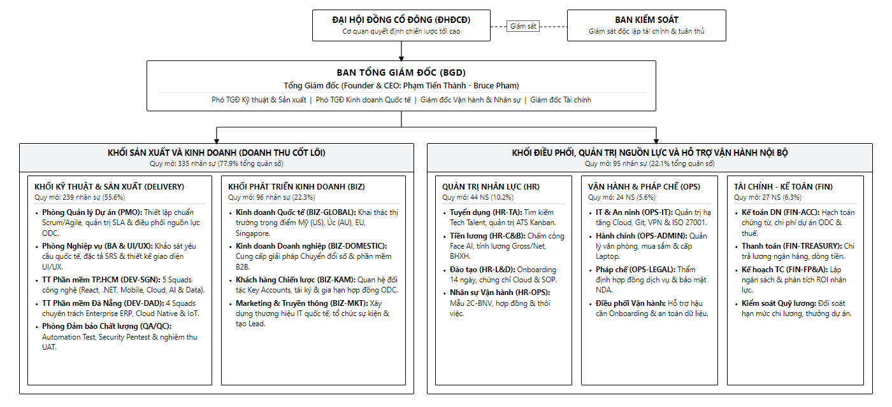

Sơ đồ tổ chức tham chiếu chia các đơn vị thành năm nhóm chức năng để thuận tiện mô tả quy trình:

**A. Cấp Quản trị Sở hữu và Ban Giám đốc Điều hành**
- **Đại hội đồng Cổ đông (ĐHCĐ):** Cơ quan quyết định cao nhất của công ty cổ phần, thông qua các định hướng kinh doanh chiến lược, kế hoạch phát hành cổ phiếu thưởng ESOP và phê chuẩn ngân sách hoạt động hàng năm.
- **Ban Giám đốc Điều hành (BGĐ):** Trong HRMS, quyền phê duyệt được gán theo vai trò và từng quy trình; tài liệu không giả định một người hay một cấp duyệt cho mọi quyết định. Mô hình này không thay thế cơ cấu quản trị nội bộ của doanh nghiệp.

**B. Khối Quản trị Nguồn nhân lực & Khối Vận hành - Pháp chế (Bộ đôi điều phối & hỗ trợ)**
Trong mô hình nghiệp vụ, HR phụ trách hồ sơ và chính sách nhân sự; OPS hỗ trợ hạ tầng, tài sản và các vấn đề pháp chế. Đây là cách phân vai phục vụ thiết kế, không thay thế sơ đồ hoặc quy chế nội bộ của doanh nghiệp:

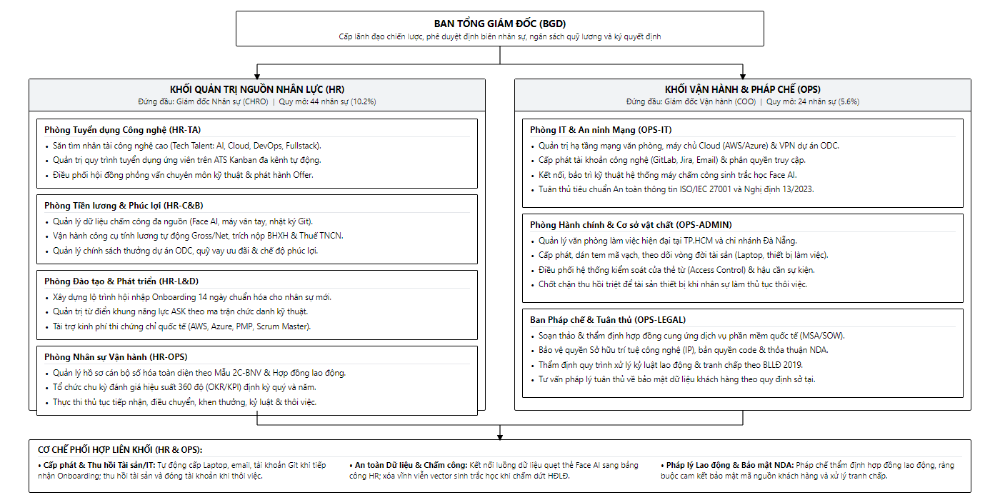

- **Khối Quản trị Nguồn nhân lực (HR):**
  1. *Phòng Tuyển dụng Công nghệ (HR-TA):* Thực hiện chiến dịch săn tìm nhân tài công nghệ cao, phụ trách phễu tuyển dụng ATS từ tiếp nhận hồ sơ, sàng lọc, điều phối phỏng vấn kỹ thuật đến phát hành thư mời nhận việc.
  2. *Phòng Tiền lương & Phúc lợi (HR-C&B):* Quản lý dữ liệu chấm công đa nguồn, vận hành chức năng tính lương tự động, trích nộp bảo hiểm xã hội bắt buộc, tính thuế thu nhập cá nhân theo biểu lũy tiến từng phần, kiểm soát hạn mức trích nợ vay phúc lợi theo Điều 102 BLLĐ 2019 và quản lý khung lương doanh nghiệp; nghiệp vụ ngạch bậc công vụ nằm ở nhánh khu vực công riêng.
  3. *Phòng Đào tạo & Phát triển (HR-L&D):* Xây dựng nội dung hội nhập cho nhân viên mới, tổ chức các khóa bồi dưỡng kỹ năng công nghệ (AI, Cloud, DevOps), hỗ trợ thi chứng chỉ quốc tế và quản trị hệ thống tri thức số. Thời lượng hội nhập 14 ngày là đề xuất của quy trình nội bộ, chưa được cấu hình cố định trong HRMS.
  4. *Phòng Nhân sự Vận hành & Văn hóa (HR-OPS):* Quản trị hồ sơ nhân sự doanh nghiệp, hợp đồng lao động, chu kỳ đánh giá KPI theo mục tiêu và vai trò, thuyên chuyển, khen thưởng, kỷ luật và khiếu nại lao động. Hồ sơ 2C-BNV và nghiệp vụ công vụ chỉ thuộc chế độ khu vực công riêng, không áp dụng cho Saigon Technology.
- **Khối Vận hành & Pháp chế (OPS):**
  1. *Phòng IT & An ninh Mạng (OPS-IT):* Quản trị hạ tầng và quyền truy cập. Nhân viên có thể xóa mẫu khuôn mặt đã đăng ký trên hồ sơ; HRMS hiện chưa tự xóa mẫu khi chuyển trạng thái thôi việc, nên bộ phận phụ trách cần xử lý theo chính sách dữ liệu của doanh nghiệp.
  2. *Phòng Hành chính & Cơ sở vật chất (OPS-ADMIN):* Quản lý cơ sở vật chất văn phòng TP.HCM và Đà Nẵng, điều phối lễ tân, mua sắm và cấp phát tài sản làm việc (laptop, màn hình), đồng thời là chốt chặn thu hồi tài sản trong quy trình thôi việc.
  3. *Ban Pháp chế & Tuân thủ (OPS-LEGAL):* Rà soát pháp lý hợp đồng cung ứng dịch vụ phần mềm quốc tế, bảo vệ quyền sở hữu trí tuệ công nghệ và thẩm định tính pháp lý trong các vụ việc xử lý kỷ luật lao động.

**C. Khối Kỹ thuật & Sản xuất Phần mềm (DELIVERY)**
Trong mô hình của đề tài, Khối Delivery phụ trách triển khai dự án phần mềm; các nhóm kỹ thuật được bố trí tại TP.HCM và Đà Nẵng theo kịch bản:

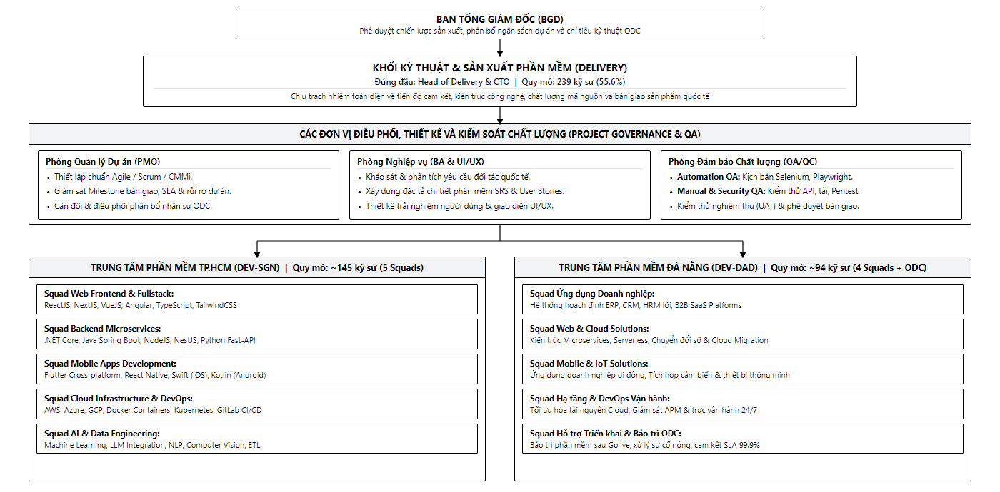

- *Phòng Quản lý Dự án (PMO):* Thiết lập và giám sát chuẩn mực thực thi dự án Agile/Scrum, kiểm soát Milestone bàn giao cho khách hàng quốc tế, quản trị định biên và điều phối nhân sự kỹ thuật giữa các dự án.
- *Phòng Phân tích Nghiệp vụ (BA & UI/UX):* Khảo sát yêu cầu khách hàng, xây dựng tài liệu đặc tả chức năng (SRS) và thiết kế hệ thống giao diện người dùng tối ưu.
- *Trung tâm Phần mềm TP.HCM (DEV-SGN):* Gồm 5 Squad công nghệ chủ lực: Web Frontend & Fullstack, Backend Microservices, Ứng dụng di động, DevOps & Cloud, và AI & Data Engineering.
- *Trung tâm Phần mềm Đà Nẵng (DEV-DAD):* Gồm 4 Squad chuyên môn: Ứng dụng doanh nghiệp, Web & Cloud Solutions, Mobile & IoT Solutions, và Hạ tầng & DevOps.
- *Phòng Đảm bảo Chất lượng (QA/QC):* Gồm Nhóm Kiểm thử tự động và Nhóm Kiểm thử thủ công & An toàn bảo mật.

**D. Khối Phát triển Kinh doanh (BIZ)**
- *Phòng Kinh doanh Quốc tế (BIZ-GLOBAL):* Đàm phán và ký kết các hợp đồng gia công phần mềm với khách hàng tại thị trường trọng điểm Mỹ, Úc, Châu Âu, Nhật Bản và Singapore.
- *Phòng Kinh doanh Doanh nghiệp (BIZ-DOMESTIC):* Phát triển giải pháp chuyển đổi số cho khối doanh nghiệp và tổ chức tài chính tại Việt Nam.
- *Phòng Khách hàng Chiến lược (BIZ-KAM):* Quản lý chăm sóc và mở rộng doanh thu từ các đối tác lớn dài hạn.
- *Phòng Marketing & Truyền thông (BIZ-MKT):* Quảng bá thương hiệu công nghệ, xây dựng thương hiệu nhà tuyển dụng và tổ chức các sự kiện kết nối cộng đồng.

**E. Khối Tài chính - Kế toán (FIN)**
- *Phòng Kế toán Doanh nghiệp & Thuế (FIN-ACC):* Hạch toán chi phí tiền lương, bảo hiểm, quyết toán thuế thu nhập doanh nghiệp và thuế TNCN.
- *Phòng Thanh toán & Dòng tiền (FIN-TREASURY):* Quản lý dòng tiền, trực tiếp thực hiện lệnh chi trả lương qua ngân hàng, chi trả tạm ứng công tác phí và giải ngân khoản vay phúc lợi.
- *Phòng Kế hoạch Tài chính (FIN-FP&A):* Dự báo ngân sách tiền lương, phân tích biên lợi nhuận dự án và thẩm định nguồn tài chính cho các đề xuất tuyển dụng mới.

---

### 2.7. Cơ cấu nhân sự tham chiếu

Bảng dưới mô tả cơ cấu nhân sự giả định dùng để xây dựng dữ liệu và kiểm tra các phân hệ. Số lượng, tỷ lệ trình độ và ngoại ngữ không phải thống kê nội bộ đã được doanh nghiệp xác nhận.

**Bảng 1.3. Cơ cấu nhân sự tham chiếu**

| Khối chức năng | Số lượng nhân sự | Tỷ lệ (%) | Trình độ Đại học / Thạc sĩ | Ngoại ngữ (Tiếng Anh lưu loát) | Địa bàn làm việc chính |
| :--- | :---: | :---: | :---: | :---: | :--- |
| **Khối Kỹ thuật & Sản xuất (DELIVERY)** | **239** | 55.6% | 100% (Kỹ sư CNTT) | 100% (IELTS 6.0+ / TOEIC 750+) | TP.HCM (60%) & Đà Nẵng (40%) |
| **Khối Quản trị Nhân lực (HR)** | **44** | 10.2% | 100% (Cử nhân QTNL/Luật/Kinh tế)| 85% | TP.HCM & Đà Nẵng |
| **Khối Vận hành & Pháp chế (OPS)** | **24** | 5.6% | 100% (Cử nhân Luật/CNTT) | 80% | TP.HCM & Đà Nẵng |
| **Khối Phát triển Kinh doanh (BIZ)** | **96** | 22.3% | 100% (Cử nhân Kinh tế/QTKD) | 100% (IELTS 7.0+ / Bản ngữ) | TP.HCM, Mỹ, Úc, Singapore |
| **Khối Tài chính - Kế toán (FIN)** | **27** | 6.3% | 100% (Cử nhân Tài chính/Kế toán)| 75% | TP.HCM |
| **Tổng số** | **430+** | **100.0%** | **100%** | **~95%** | **TP.HCM, Đà Nẵng & Quốc tế** |

Các giả định dùng trong kịch bản:
1. *Độ tuổi:* Mốc bình quân 27,5 tuổi là giả định minh họa, không phải kết quả khảo sát nhân sự.
2. *Địa điểm và ca làm:* Kịch bản có nhóm làm việc tại văn phòng và nhóm phối hợp với khách hàng quốc tế; lịch ca thực tế cần cấu hình theo từng đơn vị.
3. *Đào tạo và phúc lợi:* Mức hỗ trợ chứng chỉ, quỹ phúc lợi, cách đánh giá và lịch rà soát lương phải lấy từ quy chế doanh nghiệp; đề tài không gán các mức tiền giả định này thành chính sách thực tế.

---

### 2.8. Bối cảnh nghiệp vụ đặt ra cho hệ thống HRMS

Các tình huống dưới đây được đặt ra để xác định yêu cầu của HRMS; đây không phải kết luận từ khảo sát nội bộ tại Saigon Technology:

Trong kịch bản, hồ sơ, hợp đồng, chứng từ và dữ liệu chấm công đang được lưu ở nhiều nơi. HRMS được xây dựng để tập trung các thông tin này và giúp tra cứu theo quyền được cấp.

Tình huống tính lương bằng bảng tính cho hơn 430 hồ sơ trong 4–6 ngày là giả định để mô tả quy mô bài toán, chưa phải số liệu đo tại doanh nghiệp. Thời gian và sai lệch thực tế cần được đánh giá khi có dữ liệu vận hành.

Kịch bản cũng xem xét trường hợp đề xuất tuyển dụng, nghỉ phép và làm thêm giờ được xử lý qua giấy tờ hoặc email, khiến việc theo dõi trạng thái và lịch sử phê duyệt chưa thuận tiện.

Một yêu cầu đặt ra là nhân viên có thể tự gửi đơn, xem ngày phép, lịch sử chấm công và phiếu lương trong phạm vi quyền được cấp.

Các tình huống này là căn cứ xác định phạm vi chức năng của đồ án. Hiệu quả của HRMS cần được đánh giá bằng dữ liệu vận hành và so sánh trước–sau, không thể kết luận chỉ từ thiết kế.

---

### 2.9. Mối quan hệ liên kết nghiệp vụ giữa các bộ phận

Trong mô hình quy trình của đề tài, ba nhóm vai trò phối hợp gồm Ban Giám đốc, HR/OPS và các đơn vị chuyên môn. Trách nhiệm cụ thể được phân theo từng quy trình và quyền được cấu hình trong HRMS:

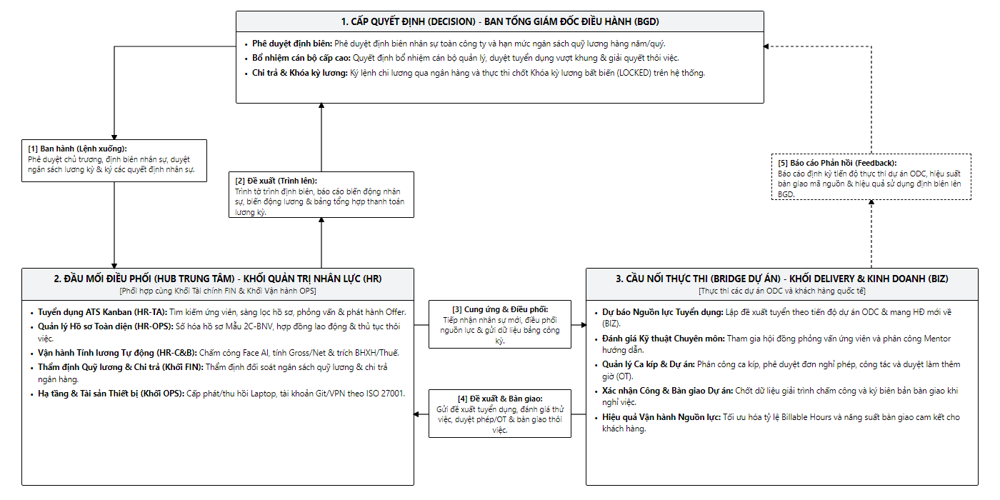

## 3. Mục tiêu và nhiệm vụ

Mục tiêu là phân tích, thiết kế và xây dựng hệ thống thông tin quản trị nhân lực theo phương pháp hướng đối tượng. Saigon Technology là bối cảnh tham chiếu dựa trên thông tin công khai; những quy trình chưa có tài liệu xác nhận được trình bày như yêu cầu nghiệp vụ, không khẳng định là quy trình nội bộ của doanh nghiệp.

Đề tài tập trung vào các nhiệm vụ sau:

Thứ nhất, tổng hợp thông tin công khai về Saigon Technology và xây dựng kịch bản nghiệp vụ giả định để xác định các yêu cầu nhân sự cần mô hình hóa; đề tài không thực hiện khảo sát nội bộ tại doanh nghiệp.

Thứ hai, hệ thống hóa cơ sở lý luận về quản trị nhân lực và phương pháp phân tích thiết kế hướng đối tượng với ngôn ngữ mô hình hóa UML; nghiên cứu các quy định pháp luật về lao động, tiền lương, bảo hiểm xã hội, thuế thu nhập cá nhân và bảo vệ dữ liệu cá nhân theo Nghị định 13/2023/NĐ-CP.

Thứ ba, lập danh mục 47 use case trong phạm vi phân tích và xây dựng các mô hình động (biểu đồ trình tự, hoạt động, trạng thái) cùng các mô hình tĩnh (biểu đồ lớp, dữ liệu quan hệ và kiến trúc ba tầng). Danh mục này mô tả thiết kế, không khẳng định mọi chức năng đã được triển khai.

Thứ tư, xây dựng hệ thống bằng Next.js, NestJS, PostgreSQL, Prisma ORM và Docker; kiểm tra các luồng nghiệp vụ đã triển khai và nêu rõ phần còn hạn chế. Kết quả kiểm tra được trình bày tại Chương 3.

Thứ năm, đánh giá khách quan các ưu điểm và hạn chế của giải pháp, từ đó đề xuất định hướng phát triển và nâng cấp hệ thống trong tương lai.

## 4. Đối tượng và phạm vi nghiên cứu

Đối tượng nghiên cứu của đề tài là các quy trình nghiệp vụ quản lý nhân sự trong doanh nghiệp công nghệ phần mềm và phương pháp phân tích thiết kế hệ thống thông tin hướng đối tượng bằng ngôn ngữ mô hình hóa UML.

Về phạm vi nghiên cứu:

Về nội dung, đề tài mô hình hóa các quy trình nhân sự thường gặp trong doanh nghiệp phần mềm, lấy thông tin công khai về Saigon Technology làm bối cảnh tham chiếu. Các quy trình nội bộ chưa được doanh nghiệp xác nhận là giả định của kịch bản. Hồ sơ 2C-BNV/2008, ngạch bậc và biểu mẫu công vụ được trình bày ở nhánh khu vực công riêng, không áp dụng cho bối cảnh doanh nghiệp tư nhân.

Về không gian, kịch bản tham chiếu các địa điểm hoạt động tại Thành phố Hồ Chí Minh và Đà Nẵng theo thông tin công khai. Đề tài không khảo sát tại chỗ hoặc triển khai HRMS tại các văn phòng này.

Về thời gian, thông tin công khai và văn bản pháp luật được tra cứu đến năm 2026. Dữ liệu và quy trình được cấu hình trong HRMS phục vụ các nghiệp vụ đã mô tả; thông tin chưa có nguồn nội bộ xác nhận không được xem là hồ sơ chính thức của Saigon Technology.

**Chế độ tổ chức trong HRMS:** Quản trị viên chọn doanh nghiệp tư nhân hoặc khu vực công trong cấu hình dùng chung; nếu chọn khu vực công thì chọn tiếp công chức hoặc viên chức. Mỗi chu kỳ mới lưu lại chế độ và căn cứ đánh giá tại thời điểm tạo. Việc đổi chế độ chỉ đổi quy tắc/mẫu cho kỳ mới, không biến đổi dữ liệu hay điểm của kỳ đã có. Báo cáo này dùng Saigon Technology ở chế độ doanh nghiệp; hồ sơ 2C và quy trình công vụ là nhánh riêng.

## 5. Cấu trúc của báo cáo

Nội dung báo cáo kết thúc học phần được bố cục thành các phần chính:

Phần Mở đầu: Trình bày tính cấp thiết của đề tài, giới thiệu tổng quan về Công ty Cổ phần Phần mềm Saigon Technology, mục tiêu, nhiệm vụ, đối tượng, phạm vi nghiên cứu và cấu trúc tổng quát của báo cáo.

Phần Nội dung: Gồm ba chương:
Chương 1 trình bày cơ sở lý luận, bối cảnh tham chiếu và yêu cầu nghiệp vụ của HRMS; chương không kết luận về hiện trạng nội bộ của Saigon Technology.
Chương 2 là nội dung trọng tâm của đề tài, thể hiện chi tiết quá trình phân tích yêu cầu, xác định tác nhân, xây dựng danh mục 47 Use Case, đặc tả nghiệp vụ, các biểu đồ tương tác động, biểu đồ lớp, thiết kế cơ sở dữ liệu, giao diện người dùng và mô hình kiến trúc phần mềm 3 tầng.
Chương 3 tổng kết các kết quả đạt được sau quá trình cài đặt và thử nghiệm hệ thống, đánh giá khách quan các ưu điểm và hạn chế, đồng thời đề xuất định hướng nghiên cứu và phát triển tiếp theo.

Phần Tài liệu tham khảo: Liệt kê các giáo trình, văn bản quy phạm pháp luật và tài liệu kỹ thuật được sử dụng trong quá trình nghiên cứu đề tài.

---

# PHẦN NỘI DUNG

# CHƯƠNG 1: CƠ SỞ LÝ LUẬN VỀ QUẢN TRỊ NHÂN LỰC VÀ HỆ THỐNG THÔNG TIN QUẢN TRỊ NHÂN LỰC

## 1.1. Lý thuyết cơ sở

### 1.1.1. Tổng quan về quản trị nhân lực

Quản trị nhân lực là hệ thống các triết lý, chính sách và hoạt động chức năng nhằm thu hút, đào tạo, phát triển và duy trì đội ngũ người lao động, bảo đảm tổ chức đạt được các mục tiêu chiến lược đề ra. Trong các doanh nghiệp sản xuất phần mềm như Saigon Technology, nguồn nhân lực kỹ thuật giữ vị trí quan trọng, trực tiếp tạo ra giá trị qua các sản phẩm và dịch vụ công nghệ.

Quản trị nhân lực hiện đại bao gồm sáu nhóm chức năng cốt lõi: hoạch định nguồn nhân lực và tuyển dụng; đào tạo và phát triển năng lực chuyên môn; quản lý hiệu suất và đánh giá thành tích; đãi ngộ, tiền lương và phúc lợi (C&B); quan hệ lao động và tuân thủ pháp lý; quản lý thông tin và hồ sơ nhân sự. Sự phối hợp đồng bộ giữa các chức năng này tạo nên một môi trường làm việc chuyên nghiệp, khích lệ tinh thần đổi mới sáng tạo và giảm thiểu tỷ lệ biến động nhân sự.

### 1.1.2. Hệ thống thông tin quản trị nhân lực

Hệ thống thông tin quản trị nhân lực là sự kết hợp giữa quy trình quản lý nhân sự với công nghệ thông tin. Hệ thống thu thập, lưu trữ, xử lý và phân phối thông tin liên quan đến nguồn nhân lực, đóng vai trò là nền tảng quản lý và vận hành thông tin nhân sự của toàn bộ doanh nghiệp.

Khác với các hệ thống thông tin thông thường, hệ thống thông tin nhân sự mang tính ràng buộc pháp lý rất cao. Mọi dữ liệu về hợp đồng lao động, thời gian làm việc, mức trích nộp bảo hiểm xã hội hay khấu trừ thuế thu nhập cá nhân đều phải tuân thủ nghiêm ngặt theo các quy định của Bộ luật Lao động, Luật Bảo hiểm xã hội và Luật Thuế. Do đó, hệ thống không chỉ thuần túy thực hiện các tác vụ lưu trữ dữ liệu (CRUD) mà còn phải cài đặt các quy tắc kiểm soát nghiệp vụ chặt chẽ, bảo đảm tính toàn vẹn và khả năng truy vết lịch sử dữ liệu.

### 1.1.3. Quy trình xây dựng và phương pháp phân tích thiết kế hệ thống

Quy trình phát triển hệ thống phần mềm trải qua các giai đoạn chính: khảo sát hiện trạng, phân tích yêu cầu nghiệp vụ, thiết kế hệ thống, lập trình cài đặt, kiểm thử và chuyển giao vận hành. Trong đó, giai đoạn phân tích và thiết kế giữ vai trò quyết định đến độ tin cậy, tính linh hoạt và khả năng mở rộng của phần mềm.

Phương pháp phân tích và thiết kế hướng đối tượng (OOAD) tiếp cận bài toán thực tế bằng cách mô hình hóa hệ thống thành tập hợp các đối tượng tương tác với nhau, mang đầy đủ thuộc tính (dữ liệu) và phương thức (hành vi). OOAD vận dụng triệt để bốn nguyên lý trụ cột của lập trình hướng đối tượng: trừu tượng hóa, bao đóng, kế thừa và đa hình.

Ngôn ngữ mô hình hóa thống nhất (UML) được sử dụng làm phương tiện trực quan để đặc tả, thiết kế và tài liệu hóa các thành phần của hệ thống thông qua các nhóm sơ đồ tiêu chuẩn. Trong đó, biểu đồ Use Case mô tả phạm vi hệ thống, xác định các tác nhân và các chức năng cung cấp cho người dùng. Biểu đồ trình tự mô tả sự tương tác và truyền thông điệp giữa các đối tượng theo thứ tự thời gian trong từng kịch bản nghiệp vụ. Biểu đồ hoạt động trực quan hóa luồng xử lý công việc, các bước thực hiện tuần tự hoặc rẽ nhánh trong quy trình. Biểu đồ trạng thái thể hiện các giai đoạn biến đổi trạng thái của những thực thể quan trọng trong hệ thống. Cuối cùng, biểu đồ lớp mô tả cấu trúc tĩnh, bao gồm các lớp đối tượng, thuộc tính, phương thức và mối quan hệ giữa chúng.

### 1.1.4. Công cụ và phần mềm ứng dụng

Để phục vụ quá trình phân tích, thiết kế và cài đặt hệ thống, đề tài sử dụng PlantUML và Draw.io để xây dựng biểu đồ UML; PostgreSQL và Prisma để lưu trữ dữ liệu; NestJS với TypeScript cho tầng nghiệp vụ; Next.js cho giao diện; và Docker Compose để tổ chức các dịch vụ. Theo kết quả kiểm kê mã nguồn ngày 07/10/2026, schema Prisma có 102 model, mã nguồn có 42 tệp module NestJS và 39 tệp `page.tsx`. Đây là số lượng tệp, không phải số phân hệ hay màn hình nghiệp vụ độc lập.

## 1.2. Một số vấn đề liên quan đến chủ đề "Xây dựng hệ thống thông tin quản trị nhân lực cho Công ty Cổ phần Phần mềm Saigon Technology"

### 1.2.1. Ý nghĩa

Đề tài tập trung xây dựng một nơi quản lý thống nhất các nghiệp vụ nhân sự thường ngày, từ tuyển dụng, hồ sơ và hợp đồng đến chấm công, nghỉ phép, tiền lương và bàn giao khi nhân viên nghỉ việc. Khi thông tin được ghi nhận theo cùng một quy trình, bộ phận phụ trách có thể tra cứu và đối chiếu thuận tiện hơn, đồng thời giảm việc nhập lại dữ liệu giữa nhiều bảng tính. Hệ thống vẫn cần người dùng kiểm tra hồ sơ và quyết định nghiệp vụ trước khi phê duyệt.

### 1.2.2. Vai trò

HRMS ghi nhận trạng thái hồ sơ và các bước xử lý như duyệt thay đổi thông tin, chốt công hoặc phê duyệt lương. Tùy từng nghiệp vụ, người có thẩm quyền vẫn phải kiểm tra nội dung, chứng từ và căn cứ áp dụng. Phần mềm hỗ trợ theo dõi và luân chuyển công việc; việc thẩm định, tuân thủ pháp luật và quyết định cuối cùng thuộc về doanh nghiệp.

### 1.2.3. Tác dụng

Cổng tự phục vụ hỗ trợ gửi đơn, xem lịch sử chấm công và tra cứu phiếu lương; người phụ trách tổng hợp thông tin từ HRMS. Quy mô 18 chuyên viên, hơn 430 hồ sơ và mức giảm thời gian xử lý là giả định, chưa phải kết quả đo được. Hiệu quả cần đánh giá bằng cách so sánh thời gian xử lý và tỷ lệ sai lệch trước và sau khi triển khai.

### 1.2.4. Nhu cầu và khả năng ứng dụng

Đội ngũ làm việc tại nhiều địa điểm và theo các khung giờ khác nhau cần cách ghi nhận hồ sơ, ca làm và ngày công nhất quán. Thiết kế hướng đối tượng giúp tách các nhóm nghiệp vụ để có thể điều chỉnh từng phần khi quy trình thay đổi. Khả năng tích hợp với thiết bị hoặc dịch vụ bên ngoài còn phụ thuộc vào adapter, cấu hình và kiểm thử cụ thể; kiến trúc tự nó không bảo đảm việc kết nối đã sẵn sàng.

### 1.2.5. Bài học kinh nghiệm rút ra từ việc tiếp cận hệ thống

Thứ nhất, cơ cấu tổ chức doanh nghiệp luôn vận động và biến đổi theo chiến lược kinh doanh. Do đó, cây tổ chức phòng ban phải nên được lưu bằng dữ liệu cấu hình phân cấp để có thể cập nhật theo quy trình và quyền được cấp.

Thứ hai, các tham số pháp lý về tiền lương, thuế và bảo hiểm xã hội thường xuyên thay đổi theo các chính sách của Nhà nước. Hệ thống cần quản lý các tham số này gắn liền với ngày hiệu lực để bảo đảm tính chính xác khi truy xuất lịch sử.

Thứ ba, dữ liệu tài chính và nhân sự sau khi đã phê duyệt phải tuân thủ nguyên tắc bất biến. Cơ chế khóa kỳ lương hoặc nhật ký kiểm toán chỉ thêm (Append-Only) giúp lưu vết thay đổi; quyền sửa và quy trình điều chỉnh vẫn cần được cấu hình rõ ràng.

## 1.3. Phát biểu bài toán cần giải quyết

### 1.3.1. Bối cảnh hoạt động và đặc thù quản lý nhân lực tại Saigon Technology

Bối cảnh dưới đây được mô hình hóa từ các dịch vụ và địa điểm công khai của Saigon Technology [10]. Các yêu cầu về nhiều địa điểm, dự án và ca làm là giả định của đề tài; cần xác nhận với doanh nghiệp trước khi dùng làm quy trình vận hành.

Các yêu cầu nghiệp vụ dưới đây phản ánh những nhu cầu thường gặp trong doanh nghiệp phần mềm:

Bố trí theo dự án: Nhu cầu về lập trình viên, kỹ sư kiểm thử và kiến trúc sư có thể thay đổi theo tiến độ. HRMS hỗ trợ ghi nhận nhu cầu và quyết định điều chuyển; kế hoạch chi phí vẫn do đơn vị phụ trách xác nhận.

Ca làm và địa điểm: Kịch bản có nhân sự làm tại văn phòng hoặc phối hợp với khách hàng ở múi giờ khác. Ca thực tế cần được cấu hình theo đơn vị và thỏa thuận làm việc; phần mềm không tự suy ra lịch làm.

Bảo mật và bàn giao: HRMS có thể lưu người phụ trách và trạng thái bàn giao tài sản, nhưng không tự cấp hoặc thu hồi tài khoản ngoài hệ thống. Quy trình bảo mật, quyền truy cập và thu hồi thiết bị cần theo chính sách được doanh nghiệp ban hành.

Mô hình nghiệp vụ của đề tài phân vai giữa HR, OPS, Tài chính, đơn vị chuyên môn và Ban Giám đốc. Cách phối hợp thực tế cần được doanh nghiệp xác nhận trước khi cấu hình chính thức.

### 1.3.2. Các quy trình nghiệp vụ được mô hình hóa

Đề tài mô tả chín quy trình tham chiếu để phân tích yêu cầu. Các bước và vai trò dưới đây là mô hình nghiệp vụ, không khẳng định trùng hoàn toàn với quy trình nội bộ hiện hành của công ty:

**1. Quy trình tuyển dụng và thu hút nhân sự**

Mục đích: Bổ sung kịp thời kỹ sư phần mềm cho các dự án mới thành lập hoặc thay thế các vị trí nhân sự biến động, bảo đảm đúng định biên và kế hoạch chi phí dự án.

Luồng nghiệp vụ tham chiếu:
1. Lập đề xuất tuyển dụng: Trưởng dự án lập phiếu đề xuất tuyển dụng, nêu rõ vị trí công nghệ, số lượng, yêu cầu kinh nghiệm và khung lương dự kiến.
2. Thẩm định định biên: Chuyên viên tuyển dụng kiểm tra đối chiếu nhu cầu với cơ cấu tổ chức và chỉ tiêu nhân sự của bộ phận.
3. Kiểm tra ngân sách: Kế toán viên đối chiếu hợp đồng dự án để xác nhận nguồn kinh phí chi trả lương.
4. Phê duyệt đề xuất: Ban Giám đốc xem xét nhu cầu thực tế và ký duyệt chỉ tiêu tuyển dụng.
5. Tìm kiếm và phỏng vấn: Chuyên viên tuyển dụng đăng tin, tiếp nhận hồ sơ, sàng lọc ứng viên và sắp xếp lịch phỏng vấn. Trưởng dự án phỏng vấn chuyên môn kỹ thuật; Chuyên viên tuyển dụng phỏng vấn về mức độ phù hợp văn hóa và ngoại ngữ; kết quả được ghi nhận vào phiếu đánh giá.
6. Gửi thư mời nhận việc: Chuyên viên tuyển dụng trao đổi mức lương, trình Giám đốc phê duyệt và gửi thư mời nhận việc chính thức cho ứng viên.

Các vai trò tham gia: Đơn vị chủ trì là Phòng Tuyển dụng, chịu trách nhiệm sàng lọc hồ sơ, điều phối phỏng vấn và gửi thư mời nhận việc. Đơn vị đề xuất và đánh giá chuyên môn là Khối Kỹ thuật và Sản xuất. Phòng Kế toán kiểm soát ngân sách lương dự án và Phòng Công nghệ thông tin hỗ trợ môi trường kiểm tra kỹ thuật. Cấp phê duyệt cuối cùng là Ban Giám đốc.

Vấn đề cần xử lý trong kịch bản: Việc gửi và duyệt phiếu đề xuất qua thư điện tử hoặc bản giấy mất từ 3 đến 5 ngày làm việc; hồ sơ ứng viên lưu rải rác trên máy tính cá nhân của từng chuyên viên gây trùng lặp dữ liệu và dễ thất lạc khi có sự thay đổi người phụ trách.

**2. Quy trình tiếp nhận nhân sự mới và quản lý hợp đồng lao động**

Mục đích: Thiết lập quan hệ lao động hợp pháp, chuẩn bị điều kiện làm việc, tài sản, tài khoản hệ thống và hướng dẫn nhân viên mới hòa nhập văn hóa doanh nghiệp.

Luồng nghiệp vụ tham chiếu:
1. Tiếp nhận hồ sơ: Ứng viên nộp hồ sơ cá nhân gồm căn cước công dân, sơ yếu lý lịch, văn bằng và chứng chỉ chuyên môn. Chuyên viên hồ sơ kiểm tra tính hợp lệ và thực hiện lưu trữ.
2. Ký hợp đồng thử việc: Chuyên viên hồ sơ soạn hợp đồng thử việc thời hạn 60 ngày theo Điều 25 Bộ luật Lao động 2019 với mức lương thử việc theo quy định, sau đó trình Giám đốc ký kết.
3. Chuẩn bị tiếp nhận: Bộ phận nhân sự thông báo trước ngày làm việc đầu tiên. Phòng Hành chính sắp xếp chỗ ngồi, cấp thẻ ra vào văn phòng; Phòng Công nghệ thông tin tạo hòm thư điện tử nội bộ, cấp máy tính làm việc và thiết lập quyền truy cập mạng.
4. Đón tiếp ngày đầu tiên: Chuyên viên hồ sơ đón tiếp nhân viên mới, phổ biến nội quy lao động, ký cam kết bảo mật thông tin và bàn giao thiết bị làm việc.
5. Quá trình thử việc: Nhân viên tham gia các buổi giới thiệu quy trình làm việc của công ty, sau đó về nhóm dự án dưới sự hướng dẫn của người kèm cặp.
6. Đánh giá thử việc và ký hợp đồng chính thức: Trước khi hết hạn thử việc 7 ngày, Trưởng dự án đánh giá kết quả công việc. Nếu đạt yêu cầu, Chuyên viên hồ sơ soạn hợp đồng lao động xác định thời hạn trình Giám đốc ký và làm thủ tục báo tăng bảo hiểm xã hội.

Các vai trò tham gia: Phòng Nhân sự vận hành giữ vai trò chủ trì tiếp nhận và quản lý hồ sơ nhân viên; Người lao động mới thực hiện nghĩa vụ nộp hồ sơ và ký hợp đồng. Các đơn vị phối hợp gồm Phòng Hành chính bố trí cơ sở vật chất, Phòng Công nghệ thông tin cấp tài khoản và thiết bị, Nhóm dự án hướng dẫn công việc. Ban Giám đốc ký kết hợp đồng lao động chính thức.

Vấn đề cần xử lý trong kịch bản: Việc trao đổi thông tin giữa các phòng ban qua thư điện tử đôi khi bị chậm trễ khiến nhân viên mới chưa có ngay thiết bị làm việc trong ngày đầu tiên; việc theo dõi thời hạn thử việc bằng bảng tính thủ công dễ dẫn đến quên thời hạn đánh giá và ký hợp đồng chính thức.

**3. Quy trình quản lý thời gian làm việc và chấm công**

Mục đích: Ghi nhận chính xác ngày công thực tế của nhân viên, bảo đảm kỷ luật lao động, làm cơ sở tính lương và phục vụ nghiệm thu dự án với khách hàng.

Luồng nghiệp vụ tham chiếu:
1. Thiết lập ca làm việc: Đầu tháng hoặc theo từng giai đoạn dự án, Trưởng dự án xếp lịch làm việc cho các thành viên theo ca hành chính chuẩn, ca linh hoạt hoặc ca trực hỗ trợ đối tác nước ngoài.
2. Ghi nhận giờ làm: Hệ thống hiện cho phép chấm công trên web và điểm danh khuôn mặt bằng camera thường sau khi nhân viên đăng ký mẫu. Thẻ hoặc máy chấm công chỉ dùng được khi thiết bị và kết nối tương ứng đã được cấu hình.
3. Tổng hợp dữ liệu: Sự kiện từ các kênh đã cấu hình được lưu tập trung; việc đồng bộ từ thiết bị bên ngoài phụ thuộc adapter và môi trường triển khai.
4. Xử lý giải trình công: Nếu quên điểm danh, gặp sự cố thiết bị hoặc đi công tác ngoài, nhân viên gửi phiếu giải trình kèm lý do để Trưởng dự án phê duyệt.
5. Đối soát bảng công: Cuối tháng, Chuyên viên tiền lương rà soát các trường hợp đi muộn, về sớm, tổng hợp số giờ làm thực tế và khóa sổ dữ liệu chấm công.

Các vai trò tham gia: Toàn thể nhân viên có trách nhiệm điểm danh đúng quy định và gửi phiếu giải trình khi có phát sinh; Trưởng dự án thực hiện xếp ca và phê duyệt giải trình công; Phòng Công nghệ thông tin duy trì đường truyền và hạ tầng máy móc; Phòng Tiền lương và Phúc lợi chịu trách nhiệm tổng hợp, đối soát và khóa sổ bảng công.

Vấn đề cần xử lý trong kịch bản: Thiết bị chấm công ở các văn phòng lưu trữ dữ liệu riêng rẽ, cuối tháng nhân sự phải xuất file ra ghép nối thủ công; mất nhiều thời gian rà soát từng trường hợp quên quẹt thẻ hoặc giải trình trễ hạn.

**4. Quy trình quản lý nghỉ phép và làm thêm giờ**

Mục đích: Đảm bảo quyền nghỉ ngơi của người lao động theo luật định, đồng thời kiểm soát giờ làm thêm nhằm bảo vệ sức khỏe nhân viên và tuân thủ đúng quy định pháp luật.

Luồng nghiệp vụ tham chiếu:
1. Nghỉ phép: Nhân viên kiểm tra số ngày phép còn lại, gửi đơn xin nghỉ phép năm, nghỉ ốm hoặc thai sản trước từ 1 đến 3 ngày. Trưởng dự án duyệt theo tiến độ công việc; trường hợp nghỉ dài ngày từ 3 ngày trở lên chuyển tiếp Giám đốc phê duyệt; bộ phận nhân sự kiểm tra chế độ bảo hiểm xã hội nếu là nghỉ ốm đau, thai sản.
2. Làm thêm giờ: Khi dự án cần đẩy nhanh tiến độ bàn giao, Trưởng dự án lập kế hoạch làm thêm giờ, nêu rõ lý do kỹ thuật, danh sách kỹ sư tham gia và thời gian dự kiến. Chuyên viên tiền lương kiểm tra số giờ làm thêm lũy kế của từng người để bảo đảm không vượt quá 40 giờ trong một tháng và 200 giờ trong một năm theo quy định tại Điều 107 Bộ luật Lao động 2019. Ban Giám đốc phê duyệt kế hoạch trước khi thực hiện. Sau khi kết thúc, Trưởng dự án xác nhận số giờ làm thêm thực tế để làm căn cứ chi trả thù lao.

Các vai trò tham gia: Nhân viên chủ động gửi đơn phép và ghi nhận giờ làm thêm; Trưởng dự án lập kế hoạch làm thêm, duyệt đơn phép và xác nhận giờ thực tế; Phòng Tiền lương và Phúc lợi kiểm tra quỹ phép và kiểm soát trần giờ làm thêm; Ban Giám đốc phê duyệt các kế hoạch làm thêm giờ và đơn nghỉ dài ngày; Phòng Kế toán ghi nhận chi phí dự án.

Vấn đề cần xử lý trong kịch bản: Đơn xin nghỉ phép và thông báo làm thêm giờ thường trao đổi qua ứng dụng nhắn tin hoặc thư điện tử, dễ bị sót khi tổng hợp công; thiếu hệ thống cảnh báo tự động khi nhân viên sắp chạm trần giờ làm thêm theo luật định.

**5. Quy trình tính toán và chi trả tiền lương**

Mục đích: Tính toán chính xác, minh bạch thu nhập hàng tháng của người lao động, đồng thời trích nộp bảo hiểm bắt buộc và khấu trừ thuế thu nhập cá nhân theo đúng luật định.

Luồng nghiệp vụ tham chiếu:
1. Chốt dữ liệu công: Ngày 25 hàng tháng, Chuyên viên tiền lương chốt bảng chấm công, phân loại ngày công thực tế, ngày nghỉ phép, ngày nghỉ không lương và số giờ làm thêm.
2. Tập hợp các khoản thu nhập và giảm trừ: Lấy dữ liệu lương cơ bản theo hợp đồng, phụ cấp vị trí, thưởng dự án; các khoản trích nộp gồm bảo hiểm xã hội 8%, bảo hiểm y tế 1.5%, bảo hiểm thất nghiệp 1%, tiền tạm ứng trong kỳ, khoản trả nợ vay phúc lợi và giảm trừ gia cảnh.
3. Tính toán lương thực lĩnh: Tính khoản chịu thuế theo quy định của kỳ, khấu trừ bảo hiểm và giảm trừ hợp lệ, sau đó trừ các khoản vay/tạm ứng đã duyệt theo lịch và ủy quyền. Không áp dụng giới hạn 30% tại Điều 102 cho mọi khoản vay; điều khoản này áp dụng cho khấu trừ lương do bồi thường thiệt hại tài sản theo điều kiện luật định.
4. Đối soát tài chính: Chuyên viên tiền lương chuyển bảng thanh toán lương cho Kế toán trưởng đối chiếu với số dư tài khoản ngân hàng và định mức chi phí.
5. Phê duyệt bảng lương: Giám đốc ký duyệt bảng thanh toán tiền lương toàn công ty.
6. Chi trả lương và gửi phiếu lương: Vào ngày 05 hàng tháng, Kế toán thực hiện lệnh chuyển khoản qua ngân hàng cho nhân viên; Chuyên viên tiền lương xuất và gửi phiếu lương điện tử có mật khẩu đến từng cá nhân, đồng thời làm hồ sơ khai báo với cơ quan bảo hiểm xã hội.

Các vai trò tham gia: Phòng Tiền lương và Phúc lợi chủ trì tổng hợp công, tính toán lương và gửi phiếu lương; Khối Tài chính - Kế toán kiểm tra đối soát nguồn tiền và thực hiện chuyển khoản; Ban Giám đốc phê duyệt bảng lương toàn công ty; Nhân viên tiếp nhận lương và tra cứu phiếu lương.

Vấn đề cần xử lý trong kịch bản: Giả định tính lương cho hơn 430 hồ sơ bằng bảng tính mất 4–5 ngày. Đây là mốc minh họa, chưa phải thời gian đo tại doanh nghiệp; thời gian và sai lệch thực tế cần được đánh giá khi có dữ liệu vận hành.

**6. Quy trình tạm ứng lương, vay phúc lợi và thanh toán công tác phí**

Mục đích: Thực hiện chế độ phúc lợi nội bộ, hỗ trợ tài chính kịp thời cho người lao động và quyết toán nhanh chóng các khoản chi phí phát sinh khi đi công tác.

Luồng nghiệp vụ tham chiếu:
1. Tạm ứng lương: Đây là quy trình phúc lợi đề xuất trong mô hình nghiệp vụ, chưa thấy luồng tạm ứng lương riêng trong HRMS hiện tại. Không nhầm khoản này với tạm ứng công tác phí ở `/expense-claims` hoặc khoản vay phúc lợi ở `/loans`; nếu triển khai, doanh nghiệp cần quy định điều kiện, cấp duyệt, chứng từ chi và cách thu hồi trước khi đưa vào tính lương.
2. Vay vốn phúc lợi: Nhân viên đề nghị khoản vay có hợp đồng và lịch trả nợ. Quản lý xác nhận nhu cầu; Chuyên viên tiền lương kiểm tra khoản khấu trừ đã được đồng ý; Kế toán kiểm tra quỹ; người có thẩm quyền duyệt hợp đồng; Kế toán giải ngân; hàng tháng bảng lương chỉ trừ tối đa kỳ trả đã duyệt, dư nợ còn lại và số ròng khả dụng. Khoản không thể trừ đủ phải được xử lý theo hợp đồng, không tự động khẳng định mức 30% là trần pháp lý chung.
3. Thanh toán công tác phí: Nhân viên được cử đi công tác tại các văn phòng trong và ngoài nước lập dự toán chi phí. Khi hoàn thành chuyến công tác, nhân viên gửi giấy đề nghị thanh toán kèm hóa đơn chứng từ hợp lệ gồm vé máy bay, phòng nghỉ, đi lại để kế toán kiểm tra và chuyển khoản thanh toán.

Các vai trò tham gia: Nhân viên lập hồ sơ đề xuất và cung cấp đầy đủ hóa đơn chứng từ; Trưởng dự án xác nhận nhu cầu; Phòng Tiền lương và Phúc lợi kiểm tra điều kiện khấu trừ lương; Phòng Kế toán thẩm định chứng từ, kiểm tra nguồn quỹ và thực hiện giải ngân; Ban Giám đốc phê duyệt hợp đồng vay vốn; Ban Chấp hành Công đoàn giám sát tính công khai của quỹ phúc lợi.

Vấn đề cần xử lý trong kịch bản: Việc theo dõi danh sách vay và lịch thu hồi nợ bằng sổ theo dõi thủ công dễ dẫn đến sai sót hoặc bỏ quên việc khấu trừ khi nhân viên chuyển dự án; việc duyệt công tác phí bằng hồ sơ giấy mất nhiều thời gian luân chuyển giữa các phòng ban.

**7. Quy trình thiết lập và đánh giá KPI**

Mục đích: Theo dõi kết quả công việc theo các mục tiêu có chỉ số, mức cần đạt, thời hạn và trọng số rõ ràng. Điểm KPI hỗ trợ trao đổi kết quả công việc; quyết định thưởng, điều chỉnh lương hoặc bổ nhiệm vẫn theo quy trình phê duyệt riêng.

Luồng nghiệp vụ:
1. Đầu kỳ, HR tạo chu kỳ đánh giá; quản lý giao KPI, chỉ số đo, mức cần đạt và trọng số cho từng nhân viên. Tổng trọng số mục tiêu của một người trong kỳ phải bằng 100%.
2. Trong kỳ, nhân viên cập nhật kết quả thực tế và đính kèm minh chứng phù hợp với từng KPI.
3. Quản lý đối chiếu chỉ tiêu, kết quả và minh chứng rồi chấm từng KPI trên thang 0–100. Hệ thống tính điểm chu kỳ bằng tổng điểm KPI nhân với trọng số tương ứng.
4. HR và quản lý rà soát các mục tiêu còn thiếu kết quả hoặc minh chứng, xử lý sai lệch rồi đóng chu kỳ theo quyền được giao.

Các vai trò tham gia: HR quản lý chu kỳ; quản lý trực tiếp giao mục tiêu và chấm kết quả; nhân viên cập nhật kết quả, minh chứng và theo dõi điểm KPI của mình. Kết quả KPI không tự tạo khoản thưởng hoặc thay đổi lương.

Nhánh khu vực công có quy trình đánh giá công chức, viên chức theo căn cứ áp dụng riêng. Nhánh đó được ghi nhận và phê duyệt theo quy định tương ứng, không dùng công thức KPI doanh nghiệp thay cho kết luận công vụ.

**8. Quy trình điều chuyển, bổ nhiệm, khen thưởng và kỷ luật**

Mục đích: Quản lý các biến động về vị trí công tác, điều chỉnh ngạch bậc lương, ghi nhận đóng góp nổi bật và thực hiện xử lý kỷ luật theo đúng trình tự pháp luật lao động.

Luồng nghiệp vụ tham chiếu:
1. Bổ nhiệm và nâng bậc lương: Khi nhân viên đạt thành tích tốt hoặc đến kỳ rà soát, Trưởng dự án lập đề xuất; Chuyên viên hồ sơ đối chiếu tiêu chuẩn chức danh; Ban Giám đốc ký quyết định; Chuyên viên hồ sơ soạn phụ lục hợp đồng, cập nhật chức danh trên sơ đồ tổ chức và điều chỉnh phân quyền hệ thống.
2. Khen thưởng: Khi dự án hoàn thành vượt tiến độ hoặc được khách hàng khen ngợi, Trưởng dự án gửi đề xuất khen thưởng; Hội đồng thi đua khen thưởng thẩm định; Giám đốc ký quyết định và chuyển Kế toán chi trả tiền thưởng.
3. Xử lý kỷ luật lao động: Khi phát hiện nhân viên vi phạm nội quy lao động như vi phạm quy định bảo mật thông tin hoặc tự ý bỏ việc nhiều ngày, Trưởng bộ phận lập biên bản; Chuyên viên hồ sơ thu thập chứng cứ và gửi thông báo mời họp xử lý kỷ luật trước ít nhất 5 ngày làm việc theo quy định tại Điều 122 Bộ luật Lao động 2019; cuộc họp xử lý kỷ luật bắt buộc có sự tham gia của Người lao động và Đại diện Ban Chấp hành Công đoàn; các bên ký biên bản cuộc họp; Giám đốc ban hành quyết định kỷ luật gồm khiển trách, kéo dài thời hạn nâng lương, cách chức hoặc sa thải.

Các vai trò tham gia: Trưởng bộ phận lập đề xuất bổ nhiệm hoặc biên bản vi phạm kỷ luật; Phòng Nhân sự vận hành chuẩn bị thủ tục, đối chiếu tiêu chuẩn chức danh và thu thập chứng cứ; Đại diện Ban Chấp hành Công đoàn tham gia bảo vệ quyền lợi người lao động trong các cuộc họp kỷ luật; Ban Giám đốc ký quyết định chính thức; Phòng Công nghệ thông tin điều chỉnh quyền truy cập hệ thống; Phòng Kế toán điều chỉnh mức lương hoặc chi tiền thưởng.

Vấn đề cần xử lý trong kịch bản: Các văn bản quyết định lưu trữ bản cứng dễ thất lạc; nếu quy trình xử lý kỷ luật không chặt chẽ về thời hạn thông báo và thành phần tham dự sẽ tiềm ẩn nguy cơ khiếu nại lao động; việc bổ nhiệm chức danh mới chưa đồng bộ tự động với quyền truy cập trên các phần mềm quản lý công việc.

**9. Quy trình thôi việc và bàn giao công việc**

Mục đích: Thực hiện thủ tục chấm dứt hợp đồng lao động đúng quy định pháp luật, bảo đảm thu hồi đầy đủ tài sản làm việc, bàn giao mã nguồn và tài liệu dự án, ngăn ngừa nguy cơ rò rỉ dữ liệu của khách hàng.

Luồng nghiệp vụ tham chiếu:
1. Nộp đơn thôi việc: Nhân viên gửi đơn xin thôi việc, bảo đảm thời hạn báo trước theo Điều 35 Bộ luật Lao động 2019 gồm 30 ngày đối với hợp đồng xác định thời hạn và 45 ngày đối với hợp đồng không xác định thời hạn.
2. Trao đổi nguyện vọng và phê duyệt: Trưởng dự án và đại diện nhân sự gặp gỡ trao đổi để tìm hiểu lý do; trường hợp nhân viên giữ nguyên nguyện vọng thôi việc, Giám đốc ký duyệt ngày làm việc cuối cùng.
3. Thực hiện bàn giao qua 5 khâu độc lập: Nhân viên hoàn tất các thủ tục bàn giao tại năm bộ phận gồm: bàn giao kỹ thuật cho Trưởng dự án (nghiệm thu mã nguồn, tài liệu thiết kế và tài khoản máy chủ thử nghiệm); bàn giao tài sản cho Phòng Hành chính (trả lại máy tính, màn hình phụ, thẻ ra vào và chìa khóa cá nhân); thu hồi quyền truy cập qua Phòng Công nghệ thông tin (khóa hòm thư điện tử nội bộ, ngắt quyền kết nối mạng từ xa và các công cụ dự án); chốt chế độ chính sách tại Phòng Tiền lương (chốt ngày công tháng cuối, tính tiền ngày phép năm chưa nghỉ, trợ cấp thôi việc và báo giảm bảo hiểm xã hội); và quyết toán tài chính tại Phòng Kế toán (đối chiếu hoàn trả tạm ứng, nợ vay và khấu trừ trực tiếp vào kỳ lương cuối cùng).
4. Ký quyết định thôi việc: Sau khi đủ chữ ký xác nhận của 5 bộ phận trên phiếu bàn giao, Giám đốc ban hành quyết định chấm dứt hợp đồng lao động.
5. Thanh toán quyền lợi và trả hồ sơ: Trong thời hạn 14 ngày làm việc theo Điều 48 Bộ luật Lao động 2019, Phòng Kế toán chi trả toàn bộ tiền lương và trợ cấp cho nhân viên; Chuyên viên hồ sơ hoàn tất trả sổ bảo hiểm xã hội và hồ sơ cá nhân.

Các vai trò tham gia: Nhân viên thôi việc có trách nhiệm thực hiện đầy đủ nghĩa vụ bàn giao và nhận quyết toán; Trưởng dự án nghiệm thu bàn giao kỹ thuật; Phòng Hành chính thu hồi tài sản; Phòng Công nghệ thông tin khóa tài khoản và ngắt quyền truy cập; Phòng Tiền lương và Phúc lợi chốt ngày công và chế độ chính sách; Phòng Kế toán thực hiện quyết toán chi trả tài chính; Ban Giám đốc ký quyết định chấm dứt hợp đồng lao động; Cơ quan Bảo hiểm xã hội chốt sổ và giải quyết chế độ cho người lao động.

Vấn đề cần xử lý trong kịch bản: Phiếu bàn giao bằng giấy chuyển qua 5 bộ phận thường bị kéo dài từ 1 đến 2 tuần, làm chậm tiến độ thanh toán lương và trả sổ bảo hiểm xã hội; việc chậm khóa tài khoản truy cập máy chủ dự án tiềm ẩn rủi ro về an toàn thông tin theo tiêu chuẩn ISO 27001.

### 1.3.3. Ma trận phân định trách nhiệm liên phòng ban trong các quy trình quản trị nhân sự

Để làm rõ trách nhiệm của các bộ phận trong toàn bộ hoạt động quản lý nhân lực tại Saigon Technology, ma trận phân định trách nhiệm RACI gồm bốn vai trò: R - Thực hiện, A - Phê duyệt, C - Phối hợp hoặc Tham vấn, I - Nhận thông tin được tổng hợp như sau:

**Bảng 1.4. Ma trận phân định trách nhiệm liên phòng ban trong các quy trình quản trị nhân sự**

| STT | Quy trình Quản trị Nhân sự | Khối Kỹ thuật | Phòng Tuyển dụng | Phòng Nhân sự vận hành | Phòng Tiền lương và Phúc lợi | Khối Vận hành | Khối Tài chính - Kế toán | Ban Giám đốc |
| :---: | :--- | :---: | :---: | :---: | :---: | :---: | :---: | :---: |
| 1 | Tuyển dụng và thu hút nhân sự | **R** | **R** | **I** | **I** | **C** | **C** | **A** |
| 2 | Tiếp nhận nhân sự mới và hợp đồng lao động | **C** | **I** | **R** | **I** | **R** | **I** | **A** |
| 3 | Phân ca và chấm công | **R** | **I** | **C** | **R** | **R** | **I** | **I** |
| 4 | Xét duyệt nghỉ phép và làm thêm giờ | **R** | **I** | **C** | **R** | **I** | **C** | **A** |
| 5 | Tính toán và chi trả tiền lương | **I** | **I** | **C** | **R** | **I** | **C** | **A** |
| 6 | Tạm ứng lương và vay phúc lợi | **C** | **I** | **I** | **R** | **I** | **R** | **A** |
| 7 | Đánh giá KPI và đào tạo | **R** | **I** | **C** | **C** | **I** | **C** | **A** |
| 8 | Bổ nhiệm, khen thưởng và kỷ luật | **R** | **I** | **R** | **C** | **C** | **C** | **A** |
| 9 | Thôi việc và bàn giao công việc | **R** | **I** | **R** | **R** | **R** | **R** | **A** |

*Ghi chú: **R** - Bộ phận trực tiếp thực hiện; **A** - Cấp phê duyệt và chịu trách nhiệm cao nhất; **C** - Bộ phận phối hợp, tham gia ý kiến chuyên môn; **I** - Bộ phận nhận thông tin để theo dõi.*

### 1.3.4. Phát biểu bài toán tổng quát và yêu cầu hệ thống hóa

Từ các vấn đề nêu trên, đề tài đặt ra yêu cầu xây dựng một hệ thống dùng chung để quản lý hồ sơ, chấm công, nghỉ phép, tiền lương và các bước phê duyệt liên quan. Hệ thống cần phân quyền theo vai trò, lưu được lịch sử xử lý và cung cấp cổng tự phục vụ cho nhân viên. Các yêu cầu này là mục tiêu thiết kế; mức độ đáp ứng phải được đánh giá theo từng luồng đã triển khai và kiểm thử.

Để giải quyết bài toán trên, hệ thống cần đáp ứng bốn nhóm yêu cầu cụ thể:

1. Quản lý dữ liệu tập trung và liên thông quy trình: Xây dựng cơ sở dữ liệu dùng chung, thay thế các bảng tính thủ công rời rạc; tự động hóa việc luân chuyển và phê duyệt hồ sơ trực tuyến giữa các bộ phận từ Dự án, Nhân sự, Công nghệ thông tin đến Kế toán và Ban Giám đốc, bảo đảm lưu lại lịch sử xử lý của từng người dùng.
2. Hỗ trợ các nghiệp vụ chính: Theo dõi ứng viên theo từng vòng; tổng hợp sự kiện chấm công từ các nguồn đã cấu hình, gồm web, QR và điểm danh khuôn mặt qua camera thường; tính lương, bảo hiểm và thuế theo dữ liệu, cấu hình của kỳ. Việc kết nối máy chấm công vật lý cần adapter và thiết bị phù hợp.
3. Đảm bảo tuân thủ pháp luật và an toàn thông tin: Cảnh báo hạn mức OT mặc định 40 giờ/tháng và 200 giờ/năm; trường hợp pháp luật cho phép tới 300 giờ/năm cần điều kiện, thông báo và bằng chứng riêng. Chỉ khấu trừ khoản vay/tạm ứng theo căn cứ và lịch đã duyệt, không áp máy móc mức 30% của Điều 102 (điều này quy định mức khấu trừ để bồi thường thiệt hại tài sản); khóa dữ liệu bảng lương sau phê duyệt và bảo vệ dữ liệu cá nhân, thu nhập.
4. Cung cấp cổng tự phục vụ và phân quyền: Cho phép nhân viên xem phiếu lương của mình, gửi đơn nghỉ phép, đăng ký làm thêm và xem thông tin chấm công; giới hạn dữ liệu theo vai trò và phạm vi được cấp.

Các yêu cầu nghiệp vụ và kỹ thuật trên là cơ sở định hướng cho việc phân tích tác nhân, xác định use case và thiết kế chi tiết hệ thống ở Chương 2.

## Tóm tắt chương 1

Chương 1 trình bày cơ sở lý luận và các giả định nghiệp vụ dùng để xác định phạm vi HRMS. Những quy trình chưa được xác nhận với doanh nghiệp được xem là mô hình tham chiếu; Chương 2 đối chiếu từng phần với chức năng hiện có.

---

# CHƯƠNG 2: THIẾT KẾ HỆ THỐNG THÔNG TIN QUẢN TRỊ NHÂN LỰC CHO CÔNG TY CỔ PHẦN PHẦN MỀM SAIGON TECHNOLOGY

## 2.1. Phân tích các yêu cầu nghiệp vụ

### 2.1.1. Xác định và phân loại các tác nhân

Trong phân tích hướng đối tượng, tác nhân là người hoặc hệ thống bên ngoài có tương tác với phần mềm. Dựa trên các quy trình mô hình hóa, đề tài xác định 12 tác nhân và ánh xạ vào các vai trò RBAC. Danh sách này phục vụ thiết kế phân quyền của HRMS; không khẳng định đây là sơ đồ chức danh nội bộ chính thức của Saigon Technology.

**Bảng 2.1. Ánh xạ tác nhân trong kịch bản HRMS với nhóm vai trò hệ thống**

| STT | Tác nhân nghiệp vụ | Vị trí trong mô hình nghiệp vụ | Vai trò hệ thống | Trách nhiệm và quyền hạn chính trên phần mềm |
| :---: | :--- | :--- | :---: | :--- |
| 1 | Nhân viên | Toàn thể kỹ sư, lập trình viên, chuyên viên tại các dự án, chi nhánh và phòng ban | USER | Sử dụng cổng tự phục vụ ESS: điểm danh, nộp đơn nghỉ phép, đăng ký làm thêm giờ, tra cứu phiếu lương cá nhân, cập nhật thông tin liên lạc (Mức 1). |
| 2 | Trưởng dự án | Quản lý dự án phần mềm, Trưởng nhóm kỹ thuật | USER | Lập phiếu đề xuất tuyển dụng, phân ca làm việc cho thành viên dự án, duyệt đơn nghỉ phép, xác nhận giờ làm thêm, đánh giá thử việc và đánh giá KPI thành viên. |
| 3 | Chuyên viên Tuyển dụng | Phòng Tuyển dụng Công nghệ (HR-TA) - Khối Quản trị Nguồn nhân lực | KM_MANAGER | Quản lý tin tuyển dụng, tiếp nhận và sàng lọc hồ sơ ứng viên trên pipeline Quy trình tuyển dụng đa giai đoạn, lên lịch phỏng vấn, lập tờ trình tuyển dụng và gửi thư mời nhận việc. |
| 4 | Chuyên viên Hồ sơ | Phòng Nhân sự Vận hành & Văn hóa (HR-OPS) - Khối Quản trị Nguồn nhân lực | KM_MANAGER | Tiếp nhận nhân viên mới, lập hợp đồng lao động, số hóa văn bằng chứng chỉ, quản lý mượn trả hồ sơ gốc, thẩm định đề xuất thay đổi thông tin định danh (Mức 2). |
| 5 | Chuyên viên Tiền lương | Phòng Tiền lương & Phúc lợi (HR-C&B) - Khối Quản trị Nguồn nhân lực | KM_MANAGER | Giám sát dữ liệu chấm công, xử lý ngoại lệ lệch công, cấu hình công thức lương, chạy chức năng tính lương tự động, quản lý tạm ứng và khoản vay phúc lợi. |
| 6 | Chuyên viên Đào tạo & Hiệu suất | Phòng Đào tạo & Phát triển (HR-L&D) - Khối Quản trị Nguồn nhân lực | KM_MANAGER | Tổ chức khóa đào tạo, quản lý chu kỳ KPI và tiếp nhận, điều phối khiếu nại lao động. |
| 7 | Nhân viên Hành chính | Phòng Hành chính & Cơ sở vật chất (OPS-ADMIN) - Khối Vận hành & Pháp chế | KM_MANAGER | Quản lý cấp phát, thu hồi tài sản làm việc (laptop, màn hình), bàn giao chỗ ngồi và thẻ từ ra vào văn phòng tại các cơ sở/chi nhánh. |
| 8 | Kế toán viên | Phòng Kế toán Doanh nghiệp & Thuế (FIN-ACC) - Khối Tài chính - Kế toán | KM_MANAGER | Xác nhận ngân sách quỹ lương, đối chiếu bảng thanh toán tiền lương, tạm ứng và thanh quyết toán các khoản chi phí công tác. |
| 9 | Đại diện Người lao động | Ban Chấp hành Công đoàn cơ sở | USER | Tham gia đóng góp ý kiến và giám sát trong quy trình xử lý kỷ luật lao động và giải quyết khiếu nại theo quy định pháp luật. |
| 10 | Ban Giám Đốc (Tổng Giám đốc) | Ban Giám đốc Điều hành (BGD) | BOD | Ban Lãnh đạo điều hành doanh nghiệp: Phê duyệt kế hoạch định biên tuyển dụng, ký duyệt hợp đồng lao động chính thức, phê duyệt bảng lương tháng, phê duyệt bổ nhiệm, khen thưởng và kỷ luật. Xem dashboard điều hành toàn công ty. |
| 11 | Cổ đông & Hội đồng Quản trị | Đại hội đồng Cổ đông & Hội đồng Quản trị (ĐHCĐ) | SHAREHOLDER | Quản trị sở hữu và giám sát tối cao: Xem báo cáo thường niên ĐHCĐ, báo cáo tài chính - quỹ lương tổng thể, chiến lược nhân sự, giám sát tuân thủ và kiểm toán độc lập. |
| 12 | Quản trị viên Hệ thống CNTT | Phòng IT & An ninh Mạng (OPS-IT) - Khối Vận hành & Pháp chế | ADMIN | Quản trị kỹ thuật CNTT (IT SysAdmin): Quản trị hạ tầng máy chủ phần mềm, cấu hình tham số hệ thống, phân quyền vai trò RBAC, tích hợp máy chấm công và giám sát nhật ký kiểm toán (Audit Log) theo ISO 27001. Không can thiệp quyết định kinh doanh / phê duyệt tiền lương của Ban Giám Đốc. |

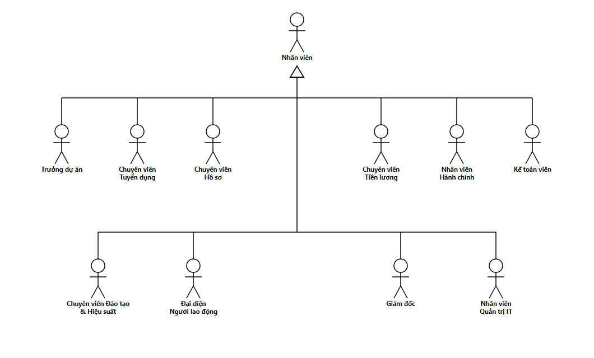

Biểu đồ mô tả cây kế thừa của 11 tác nhân thuộc nhóm nhân viên và nghiệp vụ. SHAREHOLDER là vai trò giám sát được phân quyền độc lập trong hệ thống nên không nằm trong cây này.

### 2.1.2. Danh sách Use case và phân nhóm nhiệm vụ

Từ các quy trình mô hình hóa và tác nhân đã xác định, đề tài lập danh mục 47 use case tham chiếu, chia thành 10 nhóm nghiệp vụ. Danh mục này thể hiện phạm vi phân tích, không khẳng định mọi luồng đã được triển khai.

**Bảng 2.2. Danh sách 47 Use case của Hệ thống Quản trị nhân lực**

| STT | Mã Use case | Tên Use case nghiệp vụ | Tác nhân chính | Nhóm phân hệ chức năng |
| :---: | :---: | :--- | :--- | :--- |
| 1 | UC01 | Đăng nhập & Xác thực hệ thống | Toàn thể nhân viên | Nhóm A: Quản trị hệ thống & Tổ chức |
| 2 | UC02 | Quản trị người dùng & Phân quyền RBAC | Nhân viên Quản trị CNTT | Nhóm A: Quản trị hệ thống & Tổ chức |
| 3 | UC03 | Quản trị cơ cấu tổ chức & Cây phòng ban | Nhân viên Quản trị CNTT | Nhóm A: Quản trị hệ thống & Tổ chức |
| 4 | UC04 | Lập phiếu đề xuất tuyển dụng nhân sự | Trưởng dự án | Nhóm B: Tuyển dụng & Ứng viên |
| 5 | UC05 | Thẩm định chỉ tiêu & Kiểm soát định biên tuyển dụng | Chuyên viên Tuyển dụng, Kế toán | Nhóm B: Tuyển dụng & Ứng viên |
| 6 | UC06 | Phê duyệt chỉ tiêu tuyển dụng | Giám đốc | Nhóm B: Tuyển dụng & Ứng viên |
| 7 | UC07 | Quản lý hồ sơ ứng viên & Tuyển dụng Quy trình tuyển dụng đa giai đoạn | Chuyên viên Tuyển dụng | Nhóm B: Tuyển dụng & Ứng viên |
| 8 | UC08 | Gửi thư mời nhận việc & Thỏa thuận mức lương | Chuyên viên Tuyển dụng, Ứng viên | Nhóm B: Tuyển dụng & Ứng viên |
| 9 | UC09 | Quản lý hồ sơ nhân viên toàn diện | Chuyên viên Hồ sơ | Nhóm C: Hồ sơ nhân sự & Hội nhập |
| 10 | UC10 | Quản lý hợp đồng lao động & Phụ lục hợp đồng | Chuyên viên Hồ sơ | Nhóm C: Hồ sơ nhân sự & Hội nhập |
| 11 | UC11 | Quản lý văn bằng, chứng chỉ chuyên môn | Chuyên viên Hồ sơ | Nhóm C: Hồ sơ nhân sự & Hội nhập |
| 12 | UC12 | Mượn - trả hồ sơ, chứng chỉ bản gốc | Nhân viên, Chuyên viên Hồ sơ | Nhóm C: Hồ sơ nhân sự & Hội nhập |
| 13 | UC13 | Đánh giá kết quả thử việc & Ký HĐLĐ chính thức | Trưởng dự án, Chuyên viên Hồ sơ, Giám đốc | Nhóm C: Hồ sơ nhân sự & Hội nhập |
| 14 | UC14 | Lộ trình hội nhập nhân viên mới | Nhân viên mới, Chuyên viên Hồ sơ, Mentor | Nhóm C: Hồ sơ nhân sự & Hội nhập |
| 15 | UC15 | Cổng tự phục vụ nhân viên tập trung | Toàn thể nhân viên | Nhóm D: Cổng tự phục vụ nhân viên |
| 16 | UC16 | Quản lý thông tin cá nhân phân cấp 3 mức độ | Toàn thể nhân viên | Nhóm D: Cổng tự phục vụ nhân viên |
| 17 | UC17 | Thẩm định & Phê duyệt đề xuất điều chỉnh hồ sơ Mức 2 | Chuyên viên Hồ sơ, Quản trị viên | Nhóm D: Cổng tự phục vụ nhân viên |
| 18 | UC18 | Ghi nhận sự kiện chấm công & Điểm danh vào/ra ca | Toàn thể nhân viên | Nhóm E: Chấm công & Phân ca |
| 19 | UC19 | Điểm danh bằng khuôn mặt qua camera thường | Nhân viên | Nhóm E: Chấm công & Phân ca |
| 20 | UC20 | Quản trị kết nối thiết bị máy chấm công | Chuyên viên Hồ sơ, Quản trị CNTT | Nhóm E: Chấm công & Phân ca |
| 21 | UC21 | Đăng ký & Xét duyệt nghỉ phép trực tuyến | Nhân viên, Trưởng dự án, Chuyên viên Hồ sơ | Nhóm E: Chấm công & Phân ca |
| 22 | UC22 | Đăng ký & Phê duyệt làm thêm giờ (OT) | Nhân viên, Trưởng dự án, Chuyên viên Tiền lương | Nhóm E: Chấm công & Phân ca |
| 23 | UC23 | Lập lịch và phân ca làm việc | Trưởng dự án, Chuyên viên Tiền lương | Nhóm E: Chấm công & Phân ca |
| 24 | UC24 | Giải trình bổ sung giờ công & Xử lý lệch công | Nhân viên, Trưởng dự án, Chuyên viên Tiền lương | Nhóm E: Chấm công & Phân ca |
| 25 | UC25 | Tổng hợp & Chốt bảng chấm công tháng | Chuyên viên Tiền lương, Trưởng dự án | Nhóm E: Chấm công & Phân ca |
| 26 | UC26 | Cấu hình công thức và ngạch bậc lương | Chuyên viên Tiền lương | Nhóm F: Tiền lương & Phúc lợi |
| 27 | UC27 | Vận hành chức năng tính lương tự động | Chuyên viên Tiền lương | Nhóm F: Tiền lương & Phúc lợi |
| 28 | UC28 | Phê duyệt, khóa và ghi nhận chi trả kỳ lương | Chuyên viên Tiền lương, Giám đốc | Nhóm F: Tiền lương & Phúc lợi |
| 29 | UC29 | Quản lý tạm ứng & Khoản vay phúc lợi nhân viên | Nhân viên, Chuyên viên Tiền lương, Giám đốc | Nhóm F: Tiền lương & Phúc lợi |
| 30 | UC30 | Quản lý đề xuất công tác & Quyết toán chi phí | Nhân viên, Trưởng dự án, Kế toán | Nhóm F: Tiền lương & Phúc lợi |
| 31 | UC31 | Quản lý cấp phát & Thu hồi tài sản làm việc | Nhân viên Hành chính, Nhân viên | Nhóm F: Tiền lương & Phúc lợi |
| 32 | UC32 | Đề xuất & Phê duyệt điều chuyển công tác nội bộ | Trưởng dự án, Giám đốc, Chuyên viên Hồ sơ | Nhóm G: Biến động nhân sự & Thôi việc |
| 33 | UC33 | Đề xuất & Phê duyệt điều chỉnh bậc lương | Trưởng dự án, Giám đốc, Chuyên viên Tiền lương | Nhóm G: Biến động nhân sự & Thôi việc |
| 34 | UC34 | Đề xuất & Phê duyệt khen thưởng nhân sự | Trưởng dự án, Giám đốc, Chuyên viên Tiền lương | Nhóm G: Biến động nhân sự & Thôi việc |
| 35 | UC35 | Xử lý kỷ luật & Vi phạm nội quy lao động | Trưởng dự án, Đại diện NLĐ, Giám đốc | Nhóm G: Biến động nhân sự & Thôi việc |
| 36 | UC36 | Tiếp nhận, Xử lý thôi việc & Bàn giao đa bộ phận | Nhân viên, Chuyên viên Hồ sơ, Các bộ phận | Nhóm G: Biến động nhân sự & Thôi việc |
| 37 | UC37 | Quản lý mục tiêu và đánh giá KPI | Chuyên viên nhân sự, Quản lý trực tiếp, Nhân viên | Nhóm H: Đánh giá KPI & Đào tạo |
| 38 | UC38 | Quản trị chương trình đào tạo nội bộ | Chuyên viên nhân sự, Nhân viên | Nhóm H: Đánh giá KPI, Đào tạo & Khiếu nại |
| 39 | UC39 | Tiếp nhận & Giải quyết khiếu nại lao động bảo mật | Chuyên viên nhân sự, Nhân viên | Nhóm H: Đánh giá KPI, Đào tạo & Khiếu nại |
| 40 | UC40 | Hồ sơ công vụ (Mẫu 2C-BNV/2008 chỉ là tham chiếu; phải xác minh mẫu hiện hành) | Chuyên viên Hồ sơ | Nhánh khu vực công |
| 41 | UC41 | Quản trị danh mục ngạch bậc khu vực công (nguồn và hiệu lực phải xác minh) | Chuyên viên Hồ sơ | Nhánh khu vực công |
| 42 | UC42 | Rà soát điều kiện nâng bậc công vụ (đề xuất; căn cứ phải xác minh) | Chuyên viên Hồ sơ, người có thẩm quyền | Nhánh khu vực công |
| 43 | UC43 | Kết xuất hồ sơ công vụ (đề xuất; biểu mẫu pháp quy chưa xác nhận) | Chuyên viên Hồ sơ | Nhánh khu vực công |
| 44 | UC44 | Quản lý không gian tri thức số & Tài liệu quy trình vận hành chuẩn | Toàn thể nhân viên (theo quyền không gian) | Nhóm J: Quản trị tri thức & Điều hành |
| 45 | UC45 | Tìm kiếm tri thức toàn văn & Danh bạ chuyên gia | Toàn thể nhân viên | Nhóm J: Quản trị tri thức & Điều hành |
| 46 | UC46 | Bảng điều khiển phân tích & Thống kê nhân sự | Ban Giám đốc, Quản lý, Nhân viên | Nhóm J: Quản trị tri thức & Điều hành |
| 47 | UC47 | Nhật ký kiểm toán hệ thống & Cấu hình tham số | Nhân viên Quản trị CNTT | Nhóm J: Quản trị tri thức & Điều hành |

### 2.1.3. Đặc tả chi tiết các Use case của hệ thống

Dưới đây là các kịch bản nghiệp vụ dự kiến cho 47 use case. Đây là mô hình phân tích theo phạm vi đồ án; mức độ hỗ trợ trong mã nguồn hiện tại được nêu riêng ở Chương 3.

**UC01 - Đăng nhập & Xác thực hệ thống**

- **Tác nhân chính:** Toàn thể nhân viên
- **Mục đích / Mô tả:** Xác thực định danh người dùng bằng email công vụ và mật khẩu, phân bổ phiên làm việc bảo mật với JWT.
- **Điều kiện tiên quyết:** Người dùng đã được cấp tài khoản hoạt động (ACTIVE) trong cơ sở dữ liệu.
- **Hậu điều kiện:** Hệ thống cấp phát JWT token hợp lệ và điều hướng người dùng tới Dashboard tương ứng với vai trò.

| Bước | Tác nhân (Người dùng) | Hệ thống phần mềm |
| :---: | :--- | :--- |
| 1 | Truy cập giao diện `/login`, nhập email công vụ và mật khẩu; bấm "Đăng nhập". | Tiếp nhận thông tin, kiểm tra tính hợp lệ của định dạng dữ liệu đầu vào. |
| 2 | - | Truy vấn CSDL tìm tài khoản; đối chiếu mã băm mật khẩu bằng thuật toán bcrypt. |
| 3 | - | Nếu hợp lệ: Cấp Access Token (JWT thời hạn 15 phút) và Refresh Token (thời hạn 7 ngày); lưu hash Refresh Token vào CSDL; điều hướng người dùng tới giao diện làm việc. |
| 4 | - | Nếu không hợp lệ: Thông báo lỗi "Tài khoản hoặc mật khẩu không chính xác"; tăng biến đếm số lần thất bại (nếu nhập sai quá 5 lần liên tiếp, tự động khóa tài khoản trong 15 phút để chống tấn công Brute-Force). |

**UC02 - Quản trị người dùng & Phân quyền RBAC**

- **Tác nhân chính:** Nhân viên Quản trị CNTT
- **Mục đích / Mô tả:** Khởi tạo, chỉnh sửa tài khoản người dùng, gán vai trò RBAC doanh nghiệp đa cấp (10 vai trò: ADMIN, BOD, KM_MANAGER, LINE_MANAGER, HR_CB, ACCOUNTANT, HR_RECRUITER, HR_TRAINER, AUDITOR, USER) và cấu hình ma trận phân quyền 8 phân hệ trực tiếp trên hệ thống.
- **Điều kiện tiên quyết:** Quản trị viên IT đã đăng nhập với vai trò ADMIN.
- **Hậu điều kiện:** Quyền hạn mới có hiệu lực ngay lập tức tại Cổng API và Menu giao diện; toàn bộ thao tác được ghi vết vào nhật ký kiểm toán hệ thống.

| Bước | Tác nhân (Người dùng) | Hệ thống phần mềm |
| :---: | :--- | :--- |
| 1 | Truy cập giao diện Quản lý phân quyền `/admin/roles` (hoặc `/admin/users`). | Hiển thị 3 tab chức năng: Phân quyền tài khoản (383 nhân sự), Danh mục vai trò và Ma trận phân quyền 8 phân hệ (RBAC Matrix). |
| 2 | Tại Tab "Phân quyền tài khoản", chọn tài khoản cần thay đổi quyền và chọn vai trò tương ứng trong danh mục 10 vai trò doanh nghiệp; hoặc chuyển sang Tab "Ma trận phân quyền" để biên tập quyền hạn cho từng phân hệ. | Hệ thống hiển thị huy hiệu vai trò phân loại trực quan; kiểm tra tính toàn vẹn dữ liệu vai trò. |
| 3 | Bấm "Cập nhật vai trò" hoặc "Lưu cấu hình quyền". | Cập nhật quan hệ `UserRole` và bản ghi cấu hình `Setting` (`RBAC_PERMISSIONS_MATRIX`); ghi nhật ký kiểm toán `AuditLog`. |

**UC03 - Quản trị cơ cấu tổ chức & Cây phòng ban**

- **Tác nhân chính:** Nhân viên Quản trị CNTT / Ban Giám đốc
- **Mục đích / Mô tả:** Thiết lập và quản lý cấu trúc cây phòng ban phân cấp đa tầng, định biên nhân sự và chỉ định trưởng đơn vị.
- **Điều kiện tiên quyết:** Người dùng có quyền quản trị tổ chức.
- **Hậu điều kiện:** Cơ cấu tổ chức mới được lưu trữ; sơ đồ cây phòng ban được cập nhật hiển thị theo thời gian thực.

| Bước | Tác nhân (Người dùng) | Hệ thống phần mềm |
| :---: | :--- | :--- |
| 1 | Truy cập giao diện `/org-chart`, chọn thao tác thêm mới phòng ban hoặc kéo-thả đơn vị con trên cây tổ chức. | Hiển thị sơ đồ phân cấp trực quan dạng cây (Tree-view). |
| 2 | Nhập mã đơn vị, tên đơn vị, chọn phòng ban cha (`parentId`), nhập chỉ tiêu định biên nhân sự và chỉ định Trưởng đơn vị (`headId`). | Kiểm tra quan hệ cha-con chống tạo vòng lặp vô hạn (Cycle detection). |
| 3 | Bấm "Xác nhận cập nhật". | Cập nhật bảng `Department` trong CSDL; đồng bộ phạm vi quản lý duyệt đơn cho Trưởng đơn vị mới. |

**UC04 - Lập phiếu đề xuất tuyển dụng nhân sự**

- **Tác nhân chính:** Trưởng dự án (PM)
- **Mục đích / Mô tả:** Khởi tạo nhu cầu bổ sung nhân sự cho dự án/phòng ban kèm yêu cầu chuyên môn, số lượng và khung lương đề xuất.
- **Điều kiện tiên quyết:** Trưởng dự án có tài khoản hoạt động và thuộc đơn vị có nhu cầu nhân sự.
- **Hậu điều kiện:** Phiếu đề xuất được tạo với trạng thái `PENDING_REVIEW` và gửi tới bộ phận Tuyển dụng.

| Bước | Tác nhân (Người dùng) | Hệ thống phần mềm |
| :---: | :--- | :--- |
| 1 | Truy cập `/recruitment-ats`, chọn "Lập đề xuất tuyển dụng"; điền chức danh, số lượng, cấp bậc (Junior/Senior), khung lương và mô tả công việc (JD). | Kiểm tra chỉ tiêu đề xuất với định biên còn trống của phòng ban. |
| 2 | - | Nếu vượt định biên: Hiển thị cảnh báo yêu cầu bổ sung tờ trình giải trình đặc biệt gửi Giám đốc. |
| 3 | Bấm "Gửi đề xuất". | Lưu bản ghi `Requisition` với trạng thái `PENDING_REVIEW`; gửi thông báo tới Chuyên viên tuyển dụng. |

**UC05 - Thẩm định chỉ tiêu & Kiểm soát định biên tuyển dụng**

- **Tác nhân chính:** Chuyên viên Tuyển dụng, Kế toán
- **Mục đích / Mô tả:** Rà soát tính khả thi về nguồn ứng viên trên thị trường và thẩm định ngân sách quỹ lương phục vụ tuyển dụng.
- **Điều kiện tiên quyết:** Tồn tại phiếu đề xuất tuyển dụng ở trạng thái `PENDING_REVIEW`.
- **Hậu điều kiện:** Phiếu đề xuất chuyển sang trạng thái `PENDING_APPROVAL` hoặc bị từ chối/yêu cầu hiệu chỉnh.

| Bước | Tác nhân (Người dùng) | Hệ thống phần mềm |
| :---: | :--- | :--- |
| 1 | Chuyên viên tuyển dụng mở phiếu đề xuất, rà soát mô tả công việc, khảo sát nguồn ứng viên nội bộ và ngoài thị trường; ghi nhận ý kiến thẩm định. | Cập nhật ý kiến thẩm định chuyên môn vào phiếu. |
| 2 | Kế toán viên kiểm tra ngân sách quỹ lương và chi phí dự kiến cho vị trí tuyển dụng. | Ghi nhận xác nhận ngân sách hợp lệ. |
| 3 | Chuyên viên tuyển dụng bấm "Chuyển phê duyệt". | Cập nhật trạng thái phiếu thành `PENDING_APPROVAL`; tạo thông báo tới Giám đốc điều hành. |

**UC06 - Phê duyệt chỉ tiêu tuyển dụng**

- **Tác nhân chính:** Giám đốc
- **Mục đích / Mô tả:** Xem xét toàn diện phiếu đề xuất đã qua thẩm định và ban hành quyết định phê duyệt mở đợt tuyển dụng.
- **Điều kiện tiên quyết:** Phiếu đề xuất ở trạng thái `PENDING_APPROVAL`.
- **Hậu điều kiện:** Phiếu đề xuất chuyển sang trạng thái `OPEN` (Mở đợt tuyển dụng).

| Bước | Tác nhân (Người dùng) | Hệ thống phần mềm |
| :---: | :--- | :--- |
| 1 | Giám đốc đăng nhập, xem danh sách phiếu chờ duyệt trên Dashboard điều hành. | Hiển thị chi tiết đề xuất, ý kiến thẩm định của Tuyển dụng và Kế toán. |
| 2 | Lựa chọn "Phê duyệt" (hoặc "Từ chối" kèm lý do phản hồi). | Hệ thống cập nhật trạng thái phiếu thành `OPEN`; phát sinh sự kiện thông báo cho bộ phận Tuyển dụng kích hoạt chiến dịch tìm kiếm ứng viên. |

**UC07 - Quản lý hồ sơ ứng viên & Tuyển dụng Quy trình tuyển dụng đa giai đoạn**

- **Tác nhân chính:** Chuyên viên Tuyển dụng
- **Mục đích / Mô tả:** Tiếp nhận CV, đánh giá và điều phối ứng viên qua các vòng phỏng vấn trên bảng Kanban trực quan.
- **Điều kiện tiên quyết:** Đợt tuyển dụng đang ở trạng thái `OPEN`.
- **Hậu điều kiện:** Trạng thái ứng viên được cập nhật liên tục qua các vòng; lịch phỏng vấn được đồng bộ.

| Bước | Tác nhân (Người dùng) | Hệ thống phần mềm |
| :---: | :--- | :--- |
| 1 | Truy cập bảng Kanban `/recruitment-ats`, chọn đợt tuyển dụng; tải lên CV ứng viên hoặc tiếp nhận CV từ cổng ứng tuyển. | Tự động bóc tách thông tin ứng viên, tạo thẻ ứng viên ở cột `APPLIED`. |
| 2 | Kéo-thả thẻ ứng viên qua các cột: Sàng lọc (`SCREENING`) -> Phỏng vấn 1 (`INTERVIEW_1`) -> Phỏng vấn 2 (`INTERVIEW_2`). | Mở popup thiết lập lịch phỏng vấn, chọn người phỏng vấn (Interviewer) và phòng họp. |
| 3 | Nhập điểm đánh giá phỏng vấn sau buổi họp. | Lưu trữ phiếu đánh giá năng lực ứng viên; cập nhật điểm số bình quân vào hồ sơ. |

**UC08 - Gửi thư mời nhận việc & Thỏa thuận mức lương**

- **Tác nhân chính:** Chuyên viên Tuyển dụng, Ứng viên
- **Mục đích / Mô tả:** Lập thư mời làm việc kèm thỏa thuận lương, gửi cho ứng viên và ghi nhận kết quả phản hồi.
- **Điều kiện tiên quyết:** Ứng viên đã vượt qua các vòng phỏng vấn (cột `OFFER_PENDING`).
- **Hậu điều kiện:** Ứng viên chấp nhận offer; hệ thống sẵn sàng chuyển đổi hồ sơ sang quy trình tiếp nhận.

| Bước | Tác nhân (Người dùng) | Hệ thống phần mềm |
| :---: | :--- | :--- |
| 1 | Chuyên viên tuyển dụng chọn ứng viên đạt yêu cầu, nhập thông tin mức lương đề xuất, ngày bắt đầu đi làm và thời gian thử việc; bấm "Tạo thư mời". | Hệ thống áp mẫu Offer Letter chuẩn của công ty, kiểm tra mức lương đề xuất có nằm trong khung lương đã duyệt. |
| 2 | Bấm "Gửi thư mời nhận việc". | Hệ thống gửi email tự động kèm Offer Letter có chữ ký số tới ứng viên và tạo đường dẫn xác nhận trực tuyến. |
| 3 | Ứng viên truy cập đường dẫn, bấm "Đồng ý nhận việc" (hoặc từ chối/thỏa thuận lại). | Cập nhật trạng thái ứng viên sang `OFFER_ACCEPTED`; tự động kích hoạt luồng hội nhập Onboarding. |

**UC09 - Quản lý hồ sơ nhân viên toàn diện**

- **Tác nhân chính:** Chuyên viên Hồ sơ
- **Mục đích / Mô tả:** Quản trị hồ sơ lý lịch trích ngang của toàn thể nhân viên, bao gồm thông tin cá nhân, phòng ban, quá trình công tác.
- **Điều kiện tiên quyết:** Chuyên viên hồ sơ có quyền quản trị dữ liệu nhân sự.
- **Hậu điều kiện:** Hồ sơ nhân viên được lưu trữ đầy đủ trong CSDL, phục vụ cho mọi phân hệ khác.

| Bước | Tác nhân (Người dùng) | Hệ thống phần mềm |
| :---: | :--- | :--- |
| 1 | Truy cập `/employees`, tra cứu nhân viên theo tên, mã NV hoặc phòng ban. | Hiển thị danh sách nhân viên kèm ảnh, chức danh, trạng thái làm việc. |
| 2 | Mở chi tiết hồ sơ; cập nhật thông tin cá nhân, số CCCD, hộ khẩu, người phụ thuộc giảm trừ gia cảnh. | Kiểm tra tính hợp lệ dữ liệu (độ dài CCCD, định dạng ngày sinh, mã số thuế). |
| 3 | Bấm "Lưu thay đổi". | Cập nhật bản ghi `Employee`; lưu lịch sử thay đổi vào bảng kiểm toán. |

**UC10 - Quản lý hợp đồng lao động & Phụ lục hợp đồng**

- **Tác nhân chính:** Chuyên viên Hồ sơ
- **Mục đích / Mô tả:** Khởi tạo, gia hạn, ký kết HĐLĐ (thử việc, xác định thời hạn, không xác định thời hạn) và cảnh báo hợp đồng sắp hết hạn.
- **Điều kiện tiên quyết:** Nhân viên đã có hồ sơ trong hệ thống.
- **Hậu điều kiện:** HĐLĐ được ban hành; ngày hết hạn được đưa vào hàng đợi cảnh báo tự động.

| Bước | Tác nhân (Người dùng) | Hệ thống phần mềm |
| :---: | :--- | :--- |
| 1 | Vào mục Hợp đồng trong hồ sơ nhân viên, chọn "Tạo mới hợp đồng". | Hiển thị form nhập: Loại hợp đồng, thời hạn, mức lương đóng BHXH, chức danh công việc. |
| 2 | Điền thông tin và đính kèm bản quét hợp đồng đã ký; bấm "Lưu hợp đồng". | Lưu bản ghi `Contract`; cập nhật mức lương cơ bản hiện tại của nhân viên. |
| 3 | - | Hệ thống tự động kích hoạt tiến trình định kỳ quét các HĐLĐ còn hiệu lực dưới 45 ngày để cảnh báo cho HR gia hạn. |

**UC11 - Quản lý văn bằng, chứng chỉ chuyên môn**

- **Tác nhân chính:** Chuyên viên Hồ sơ
- **Mục đích / Mô tả:** Lưu trữ, phân loại văn bằng đại học, chứng chỉ kỹ thuật quốc tế (AWS, PMP, Scrum Master...) và theo dõi hạn sử dụng.
- **Điều kiện tiên quyết:** Nhân viên đã nộp văn bằng chứng chỉ cho phòng nhân sự.
- **Hậu điều kiện:** Dữ liệu bằng cấp được chuẩn hóa và gắn liền với hồ sơ năng lực nhân viên.

| Bước | Tác nhân (Người dùng) | Hệ thống phần mềm |
| :---: | :--- | :--- |
| 1 | Tại hồ sơ nhân viên, chuyển sang tab "Bằng cấp & Chứng chỉ", chọn "Thêm mới". | Hiển thị form khai báo: Tên chứng chỉ, tổ chức cấp, ngày cấp, ngày hết hạn, bản mềm scan. |
| 2 | Nhập thông tin và bấm "Lưu". | Kiểm tra tính hợp lệ của thời hạn chứng chỉ, cập nhật bảng `Certificate`. |
| 3 | - | Hệ thống tự động cập nhật ma trận kỹ năng của nhân viên phục vụ điều phối dự án. |

**UC12 - Mượn - trả hồ sơ, chứng chỉ bản gốc**

- **Tác nhân chính:** Nhân viên, Chuyên viên Hồ sơ
- **Mục đích / Mô tả:** Quy trình tiếp nhận đề xuất mượn hồ sơ gốc (bằng tốt nghiệp, sổ bảo hiểm) từ nhân viên và quản lý việc hoàn trả đúng hạn.
- **Điều kiện tiên quyết:** Phòng nhân sự đang lưu giữ bản gốc hồ sơ của nhân viên.
- **Hậu điều kiện:** Phiếu mượn được tạo; trạng thái vị trí hồ sơ vật lý được cập nhật.

| Bước | Tác nhân (Người dùng) | Hệ thống phần mềm |
| :---: | :--- | :--- |
| 1 | Nhân viên gửi yêu cầu mượn hồ sơ gốc qua cổng tự phục vụ nhân viên, nêu rõ lý do và ngày cam kết hoàn trả. | Tạo phiếu mượn ở trạng thái `PENDING` gửi tới Chuyên viên hồ sơ. |
| 2 | Chuyên viên hồ sơ kiểm tra vị trí tủ lưu trữ, bàn giao hồ sơ vật lý và bấm "Xác nhận bàn giao". | Chuyển trạng thái phiếu mượn sang `BORROWED`; lưu ngày giờ bàn giao thực tế. |
| 3 | Khi nhân viên trả hồ sơ, Chuyên viên hồ sơ kiểm tra tính nguyên vẹn và bấm "Xác nhận đã trả". | Chuyển trạng thái sang `RETURNED`; lưu vết đóng phiếu mượn. |

**UC13 - Đánh giá kết quả thử việc & Ký HĐLĐ chính thức**

- **Tác nhân chính:** Trưởng dự án, Chuyên viên Hồ sơ, Giám đốc
- **Mục đích / Mô tả:** Ghi nhận kết quả đánh giá thử việc và xử lý quyết định chuyển sang hợp đồng lao động chính thức khi được phê duyệt.
- **Điều kiện tiên quyết:** Nhân viên có hợp đồng thử việc và quản lý lập hồ sơ đánh giá.
- **Hậu điều kiện:** Kết quả được phê duyệt và lưu thành quyết định nhân sự. Đến ngày hiệu lực, hệ thống kết thúc hợp đồng thử việc, tạo hợp đồng mới và cập nhật trạng thái nhân sự; hệ thống chưa tự đăng ký bảo hiểm xã hội.

| Bước | Tác nhân (Người dùng) | Hệ thống phần mềm |
| :---: | :--- | :--- |
| 1 | Trưởng dự án lập đánh giá thử việc, ghi điểm, kết luận và minh chứng. | Lưu hồ sơ ở trạng thái chờ thẩm định; hiện chưa có tác vụ tự động nhắc trước ngày kết thúc thử việc. |
| 2 | Chuyên viên nhân sự thẩm định hồ sơ, sau đó trình cấp có thẩm quyền phê duyệt. | Lưu người xử lý, kết quả và quyết định nhân sự kèm ngày hiệu lực. |
| 3 | Khi quyết định đến ngày hiệu lực, hệ thống kết thúc hợp đồng thử việc và tạo hợp đồng theo loại đã duyệt. | Cập nhật nhân sự sang trạng thái đang làm việc; việc đăng ký bảo hiểm xã hội vẫn do bộ phận phụ trách thực hiện ngoài hệ thống. |

**UC14 - Lộ trình hội nhập nhân viên mới**

- **Tác nhân chính:** Nhân viên mới, Chuyên viên Hồ sơ, Mentor
- **Mục đích / Mô tả:** Theo dõi các nhiệm vụ hội nhập được giao cho nhân viên mới. Thời hạn 14 ngày chưa được hệ thống áp dụng cố định.
- **Điều kiện tiên quyết:** Nhân viên mới nhận việc vào ngày đầu tiên (Day-1).
- **Hậu điều kiện:** Trạng thái các nhiệm vụ được lưu để HR và quản lý theo dõi. Việc xác nhận hoàn tất theo quy trình nội bộ; hệ thống chưa tự kết luận nhân viên đã sẵn sàng nhận việc.

| Bước | Tác nhân (Người dùng) | Hệ thống phần mềm |
| :---: | :--- | :--- |
| 1 | Khi tiếp nhận ứng viên, HRMS tạo các nhiệm vụ hội nhập ban đầu cho HR, IT, Hành chính và bộ phận chuyên môn. HR có thể giao thêm lộ trình tài liệu cho nhân viên. | Lưu người phụ trách và trạng thái từng nhiệm vụ; tài khoản mới được tạo ở trạng thái chưa kích hoạt. |
| 2 | Bộ phận được giao xác nhận khi hoàn thành nhiệm vụ; IT kích hoạt tài khoản tại màn hình quản trị người dùng. | Cập nhật trạng thái nhiệm vụ. Việc cấp email, máy tính hoặc tài khoản dịch vụ bên ngoài cần bộ phận phụ trách thực hiện. |
| 3 | HR và quản lý theo dõi các nhiệm vụ còn mở, xác nhận hoàn tất theo quy trình nội bộ. | Ghi nhận trạng thái hội nhập; hệ thống hiện chưa áp dụng thời lượng 14 ngày hoặc tự kết luận nhân viên đã sẵn sàng nhận việc. |

**UC15 - Cổng tự phục vụ nhân viên tập trung**

- **Tác nhân chính:** Toàn thể nhân viên
- **Mục đích / Mô tả:** Cung cấp trang tổng quan tập trung cho nhân viên xem số dư phép, thông tin chấm công hàng ngày, phiếu lương và nộp đơn từ trực tuyến.
- **Điều kiện tiên quyết:** Nhân viên đã đăng nhập tài khoản vào hệ thống.
- **Hậu điều kiện:** Mọi thông tin cá nhân liên quan được hiển thị bảo mật, đầy đủ và trực quan.

| Bước | Tác nhân (Người dùng) | Hệ thống phần mềm |
| :---: | :--- | :--- |
| 1 | Nhân viên truy cập `/ess`. | Hệ thống tải dữ liệu tổng hợp: Thống kê giờ công tháng này, số ngày phép còn lại, thông báo đơn từ và liên kết nhanh tới các biểu mẫu. |
| 2 | Nhân viên chọn xem Phiếu lương điện tử gần nhất. | Yêu cầu nhập lại mật khẩu hoặc mã PIN bảo mật; hiển thị chi tiết thu nhập, thuế TNCN và thực lĩnh. |

**UC16 - Quản lý thông tin cá nhân phân cấp 3 mức độ**

- **Tác nhân chính:** Toàn thể nhân viên
- **Mục đích / Mô tả:** Cho phép nhân viên tự xem và sửa đổi thông tin cá nhân theo cơ chế phân quyền bảo vệ 3 mức (Mức 1 tự sửa, Mức 2 phải duyệt, Mức 3 khóa).
- **Điều kiện tiên quyết:** Nhân viên đang truy cập trang thông tin cá nhân `/profile`.
- **Hậu điều kiện:** Thông tin Mức 1 được cập nhật tức thì; thông tin Mức 2 sinh phiếu đề xuất chờ thẩm định.

| Bước | Tác nhân (Người dùng) | Hệ thống phần mềm |
| :---: | :--- | :--- |
| 1 | Nhân viên truy cập `/profile`, xem các trường thông tin được chia theo 3 nhóm màu sắc nhận diện. | Phân định quyền: Mức 1 (SĐT, nơi ở hiện tại, liên hệ khẩn cấp) cho phép sửa; Mức 2 (CCCD, STK ngân hàng) cho phép đề xuất; Mức 3 (Lương, Chức danh) chỉ đọc. |
| 2 | Nhân viên thay đổi SĐT (Mức 1) và bấm "Cập nhật". | Hệ thống lưu ngay vào CSDL mà không cần phê duyệt. |
| 3 | Nhân viên sửa số tài khoản ngân hàng (Mức 2), tải ảnh thẻ ATM minh chứng và bấm "Gửi đề xuất". | Hệ thống sinh bản ghi `ProfileChangeRequest` ở trạng thái `PENDING` và đẩy vào hàng đợi của bộ phận nhân sự. |

**UC17 - Thẩm định & Phê duyệt đề xuất điều chỉnh hồ sơ Mức 2**

- **Tác nhân chính:** Chuyên viên Hồ sơ, Quản trị viên
- **Mục đích / Mô tả:** Kiểm tra tính xác thực của đề xuất thay đổi thông tin quan trọng (CCCD, ngân hàng) kèm ảnh minh chứng trước khi áp dụng vào hồ sơ gốc.
- **Điều kiện tiên quyết:** Tồn tại yêu cầu thay đổi thông tin ở trạng thái `PENDING`.
- **Hậu điều kiện:** Hồ sơ nhân viên được cập nhật dữ liệu mới nếu được duyệt; hoặc bị từ chối kèm lý do.

| Bước | Tác nhân (Người dùng) | Hệ thống phần mềm |
| :---: | :--- | :--- |
| 1 | Chuyên viên hồ sơ mở danh sách phê duyệt hồ sơ. | Hiển thị bảng so sánh đối chiếu: Giá trị cũ (Old Value) vs Giá trị mới đề xuất (New Value) cùng hình ảnh đính kèm. |
| 2 | Chuyên viên đối chiếu tính hợp lệ của giấy tờ minh chứng. | Kích hoạt nút phê duyệt. |
| 3 | Bấm "Duyệt yêu cầu". | Thực thi giao dịch CSDL nguyên tử: Cập nhật thông tin vào bảng `Employee`, đổi trạng thái yêu cầu sang `APPROVED`, gửi thông báo kết quả tới nhân viên. |

**UC18 - Ghi nhận sự kiện chấm công & Điểm danh vào/ra ca**

- **Tác nhân chính:** Toàn thể nhân viên
- **Mục đích / Mô tả:** Thu thập sự kiện Check-in / Check-out từ nhiều kênh (Web Portal, Ứng dụng di động, Máy chấm công) vào bảng sự kiện bất biến.
- **Điều kiện tiên quyết:** Nhân viên có mặt tại điểm làm việc hoặc trong khung giờ quy định.
- **Hậu điều kiện:** Sự kiện chấm công thô được ghi nhận kèm dấu vết thời gian bất biến.

| Bước | Tác nhân (Người dùng) | Hệ thống phần mềm |
| :---: | :--- | :--- |
| 1 | Nhân viên thực hiện thao tác Check-in trên Web hoặc quẹt thẻ tại cổng. | Tiếp nhận sự kiện; ghi nhận thời gian máy chủ (Server Timestamp), mã thiết bị và tọa độ GPS (nếu qua mobile). |
| 2 | - | Ghi bản ghi bất biến vào bảng `AttendanceEvent`. |
| 3 | - | Khớp giờ check-in với ca làm việc được phân bổ để xác định trạng thái ban đầu: Đúng giờ, Đi muộn (Late). Hiển thị phản hồi tức thì cho nhân viên. |

**UC19 - Điểm danh bằng khuôn mặt qua camera thường**

- **Tác nhân chính:** Nhân viên
- **Mục đích / Mô tả:** Nhân viên đăng ký mẫu khuôn mặt và dùng camera thường trên trình duyệt để xác thực lượt vào/ra. Khi mẫu đạt ngưỡng so khớp đã cấu hình, hệ thống ghi nhận sự kiện chấm công.
- **Điều kiện tiên quyết:** Nhân viên đã đăng nhập, đồng ý xử lý dữ liệu khuôn mặt, đăng ký mẫu và cho phép trình duyệt truy cập camera.
- **Hậu điều kiện:** Sự kiện chấm công nguồn `FACE` được lưu; bảng công ngày được tính lại.

| Bước | Tác nhân (Người dùng) | Hệ thống phần mềm |
| :---: | :--- | :--- |
| 1 | Nhân viên đồng ý xử lý dữ liệu và chụp ba mẫu bằng camera thường. | Tạo vector mô tả từ khung hình và lưu mẫu đã mã hóa; hệ thống không lưu ảnh gốc từ bước đăng ký. |
| 2 | Mở `/check-in`, bật camera và đặt khuôn mặt trong khung hình. | Trình duyệt lấy vùng giữa khung hình 64×64, tính vector 256 chiều bằng HOG/LBP và gửi vector lên máy chủ. Luồng hiện chưa có bộ phát hiện khuôn mặt chuyên dụng. |
| 3 | Nhấn nút điểm danh. | Máy chủ kiểm tra đồng thuận và mẫu đã đăng ký, so vector bằng cosine similarity với ngưỡng cấu hình (mặc định 0,95). Nếu đạt, hệ thống xác định lượt vào/ra kế tiếp, ghi `AttendanceEvent` nguồn `FACE` và tính lại công ngày. |
| 4 | - | Nếu chưa đồng ý, chưa đăng ký mẫu hoặc không đạt ngưỡng, hệ thống từ chối và hiển thị lý do. Luồng hiện chưa xác minh người thật; ảnh hoặc video có thể bị dùng để giả mạo. |

**UC20 - Quản trị kết nối thiết bị máy chấm công**

- **Tác nhân chính:** Chuyên viên Hồ sơ, Quản trị CNTT
- **Mục đích / Mô tả:** Cấu hình kết nối mạng, quản lý webhook đồng bộ dữ liệu thời gian thực từ các máy chấm công vân tay/thẻ từ tại các chi nhánh.
- **Điều kiện tiên quyết:** Máy chấm công vật lý được kết nối mạng nội bộ công ty.
- **Hậu điều kiện:** Dữ liệu chấm công từ thiết bị được đồng bộ tự động và an toàn vào CSDL.

| Bước | Tác nhân (Người dùng) | Hệ thống phần mềm |
| :---: | :--- | :--- |
| 1 | Quản trị CNTT vào mục Quản trị thiết bị, khai báo thông số máy: IP, Serial Number, vị trí văn phòng và khóa bảo mật HMAC. | Hệ thống kiểm tra kết nối mạng (Ping / Handshake) tới thiết bị. |
| 2 | Thiết lập endpoint tiếp nhận Webhook sự kiện. | Hệ thống sẵn sàng lắng nghe các HTTP POST webhook gửi từ thiết bị. |
| 3 | Khi máy chấm công gửi dữ liệu thô, hệ thống kiểm tra chữ ký số HMAC-SHA256. | Nếu chữ ký hợp lệ: Giải nén gói tin và ghi nhận hàng loạt sự kiện vào CSDL. |

**UC21 - Đăng ký & Xét duyệt nghỉ phép trực tuyến**

- **Tác nhân chính:** Nhân viên, Trưởng dự án, Chuyên viên Hồ sơ
- **Mục đích / Mô tả:** Nộp đơn xin nghỉ phép (phép năm, phép ốm, việc riêng), tự động kiểm tra quỹ phép khả dụng và luồng phê duyệt trực tuyến.
- **Điều kiện tiên quyết:** Nhân viên có tài khoản và còn số dư phép khả dụng trong năm.
- **Hậu điều kiện:** Đơn phép được duyệt; quỹ phép của nhân viên được trừ tự động; dữ liệu nạp vào bảng công.

| Bước | Tác nhân (Người dùng) | Hệ thống phần mềm |
| :---: | :--- | :--- |
| 1 | Nhân viên vào `/leave`, chọn "Tạo đơn xin nghỉ phép"; chọn loại phép, khoảng ngày nghỉ và lý do. | Hệ thống kiểm tra số dư phép (`LeaveBalance`) và kiểm tra trùng lịch với các đơn phép đã nộp trước đó. |
| 2 | Bấm "Gửi đơn". | Tạo đơn trạng thái `PENDING`, gửi email thông báo kèm link phê duyệt nhanh cho Trưởng dự án (PM). |
| 3 | Trưởng dự án mở đơn, xem xét phân bổ công việc của nhóm và bấm "Duyệt". | Hệ thống trừ ngay số ngày nghỉ vào quỹ phép của nhân viên; ghi chú ngày nghỉ vào bảng chấm công tháng; gửi thông báo hoàn tất cho nhân viên. |

**UC22 - Đăng ký & Phê duyệt làm thêm giờ (OT)**

- **Tác nhân chính:** Nhân viên, Trưởng dự án, Chuyên viên Tiền lương
- **Mục đích / Mô tả:** Đăng ký kế hoạch làm thêm giờ ngoài giờ tiêu chuẩn, kiểm soát trần thời gian OT theo luật và phê duyệt ghi nhận.
- **Điều kiện tiên quyết:** Có nhu cầu làm thêm giờ do tiến độ dự án yêu cầu.
- **Hậu điều kiện:** Giờ làm thêm được duyệt và tự động đưa vào bảng công tháng phục vụ tính lương hệ số cao.

| Bước | Tác nhân (Người dùng) | Hệ thống phần mềm |
| :---: | :--- | :--- |
| 1 | Nhân viên lập phiếu đăng ký OT: chọn dự án, ngày, số giờ, loại ngày, số giờ ban đêm và lý do. | Hệ thống chặn quá 4h/ngày theo cấu hình bài tập, đồng thời kiểm tra 40h/tháng và 200h/năm; giới hạn pháp lý ngày thực tế phụ thuộc giờ làm bình thường. Trường hợp ngoại lệ tới 300h/năm cần điều kiện và hồ sơ riêng, hiện chưa tự động quản lý đủ thủ tục đó. |
| 2 | Bấm "Nộp phiếu OT". | Chuyển đơn tới Trưởng dự án phụ trách. |
| 3 | Trưởng dự án duyệt phiếu. | Hệ thống lưu trạng thái `APPROVED`; kỳ lương tính hệ số OT 150%, 200%, 300%, phụ trội ban đêm và phần cộng thêm cho OT đêm theo loại ngày. |

**UC23 - Lập lịch và phân ca làm việc**

- **Tác nhân chính:** Trưởng dự án, Chuyên viên Tiền lương
- **Mục đích / Mô tả:** Thiết lập danh mục ca làm việc (ca hành chính, ca hỗ trợ khách hàng, ca đêm) và gán lịch ca cho nhân viên theo tuần/tháng.
- **Điều kiện tiên quyết:** Danh mục ca làm việc đã được khai báo khung giờ chuẩn.
- **Hậu điều kiện:** Lịch ca được công bố; làm căn cứ tự động so khớp giờ check-in/out.

| Bước | Tác nhân (Người dùng) | Hệ thống phần mềm |
| :---: | :--- | :--- |
| 1 | Người quản lý truy cập `/shifts`, chọn phòng ban hoặc dự án và chọn tuần làm việc. | Hiển thị ma trận phân ca dạng lưới (Lịch tuần/tháng). |
| 2 | Gán ca làm việc (Ca Sáng 8h-12h, Ca Chiều 13h30-17h30, Ca Tối) cho từng nhân sự hoặc áp dụng lịch mẫu cho cả nhóm. | Kiểm tra thời gian nghỉ ngơi tối thiểu giữa hai ca liên tiếp của nhân viên. |
| 3 | Bấm "Công bố lịch ca". | Lưu bản ghi phân ca; gửi thông báo lịch làm việc mới tới ứng dụng di động/web của từng nhân viên. |

**UC24 - Giải trình bổ sung giờ công & Xử lý lệch công**

- **Tác nhân chính:** Nhân viên, Trưởng dự án, Chuyên viên Tiền lương
- **Mục đích / Mô tả:** Cho phép nhân viên gửi đơn giải trình khi quên quẹt thẻ hoặc đi công tác đột xuất kèm minh chứng để hiệu chỉnh dữ liệu chấm công.
- **Điều kiện tiên quyết:** Bảng chấm công có bản ghi ghi nhận đi muộn/về sớm hoặc thiếu lượt quẹt thẻ.
- **Hậu điều kiện:** Dữ liệu công được điều chỉnh về trạng thái hợp lệ có lưu vết kiểm toán đầy đủ.

| Bước | Tác nhân (Người dùng) | Hệ thống phần mềm |
| :---: | :--- | :--- |
| 1 | Nhân viên xem bảng công cá nhân, bấm vào ngày bị thiếu công để tạo "Đơn giải trình quên quẹt thẻ / Công tác". | Hiển thị form giải trình: Chọn loại lý do (quên thẻ, hỏng máy, gặp khách hàng), nhập giờ vào/ra thực tế, tải tài liệu/ảnh minh chứng. |
| 2 | Bấm "Gửi giải trình". | Gửi đơn tới Quản lý trực tiếp. |
| 3 | Quản lý xác nhận và bấm "Chấp thuận". | Hệ thống cập nhật lại ngày công trong bảng tổng hợp `AttendanceDay`; lưu lại lý do và danh tính người duyệt vào lịch sử kiểm toán. |

**UC25 - Tổng hợp & Chốt bảng chấm công tháng**

- **Tác nhân chính:** Chuyên viên Tiền lương, Trưởng dự án
- **Mục đích / Mô tả:** Khóa dữ liệu chấm công định kỳ ngày 25 hàng tháng, giải quyết toàn bộ sai lệch công và tổng hợp bảng công chuẩn bị tính lương.
- **Điều kiện tiên quyết:** Đến kỳ chốt công tháng (thường là ngày 25 của tháng làm việc).
- **Hậu điều kiện:** Bảng công tháng được chốt ở trạng thái `LOCKED`, chuyển giao toàn bộ số liệu công cho phân hệ tính lương.

| Bước | Tác nhân (Người dùng) | Hệ thống phần mềm |
| :---: | :--- | :--- |
| 1 | Chuyên viên tiền lương chọn kỳ công (Tháng/Năm), bấm "Khóa dữ liệu thô". | Ngăn chặn nhân viên nộp thêm đơn giải trình hoặc đơn phép cho kỳ công đó. |
| 2 | Hệ thống chạy batch job tổng hợp dữ liệu: | Tự động tính: Tổng ngày công chuẩn, ngày công thực tế, số ngày nghỉ hưởng lương/không lương, tổng số giờ OT theo từng hệ số. |
| 3 | Chuyên viên rà soát các bản ghi cảnh báo lệch công còn tồn đọng và xử lý triệt để. | Hiển thị bảng tổng hợp công toàn công ty. |
| 4 | Bấm "Chốt bảng công". | Chuyển trạng thái bảng công sang `FINALIZED`, gửi tín hiệu sẵn sàng sang phân hệ tính lương. |

**UC26 - Cấu hình công thức và ngạch bậc lương**

- **Tác nhân chính:** Chuyên viên Tiền lương
- **Mục đích / Mô tả:** Thiết lập các thành phần thu nhập (lương cứng, phụ cấp ăn trưa, xăng xe, trách nhiệm), định mức đóng bảo hiểm và biểu thuế TNCN lũy tiến.
- **Điều kiện tiên quyết:** Chuyên viên tiền lương có quyền quản trị phân hệ đãi ngộ.
- **Hậu điều kiện:** Quy tắc tính lương mới được lưu lại, áp dụng tự động cho các chu kỳ tính lương tiếp theo.

| Bước | Tác nhân (Người dùng) | Hệ thống phần mềm |
| :---: | :--- | :--- |
| 1 | Truy cập `/payroll-engine`, chọn "Cấu hình thành phần lương". | Hiển thị danh mục phụ cấp, khoản khấu trừ và công thức tính. |
| 2 | Chọn tham số theo ngày hiệu lực và năm tính thuế. Kỳ 2025 dùng giảm trừ 11 triệu/tháng và 4,4 triệu/người phụ thuộc; kỳ tính thuế 2026 dùng 15,5 triệu và 6,2 triệu, biểu 5 bậc. Cấu hình tỷ lệ/căn cứ đóng BHXH, BHYT, BHTN, TNLĐ-BNN, kinh phí công đoàn, mức trần và vùng lương. | Kiểm tra tính đầy đủ của tham số, hiệu lực và người phê duyệt; khi vận hành thật còn phải so khớp với loại hợp đồng, hồ sơ người phụ thuộc, mức đóng và chính sách doanh nghiệp. |
| 3 | Bấm "Lưu cấu hình". | Lưu phiên bản cấu hình lương mới có ghi nhận ngày bắt đầu hiệu lực. |

**UC27 - Vận hành chức năng tính lương tự động**

- **Tác nhân chính:** Chuyên viên Tiền lương
- **Mục đích / Mô tả:** Khởi chạy tiến trình tính toán tiền lương tự động cho toàn thể nhân viên dựa trên bảng công đã chốt, hợp đồng lao động và thuế/bảo hiểm.
- **Điều kiện tiên quyết:** Bảng chấm công kỳ này đã được chốt (`FINALIZED`) và hợp đồng còn hiệu lực.
- **Hậu điều kiện:** Kỳ lương được tính ở trạng thái `PROCESSED`; các phiếu lương chi tiết được tạo ở trạng thái `DRAFT` chờ rà soát.

| Bước | Tác nhân (Người dùng) | Hệ thống phần mềm |
| :---: | :--- | :--- |
| 1 | Chuyên viên tiền lương truy cập `/payroll-engine`, chọn kỳ lương cần tính và bấm "Khởi chạy tính lương tự động". | Hệ thống hiển thị thanh tiến trình xử lý theo lô (Batch processing). |
| 2 | - | Hệ thống lấy mức cơ bản từ cấu trúc lương gán riêng còn hiệu lực nếu ngày gán phù hợp với hợp đồng; nếu không, lấy từ hợp đồng/phụ lục còn hiệu lực, rồi mới dùng mức trong hồ sơ khi không có hợp đồng. Cấu trúc vị trí cung cấp các khoản thu nhập đã cấu hình, còn khung lương là căn cứ tham chiếu và không tự thay đổi hợp đồng. Từ dữ liệu đó, hệ thống tính công, OT theo loại ngày và giờ đêm, phụ trội ca đêm, bảo hiểm, thuế theo năm và phần đóng của doanh nghiệp. Khoản vay chỉ được khấu trừ theo lịch đã duyệt, có ủy quyền và trong khả năng thực nhận. |
| 3 | - | Sinh bảng tổng hợp và phiếu lương chi tiết (`HrmsPayrollSlip`). Hiển thị kết quả tính để HR kiểm tra trước khi đối soát. `Payslip` là model của luồng lương cũ. |

**UC28 - Phê duyệt, khóa và ghi nhận chi trả kỳ lương**

- **Tác nhân chính:** Chuyên viên Tiền lương, Giám đốc
- **Mục đích / Mô tả:** Đối soát, phê duyệt, khóa kỳ lương và lưu thông tin thanh toán sau khi thực hiện chi trả.
- **Điều kiện tiên quyết:** Kỳ lương ở `PROCESSED`; người khác với người tính thực hiện đối soát; người duyệt phải khác cả người tính lẫn người đối soát. Người tính không được tự phê duyệt hoặc khóa kỳ.
- **Hậu điều kiện:** Kỳ lương đi qua `APPROVED`, `LOCKED` rồi `PAID`; chỉnh sửa trực tiếp bị chặn sau khi khóa. Khi ghi nhận `PAID`, Kế toán phải nhập phương thức thanh toán và mã giao dịch hoặc số chứng từ. Hệ thống lưu thông tin này nhưng chưa xác minh với ngân hàng và không tự gửi lệnh chuyển tiền.

| Bước | Tác nhân (Người dùng) | Hệ thống phần mềm |
| :---: | :--- | :--- |
| 1 | HR/C&B hoặc Kế toán đối soát kết quả đã tính; không được là người đã tính kỳ lương. | Chuyển trạng thái từ `PROCESSED` sang `REVIEWED`, ghi người và thời điểm đối soát. Nếu cần lập lại, người có quyền có thể hủy kỳ; hệ thống giữ bản ghi cũ ở trạng thái `CANCELLED` và cho tạo kỳ mới cùng thời gian. |
| 2 | Giám đốc xem kết quả đã đối soát và phê duyệt. | Chuyển trạng thái thành `APPROVED`; người phê duyệt khác cả người tính lẫn người đối soát. Phiếu lương được hiển thị sau phê duyệt. |
| 3 | Giám đốc khóa kỳ đã duyệt; Kế toán ghi nhận chi trả sau khi thực hiện thanh toán. | Chuyển trạng thái `LOCKED` rồi `PAID`; chỉ tại bước `PAID` mới hạch toán khoản vay đã đặt trước và yêu cầu phương thức cùng mã giao dịch/chứng từ. Hệ thống không xác minh trực tiếp giao dịch ngân hàng. Kỳ đã khóa hoặc đã thanh toán có thể được hủy để lập lại; thao tác này không đảo khoản tiền đã chuyển và bị chặn nếu khoản vay của kỳ đã được hạch toán. |

**UC29 - Quản lý tạm ứng & Khoản vay phúc lợi nhân viên**

- **Tác nhân chính:** Nhân viên, Chuyên viên Tiền lương, Giám đốc
- **Mục đích / Mô tả:** Quy trình nhân viên nộp đơn vay phúc lợi công ty hoặc tạm ứng lương; tự động thẩm định định mức khấu trừ hàng tháng qua bảng lương.
- **Điều kiện tiên quyết:** Nhân viên chính thức có thời gian công tác từ 6 tháng trở lên.
- **Hậu điều kiện:** Đơn vay lưu trạng thái `PENDING` cùng thời điểm và phiên bản chấp thuận khấu trừ. Người có thẩm quyền duyệt riêng; `APPROVED` chưa đồng nghĩa đã giải ngân. Kế toán ghi nhận phương thức và mã chứng từ để chuyển `DISBURSED`. Chỉ khoản đã giải ngân, còn dư nợ và có chấp thuận mới được xét khấu trừ ở kỳ lương sau; dư nợ bằng 0 mới chuyển `COMPLETED`. Mã tham chiếu hiện là dữ liệu ghi nhận, chưa xác minh trực tiếp với ngân hàng.

| Bước | Tác nhân (Người dùng) | Hệ thống phần mềm |
| :---: | :--- | :--- |
| 1 | Nhân viên truy cập `/loans`, nhập số tiền cần vay/tạm ứng, mục đích và chọn kỳ hạn trả nợ (3 - 12 tháng). | Hệ thống tính lịch trả dự kiến; khoản khấu trừ chỉ được đưa vào lương khi hồ sơ, thỏa thuận/ủy quyền, lịch trả và khoản vay đã được duyệt. Không áp dụng trần 30% chung cho mọi khoản vay. |
| 2 | Bấm "Gửi đơn vay". | Gửi đơn tới Chuyên viên tiền lương và Giám đốc phê duyệt. |
| 3 | Người có thẩm quyền duyệt hoặc từ chối; kế toán thực hiện chi riêng sau khi được duyệt. | Khi duyệt, trạng thái chỉ là `APPROVED`, chưa tạo khấu trừ. Kế toán ghi phương thức tiền mặt/chuyển khoản và mã chứng từ để chuyển `DISBURSED`. Bộ tính lương chỉ lấy khoản đã giải ngân, còn dư nợ và có chấp thuận khấu trừ; đây chưa phải xác nhận tiền đã vào tài khoản. |

**UC30 - Quản lý đề xuất công tác & Quyết toán chi phí**

- **Tác nhân chính:** Nhân viên, Trưởng dự án, Kế toán
- **Mục đích / Mô tả:** Lập kế hoạch đi công tác, tạm ứng công tác phí và kê khai hóa đơn điện tử quyết toán chi phí sau chuyến đi.
- **Điều kiện tiên quyết:** Có phát sinh nhu cầu đi công tác phục vụ dự án.
- **Hậu điều kiện:** Chi phí công tác được quyết toán minh bạch; hoàn ứng hoặc chi trả bổ sung cho nhân viên.

| Bước | Tác nhân (Người dùng) | Hệ thống phần mềm |
| :---: | :--- | :--- |
| 1 | Nhân viên vào `/expense-claims`, tạo "Đề xuất công tác": Điền điểm đến, thời gian, dự toán vé máy bay/khách sạn/công tác phí. | Gửi đề xuất tới Trưởng dự án và Kế toán thẩm định. |
| 2 | Sau khi chuyến công tác hoàn thành, nhân viên tải lên các hóa đơn điện tử (vé máy bay, khách sạn, tiếp khách) để quyết toán. | Kế toán đối soát tính hợp lệ của hóa đơn theo quy chuẩn thuế. |
| 3 | Kế toán bấm "Phê duyệt quyết toán". | Hệ thống đối trừ với số tiền đã tạm ứng, xuất phiếu thanh toán phần chênh lệch cho nhân viên. |

**UC31 - Quản lý cấp phát & Thu hồi tài sản làm việc**

- **Tác nhân chính:** Nhân viên Hành chính, Nhân viên
- **Mục đích / Mô tả:** Theo dõi vòng đời tài sản làm việc (laptop, màn hình, thẻ từ) từ khi bàn giao cho nhân viên đến bảo dưỡng và thu hồi khi thôi việc.
- **Điều kiện tiên quyết:** Tài sản đã được nhập kho hành chính kèm mã định danh QR/Serial.
- **Hậu điều kiện:** Biên bản bàn giao điện tử được xác nhận; tài sản được ghi nhận gắn với trách nhiệm của nhân viên.

| Bước | Tác nhân (Người dùng) | Hệ thống phần mềm |
| :---: | :--- | :--- |
| 1 | Nhân viên hành chính vào `/assets`, chọn tài sản trong kho và chọn nhân viên tiếp nhận. | Hệ thống hiển thị thông số thiết bị và tình trạng hiện tại. |
| 2 | Bấm "Tạo biên bản bàn giao". | Gửi thông báo xác nhận tới tài khoản ESS của nhân viên kèm cam kết giữ gìn thiết bị. |
| 3 | Nhân viên kiểm tra thiết bị thực tế và bấm "Xác nhận nhận tài sản". | Cập nhật trạng thái tài sản sang `ASSIGNED`; gắn mã tài sản vào hồ sơ nhân viên phục vụ kiểm kê. |

**UC32 - Đề xuất & Phê duyệt điều chuyển công tác nội bộ**

- **Tác nhân chính:** Trưởng dự án, Giám đốc, Chuyên viên Hồ sơ
- **Mục đích / Mô tả:** Thực hiện quy trình điều chuyển nhân viên giữa các dự án hoặc giữa các phòng ban chức năng.
- **Điều kiện tiên quyết:** Nhân viên đang làm việc chính thức tại một đơn vị.
- **Hậu điều kiện:** Phòng ban/dự án mới của nhân viên được cập nhật; quyền hạn truy cập tài nguyên tự động chuyển đổi.

| Bước | Tác nhân (Người dùng) | Hệ thống phần mềm |
| :---: | :--- | :--- |
| 1 | Trưởng dự án lập phiếu đề xuất điều chuyển nhân sự trên hệ thống, nêu rõ đơn vị tiếp nhận và ngày hiệu lực. | Hệ thống chuyển phiếu tới Quản lý đơn vị tiếp nhận để lấy ý kiến đồng thuận. |
| 2 | Quản lý đơn vị mới bấm "Đồng ý tiếp nhận". | Chuyển hồ sơ đề xuất lên Giám đốc điều hành phê duyệt. |
| 3 | Giám đốc ký duyệt quyết định điều chuyển. | Cập nhật trường `departmentId` của nhân viên; tự động điều chỉnh phân quyền dữ liệu và quyền duyệt đơn sang đơn vị mới. |

**UC33 - Đề xuất & Phê duyệt điều chỉnh bậc lương**

- **Tác nhân chính:** Trưởng dự án, Giám đốc, Chuyên viên Tiền lương
- **Mục đích / Mô tả:** Quy trình đề xuất tăng lương định kỳ hoặc đột xuất căn cứ trên hiệu suất công việc và sự phát triển năng lực của nhân viên.
- **Điều kiện tiên quyết:** Nhân viên đạt thành tích xuất sắc hoặc đến kỳ đánh giá tăng lương định kỳ.
- **Hậu điều kiện:** Mức lương mới được cập nhật vào hợp đồng/phụ lục hợp đồng, có hiệu lực từ chu kỳ lương kế tiếp.

| Bước | Tác nhân (Người dùng) | Hệ thống phần mềm |
| :---: | :--- | :--- |
| 1 | Quản lý lập phiếu đề xuất tăng lương cho nhân viên: Nhập mức lương đề xuất mới, kèm đánh giá kết quả đóng góp. | Hệ thống đối chiếu mức lương mới với khung lương của chức danh đó. |
| 2 | Chuyên viên tiền lương thẩm định quỹ lương và trình Giám đốc. | Hiển thị tỷ lệ tăng lương và tác động tới tổng quỹ lương. |
| 3 | Giám đốc phê duyệt quyết định tăng lương. | Tự động tạo phụ lục hợp đồng mới; cập nhật mức lương mới vào hồ sơ nhân sự và áp dụng cho kỳ tính lương tiếp theo. |

**UC34 - Đề xuất & Phê duyệt khen thưởng nhân sự**

- **Tác nhân chính:** Trưởng dự án, Giám đốc, Chuyên viên Tiền lương
- **Mục đích / Mô tả:** Lập danh sách khen thưởng cho cá nhân hoặc tập thể có thành tích đột xuất (như hoàn thành dự án lớn trước hạn, sáng kiến cải tiến).
- **Điều kiện tiên quyết:** Có thành tích xuất sắc được ghi nhận trong hoạt động dự án.
- **Hậu điều kiện:** Quyết định khen thưởng được ban hành; tiền thưởng được tự động nạp vào kỳ lương kế tiếp.

| Bước | Tác nhân (Người dùng) | Hệ thống phần mềm |
| :---: | :--- | :--- |
| 1 | Người đề xuất tạo phiếu khen thưởng: Chọn cá nhân/nhóm, hình thức khen thưởng (bằng khen, tiền mặt, cổ phiếu thưởng) và số tiền. | Gửi phiếu tới Hội đồng thi đua khen thưởng và Giám đốc. |
| 2 | Giám đốc ký duyệt quyết định khen thưởng. | Ban hành thông báo vinh danh trên bảng tin nội bộ. |
| 3 | - | Hệ thống tự động đồng bộ số tiền thưởng vào bảng tính lương tháng kế tiếp của nhân viên được khen thưởng. |

**UC35 - Xử lý kỷ luật & Vi phạm nội quy lao động**

- **Tác nhân chính:** Trưởng dự án, Đại diện NLĐ, Giám đốc
- **Mục đích / Mô tả:** Quy trình lập biên bản vi phạm, tổ chức họp hội đồng kỷ luật có sự tham gia của Công đoàn và ban hành quyết định xử lý đúng luật.
- **Điều kiện tiên quyết:** Phát sinh hành vi vi phạm nội quy lao động hoặc thỏa ước lao động tập thể.
- **Hậu điều kiện:** Quyết định kỷ luật được lưu vào hồ sơ nhân sự; ảnh hưởng tới việc xét tăng lương/khen thưởng.

| Bước | Tác nhân (Người dùng) | Hệ thống phần mềm |
| :---: | :--- | :--- |
| 1 | Cán bộ quản lý lập biên bản vi phạm kỷ luật trên hệ thống (đi muộn nhiều lần, vi phạm bảo mật...), đính kèm bằng chứng. | Gửi thông báo triệu tập họp hội đồng kỷ luật tới các bên liên quan (đương sự, HR, Đại diện công đoàn). |
| 2 | Sau cuộc họp, thư ký nhập biên bản họp và hình thức xử lý được thống nhất (Khiển trách, Kéo dài thời hạn nâng lương, Sa thải). | Trình quyết định kỷ luật lên Giám đốc. |
| 3 | Giám đốc ký ban hành quyết định kỷ luật. | Lưu quyết định vào hồ sơ nhân sự; tự động đóng băng quyền nâng bậc lương định kỳ trong thời gian thi hành kỷ luật. |

**UC36 - Tiếp nhận, Xử lý thôi việc & Bàn giao đa bộ phận**

- **Tác nhân chính:** Nhân viên, Chuyên viên Hồ sơ, Các bộ phận liên quan
- **Mục đích / Mô tả:** Quy trình xử lý đơn xin thôi việc, tự động sinh Checklist bàn giao 5 bên (Dự án, IT, Hành chính, Kế toán, HR) và khóa tài khoản đúng ngày nghỉ việc.
- **Điều kiện tiên quyết:** Nhân viên nộp đơn xin thôi việc tuân thủ thời hạn báo trước theo luật định (30 ngày đối với HĐ xác định thời hạn, 45 ngày đối với HĐ không xác định thời hạn).
- **Hậu điều kiện:** Hoàn tất bàn giao tài sản và công việc; phát hành quyết định chấm dứt HĐLĐ; khóa tài khoản truy cập hệ thống.

| Bước | Tác nhân (Người dùng) | Hệ thống phần mềm |
| :---: | :--- | :--- |
| 1 | Nhân viên nộp đơn xin thôi việc qua cổng tự phục vụ nhân viên, nêu lý do và ngày mong muốn nghỉ việc. | Hệ thống kiểm tra thời hạn báo trước theo loại hợp đồng hiện hành. |
| 2 | Trưởng phòng và Giám đốc duyệt đơn xin thôi việc. | Tự động sinh ma trận Checklist bàn giao đa bộ phận gồm 5 đầu mối:  - Dự án: Bàn giao tài liệu, mã nguồn và chuyển giao task còn dở dang;  - IT: Thu hồi quyền truy cập mã nguồn Git, tài khoản email công vụ, thu hồi máy tính;  - Hành chính: Thu hồi thẻ từ, chìa khóa tủ cá nhân;  - Kế toán: Quyết toán các khoản tạm ứng công tác, đối soát số dư nợ vay phúc lợi;  - Nhân sự: Chốt ngày làm việc cuối cùng, tính số ngày phép còn tồn chưa nghỉ để thanh toán tiền phép thừa. |
| 3 | Đại diện từng bộ phận đăng nhập hệ thống để bấm xác nhận hoàn tất nội dung bàn giao phụ trách. | Khi đủ 5/5 bộ phận xác nhận, hệ thống cho phép Chuyên viên nhân sự phát hành Quyết định chấm dứt hợp đồng lao động. |
| 4 | Vào 23:59:59 của ngày làm việc cuối cùng. | Hệ thống tự động vô hiệu hóa tài khoản người dùng (`User.isActive = false`), chuyển trạng thái nhân viên sang `TERMINATED` và lưu vết thời điểm khóa tài khoản vào Audit Log. |

**UC37 - Quản lý mục tiêu và đánh giá KPI**

- **Tác nhân chính:** Chuyên viên nhân sự, Quản lý trực tiếp, Nhân viên
- **Mục đích / Mô tả:** Tạo chu kỳ KPI, giao mục tiêu có chỉ số và trọng số, ghi nhận kết quả cùng minh chứng, rồi để quản lý chấm điểm theo kết quả thực tế.
- **Điều kiện tiên quyết:** Đến chu kỳ đánh giá hiệu suất (quý hoặc năm).
- **Hậu điều kiện:** Điểm từng KPI và điểm chu kỳ được lưu cùng minh chứng, người chấm và thời điểm cập nhật. Điểm KPI không tự tạo khoản thưởng hoặc thay đổi lương.

| Bước | Tác nhân (Người dùng) | Hệ thống phần mềm |
| :---: | :--- | :--- |
| 1 | HR tạo chu kỳ tại `/performance`; quản lý giao KPI, chỉ số đo, mức cần đạt và trọng số. | Kiểm tra tổng trọng số mục tiêu của từng người bằng 100%. |
| 2 | Nhân viên cập nhật kết quả thực tế và minh chứng cho từng KPI. | Lưu kết quả và minh chứng theo mục tiêu, người cập nhật và thời điểm. |
| 3 | Quản lý đối chiếu kết quả với chỉ tiêu, chấm KPI trên thang 0–100; HR rà soát dữ liệu còn thiếu trước khi đóng kỳ. | Tính điểm chu kỳ theo trọng số KPI; lưu kết quả và lịch sử thao tác. |

**UC38 - Quản trị chương trình đào tạo nội bộ**

- **Tác nhân chính:** Chuyên viên nhân sự, Nhân viên
- **Mục đích / Mô tả:** Lập kế hoạch khóa học nâng cao kỹ thuật/quy trình, cho phép nhân viên ghi danh, điểm danh lớp học và đánh giá chất lượng đào tạo.
- **Điều kiện tiên quyết:** Kế hoạch đào tạo năm đã được duyệt ngân sách.
- **Hậu điều kiện:** Khóa học được tổ chức; kết quả đào tạo và chứng chỉ nội bộ được ghi nhận vào hồ sơ học viên.

| Bước | Tác nhân (Người dùng) | Hệ thống phần mềm |
| :---: | :--- | :--- |
| 1 | Chuyên viên nhân sự tạo khóa học trên hệ thống: Tên khóa học, giảng viên, thời gian, địa điểm, giới hạn sĩ số. | Đăng tải khóa học lên danh mục đào tạo nội bộ. |
| 2 | Nhân viên quan tâm bấm "Đăng ký tham gia". | Hệ thống kiểm tra số lượng đăng ký còn trống, gửi xác nhận và lịch học vào lịch cá nhân. |
| 3 | Sau khóa học, giảng viên điểm danh và chấm điểm kiểm tra cuối khóa. | Hệ thống cập nhật chứng chỉ hoàn thành khóa học vào hồ sơ của nhân viên. |

**UC39 - Tiếp nhận & Giải quyết khiếu nại lao động bảo mật**

- **Tác nhân chính:** Chuyên viên nhân sự, Nhân viên
- **Mục đích / Mô tả:** Kênh tiếp nhận khiếu nại hoặc phản ánh bảo mật từ nhân viên về môi trường làm việc, xung đột lợi ích và quy trình hòa giải độc lập.
- **Điều kiện tiên quyết:** Nhân viên có vấn đề cần khiếu nại chính thức.
- **Hậu điều kiện:** Khiếu nại được xác minh, đối thoại và ban hành kết luận giải quyết minh bạch.

| Bước | Tác nhân (Người dùng) | Hệ thống phần mềm |
| :---: | :--- | :--- |
| 1 | Nhân viên gửi đơn khiếu nại qua kênh bảo mật trên hệ thống, có thể chọn chế độ ẩn danh người gửi với bên ngoài. | Hệ thống mã hóa nội dung khiếu nại, chỉ phân quyền cho Cán bộ phụ trách quan hệ lao động được đọc. |
| 2 | Cán bộ nhân sự tiến hành xác minh thông tin, tổ chức phiên đối thoại hòa giải giữa các bên liên quan. | Ghi nhận biên bản làm việc vào hồ sơ vụ việc. |
| 3 | Ban hành văn bản kết luận giải quyết khiếu nại. | Thông báo kết quả tới người khiếu nại và lưu trữ bảo mật trong hệ thống. |

**UC40 - Quản lý hồ sơ công vụ theo Mẫu 2C-BNV (chỉ chế độ khu vực công)**

- **Tác nhân chính:** Chuyên viên Hồ sơ
- **Mục đích / Mô tả:** Trong chế độ khu vực công, quản lý hồ sơ theo cấu trúc tham chiếu 2C-BNV/2008 và các quá trình công tác. Đây là use case riêng, không áp dụng cho hồ sơ nhân viên doanh nghiệp; số trường và biểu mẫu phải đối chiếu văn bản hiện hành trước khi triển khai chính thức.
- **Điều kiện tiên quyết:** Tổ chức đã chọn chế độ khu vực công; người được quản lý thuộc nhóm hồ sơ theo phạm vi công vụ.
- **Hậu điều kiện:** Hồ sơ được lưu theo phân quyền của chế độ công vụ. Kết xuất chính thức chỉ bật sau khi cơ quan xác nhận đúng mẫu, căn cứ pháp lý và quy trình ký duyệt.

| Bước | Tác nhân (Người dùng) | Hệ thống phần mềm |
| :---: | :--- | :--- |
| 1 | Chuyên viên hồ sơ truy cập phân hệ hồ sơ công vụ sau khi chọn chế độ nhà nước. | Giao diện tham khảo các trường cần thiết theo mẫu; cơ quan phải xác minh danh mục, quyền truy cập và phạm vi dữ liệu trước khi áp dụng. |
| 2 | Cập nhật thông tin chi tiết và lưu lịch sử quá trình trong chế độ khu vực công. | Các trường, mã danh mục và quy tắc kiểm tra là nội dung cần cấu hình, đối chiếu với mẫu hiện hành của cơ quan; không áp dụng cho hồ sơ doanh nghiệp. |
| 3 | Bấm "Lưu hồ sơ công vụ". | Dữ liệu được lưu theo quyền của chế độ khu vực công; việc kết xuất chính thức chỉ thực hiện sau khi cơ quan xác nhận mẫu, căn cứ và quy trình. |

**UC41 - Quản trị danh mục ngạch bậc khu vực công (chỉ chế độ này; nguồn và hiệu lực phải xác minh)**

- **Tác nhân chính:** Chuyên viên Hồ sơ
- **Mục đích / Mô tả:** Quản trị danh mục ngạch, bậc và căn cứ lương của khu vực công theo loại nhân sự và văn bản đang áp dụng. Các giá trị phải có nguồn, thời hạn hiệu lực và phê duyệt của cơ quan; các mốc trong dữ liệu mẫu không mặc nhiên là quy định hiện hành.
- **Điều kiện tiên quyết:** Chuyên viên hồ sơ có quyền quản trị danh mục chính sách tiền lương nhà nước.
- **Hậu điều kiện:** Danh mục tham chiếu được lưu; chỉ dùng tính toán sau khi cơ quan xác nhận dữ liệu, đối tượng, ngày hiệu lực và quy trình áp dụng.

| Bước | Tác nhân (Người dùng) | Hệ thống phần mềm |
| :---: | :--- | :--- |
| 1 | Truy cập danh mục ngạch bậc `/salary-ranks` trong chế độ khu vực công. | Hiển thị danh mục theo dữ liệu được cơ quan cấu hình; số bậc, hệ số và đối tượng áp dụng phải được đối chiếu nguồn chính thức trước khi vận hành. |
| 2 | Cập nhật căn cứ, ngày hiệu lực và điều kiện xét theo văn bản áp dụng cho từng nhóm. | Kiểm tra dữ liệu danh mục và lưu dấu vết thay đổi; không dùng một mốc thời gian chung cho mọi ngạch khi chưa được xác nhận. |
| 3 | Bấm "Cập nhật danh mục ngạch bậc". | Danh mục được lưu để tra cứu; tính năng tự động xét tăng bậc chỉ được bật sau khi hoàn tất cấu hình nghiệp vụ và kiểm chứng căn cứ áp dụng. |

**UC42 - Rà soát nâng bậc lương công vụ (chỉ chế độ khu vực công)**

- **Tác nhân chính:** Chuyên viên Hồ sơ, Giám đốc
- **Mục đích / Mô tả:** Rà soát điều kiện nâng bậc theo hồ sơ, căn cứ và ngày hiệu lực của chế độ công vụ. Đây là quy trình nghiệp vụ cần xác minh theo từng đối tượng; phần mềm không tự ban hành quyết định nâng bậc.
- **Điều kiện tiên quyết:** Có danh mục căn cứ đã được xác nhận và hồ sơ quá trình lương đầy đủ; thời điểm rà soát theo lịch của cơ quan.
- **Hậu điều kiện:** Danh sách đủ điều kiện được lập để người có thẩm quyền xem xét; hồ sơ chỉ thay đổi sau quyết định được phê duyệt và đến ngày hiệu lực.

| Bước | Tác nhân (Người dùng) | Hệ thống phần mềm |
| :---: | :--- | :--- |
| 1 | Chuyên viên hồ sơ mở danh sách rà soát theo lịch cơ quan. | Đối chiếu quá trình lương, nhóm nhân sự, căn cứ áp dụng và điều kiện đã được cấu hình; không mặc định một lịch hoặc thời hạn chung cho mọi trường hợp. |
| 2 | - | Hiển thị danh sách hồ sơ cần rà soát và các dữ liệu tham chiếu; việc xác định đủ điều kiện hoặc khoản hưởng phải theo quy định cụ thể và xác nhận nghiệp vụ. |
| 3 | Chuyên viên hồ sơ kiểm tra căn cứ và lập đề nghị theo quy trình cơ quan. | Chức năng trình ký điện tử nhiều cấp chưa được xác nhận tích hợp; đề nghị phải được xử lý qua quy trình phê duyệt được cơ quan thiết lập. |
| 4 | Người có thẩm quyền ban hành quyết định theo quy trình cơ quan. | Sau khi quyết định được ghi nhận và đến ngày hiệu lực, chuyên viên cập nhật hồ sơ; HRMS không tự phát hành quyết định hoặc đổi lương khi chưa có phê duyệt. |

**UC43 - Thiết kế kết xuất hồ sơ công vụ (Mẫu 2C, Biểu 01-03; cần xác minh biểu mẫu trước khi dùng chính thức)**

- **Tác nhân chính:** Chuyên viên Hồ sơ
- **Mục đích / Mô tả:** Đề xuất chức năng kết xuất hồ sơ và báo cáo dành riêng cho chế độ khu vực công. HRMS hiện chưa xác nhận biểu mẫu PDF pháp quy hoặc Biểu 01–03 chính thức; nội dung và định dạng phải được cơ quan đối chiếu trước khi sử dụng.
- **Điều kiện tiên quyết:** Tổ chức chọn chế độ khu vực công; cơ quan đã xác định mẫu, căn cứ, phạm vi dữ liệu và thẩm quyền ký.
- **Hậu điều kiện:** Có báo cáo nội bộ để rà soát; chỉ xem là hồ sơ pháp quy sau khi cơ quan xác nhận mẫu và phê duyệt đầu ra.

| Bước | Tác nhân (Người dùng) | Hệ thống phần mềm |
| :---: | :--- | :--- |
| 1 | Chuyên viên hồ sơ chọn chức năng kết xuất hồ sơ công vụ. | Phần mềm hiện chưa xác nhận mẫu PDF pháp quy; đây là bước trong quy trình thiết kế cần kiểm chứng với biểu mẫu và yêu cầu của cơ quan. |
| 2 | Chuyên viên chọn loại báo cáo cần lập theo yêu cầu cơ quan. | Chức năng tạo các Biểu 01-03 là mục tiêu thiết kế; nội dung, công thức và mẫu tệp phải được cơ quan có thẩm quyền xác nhận trước khi dùng chính thức. |

**UC44 - Quản lý không gian tri thức số & Tài liệu quy trình vận hành chuẩn**

- **Tác nhân chính:** Toàn thể nhân viên (theo quyền không gian)
- **Mục đích / Mô tả:** Quản trị các bài viết hướng dẫn, quy trình vận hành tiêu chuẩn (SOP), tài liệu kỹ thuật được phân loại theo từng Không gian tri thức (Space).
- **Điều kiện tiên quyết:** Nhân viên có quyền đóng góp nội dung vào Space tương ứng.
- **Hậu điều kiện:** Tài liệu quy trình vận hành được lưu trữ, kiểm soát phiên bản bất biến và phê duyệt xuất bản.

| Bước | Tác nhân (Người dùng) | Hệ thống phần mềm |
| :---: | :--- | :--- |
| 1 | Nhân viên truy cập `/documents`, chọn Không gian tri thức (Công nghệ, Nhân sự, Quy trình dự án) và bấm "Viết bài mới". | Hiển thị trình soạn thảo bài viết hỗ trợ định dạng Markdown và chèn tài liệu đính kèm. |
| 2 | Soạn thảo nội dung quy trình, gắn thẻ phân loại (tags) và bấm "Gửi duyệt xuất bản". | Lưu bản thảo ở trạng thái chờ duyệt, gửi thông báo tới Trưởng không gian (KM_MANAGER). |
| 3 | KM_MANAGER rà soát nội dung và bấm "Xuất bản". | Bài viết được công bố công khai cho các thành viên trong Space; hệ thống lưu trữ lịch sử phiên bản (`ArticleVersion`) để tra cứu lại khi cần. |

**UC45 - Tìm kiếm tri thức toàn văn & Danh bạ chuyên gia**

- **Tác nhân chính:** Toàn thể nhân viên
- **Mục đích / Mô tả:** Công cụ tìm kiếm thông minh hỗ trợ tìm kiếm toàn văn tài liệu và tra cứu danh bạ nhân sự theo chuyên môn kỹ thuật.
- **Điều kiện tiên quyết:** Nhân viên đã đăng nhập vào hệ thống.
- **Hậu điều kiện:** Trả về các tài liệu phù hợp quyền hạn và danh sách nhân sự có chuyên môn tương ứng.

| Bước | Tác nhân (Người dùng) | Hệ thống phần mềm |
| :---: | :--- | :--- |
| 1 | Nhân viên nhập từ khóa tìm kiếm (ví dụ: "Quy trình xin visa", "Chuyên gia NestJS") vào thanh tìm kiếm toàn cục. | Hệ thống thực thi thuật toán tìm kiếm toàn văn FTS trên PostgreSQL kết hợp lọc quyền truy cập bài viết. |
| 2 | Hiển thị kết quả chia làm 2 tab: "Tài liệu / Bài viết" và "Chuyên gia nội bộ". | Nhân viên có thể mở trực tiếp bài viết hướng dẫn hoặc bấm vào thẻ nhân sự để xem liên hệ và kinh nghiệm của chuyên gia. |

**UC46 - Bảng điều khiển phân tích & Thống kê nhân sự**

- **Tác nhân chính:** Ban Giám đốc, Quản lý các cấp
- **Mục đích / Mô tả:** Trực quan hóa các chỉ số nhân lực theo thời gian thực (tỷ lệ đi làm hôm nay, tháp tuổi, biến động nhân sự, tiến độ tuyển dụng, tổng quỹ lương).
- **Điều kiện tiên quyết:** Người dùng có quyền xem báo cáo phân tích quản trị.
- **Hậu điều kiện:** Các biểu đồ trực quan được cập nhật thời gian thực, hỗ trợ ra quyết định điều hành.

| Bước | Tác nhân (Người dùng) | Hệ thống phần mềm |
| :---: | :--- | :--- |
| 1 | Ban Giám đốc truy cập trang `/dashboard`. | Hệ thống tổng hợp dữ liệu từ tất cả các phân hệ và kết xuất các biểu đồ trực quan: |
| 2 | - | 1. Tỷ lệ đi làm hôm nay (Biểu đồ tròn: Đúng giờ, Đi muộn, Nghỉ phép, Chưa chấm công);  2. Cơ cấu nhân lực theo kỹ năng và phòng ban (Biểu đồ cột);  3. Biến động nhân sự và tỷ lệ nghỉ việc;  4. Thống kê tiến độ tuyển dụng ATS;  5. Báo cáo so sánh quỹ lương thực tế so với ngân sách kế hoạch. |
| 3 | Người dùng chọn bộ lọc thời gian hoặc chi nhánh. | Hệ thống tự động tính toán lại các chỉ số KPI theo bộ lọc tức thì. |

**UC47 - Nhật ký kiểm toán hệ thống & Cấu hình tham số**

- **Tác nhân chính:** Nhân viên Quản trị CNTT
- **Mục đích / Mô tả:** Truy vấn nhật ký kiểm toán bất biến (Audit Log) ghi lại mọi thao tác quan trọng trên hệ thống và cấu hình các tham số vận hành chung.
- **Điều kiện tiên quyết:** Quản trị viên IT đăng nhập với quyền ADMIN.
- **Hậu điều kiện:** Mọi hoạt động khả nghi được giám sát; các tham số vận hành hệ thống được cập nhật an toàn.

| Bước | Tác nhân (Người dùng) | Hệ thống phần mềm |
| :---: | :--- | :--- |
| 1 | Quản trị viên truy cập `/admin/audit-log`, nhập tiêu chí tìm kiếm: Khoảng thời gian, người thực hiện, loại thao tác (CREATE/UPDATE/DELETE/LOGIN), đối tượng bị tác động. | Hệ thống truy vấn bảng `AuditLog` lưu trữ bất biến (Append-only). |
| 2 | Hiển thị chi tiết bản ghi kiểm toán: | Xem rõ địa chỉ IP, User-Agent, thời điểm chính xác và dữ liệu thay đổi trước/sau (Diff JSON: Old Values vs New Values). |
| 3 | Quản trị viên chuyển sang tab Cấu hình hệ thống `/admin/settings`, cập nhật các tham số vận hành (Thời gian hết hạn JWT, dung lượng tệp tải lên tối đa, email nhận cảnh báo). | Hệ thống áp dụng cấu hình mới vào bộ nhớ đệm ứng dụng và ghi lại sự kiện thay đổi cấu hình vào Audit Log. |

### 2.1.4. Xây dựng biểu đồ Use case

Biểu đồ Use case tổng quan thể hiện các tương tác giữa các nhóm tác nhân nghiệp vụ và 10 phân hệ chức năng bao quát toàn bộ 47 Use Case trong Hệ thống thông tin Quản trị nhân lực STS HRMIS.

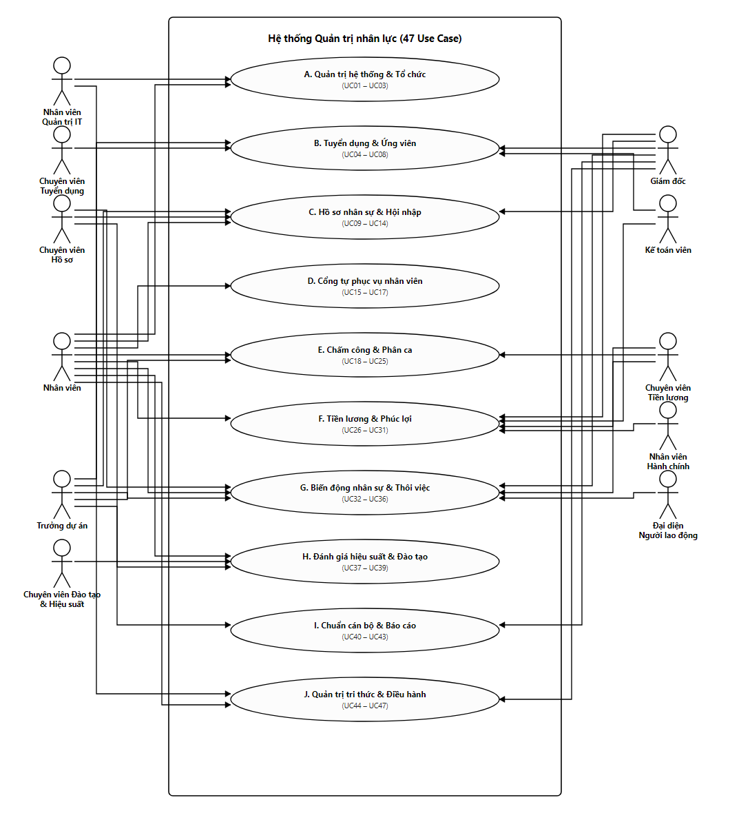

Để làm rõ chi tiết quan hệ giữa các Use Case trong từng phân hệ, hệ thống được phân rã thành 10 biểu đồ Use Case nghiệp vụ chuyên biệt, mô hình hóa đầy đủ 47 Use Case từ UC01 đến UC47:

**A. Nhóm A - Quản trị hệ thống & Tổ chức (UC01 - UC03)**
Biểu đồ mô tả tương tác đăng nhập, phân quyền RBAC và cấu hình cây phòng ban doanh nghiệp.
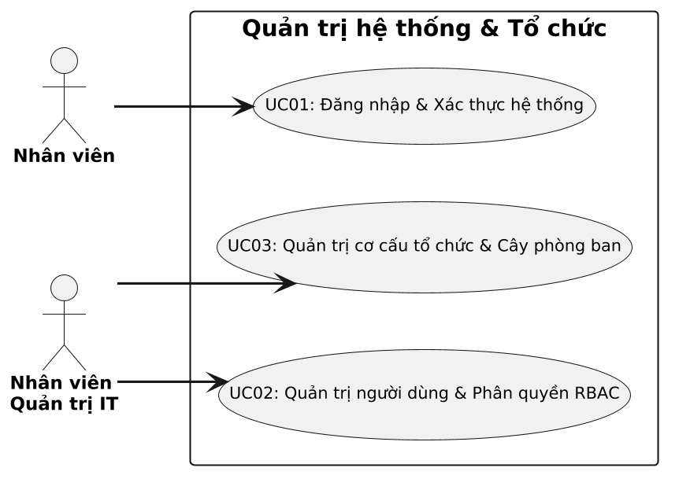

**B. Nhóm B - Tuyển dụng & Ứng viên (UC04 - UC08)**
Biểu đồ mô tả chu trình tuyển dụng từ đề xuất nhu cầu, kiểm soát định biên, duyệt chỉ tiêu, sàng lọc ứng viên Quy trình tuyển dụng đa giai đoạn đến phát hành thư mời làm việc.
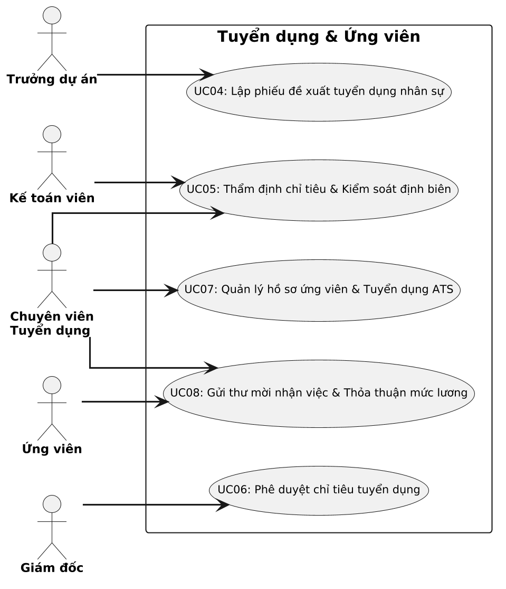

**C. Nhóm C - Hồ sơ nhân sự & Hội nhập (UC09 - UC14)**
Biểu đồ mô tả quản lý hồ sơ nhân viên toàn diện, hợp đồng lao động, bằng cấp chứng chỉ, mượn trả hồ sơ gốc, đánh giá thử việc và lộ trình hội nhập Onboarding.
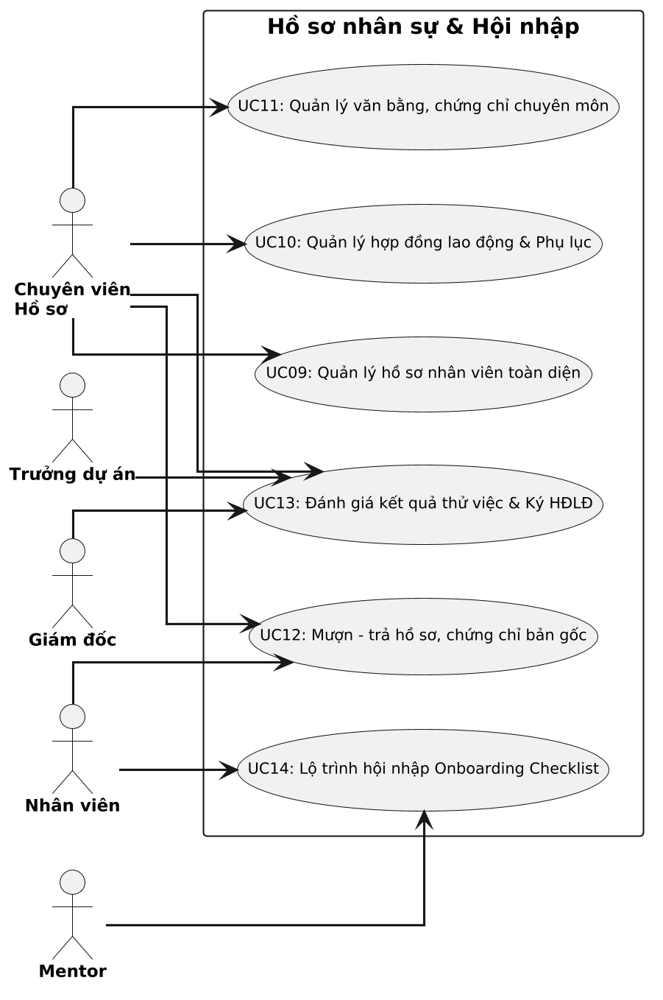

**D. Nhóm D - Cổng tự phục vụ nhân viên (UC15 - UC17)**
Biểu đồ mô tả cổng tự phục vụ tập trung của nhân viên, cơ chế quản lý thông tin phân cấp 3 mức độ và luồng thẩm định điều chỉnh hồ sơ.
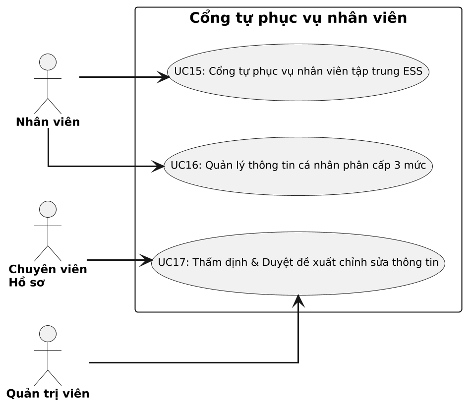

**E. Nhóm E - Chấm công & Phân ca (UC18 - UC25)**
Biểu đồ mô tả các kênh ghi nhận công hiện có và các nghiệp vụ liên quan. Nhân viên có thể điểm danh trên web hoặc dùng mẫu khuôn mặt qua camera trình duyệt; webhook thiết bị chỉ hoạt động khi có thiết bị và cấu hình tương ứng.
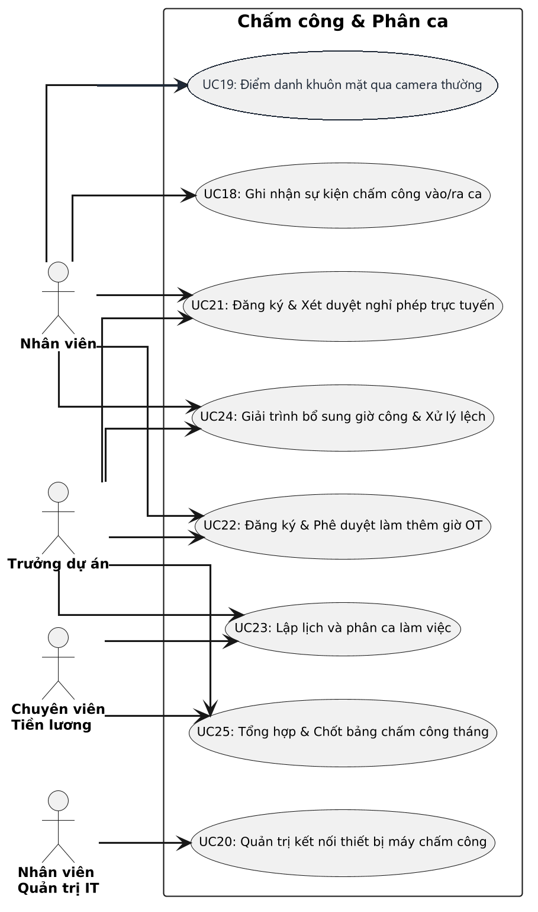

**F. Nhóm F - Tiền lương & Phúc lợi (UC26 - UC31)**
Biểu đồ mô tả cấu hình công thức và tính lương, quy trình đối soát, phê duyệt, khóa và ghi nhận chi trả; đồng thời thể hiện quản lý khoản vay phúc lợi, quyết toán công tác phí T&E và cấp phát tài sản.
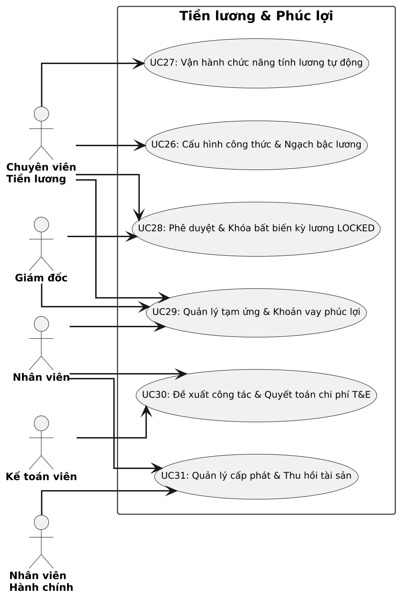

**G. Nhóm G - Biến động nhân sự & Thôi việc (UC32 - UC36)**
Biểu đồ mô tả quy trình điều chuyển nội bộ, điều chỉnh bậc lương, khen thưởng, kỷ luật lao động và tiếp nhận xử lý thôi việc bàn giao 5 bên.
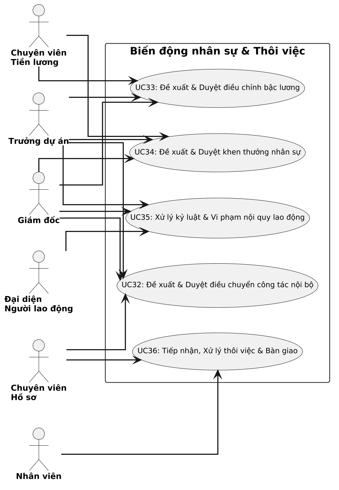

**H. Nhóm H - Đánh giá KPI, Đào tạo và Khiếu nại (UC37 - UC39)**
Biểu đồ mô tả quy trình quản lý mục tiêu KPI, tổ chức đào tạo nội bộ và tiếp nhận giải quyết khiếu nại lao động bảo mật.
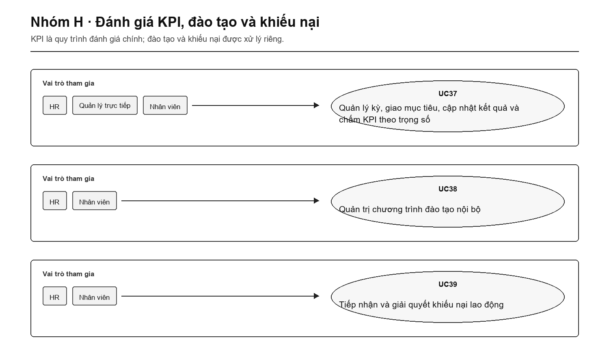

**I. Nhánh hồ sơ công vụ (UC40 - UC43, chỉ chế độ khu vực công)**
Sơ đồ yêu cầu của nhánh riêng cho hồ sơ khu vực công. Mẫu 2C, danh mục ngạch bậc, nâng bậc và báo cáo là nội dung tham chiếu; HRMS chưa xác nhận các biểu mẫu pháp quy và quy trình ký duyệt chính thức.
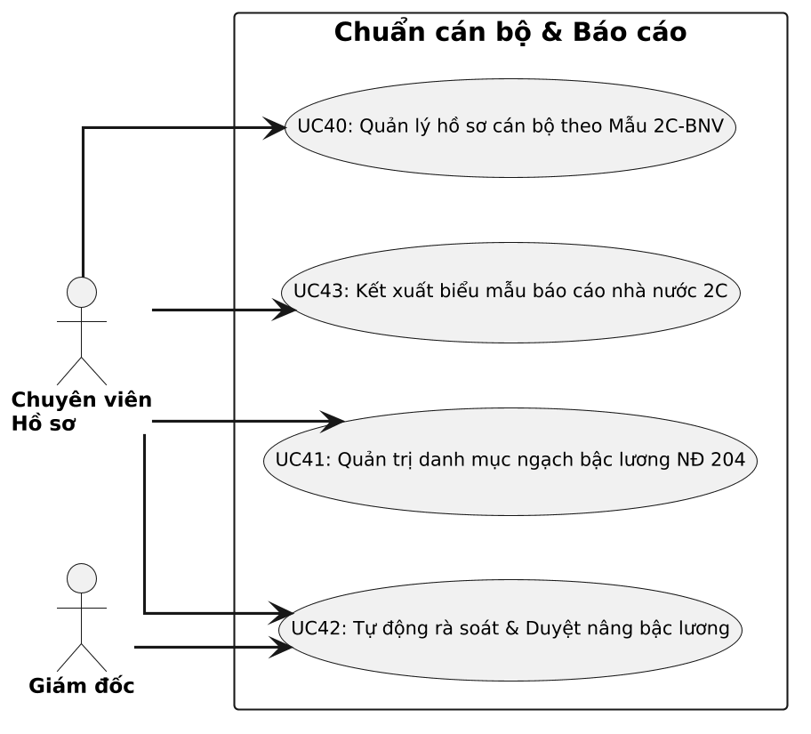

**J. Nhóm J - Quản trị tri thức & Điều hành (UC44 - UC47)**
Biểu đồ mô tả quản trị kho tri thức số và quy trình vận hành chuẩn, tìm kiếm toàn văn FTS & danh bạ chuyên gia, bảng điều khiển phân tích số Dashboard và nhật ký kiểm toán hệ thống.
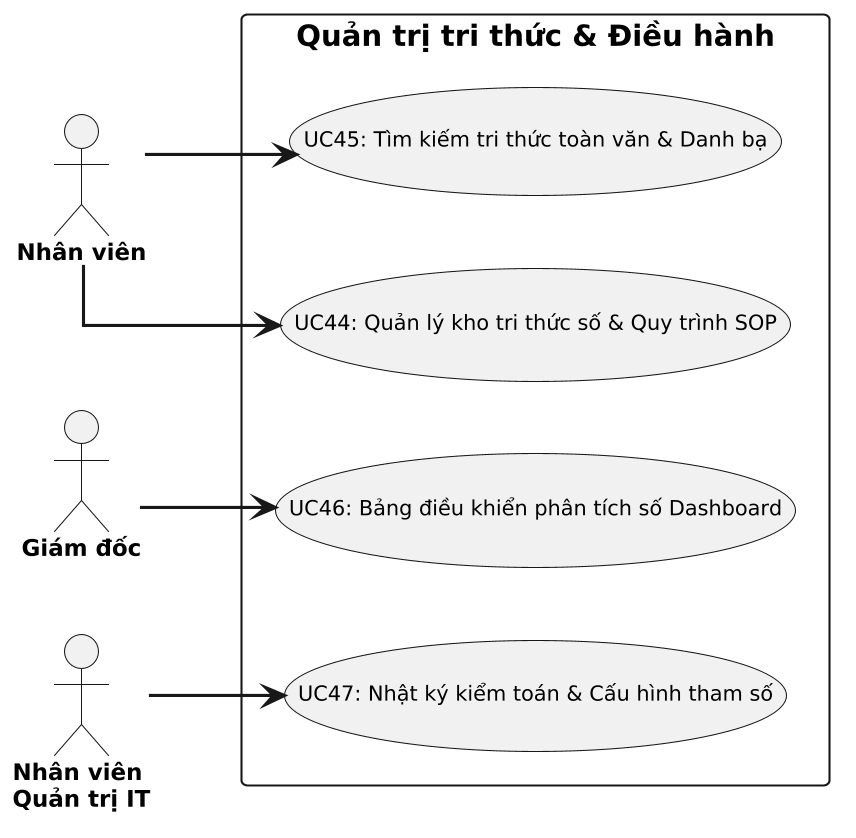

### 2.1.5. Phân tầng yêu cầu: từ quy trình nghiệp vụ đến use case hệ thống

Phân tích chuyển yêu cầu thành ba lớp mô tả: quy trình tham chiếu, use case nghiệp vụ và use case được hỗ trợ trong phần mềm. Cách phân lớp giúp phân biệt mô hình mong muốn với phạm vi đã triển khai.

Đề tài mô tả 18 quy trình tham chiếu, được chia thành 21 nhóm trong Bảng 2.3 để liên kết với use case và màn hình. Đây là quy trình mục tiêu; mức độ hỗ trợ và giới hạn của HRMS được nêu riêng trong từng mục.

**1. Quy trình Tuyển dụng nhân sự & Quản lý ứng viên:**
- Bối cảnh & Căn cứ: Áp dụng khi các dự án phần mềm ký thêm hợp đồng với khách hàng quốc tế hoặc cần bổ sung nhân lực thay thế hao hụt tự nhiên. Căn cứ vào định biên dự án, ngân sách và bản mô tả công việc (JD).
- Trình tự thực hiện: Trưởng dự án lập đề xuất tuyển dụng; các cấp có thẩm quyền thẩm định và phê duyệt chỉ tiêu trước khi mở vị trí. Chuyên viên tuyển dụng tiếp nhận hồ sơ, cập nhật các vòng tuyển chọn và tạo thư mời nhận việc. Khi ứng viên chấp thuận offer và có minh chứng, HR ghi nhận việc tiếp nhận trên hệ thống. HRMS kiểm tra chỉ tiêu còn hiệu lực, tạo hồ sơ nhân viên thử việc, hợp đồng thử việc và các nhiệm vụ hội nhập ban đầu; tài khoản được tạo ở trạng thái chưa kích hoạt. Hệ thống chưa thay thế việc phỏng vấn, ký offer, cấp tài khoản dịch vụ bên ngoài hoặc kích hoạt tài khoản.
- Ánh xạ Use case & Giao diện: UC04, UC05, UC06, UC07, UC08. Giao diện: Tuyển dụng ATS (`/recruitment-ats`), Danh mục vị trí (`/admin/catalogs`).

**2. Quy trình Tiếp nhận hồ sơ & Hội nhập nhân viên mới:**
- Bối cảnh & Căn cứ: Áp dụng trong ngày đầu tiên tiếp nhận nhân sự, bảo đảm tuân thủ quy chuẩn An ninh thông tin ISO/IEC 27001 và Thỏa thuận bảo mật thông tin khách hàng (NDA).
- Trình tự thực hiện: Sau khi ứng viên chấp thuận offer và HR ghi nhận minh chứng, hệ thống tạo mã nhân viên, hồ sơ thử việc, hợp đồng thử việc và một số nhiệm vụ hội nhập ban đầu. Tài khoản mới ở trạng thái chưa kích hoạt; IT kích hoạt tài khoản trong HRMS, còn email, Slack, Jira, VPN, máy tính, thẻ ra vào và việc kiểm tra hồ sơ gốc do bộ phận phụ trách thực hiện. HR có thể giao thêm lộ trình tài liệu; hệ thống chưa tự gán lịch hội nhập cố định 14 ngày.
- Ánh xạ Use case & Giao diện: UC09, UC10, UC11, UC14. Giao diện: Hồ sơ nhân viên (`/employees`, `/employees/[id]`), Tài liệu hội nhập (`/documents`), Quản trị người dùng (`/admin/users`).

**3. Quy trình Đánh giá Thử việc & Ký Hợp đồng chính thức:**
- Bối cảnh & Căn cứ: Căn cứ Điều 24 đến Điều 27 Bộ luật Lao động 2019 về thời hạn thử việc (tối đa 60 ngày đối với công việc kỹ thuật chuyên môn).
- Trình tự thực hiện: Khi đến kỳ đánh giá, Trưởng dự án lập phiếu thử việc, ghi kết luận và minh chứng. HR thẩm định, cấp có thẩm quyền phê duyệt và xác định ngày hiệu lực. Đến ngày đó, hệ thống kết thúc hợp đồng thử việc, tạo hợp đồng mới theo loại đã duyệt và cập nhật trạng thái nhân sự. HRMS chưa tự gửi nhắc việc trước hạn hoặc đăng ký bảo hiểm xã hội; các bước này do bộ phận phụ trách thực hiện.
- Ánh xạ Use case & Giao diện: UC10, UC13. Giao diện: Hồ sơ nhân viên - Tab Hợp đồng (`/employees/[id]`), Biến động nhân sự (`/personnel`), Khung lương doanh nghiệp (`/salary-bands`).

**4. Quy trình Phân ca, Chấm công & Điểm danh đa nguồn:**
- Bối cảnh & Căn cứ: Hệ thống hỗ trợ cấu hình nhân sự tại nhiều địa điểm, làm theo ca hoặc phối hợp với khách hàng ở múi giờ khác. Ca làm áp dụng cần căn cứ vào thỏa thuận và lịch làm đã được phê duyệt.
- Trình tự thực hiện: HR lập lịch ca; nhân viên ghi nhận công trên web hoặc điểm danh bằng khuôn mặt qua camera thường sau khi đăng ký mẫu và đồng ý xử lý dữ liệu. Hệ thống so khớp vector khuôn mặt đã mã hóa; nếu đạt ngưỡng, hệ thống tạo sự kiện vào/ra và tính lại công ngày. Luồng này chưa kiểm tra người thật nên có thể bị giả mạo bằng ảnh hoặc video. Kênh nhập máy chấm công phụ thuộc thiết bị và cấu hình thực tế. Khi thiếu sự kiện, nhân viên gửi giải trình kèm minh chứng để quản lý duyệt; HR kiểm tra ngoại lệ rồi chốt kỳ công cho kỳ lương.
- Ánh xạ Use case & Giao diện: UC18, UC19, UC20, UC23, UC24, UC25. Giao diện: Bảng chấm công (`/attendance`), Phân ca (`/shifts`), Điểm danh bằng camera thường (`/check-in`), Quản trị nguồn chấm công (`/admin/attendance`).

**5. Quy trình Quản lý Nghỉ phép:**
- Bối cảnh & Căn cứ: Căn cứ Điều 113 đến Điều 115 Bộ luật Lao động 2019 về chế độ nghỉ phép năm (12 ngày phép cơ bản, cộng thêm 1 ngày sau mỗi 5 năm thâm niên) và các chế độ nghỉ việc riêng, nghỉ bảo hiểm (ốm đau, thai sản).
- Trình tự thực hiện: Nhân viên tra cứu số dư phép khả dụng trên cổng tự phục vụ nhân viên (`/leave`) và tạo đơn xin nghỉ phép; Hệ thống tự động kiểm tra số dư: nếu quỹ phép còn đủ, chuyển đơn tới Trưởng dự án phê duyệt; Trưởng dự án cân đối tiến độ chạy nước rút (Sprint) để phê duyệt hoặc từ chối; Khi đơn được duyệt, hệ thống tự động trừ quỹ phép ngay lập tức và nạp ngày nghỉ vào bảng chấm công tháng; Bộ phận C&B theo dõi các chứng từ nghỉ ốm đau, thai sản để làm thủ tục trợ cấp BHXH.
- Ánh xạ Use case & Giao diện: UC15, UC21. Giao diện: Quản lý nghỉ phép (`/leave`), Cổng thông tin nhân viên (`/ess`).

**6. Quy trình Quản lý Làm thêm giờ:**
- Bối cảnh & Căn cứ: Căn cứ Điều 107 Bộ luật Lao động 2019 và Nghị định 145/2020/NĐ-CP về giới hạn làm thêm giờ (tối đa không quá 40 giờ/tháng và 200 giờ/năm).
- Trình tự thực hiện: Khi dự án cần huy động làm thêm giờ để kịp tiến độ bàn giao sản phẩm, Trưởng dự án lập kế hoạch OT hoặc nhân viên nộp đơn đăng ký trước; Hệ thống tự động kiểm tra số giờ lũy kế trong tháng và trong năm: nếu vượt trần quy định, tự động chặn đăng ký; Sau khi hoàn thành ca làm thêm, nhân viên điểm danh xác nhận và nộp bảng kê khối lượng công việc; Quản lý dự án phê duyệt nghiệm thu giờ công; Hệ thống tự động tính hệ số lương làm thêm (150% ngày thường, 200% ngày nghỉ cuối tuần, 300% ngày lễ) nạp vào bảng lương tháng.
- Ánh xạ Use case & Giao diện: UC15, UC22. Giao diện: Quản lý làm thêm giờ (`/overtime`), Bảng chấm công (`/attendance`).

**7. Quy trình Chu kỳ Tính & Khóa Bảng lương hàng tháng:**
- Bối cảnh & Căn cứ: Căn cứ Điều 90 đến Điều 104 Bộ luật Lao động 2019, Luật Thuế TNCN và Luật Bảo hiểm xã hội hiện hành.
- Trình tự thực hiện: HR chốt kỳ công; chuyên viên tiền lương tạo bảng lương từ dữ liệu hợp đồng, cấu trúc lương được gán và chính sách có hiệu lực trong kỳ. Mức cơ bản lấy từ cấu trúc gán riêng còn hiệu lực nếu đáp ứng ngày hiệu lực; tiếp đến là hợp đồng/phụ lục, rồi mới dùng mức trên hồ sơ khi chưa có hợp đồng. Khung lương vị trí là căn cứ tham chiếu, không tự thay đổi mức lương trong hợp đồng. Hệ thống kết hợp công đã khóa, OT được duyệt, các khoản thu nhập/khấu trừ và chính sách của kỳ; người khác đối soát trước khi cấp có thẩm quyền duyệt, khóa và ghi nhận chi trả. Kỳ lương đi qua `PROCESSED` → `REVIEWED` → `APPROVED` → `LOCKED` → `PAID`. Khi ghi nhận `PAID`, Kế toán nhập phương thức và mã giao dịch/chứng từ; hệ thống chưa xác minh giao dịch với ngân hàng và không tự gửi lệnh chuyển tiền. Quy trình tham chiếu, tham số theo hiệu lực và giới hạn triển khai được nêu trong [`QUY_TRINH_TINH_LUONG_VN_THAM_CHIEU_2026.md`](QUY_TRINH_TINH_LUONG_VN_THAM_CHIEU_2026.md).
- Ánh xạ Use case & Giao diện: UC25, UC26, UC27, UC28. Giao diện: Chức năng tính lương tự động (`/payroll-engine`), Phiếu lương cá nhân (`/ess`), Báo cáo nhân sự (`/personnel-reports`).

**8. Quy trình Tạm ứng Lương & Khoản vay phúc lợi:**
- Bối cảnh & Căn cứ: Tạm ứng tiền lương và khoản vay phúc lợi là hai nghiệp vụ khác nhau. Khoản vay phải có hợp đồng, lịch trả và căn cứ/ủy quyền khấu trừ; giới hạn tại Điều 102 Bộ luật Lao động áp dụng cho khấu trừ để bồi thường thiệt hại tài sản trong điều kiện luật định, không phải trần chung cho khoản vay.
- Trình tự đề xuất: Nhân viên nộp hồ sơ; quản lý/C&B kiểm tra điều kiện; người có thẩm quyền duyệt hợp đồng và lịch trả; kế toán ghi nhận giải ngân. Chỉ kỳ trả đã duyệt mới được đưa vào bảng lương, giới hạn bởi số kỳ đến hạn, dư nợ và số thực nhận còn khả dụng; thiếu hụt được xử lý theo hợp đồng. Giao diện hiện hỗ trợ theo dõi khoản vay/lịch trả; các điều kiện hợp đồng, bằng chứng giải ngân và tất toán phải được xác minh theo chính sách doanh nghiệp trước khi vận hành.
- Ánh xạ Use case & Giao diện: UC15, UC29. Giao diện: Quản trị Phúc lợi & Khoản vay (`/loans`), Cổng ESS (`/ess`), Chức năng tính lương tự động (`/payroll-engine`).

**9. Quy trình Đề xuất công tác & Quyết toán chi phí:**
- Bối cảnh & Căn cứ: Phục vụ các đợt cử chuyên gia, kỹ sư đi công tác tại các chi nhánh (Hà Nội, Đà Nẵng, TP.HCM) hoặc làm việc trực tiếp tại văn phòng khách hàng quốc tế (Onsite). Căn cứ Quy chế tài chính nội bộ và quy định về chứng từ thuế hợp lệ.
- Trình tự thực hiện: Kỹ sư lập đề xuất công tác trên hệ thống, nêu rõ địa điểm, thời gian và dự toán kinh phí; Quản lý dự án và Giám đốc phê duyệt; Kế toán giải ngân tạm ứng; Sau chuyến công tác, nhân viên đính kèm các hóa đơn điện tử hợp lệ (vé máy bay, khách sạn, công tác phí theo ngày) lập bảng thanh quyết toán chi phí; Kế toán thẩm tra hóa đơn và chi trả phần chênh lệch hoặc thu hồi tạm ứng thừa.
- Ánh xạ Use case & Giao diện: UC15, UC30. Giao diện: Quản lý công tác phí (`/expense-claims`), Cổng ESS (`/ess`).

**10. Quy trình Quản lý Cấp phát & Thu hồi Tài sản, Thiết bị:**
- Bối cảnh & Căn cứ: Quản lý vòng đời tài sản kỹ thuật cao (laptop, màn hình phụ, thiết bị kiểm thử) theo tiêu chuẩn bảo mật ISO 27001.
- Trình tự thực hiện: Căn cứ đề xuất của dự án hoặc tiếp nhận nhân sự mới, bộ phận Hành chính lập phiếu bàn giao tài sản, ghi nhận số seri, cấu hình và trạng thái thiết bị; Nhân viên ký nhận bàn giao điện tử trên cổng tự phục vụ nhân viên; Hệ thống theo dõi lịch sử luân chuyển, bảo dưỡng định kỳ và cảnh báo thiết bị đến hạn khấu hao; Khi nhân viên chuyển dự án hoặc thôi việc, bộ phận Hành chính thực hiện kiểm kê, thu hồi tài sản và xác nhận hoàn tất nghĩa vụ trên hệ thống.
- Ánh xạ Use case & Giao diện: UC15, UC31. Giao diện: Quản lý tài sản (`/assets`), Cổng thông tin cá nhân (`/ess`).

**11. Quy trình Quản lý mục tiêu và Đánh giá KPI:**
- Bối cảnh & Căn cứ: Doanh nghiệp giao mục tiêu có chỉ số đo, mức cần đạt, thời hạn và trọng số để theo dõi kết quả công việc. Tổng trọng số mục tiêu của mỗi người trong kỳ là 100%; điểm KPI không tự quyết định thưởng, tăng lương hoặc bổ nhiệm.
- Trình tự thực hiện: Đầu kỳ, HR tạo chu kỳ và quản lý giao KPI; trong kỳ nhân viên cập nhật kết quả, minh chứng; khi đánh giá, quản lý đối chiếu kết quả với mục tiêu và chấm từng KPI từ 0 đến 100. Hệ thống tổng hợp điểm chu kỳ theo trọng số KPI, lưu kết quả và lịch sử thao tác; HR hoặc quản lý rà soát dữ liệu thiếu trước khi đóng kỳ.
- Ánh xạ Use case & Giao diện: UC15, UC37. Giao diện: Đánh giá KPI (`/performance`), Hướng dẫn KPI (`/performance-guide`), Hồ sơ nhân viên (`/employees/[id]`). Việc đánh giá công chức, viên chức được xử lý theo nhánh công vụ và căn cứ riêng.

**12. Quy trình rà soát điều chỉnh lương trong doanh nghiệp:**
- Bối cảnh & Căn cứ: Theo khung lương, hợp đồng, ngân sách và quy chế đãi ngộ của doanh nghiệp; không dùng ngạch bậc hoặc hạn mức tăng lương công vụ.
- Trình tự thực hiện: Quản lý và HR rà soát kết quả công việc, năng lực, phạm vi trách nhiệm và vị trí lương trong khung; lập đề xuất điều chỉnh kèm căn cứ; cấp có thẩm quyền phê duyệt; quyết định được lưu với ngày hiệu lực và cập nhật vào kỳ lương sau ngày hiệu lực. Điểm KPI là một thông tin tham khảo, không tự tạo thưởng hoặc tăng lương.
- Ánh xạ Use case & Giao diện: UC33. Giao diện: Khung lương doanh nghiệp (`/salary-bands`), Biến động nhân sự (`/personnel`), Bảng tính lương (`/payroll-engine`).

**13. Quy trình Điều chuyển, Luân chuyển & Bổ nhiệm vị trí công tác:**
- Bối cảnh & Căn cứ: Thực hiện khi điều động nhân sự giữa các dự án phần mềm, bổ nhiệm cán bộ quản lý hoặc luân chuyển giữa các chi nhánh TP.HCM - Đà Nẵng.
- Trình tự thực hiện: Trưởng dự án lập đề xuất điều chuyển nhân viên; Quản lý đơn vị tiếp nhận và chuyên viên nhân sự kiểm tra năng lực và sự phù hợp; Giám đốc phê duyệt lệnh điều chuyển; Hệ thống tự động cập nhật lại cơ cấu tổ chức phòng ban, chức danh công tác và quyền hạn dự án của nhân viên trên hệ thống phần mềm.
- Ánh xạ Use case & Giao diện: UC09, UC32. Giao diện: Biến động nhân sự (`/personnel`), Sơ đồ tổ chức (`/org-chart`), Hồ sơ nhân sự (`/employees/[id]`).

**14. Quy trình Quản lý Đào tạo nội bộ & Giải quyết Khiếu nại:**
- Bối cảnh & Căn cứ: Nâng cao năng lực kỹ thuật công nghệ mới cho kỹ sư và duy trì môi trường làm việc minh bạch, tuân thủ pháp luật lao động.
- Trình tự thực hiện: Bộ phận Đào tạo xây dựng chương trình đào tạo kỹ thuật, công bố lịch học và giới hạn sĩ số trên hệ thống; Nhân viên chủ động đăng ký tham gia; Sau khóa đào tạo, hệ thống ghi nhận kết quả hoàn thành vào hồ sơ cán bộ và thực hiện khảo sát chất lượng; Đối với khiếu nại lao động, nhân viên gửi ý kiến bảo mật qua kênh chuyên biệt; Chuyên viên nhân sự tiếp nhận, tổ chức xác minh và theo dõi xử lý từ trạng thái OPEN đến RESOLVED.
- Ánh xạ Use case & Giao diện: UC15, UC38, UC39. Giao diện: Đào tạo & Khiếu nại (`/training-grievance`), Hồ sơ nhân viên (`/employees/[id]`).

**15. Quy trình Khen thưởng, Kỷ luật & Xử lý vi phạm lao động:**
- Bối cảnh & Căn cứ: Căn cứ Điều 117 đến Điều 132 Bộ luật Lao động 2019 về kỷ luật lao động, trách nhiệm vật chất và Quy chế thi đua khen thưởng của công ty.
- Trình tự thực hiện: Khi có thành tích xuất sắc, quản lý dự án lập đề xuất khen thưởng; Giám đốc duyệt và hệ thống tự động nạp tiền thưởng vào kỳ tính lương tiếp theo; Khi phát sinh hành vi vi phạm kỷ luật (vi phạm bảo mật thông tin, nghỉ làm không phép kéo dài), bộ phận nhân sự lập biên bản vi phạm; Tổ chức phiên họp xử lý kỷ luật có sự tham gia bắt buộc của Đại diện người lao động (Công đoàn); Giám đốc ký Quyết định kỷ luật; Hệ thống ghi nhận tiền án kỷ luật vào hồ sơ nhân sự và thực hiện tạm dừng nâng lương hoặc chấm dứt hợp đồng theo đúng quy định.
- Ánh xạ Use case & Giao diện: UC34, UC35. Giao diện: Biến động nhân sự (`/personnel`), Hồ sơ cán bộ (`/personnel-reports`).

**16. Quy trình Hồ sơ công vụ theo Mẫu 2C-BNV (nhánh khu vực công):**
- Bối cảnh & Căn cứ: Use case công vụ tách khỏi case Saigon Technology. Cần rà soát văn bản, phạm vi đối tượng và biểu mẫu còn hiệu lực trước khi dùng dữ liệu hoặc xuất hồ sơ chính thức.
- Trình tự thiết kế: Hồ sơ công vụ được quản lý trong chế độ tổ chức nhà nước và tách khỏi dữ liệu nhân viên doanh nghiệp. Các mẫu PDF/Excel chỉ là mục tiêu thiết kế; báo cáo này không xác nhận đã có biểu mẫu pháp quy hoàn chỉnh hoặc được cơ quan có thẩm quyền chấp thuận.
- Ánh xạ Use case & Giao diện: UC40, UC43. Giao diện: Báo cáo nhân sự & Cán bộ (`/personnel-reports`), Danh mục dùng chung (`/admin/catalogs`).

**17. Quy trình Thôi việc, Nghỉ việc & Bàn giao Đa bộ phận (Offboarding & Handover Checklist):**
- Bối cảnh & Căn cứ: Căn cứ Điều 34 đến Điều 48 Bộ luật Lao động 2019 về chấm dứt hợp đồng lao động và nghĩa vụ của các bên khi chấm dứt HĐLĐ.
- Trình tự thực hiện: Nhân viên gửi yêu cầu thôi việc; các cấp có thẩm quyền xem xét và ghi nhận quyết định. Danh mục bàn giao giúp theo dõi xác nhận của quản lý dự án, Hành chính, IT và C&B. Bộ phận phụ trách vẫn phải thu hồi tài sản, quyền truy cập và xử lý công nợ theo quy trình của doanh nghiệp. Mẫu khuôn mặt có thể được xóa trong phần quản lý dữ liệu khuôn mặt; tài liệu này không khẳng định hệ thống tự xóa mẫu hoặc tự khóa mọi tài khoản khi đến ngày nghỉ.
- Ánh xạ Use case & Giao diện: UC36. Giao diện: Biến động nhân sự (`/personnel`), Danh mục bàn giao (`/documents`), Quản trị người dùng (`/admin/users`).

**18. Quy trình Phân cấp Quản trị Dữ liệu Cá nhân & Thẩm định Điều chỉnh Hồ sơ Nhân sự:**
- Bối cảnh & Căn cứ: Căn cứ Nghị định 13/2023/NĐ-CP về bảo vệ dữ liệu cá nhân, nhằm ngăn ngừa việc tự ý chỉnh sửa các thông tin định danh pháp lý và tài chính.
- Trình tự thực hiện: Dữ liệu hồ sơ nhân sự được phân định thành 3 phân cấp: Mức 1 (Thông tin liên lạc như SĐT, địa chỉ - nhân viên tự sửa trên cổng tự phục vụ nhân viên); Mức 2 (Thông tin định danh pháp lý và tài chính như CCCD, số tài khoản ngân hàng, bằng cấp - nhân viên lập đề xuất thay đổi kèm hình ảnh chứng từ minh chứng hợp lệ); Mức 3 (Vị trí, ngạch bậc, mức lương - khóa cố định chỉ xem, chỉ thay đổi qua quyết định hành chính); Chuyên viên hồ sơ tiếp nhận yêu cầu Mức 2 tại Hàng đợi thẩm định (`ProfileChangeReviewQueue`), đối soát ảnh chụp minh chứng với dữ liệu đề xuất; Bấm phê duyệt để hệ thống cập nhật nguyên tử vào CSDL và lưu vết kiểm toán, hoặc từ chối kèm lý do phản hồi cho nhân viên.
- Ánh xạ Use case & Giao diện: UC16, UC17. Giao diện: Cổng ESS (`/ess`), Hồ sơ cá nhân (`/profile`), Quản lý nhân viên (`/employees`).

**Bảng 2.3. Bảng ánh xạ ba tầng: từ Quy trình nghiệp vụ đến Use Case và Màn hình thực tế**

| STT | Tên Quy trình nghiệp vụ thực tế | Tác nhân chính | Mã Use Case hệ thống tương ứng | Giao diện màn hình thực tế trong ứng dụng |
| :---: | :--- | :--- | :--- | :--- |
| 1 | Quản trị hệ thống, Định danh & Phân quyền RBAC | Quản trị viên IT, Toàn thể nhân viên | UC01, UC02, UC03 | `/login`, `/admin/roles`, `/admin/users`, `/admin/org-units`, `/org-chart` |
| 2 | Tuyển dụng & Quản trị ứng viên | Trưởng dự án, CV Tuyển dụng, Giám đốc | UC04, UC05, UC06, UC07, UC08 | `/recruitment-ats`, `/admin/catalogs` |
| 3 | Tiếp nhận hồ sơ, Văn bằng & Hội nhập | Nhân viên mới, CV Hồ sơ, IT | UC09, UC10, UC11, UC12, UC14 | `/employees`, `/documents`, `/admin/users`, `/employees/[id]` |
| 4 | Đánh giá thử việc & Ký hợp đồng | Trưởng dự án, CV Hồ sơ, Giám đốc | UC10, UC13 | `/employees/[id]`, `/personnel`, `/salary-bands` |
| 5 | Cổng tự phục vụ & Dữ liệu cá nhân 3 mức độ | Toàn thể nhân viên, CV Hồ sơ | UC15, UC16, UC17 | `/ess`, `/profile`, `/notifications`, `/employees` |
| 6 | Phân ca & Điểm danh đa nguồn | Toàn thể nhân viên, Kiosk, CV Hồ sơ | UC18, UC19, UC20, UC23, UC24, UC25 | `/shifts`, `/check-in`, `/attendance`, `/admin/attendance` |
| 7 | Quản lý Nghỉ phép | Nhân viên, Trưởng dự án, CV Hồ sơ | UC15, UC21 | `/leave`, `/ess` |
| 8 | Quản lý Làm thêm giờ (OT) | Nhân viên, Trưởng dự án, CV Tiền lương | UC15, UC22 | `/overtime`, `/attendance` |
| 9 | Chu kỳ Tính & Khóa Bảng lương | CV Tiền lương, Kế toán, Giám đốc | UC25, UC26, UC27, UC28 | `/payroll-engine`, `/ess`, `/personnel-reports` |
| 10 | Tạm ứng & Khoản vay phúc lợi | Nhân viên, CV Tiền lương, Giám đốc | UC15, UC29 | `/loans`, `/ess`, `/payroll-engine` |
| 11 | Đề xuất & Quyết toán công tác | Nhân viên, Trưởng dự án, Kế toán | UC15, UC30 | `/expense-claims`, `/ess` |
| 12 | Quản lý Cấp phát & Thu hồi tài sản | Nhân viên Hành chính, Nhân viên | UC15, UC31 | `/assets`, `/ess` |
| 13 | Điều chuyển & Bổ nhiệm vị trí | Trưởng dự án, Giám đốc, CV Hồ sơ | UC09, UC32 | `/personnel`, `/org-chart`, `/employees/[id]` |
| 14 | Rà soát điều chỉnh lương doanh nghiệp | Quản lý, HR, cấp phê duyệt | UC33 | `/salary-bands`, `/personnel`, `/payroll-engine` |
| 15 | Khen thưởng & Kỷ luật lao động | Trưởng dự án, Đại diện NLĐ, Giám đốc | UC34, UC35 | `/personnel`, `/personnel-reports` |
| 16 | Thôi việc & Bàn giao đa bộ phận | Nhân viên, CV Hồ sơ, Các bộ phận | UC36 | `/personnel`, `/documents`, `/admin/users` |
| 17 | Đánh giá KPI | Nhân viên, Quản lý trực tiếp, CV Nhân sự | UC15, UC37 | `/performance`, `/employees/[id]` |
| 18 | Đào tạo nội bộ & Khiếu nại lao động | CV Nhân sự, Nhân viên | UC15, UC38, UC39 | `/training-grievance`, `/employees/[id]` |
| 19 | Hồ sơ cán bộ & Báo cáo Mẫu 2C-BNV | CV Hồ sơ | UC40, UC43 | `/personnel-reports`, `/admin/catalogs` |
| 20 | Quản lý kho tài liệu quy chế & Tìm kiếm | Toàn thể nhân viên, Cán bộ Nhân sự | UC44, UC45 | `/documents`, `/employees` |
| 21 | Bảng điều khiển phân tích & Kiểm toán hệ thống | Ban Giám đốc, Quản lý, Quản trị CNTT | UC46, UC47 | `/dashboard`, `/admin/audit`, `/admin/settings` |

---

## 2.2. Phân tích cấu trúc hệ thống

### 2.2.1. Định nghĩa và biểu diễn đối tượng, lớp

Trong phương pháp phân tích thiết kế hướng đối tượng (OOAD), đối tượng đại diện cho một thực thể cụ thể trong bài toán, bao gồm dữ liệu (thuộc tính) và các hành vi xử lý (phương thức). Lớp là bản thiết kế trừu tượng định nghĩa tập hợp các thuộc tính và hành vi chung cho một nhóm đối tượng.

Để phân tách trách nhiệm rõ ràng theo mẫu kiến trúc BCE, các lớp trong hệ thống được phân thành ba nhóm chính:

Lớp Thực thể: Đại diện cho các đối tượng lưu trữ dữ liệu bền vững của doanh nghiệp, ánh xạ trực tiếp thành các model trong ORM Prisma và các bảng dữ liệu quan hệ trong PostgreSQL 16. Các lớp này chịu trách nhiệm duy trì tính toàn vẹn của dữ liệu nghiệp vụ (ví dụ: NhanVien, HopDong, PhieuLuong, DonNghiPhep).

Lớp Biên / Giao diện: Đóng vai trò là cổng giao tiếp tương tác giữa tác nhân bên ngoài với hệ thống bên trong, bao gồm các trang màn hình tác nghiệp Next.js, biểu mẫu nhập liệu, bảng hiển thị dữ liệu và các hộp thoại tương tác.

Lớp Điều khiển: Đảm nhiệm xử lý các logic nghiệp vụ và điều phối dữ liệu giữa tầng giao diện và cơ sở dữ liệu, được hiện thực hóa bằng các dịch vụ NestJS Service (như AuthService, RecruitmentService, AttendanceService, PayrollService).

### 2.2.2. Xác định các đối tượng, lớp từ đặc tả yêu cầu

Từ yêu cầu nghiệp vụ mô hình hóa, đặc tả use case và schema Prisma hiện có, đề tài xác định các lớp thực thể chính tương ứng với các phân hệ chức năng:

Nhóm Đối tượng Con người & Tổ chức:
- NguoiDung (User): Lưu trữ thông tin định danh cơ bản (Mã, Họ tên, Ngày sinh, CCCD, Email, SĐT, Địa chỉ);
- NhanVien: Kế thừa từ NguoiDung, bổ sung thông tin nhân sự (Mã NV, Ngày vào công ty, Vị trí, Đơn vị trực thuộc, Trạng thái PROBATION/ACTIVE/RESIGNED);
- DonVi (OrgUnit): Cấu trúc phòng ban và chi nhánh theo mô hình cây tự tham chiếu, quản lý định biên nhân sự;
- VaiTro (Role): Vai trò phân quyền (USER, KM_MANAGER, ADMIN);
- TaiKhoan (Account): Định danh xác thực, mật khẩu băm bcrypt, mã token JWT và trạng thái khóa tài khoản.

Nhóm Đối tượng Tuyển dụng & Đào tạo:
- PhieuTuyenDung (JobRequisition): Đề xuất tuyển dụng, vị trí, số lượng cần tuyển, trạng thái phê duyệt;
- UngVien (Candidate): Hồ sơ ứng viên, CV đính kèm, trạng thái trên pipeline ATS;
- VongPhongVan (InterviewStage): Thông tin vòng phỏng vấn, người phỏng vấn, nhận xét và điểm số Scorecard;
- ThuMoi (JobOffer): Thư mời nhận việc, mức lương thỏa thuận, ngày nhận việc;
- KhoaDaoTao (TrainingCourse): Chương trình đào tạo kỹ thuật, số lượng chỗ, giảng viên và kết quả đánh giá;
- KhieuNai (Grievance): Đơn phản ánh, khiếu nại bảo mật và tiến độ giải quyết.

Nhóm Đối tượng Hồ sơ, Hợp đồng & Biến động:
- HopDong (Contract): Hợp đồng thử việc, hợp đồng xác định thời hạn (12-36 tháng), lương cơ bản, lương đóng BHXH;
- VanBang (Certificate): Bằng tốt nghiệp đại học, chứng chỉ công nghệ, số hiệu, nơi cấp, bản quét lưu trữ;
- PhieuMuonTra (DocumentLending): Phiếu mượn - trả bằng cấp bản gốc, ngày mượn, hạn trả, ngày thu hồi;
- DeXuatBienDong (PersonnelAction): Đề xuất dùng chung cho các luồng thuyên chuyển, tăng lương, khen thưởng, kỷ luật, thôi việc;
- NhiemVuBanGiao: Danh mục kiểm tra trách nhiệm bàn giao 5 bước độc lập khi thôi việc.

Nhóm Đối tượng Chấm công, Nghỉ phép & Điểm danh:
- SuKienDiemDanh: Sự kiện điểm danh bất biến (Thời điểm, Nguồn: MACHINE/WEB/FACE/SIMULATOR, Cờ lệch);
- ThietBiChamCong: Cấu hình máy chấm công phần cứng, vị trí lắp đặt, khóa xác thực HMAC;
- MauKhuonMat: Vector mô tả ảnh khuôn mặt 256 chiều, tạo từ khung hình camera thường và mã hóa AES-256-GCM; không lưu ảnh gốc ở bước đăng ký. Luồng hiện chưa phát hiện khuôn mặt chuyên dụng hoặc xác minh người thật;
- CaLamViec: Khung giờ làm việc chuẩn, thời gian nghỉ giữa ca, dung sai ân hạn đi muộn;
- BangCongNgay: Tổng hợp ngày công, giờ vào/ra thực tế, phút đi muộn, về sớm, giờ làm thêm;
- DonNghiPhep: Đơn xin nghỉ phép, loại phép, khoảng thời gian, trạng thái phê duyệt;
- SoDuPhep: Quỹ phép năm của nhân viên (12 ngày chuẩn + thâm niên 1 ngày/5 năm).

Nhóm Đối tượng Tiền lương, Phúc lợi & Tài sản:
- ThanhPhanLuong: Thành phần lương Gross, phụ cấp, thưởng, các khoản khấu trừ;
- KyLuong: Kỳ lương tháng, trạng thái chu kỳ (OPEN -> REVIEWED -> LOCKED);
- PhieuLuong: Phiếu lương điện tử chi tiết từng cá nhân;
- KhoanVay: Khoản vay phúc lợi, lãi suất, dư nợ và lịch trả có hiệu lực; khấu trừ mỗi kỳ tối đa bằng khoản đến hạn đã thỏa thuận, dư nợ còn lại và số thực nhận khả dụng;
- CongTacPhi: Đề xuất công tác, tạm ứng và bảng thanh quyết toán chi phí kèm hóa đơn điện tử;
- TaiSan: Quản lý vòng đời tài sản thiết bị kỹ thuật (laptop, màn hình), trạng thái bàn giao và thu hồi.

Nhóm Đối tượng Quản trị & Tri thức:
- HoSoCanBo: Hồ sơ hành chính công theo cấu trúc tham chiếu Mẫu 2C-BNV/2008; chỉ dùng ở chế độ khu vực công, không phải hồ sơ chuẩn của case doanh nghiệp;
- NgachLuong: Danh mục seed có 20 mục minh họa; chưa xác minh đầy đủ danh mục, hệ số và căn cứ lương đang áp dụng; không khẳng định đây là bộ chuẩn hiện hành;
- BaiViet: Bài viết quy trình vận hành chuẩn, phiên bản nội dung bất biến (ArticleVersion);
- NhatKyKiemToan: Nhật ký kiểm toán hệ thống ghi vết chỉ thêm (Append-Only) cho mọi giao dịch dữ liệu.

## 2.3. Phân tích hành vi của hệ thống

### 2.3.1. Xây dựng biểu đồ trình tự

Biểu đồ trình tự mô tả chi tiết chuỗi tương tác theo thứ tự thời gian giữa các tác nhân người dùng, lớp biên giao diện, lớp điều khiển nghiệp vụ và các thực thể dữ liệu trong hệ thống. Dưới đây là đầy đủ 47 biểu đồ trình tự tương ứng với 47 Use Case nghiệp vụ của toàn bộ hệ thống quản trị nhân lực:

**UC01 - Đăng nhập & Xác thực hệ thống**

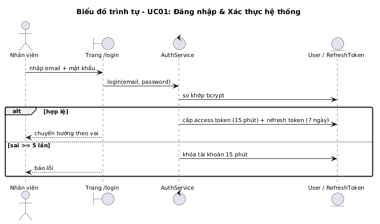

**UC02 - Quản trị người dùng & Phân quyền RBAC**

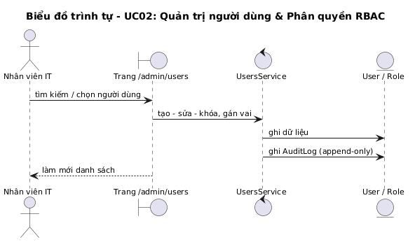

**UC03 - Quản trị cơ cấu tổ chức & Cây phòng ban**

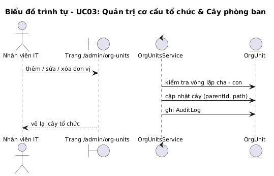

Ở ba luồng đầu, nhân viên gửi thông tin đăng nhập qua giao diện; hệ thống xác thực rồi mới cấp quyền và dựng các chức năng phù hợp với vai trò. Khi quản trị viên thay đổi tài khoản hoặc cây đơn vị, API kiểm tra quyền và dữ liệu trước khi lưu, sau đó ghi nhật ký. Nếu đăng nhập sai hoặc thiếu quyền, yêu cầu dừng ngay ở bước kiểm tra.

**UC04 - Lập phiếu đề xuất tuyển dụng nhân sự**

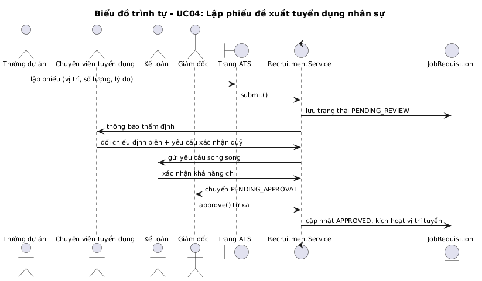

**UC05 - Thẩm định chỉ tiêu & Kiểm soát định biên tuyển dụng**

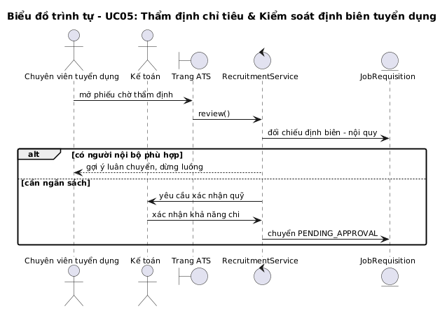

**UC06 - Phê duyệt chỉ tiêu tuyển dụng**

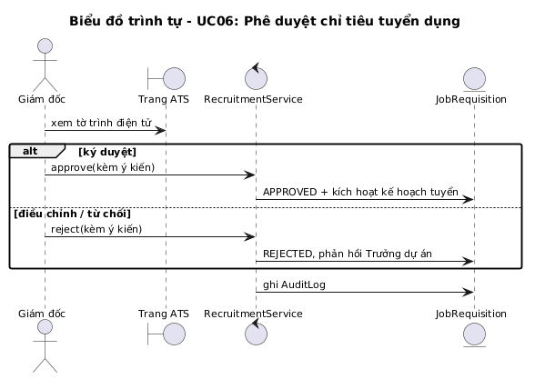

**UC07 - Quản lý hồ sơ ứng viên & Tuyển dụng Quy trình tuyển dụng đa giai đoạn**

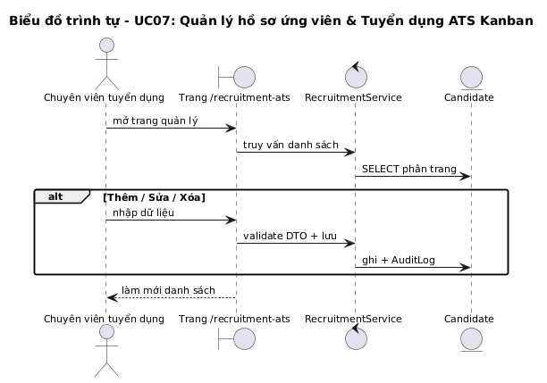

**UC08 - Gửi thư mời nhận việc & Thỏa thuận mức lương**

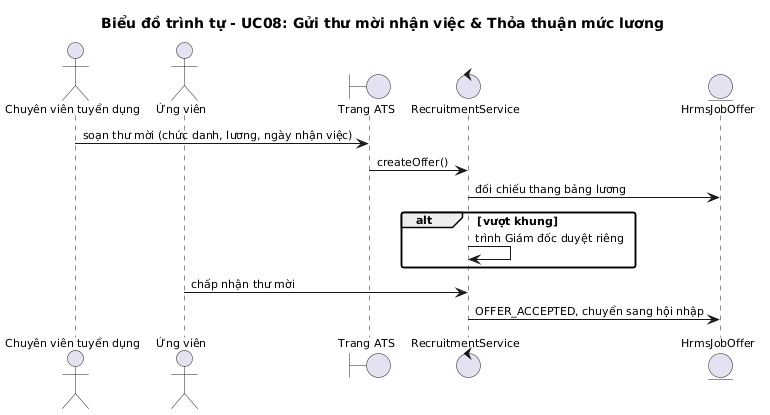

Ở nhóm tuyển dụng, đề xuất chỉ tiêu đi qua bước thẩm định định biên và phê duyệt trước khi chuyên viên mở tuyển. Hồ sơ ứng viên được cập nhật theo từng vòng; chỉ khi ứng viên được chọn và offer được chấp thuận thì hệ thống mới chuyển sang bước tiếp nhận. Hồ sơ chưa đạt hoặc chưa đủ căn cứ được trả về xử lý, không tự chuyển thành nhân viên.

**UC09 - Quản lý hồ sơ nhân viên toàn diện**

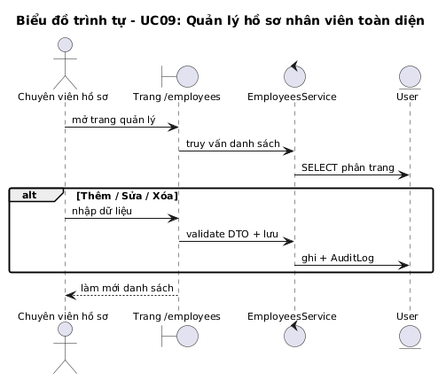

**UC10 - Quản lý hợp đồng lao động & Phụ lục hợp đồng**

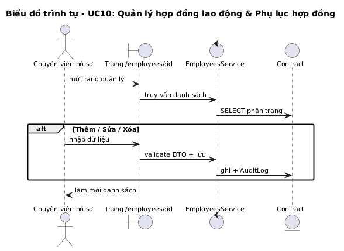

**UC11 - Quản lý văn bằng, chứng chỉ chuyên môn**

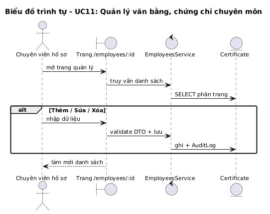

**UC12 - Mượn - trả hồ sơ, chứng chỉ bản gốc**

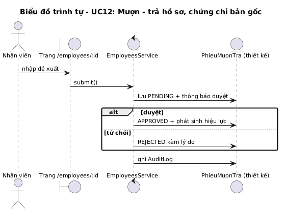

**UC13 - Đánh giá kết quả thử việc & Ký HĐLĐ chính thức**

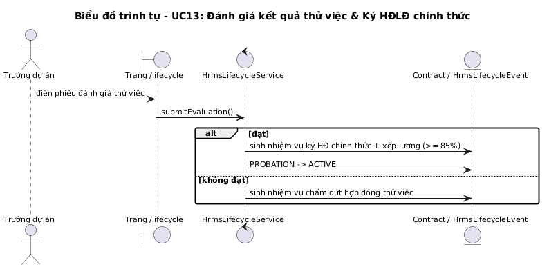

**UC14 - Lộ trình hội nhập nhân viên mới**

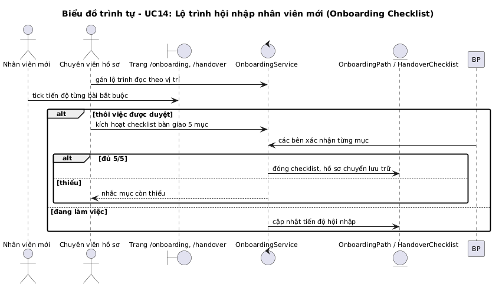

Nhóm hồ sơ và hội nhập nối dữ liệu ứng viên đã nhận việc với hồ sơ nhân viên, hợp đồng và danh sách việc cần hoàn tất. HR cập nhật hồ sơ theo quyền; nhân viên và quản lý xác nhận đầu việc được giao. Ngày hiệu lực cùng trạng thái từng nhiệm vụ quyết định bước tiếp theo, nên hồ sơ thiếu giấy tờ được giữ lại để bổ sung thay vì đóng quy trình.

**UC15 - Cổng tự phục vụ nhân viên tập trung**

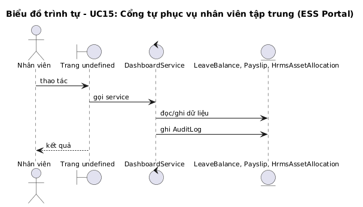

**UC16 - Quản lý thông tin cá nhân phân cấp 3 mức độ**

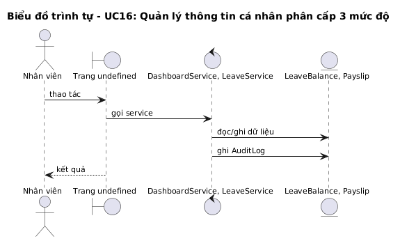

**UC17 - Thẩm định & Phê duyệt đề xuất điều chỉnh hồ sơ Mức 2**

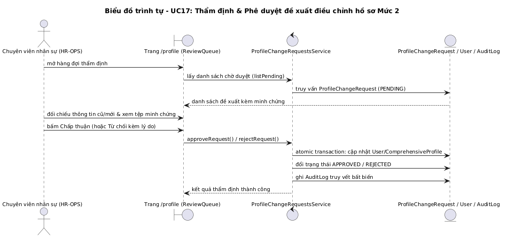

Ở cổng tự phục vụ, nhân viên chỉ gửi yêu cầu điều chỉnh thông tin thuộc phạm vi được phép sửa. Hệ thống chuyển đề nghị cho người có thẩm quyền, giữ nguyên dữ liệu hiện hành trong lúc chờ và chỉ cập nhật sau khi được duyệt. Nếu bị từ chối, lý do được trả lại để nhân viên biết cần bổ sung gì.

**UC18 - Ghi nhận sự kiện chấm công & Điểm danh vào/ra ca**

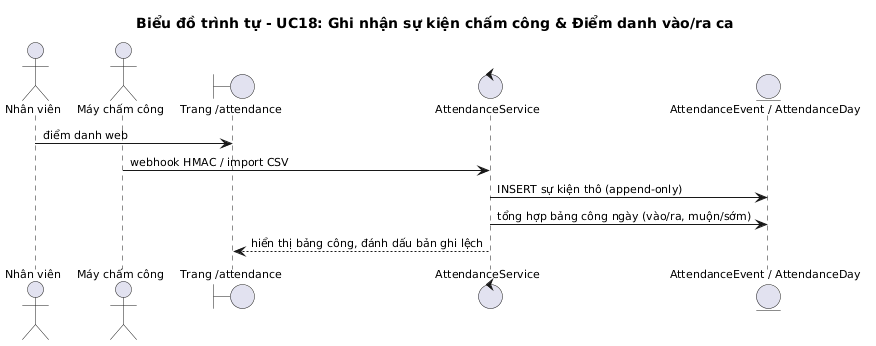

**UC19 - Điểm danh bằng khuôn mặt qua camera thường**

Nhân viên đăng ký mẫu sau khi đồng ý xử lý dữ liệu, sau đó dùng camera thường trên trang `/check-in`. Trình duyệt trích vector từ khung hình; máy chủ so vector với mẫu đã lưu. Nếu đạt ngưỡng, hệ thống tạo sự kiện chấm công và tính lại công ngày. Luồng hiện chưa xác minh người thật.

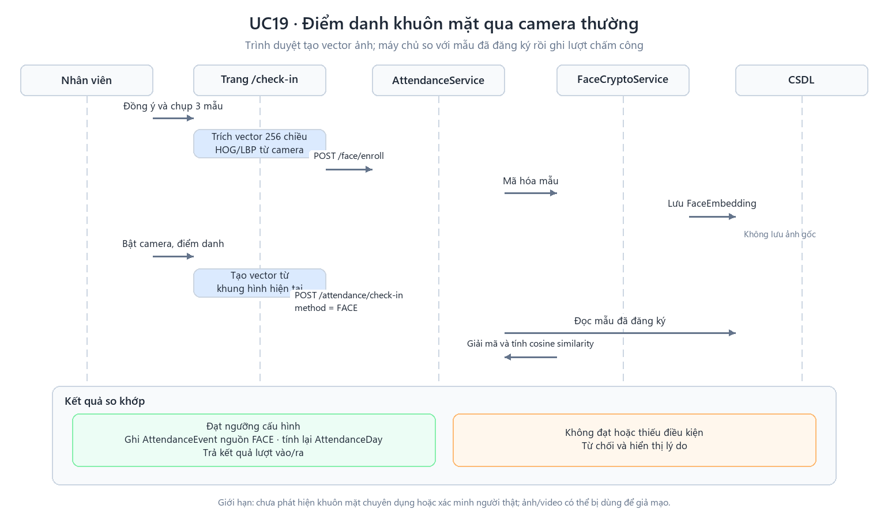

**UC20 - Quản trị kết nối thiết bị máy chấm công**

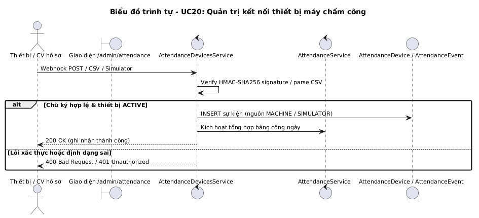

**UC21 - Đăng ký & Xét duyệt nghỉ phép trực tuyến**

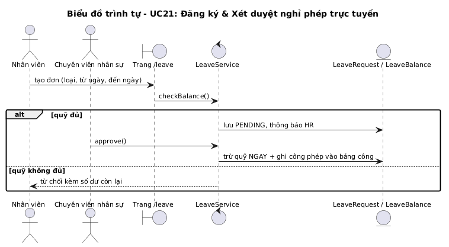

**UC22 - Đăng ký & Phê duyệt làm thêm giờ (OT)**

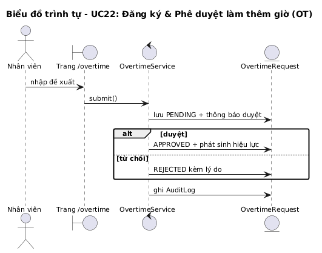

**UC23 - Lập lịch và phân ca làm việc**

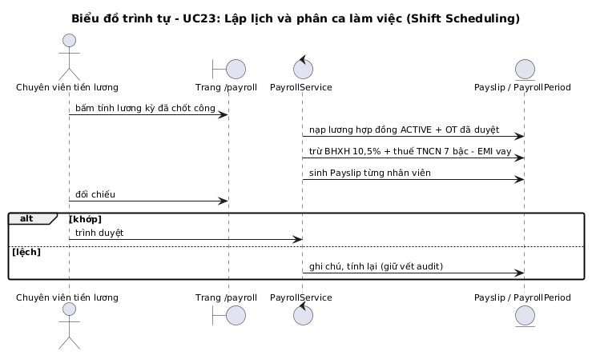

**UC24 - Giải trình bổ sung giờ công & Xử lý lệch công**

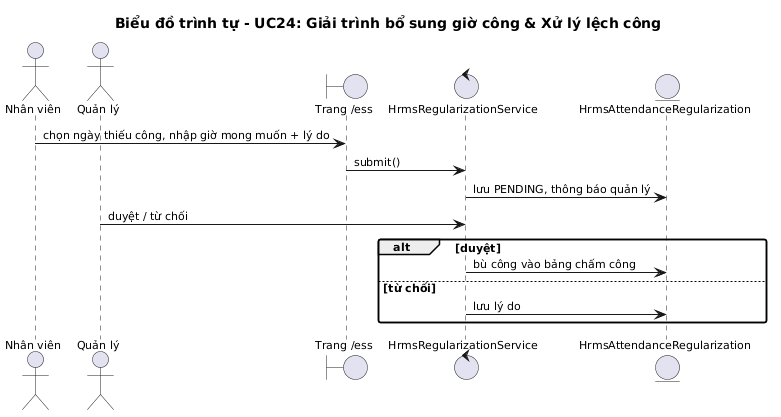

**UC25 - Tổng hợp & Chốt bảng chấm công tháng**

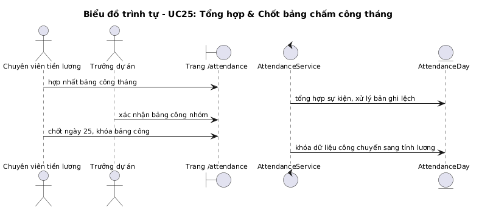

Các nguồn chấm công được ghi nhận thành sự kiện, sau đó tổng hợp thành công ngày để HR rà soát. Đơn nghỉ, làm thêm và giải trình chỉ ảnh hưởng đến kết quả sau khi được đúng người phê duyệt; lượt vào/ra còn thiếu được đưa vào danh sách cần xử lý. Khi chốt tháng, hệ thống kiểm tra các trường hợp còn treo và khóa dữ liệu đã xác nhận để kỳ lương dùng cùng một số liệu.

**UC26 - Cấu hình công thức và ngạch bậc lương**

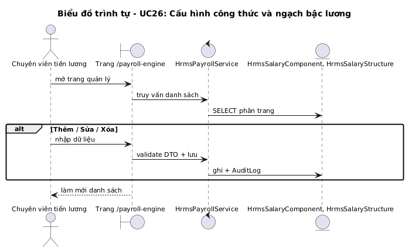

**UC27 - Vận hành chức năng tính lương tự động**

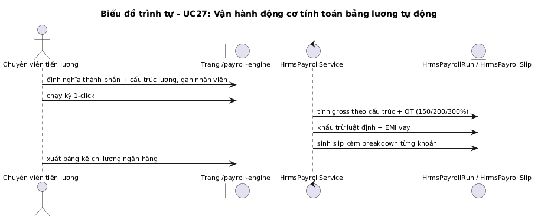

**UC28 - Phê duyệt, khóa và ghi nhận chi trả kỳ lương**

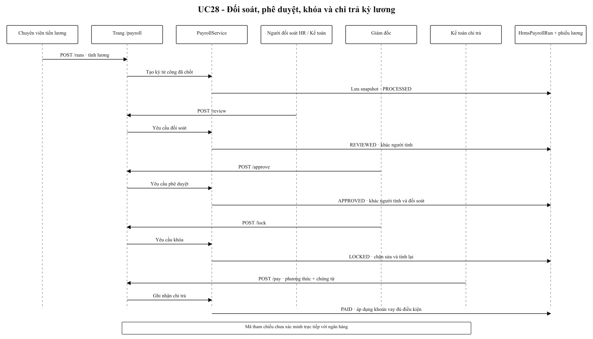

**UC29 - Quản lý tạm ứng & Khoản vay phúc lợi nhân viên**

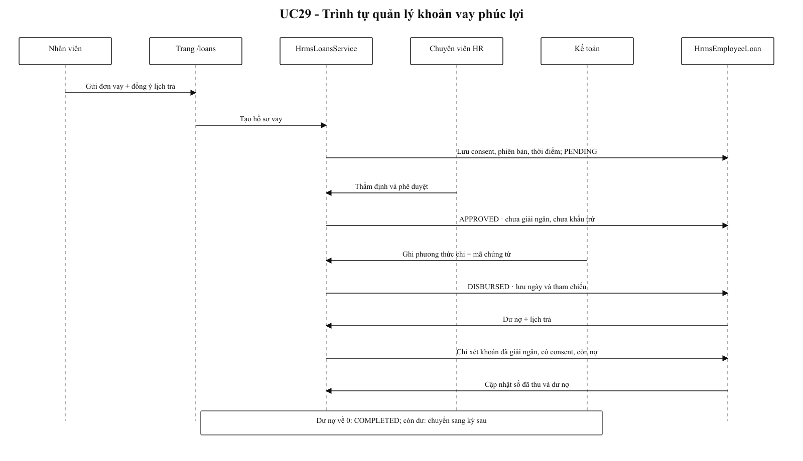

**UC30 - Quản lý đề xuất công tác & Quyết toán chi phí**

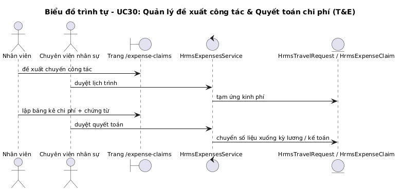

**UC31 - Quản lý cấp phát & Thu hồi tài sản làm việc**

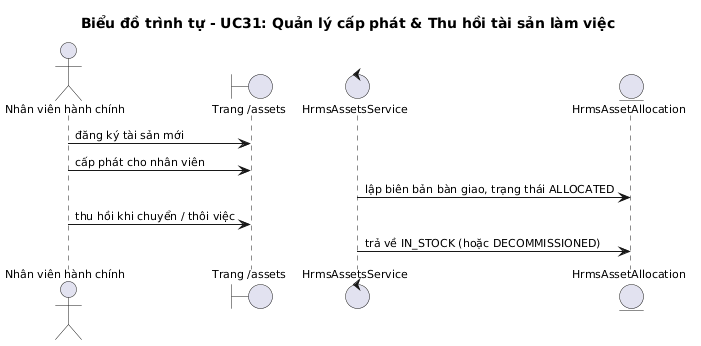

Nhóm tiền lương và phúc lợi liên kết dữ liệu hợp đồng, công đã chốt, cấu trúc lương và các khoản khấu trừ để lập phiếu; HR đối chiếu, người duyệt kiểm tra độc lập, rồi Kế toán ghi nhận chứng từ. Đề nghị vay, công tác phí và tài sản có bước duyệt, cấp phát hoặc thu hồi riêng. Hệ thống lưu trạng thái và chứng từ tham chiếu, không gửi lệnh chuyển tiền cho ngân hàng.

**UC32 - Đề xuất & Phê duyệt điều chuyển công tác nội bộ**

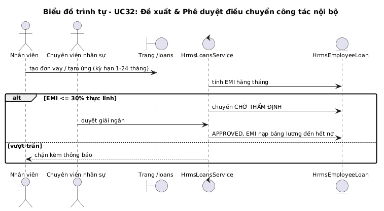

**UC33 - Đề xuất & Phê duyệt điều chỉnh bậc lương**

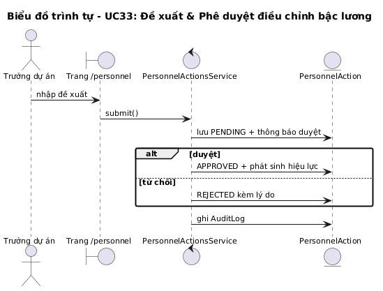

**UC34 - Đề xuất & Phê duyệt khen thưởng nhân sự**

**UC35 - Xử lý kỷ luật & Vi phạm nội quy lao động**

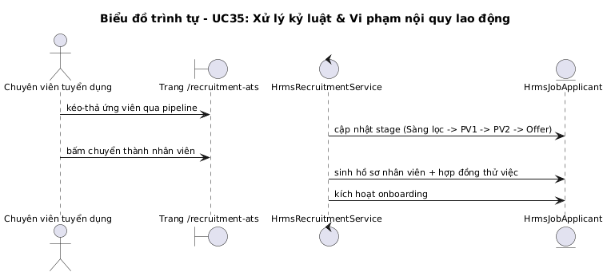

**UC36 - Tiếp nhận, Xử lý thôi việc & Bàn giao đa bộ phận**

Các đề nghị điều chuyển, thay đổi chế độ, khen thưởng hoặc xử lý kỷ luật cần người có thẩm quyền xác nhận trước ngày hiệu lực. Khi nhân viên nghỉ việc, HR khởi tạo danh sách bàn giao để các đơn vị lần lượt xác nhận tài sản, công việc và hồ sơ. Quy trình chỉ đóng khi các đầu việc bắt buộc hoàn tất; lịch sử nhân sự vẫn được lưu để tra cứu.

**UC37 - Quản lý mục tiêu và đánh giá KPI**

**UC38 - Quản trị chương trình đào tạo nội bộ**

**UC39 - Tiếp nhận & Giải quyết khiếu nại lao động bảo mật**

Với KPI, người phụ trách tạo kỳ và giao chỉ tiêu theo cá nhân hoặc đơn vị; nhân viên nhận thông báo riêng, cập nhật kết quả và gửi minh chứng để quản lý xem xét. Điểm chỉ được ghi sau khi quản lý đối chiếu dữ liệu, còn điểm kỳ tính theo trọng số đã giao. Hồ sơ khiếu nại đi theo luồng riêng, giới hạn người xem và không bị trộn vào kết quả KPI.

**UC40 - hồ sơ công vụ (tham chiếu Mẫu 2C-BNV/2008; mẫu hiện hành cần xác minh)**

**UC41 - quản trị ngạch bậc khu vực công (tham chiếu NĐ 204; dữ liệu cần xác minh)**

**UC42 - rà soát điều kiện nâng bậc công vụ (đề xuất; cần xác minh căn cứ)**

**UC43 - kết xuất hồ sơ công vụ (đề xuất; biểu mẫu pháp quy chưa xác nhận)**

Nhánh hồ sơ công vụ dùng biểu mẫu và quy tắc riêng cho đúng đối tượng; dữ liệu được kiểm tra trước khi kết xuất để tránh đưa hồ sơ thiếu hoặc sai thời kỳ vào báo cáo. Kết luận và phát hành cần người có thẩm quyền thực hiện. Biểu mẫu chưa được xác nhận căn cứ hiện hành chỉ phục vụ thiết kế tham khảo, chưa phải hồ sơ sẵn sàng sử dụng.

**UC44 - Quản lý không gian tri thức số & Tài liệu quy trình vận hành chuẩn**

**UC45 - Tìm kiếm tri thức toàn văn & Danh bạ chuyên gia**

**UC46 - Bảng điều khiển phân tích & Thống kê nhân sự**

**UC47 - Nhật ký kiểm toán hệ thống & Cấu hình tham số**

Ở nhóm điều hành, người dùng tra cứu nội dung hoặc báo cáo trong phạm vi được cấp; kết quả thay đổi theo bộ lọc và quyền truy cập. Quản trị viên có thể đổi tham số vận hành, nhưng hệ thống kiểm tra giá trị rồi ghi lại ai đã đổi và thời điểm nào. Nhật ký chỉ dùng để tra cứu, không sửa ngược lịch sử đã phát sinh.

### 2.3.2. Xây dựng biểu đồ hoạt động

Biểu đồ hoạt động thể hiện luồng điều khiển xử lý nghiệp vụ, các bước tuần tự, các nhánh điều kiện rẽ nhánh và điểm kết thúc của từng tiến trình chức năng trong hệ thống. Dưới đây là đầy đủ 47 biểu đồ hoạt động tương ứng với 47 Use Case nghiệp vụ:

**UC01 - Đăng nhập & Xác thực hệ thống**

**UC02 - Quản trị người dùng & Phân quyền RBAC**

**UC03 - Quản trị cơ cấu tổ chức & Cây phòng ban**

Luồng dừng nếu xác thực thất bại hoặc tài khoản không đủ quyền; tài khoản bị khóa tạm thời sau số lần sai theo cấu hình. Với thao tác quản trị, dữ liệu không hợp lệ được trả về để sửa, còn thay đổi hợp lệ mới được lưu và ghi nhật ký.

**UC04 - Lập phiếu đề xuất tuyển dụng nhân sự**

**UC05 - Thẩm định chỉ tiêu & Kiểm soát định biên tuyển dụng**

**UC06 - Phê duyệt chỉ tiêu tuyển dụng**

**UC07 - Quản lý hồ sơ ứng viên & Tuyển dụng Quy trình tuyển dụng đa giai đoạn**

**UC08 - Gửi thư mời nhận việc & Thỏa thuận mức lương**

Điểm rẽ chính là kết quả duyệt chỉ tiêu và quyết định sau phỏng vấn. Nếu chỉ tiêu chưa được duyệt thì quy trình tuyển dụng chưa mở; nếu ứng viên chưa đạt, hồ sơ kết thúc hoặc được xử lý tiếp theo quy định. Chỉ offer được chấp thuận mới tạo cơ sở cho bước tiếp nhận.

**UC09 - Quản lý hồ sơ nhân viên toàn diện**

**UC10 - Quản lý hợp đồng lao động & Phụ lục hợp đồng**

**UC11 - Quản lý văn bằng, chứng chỉ chuyên môn**

**UC12 - Mượn - trả hồ sơ, chứng chỉ bản gốc**

**UC13 - Đánh giá kết quả thử việc & Ký HĐLĐ chính thức**

**UC14 - Lộ trình hội nhập nhân viên mới**

Hồ sơ chỉ chuyển sang trạng thái sẵn sàng khi thông tin bắt buộc và các đầu việc hội nhập đã được xác nhận. Nhiệm vụ quá hạn hoặc thiếu tài liệu vẫn nằm trong danh sách theo dõi để người phụ trách xử lý, không bị coi là đã hoàn thành.

**UC15 - Cổng tự phục vụ nhân viên tập trung**

**UC16 - Quản lý thông tin cá nhân phân cấp 3 mức độ**

**UC17 - Thẩm định & Phê duyệt đề xuất điều chỉnh hồ sơ Mức 2**

Đề nghị ESS đi qua bước kiểm tra trường dữ liệu và phạm vi quyền trước khi gửi duyệt. Người duyệt có thể chấp thuận hoặc trả lại kèm lý do; dữ liệu gốc chỉ thay đổi sau quyết định hợp lệ, nhờ đó nhân viên vẫn thấy thông tin cũ trong lúc yêu cầu đang chờ.

**UC18 - Ghi nhận sự kiện chấm công & Điểm danh vào/ra ca**

**UC19 - Điểm danh bằng khuôn mặt qua camera thường**

Luồng bắt đầu khi nhân viên đã đồng ý xử lý dữ liệu, có mẫu đăng ký và cấp quyền camera. Hệ thống so khớp vector; nếu đạt ngưỡng thì ghi sự kiện vào/ra, nếu không thì trả thông báo để thử lại. Hệ thống chưa có bước xác minh người thật.

**UC20 - Quản trị kết nối thiết bị máy chấm công**

**UC21 - Đăng ký & Xét duyệt nghỉ phép trực tuyến**

**UC22 - Đăng ký & Phê duyệt làm thêm giờ (OT)**

**UC23 - Lập lịch và phân ca làm việc**

**UC24 - Giải trình bổ sung giờ công & Xử lý lệch công**

**UC25 - Tổng hợp & Chốt bảng chấm công tháng**

Trước khi chốt công, hệ thống tách ngày đủ công, nghỉ đã duyệt và ngày còn thiếu lượt chấm để HR xử lý đúng nguyên nhân. Nếu vẫn còn ngoại lệ chưa giải quyết, bước chốt bị chặn; sau khi hoàn tất, bảng công được khóa để số liệu dùng tính lương không thay đổi âm thầm.

**UC26 - Cấu hình công thức và ngạch bậc lương**

**UC27 - Vận hành chức năng tính lương tự động**

**UC28 - Phê duyệt, khóa và ghi nhận chi trả kỳ lương**

**UC29 - Quản lý tạm ứng & Khoản vay phúc lợi nhân viên**

**UC30 - Quản lý đề xuất công tác & Quyết toán chi phí**

**UC31 - Quản lý cấp phát & Thu hồi tài sản làm việc**

Khi cấp phát tài sản, hệ thống ghi người nhận và biên bản bàn giao rồi chuyển tài sản sang trạng thái đang sử dụng. Nếu nhân viên chuyển đơn vị hoặc nghỉ việc, tài sản phải được thu hồi về kho; nếu chưa phát sinh thay đổi, trạng thái tiếp tục sử dụng được giữ nguyên.

**UC32 - Đề xuất & Phê duyệt điều chuyển công tác nội bộ**

**UC33 - Đề xuất & Phê duyệt điều chỉnh bậc lương**

**UC34 - Đề xuất & Phê duyệt khen thưởng nhân sự**

**UC35 - Xử lý kỷ luật & Vi phạm nội quy lao động**

**UC36 - Tiếp nhận, Xử lý thôi việc & Bàn giao đa bộ phận**

Kết quả duyệt quyết định đề nghị có hiệu lực hay phải quay lại bổ sung. Riêng quy trình nghỉ việc chờ các đơn vị xác nhận phần việc của mình; hồ sơ chỉ đóng khi đủ bàn giao bắt buộc, còn mục chưa xong sẽ hiện rõ người chịu trách nhiệm.

**UC37 - Quản lý mục tiêu và đánh giá KPI**

**UC38 - Quản trị chương trình đào tạo nội bộ**

**UC39 - Tiếp nhận & Giải quyết khiếu nại lao động bảo mật**

Kỳ KPI vẫn ở trạng thái đang thực hiện nếu thiếu trọng số, điểm hoặc minh chứng cần thiết; chỉ đủ điều kiện mới được hoàn tất. Nhánh công vụ kiểm tra tiêu chí và thẩm quyền riêng, còn hồ sơ khiếu nại được xử lý kín theo người được phân công, không làm thay đổi điểm KPI.

**UC40 - hồ sơ công vụ (tham chiếu Mẫu 2C-BNV/2008; mẫu hiện hành cần xác minh)**

**UC41 - quản trị ngạch bậc khu vực công (tham chiếu NĐ 204; dữ liệu cần xác minh)**

**UC42 - rà soát điều kiện nâng bậc công vụ (đề xuất; cần xác minh căn cứ)**

**UC43 - kết xuất hồ sơ công vụ (đề xuất; biểu mẫu pháp quy chưa xác nhận)**

Nhánh công vụ cần dừng để bổ sung khi hồ sơ, nhóm nhiệm vụ hoặc căn cứ xếp loại chưa đủ. Người có thẩm quyền mới ghi kết luận cuối; hệ thống kiểm tra điều kiện và lưu kết quả nhưng không tự thay cơ quan quyết định.

**UC44 - Quản lý không gian tri thức số & Tài liệu quy trình vận hành chuẩn**

**UC45 - Tìm kiếm tri thức toàn văn & Danh bạ chuyên gia**

**UC46 - Bảng điều khiển phân tích & Thống kê nhân sự**

**UC47 - Nhật ký kiểm toán hệ thống & Cấu hình tham số**

Thao tác tra cứu chỉ trả về bản ghi trong phạm vi quyền; giá trị cấu hình sai định dạng bị từ chối trước khi lưu. Mỗi thay đổi hợp lệ đều để lại dấu vết kiểm toán, giúp người quản trị lần lại nguyên nhân khi cần.

### 2.3.3. Xây dựng biểu đồ trạng thái

Biểu đồ trạng thái mô hình hóa vòng đời và các bước chuyển đổi trạng thái của các thực thể nghiệp vụ cốt lõi dưới tác động của các sự kiện phát sinh:

**1. Biểu đồ trạng thái vòng đời Nhân viên**

Vòng đời đối tượng Nhân viên trải qua các trạng thái: Ứng viên đạt tuyển dụng (ONBOARDING) -> Thử việc (PROBATION) -> Ký hợp đồng chính thức (ACTIVE) -> Nghỉ thai sản/Tạm hoãn (SUSPENDED) -> Đã nghỉ việc (TERMINATED).

**2. Biểu đồ trạng thái Phiếu tuyển dụng**

Vòng đời phiếu tuyển dụng: Bản nháp (DRAFT) -> Chờ thẩm định định biên (PENDING_REVIEW) -> Chờ Giám đốc duyệt (PENDING_APPROVAL) -> Đã phê duyệt mở tuyển (APPROVED) hoặc Bị từ chối (REJECTED) -> Hoàn tất tuyển dụng (CLOSED).

**3. Biểu đồ trạng thái Đơn nghỉ phép**

Vòng đời đơn nghỉ phép: Khởi tạo (DRAFT) -> Chờ Trưởng dự án duyệt (SUBMITTED) -> Chờ HR xác nhận trừ phép (HR_CONFIRMED) -> Chấp thuận (APPROVED) hoặc Bị bác đơn (REJECTED) -> Đã hủy (CANCELLED).

**4. Biểu đồ trạng thái Phiếu mượn - trả hồ sơ**

Vòng đời phiếu mượn hồ sơ: Yêu cầu mượn (REQUESTED) -> HR xuất kho bàn giao (BORROWED) -> Nhân viên hoàn trả hồ sơ (RETURNED) -> HR kiểm tra niêm phong và đóng phiếu (CLOSED).

**5. Biểu đồ trạng thái Phiếu lương**

Vòng đời kỳ lương: `PROCESSED` -> `REVIEWED` -> `APPROVED` -> `LOCKED` -> `PAID`; phiếu lương được tạo cùng kỳ và chỉ hiển thị cho nhân viên sau khi được duyệt. Khi ghi nhận `PAID`, Kế toán phải nhập phương thức cùng mã giao dịch hoặc số chứng từ. Hệ thống lưu thông tin thanh toán nhưng chưa xác minh với ngân hàng và không tự gửi lệnh chuyển tiền. Người có quyền có thể hủy kỳ đã đối soát, khóa hoặc thanh toán để lập lại; kỳ cũ được giữ ở trạng thái `CANCELLED`, thao tác không đảo giao dịch ngân hàng và bị chặn nếu khoản vay của kỳ đã được hạch toán.

### 2.3.4. Xây dựng biểu đồ cộng tác

Biểu đồ cộng tác tập trung làm nổi bật mối quan hệ cấu trúc không gian và sự phân bổ trách nhiệm giữa các đối tượng trong việc thực thi các kịch bản tương tác liên phòng ban.

Trong phân hệ quản trị tiền lương, kịch bản tính lương định kỳ thể hiện sự cộng tác chặt chẽ giữa các đối tượng: Lớp giao diện `PayrollView` tiếp nhận yêu cầu từ chuyên viên; chuyển thông điệp tới bộ điều khiển `PayrollService`; `PayrollService` gửi thông điệp truy vấn tới `AttendanceDay` để lấy tổng số ngày công thực tế, gửi thông điệp tới `Contract` để lấy mức lương đóng bảo hiểm, và gửi thông điệp tới `EmployeeLoan` để tính toán số tiền trích nợ kỳ hiện tại; sau khi hoàn tất tính toán tổng hợp, `PayrollService` gửi thông điệp khởi tạo và lưu trữ hàng loạt các đối tượng `Payslip` vào cơ sở dữ liệu.

## 2.4. Thiết kế hệ thống

### 2.4.1. Xây dựng biểu đồ lớp

Biểu đồ gói tổng quan thể hiện cấu trúc phân rã các gói chức năng và mối quan hệ phụ thuộc kiến trúc trong toàn bộ hệ thống phần mềm.

Biểu đồ lớp phân tích cho 10 phân hệ nghiệp vụ thể hiện cấu trúc thuộc tính, phương thức và sự tương tác giữa ba tầng Boundary, Control và Entity, bao quát đầy đủ 47 Use Case của hệ thống:

**1. Phân hệ Quản trị hệ thống và Cơ cấu tổ chức (Nhóm A: UC01 - UC03):**

Nhóm chức năng này quản lý tài khoản, vai trò và cơ cấu đơn vị. Người dùng đăng nhập qua giao diện chung; quản trị viên có thể tạo tài khoản, gán vai trò và điều chỉnh cây tổ chức theo quyền được cấp.

**2. Phân hệ Tuyển dụng và Quản lý ứng viên (Nhóm B: UC04 - UC08):**

Nhóm tuyển dụng lưu vị trí cần tuyển, hồ sơ ứng viên, các vòng phỏng vấn và offer. Chuyên viên có thể cập nhật trạng thái hồ sơ và kết quả đánh giá trên giao diện; các bước phê duyệt định biên, gửi thư và tiếp nhận nhân viên cần theo quy trình đã cấu hình.

**3. Phân hệ Hồ sơ nhân sự, Hợp đồng và Hội nhập (Nhóm C: UC09 - UC14):**

Hồ sơ nhân sự tập hợp thông tin cá nhân, hợp đồng, bằng cấp và các nhiệm vụ hội nhập được giao. Nhân viên có thể cập nhật một số trường; thay đổi thuộc diện kiểm soát được gửi cho HR xem xét. Hệ thống lưu các mốc hợp đồng và kết quả thử việc đã nhập, còn việc kiểm tra hồ sơ gốc và thực hiện thủ tục bên ngoài do bộ phận phụ trách đảm nhiệm.

**4. Phân hệ Cổng tự phục vụ nhân viên và Phân cấp hồ sơ (Nhóm D: UC15 - UC17):**

Cổng ESS cho phép nhân viên xem thông tin của mình, gửi đơn nghỉ phép hoặc làm thêm, tra cứu phiếu lương và đề nghị sửa một số dữ liệu hồ sơ. Với trường cần thẩm định, yêu cầu kèm minh chứng được chuyển tới HR; chỉ sau khi được duyệt, thông tin chính thức mới được cập nhật.

**5. Phân hệ Chấm công, Phân ca và Điểm danh đa nguồn (Nhóm E: UC18 - UC25):**

Phân hệ ghi nhận giờ công qua web, QR và luồng so khớp khuôn mặt từ camera thường. Với lượt khuôn mặt, trình duyệt gửi vector mô tả ảnh để máy chủ so với mẫu đã đăng ký; hệ thống chưa xác minh người đứng trước camera có phải người thật hay không. Các sự kiện được đối chiếu với ca để tổng hợp công ngày; trường hợp cần kết nối thiết bị ngoài còn phụ thuộc adapter và cấu hình tương ứng. Đơn nghỉ phép được quản lý trong luồng riêng và ảnh hưởng đến công theo trạng thái đã duyệt.

**6. Phân hệ Tiền lương, Chế độ đãi ngộ và Phúc lợi (Nhóm F: UC26 - UC31):**

Động cơ tiền lương tổng hợp công, khoản thu nhập, khấu trừ bảo hiểm và thuế theo dữ liệu cùng cấu hình của kỳ. C&B xem từng phiếu, xử lý sai lệch rồi chuyển bảng qua các bước duyệt và khóa theo trạng thái đang áp dụng. Các khoản vay, tạm ứng và công tác phí có luồng quản lý riêng, chỉ được đưa vào lương khi đủ điều kiện.

**7. Phân hệ Biến động nhân sự và Thôi việc (Nhóm G: UC32 - UC36):**

Màn hình biến động nhân sự ghi nhận các đề xuất như điều chuyển, bổ nhiệm, điều chỉnh lương hoặc thôi việc cùng ngày hiệu lực và người phê duyệt. Danh sách bàn giao giúp các bộ phận theo dõi việc thu hồi tài sản, xử lý công nợ và bàn giao công việc; việc hoàn tất ngoài hệ thống vẫn cần được xác nhận bởi người phụ trách.

**8. Phân hệ Đánh giá KPI, Đào tạo và Khiếu nại (Nhóm H: UC37 - UC39):**

UC37 quản lý chu kỳ, mục tiêu KPI, kết quả, minh chứng và điểm do quản lý chấm. Đào tạo (UC38) và khiếu nại (UC39) là các quy trình riêng.

**9. Nhánh hồ sơ công vụ (UC40 - UC43, chỉ chế độ khu vực công):**

Thiết kế tách hồ sơ công vụ khỏi hồ sơ nhân viên doanh nghiệp và hỗ trợ cấu hình riêng theo loại nhân sự công chức/viên chức. HRMS hiện lưu được cấu hình tổ chức theo chế độ và có khung đánh giá 30/70 cùng bước ghi nhận kết luận, kiểm tra tỷ lệ; các mẫu 2C-BNV, báo cáo 01–03, quyết định nâng bậc và quy trình ký duyệt pháp quy chưa được xác nhận tích hợp đầy đủ. Cơ quan cần cấu hình và kiểm chứng danh mục, nguồn dữ liệu, thời hạn áp dụng, thẩm quyền và biểu mẫu trước khi vận hành chính thức.

**10. Phân hệ Quản trị tri thức và Điều hành hệ thống (Nhóm J: UC44 - UC47):**

Kho tri thức lưu bài viết, tài liệu và phiên bản nội dung để nhân viên tra cứu. Các trang báo cáo tổng hợp số liệu theo dữ liệu hiện có và quyền truy cập; nhật ký kiểm toán ghi lại những nhóm thao tác đã được cấu hình lưu vết, không phải mọi hành động trên hệ thống.

**11. Biểu đồ lớp phân tích tương tác Use case Đăng ký nghỉ phép (UC21):**

Bao gồm lớp giao diện `LeaveRequestForm`, lớp điều khiển `LeaveService` cùng các lớp thực thể `LeaveRequest`, `LeaveBalance`, `Employee`.

**12. Biểu đồ lớp miền cốt lõi của hệ thống:**

Thể hiện mối quan hệ liên kết, hợp thành và kế thừa giữa các thực thể dữ liệu chính trong hệ thống quản trị nhân lực của doanh nghiệp.

**Bảng 2.4. Ma trận phân quyền truy cập chức năng theo vai trò doanh nghiệp (RBAC Matrix)**

Hệ thống triển khai cơ chế kiểm soát truy cập dựa trên vai trò (RBAC) kết hợp phân cấp dữ liệu tổ chức, quản lý phân quyền tập trung qua 11 vai trò nghiệp vụ (ADMIN, BOD, SHAREHOLDER, KM_MANAGER, LINE_MANAGER, HR_CB, ACCOUNTANT, HR_RECRUITER, HR_TRAINER, AUDITOR, USER). Snapshot DB ngày 07/10/2026 có 388 hồ sơ trạng thái ACTIVE và 2 hồ sơ RESIGNED; kỳ lương 09/2026 có 390 phiếu. Đây là số liệu tại thời điểm trích xuất; số lượng hồ sơ và phiếu lương có thể thay đổi theo dữ liệu vận hành:

| Phân hệ chức năng | Bảng dữ liệu chính | Nhân viên (USER) | Quản lý bộ phận (LINE_MANAGER) | Cán bộ C&B / Tuyển dụng / L&D | Kế toán (ACCOUNTANT) | Kiểm toán (AUDITOR) | Ban Giám Đốc (BOD) | Cổ đông & HĐQT (SHAREHOLDER) | Quản trị nhân sự (KM_MANAGER) | Quản trị hệ thống (ADMIN) |
| :--- | :--- | :---: | :---: | :---: | :---: | :---: | :---: | :---: | :---: | :---: |
| 1. Cổng tự phục vụ ESS | User, Notification | C, R (cá nhân) | C, R, U (duyệt đơn nhóm) | C, R (cá nhân + tra cứu) | C, R (chứng từ cá nhân) | R (giám sát quy trình) | R (dashboard điều hành) | R (dashboard HĐQT) | C, R, U (dashboard nhân sự) | C, R, U, D (toàn quyền) |
| 2. Hồ sơ & Hợp đồng | Employee, Contract, Certificate | R (hồ sơ cá nhân) | R (nhân sự bộ phận) | C, R, U (tiếp nhận, C&B, L&D) | R (tài khoản, MST) | R (soát xét pháp lý HĐ) | R (toàn bộ nhân sự cty) | R (định biên, quy mô cty) | C, R, U (quản lý hồ sơ, ký HĐ) | C, R, U, D (toàn quyền) |
| 3. Chấm công & Phân ca | AttendanceEvent, WorkShift, AttendanceCorrection | C, R (điểm danh cá nhân) | C, R, U (phân ca, duyệt giải trình) | C, R, U (tổng hợp công tháng C&B) | R (tổng hợp ngày công) | R (kiểm tra tuân thủ giờ làm) | R (thống kê tỷ lệ đi làm cty) | R (báo cáo năng suất cty) | C, R, U (chốt bảng công tháng) | C, R, U, D (toàn quyền + máy chấm công) |
| 4. Tiền lương & Khoản vay | PayrollPeriod, Payslip, EmployeeLoan, ExpenseClaim | R (phiếu lương cá nhân, nộp đơn vay) | R (chi phí lương bộ phận ủy quyền) | C, R, U (động cơ tính lương, BHXH) | C, R, U (đối soát, chi trả, duyệt chi) | R (kiểm toán công thức, thuế) | R, U (phê duyệt quỹ lương tháng) | R (tổng hợp chi phí quỹ lương) | C, R, U (tính lương, duyệt vay và ghi nhận giải ngân theo vai trò) | C, R, U, D (toàn quyền + công thức) |
| 5. Tuyển dụng & ATS | JobRequisition, Candidate, InterviewRound | - | C, R (lập đề xuất, phỏng vấn) | C, R, U, D (quản trị ATS, đề xuất offer) | - | R (giám sát tính minh bạch) | R, U (phê duyệt định biên năm) | R (báo cáo chiến lược nhân tài) | C, R, U (quản lý tin, duyệt offer) | C, R, U, D (toàn quyền kiểm soát) |
| 6. Đánh giá KPI & Đào tạo | HrmsAppraisalCycle, HrmsAppraisalGoal, TrainingCourse, Grievance | C, R, U (cập nhật kết quả và minh chứng KPI; nộp khiếu nại) | C, R, U (giao KPI, chấm kết quả trong phạm vi quản lý) | C, R, U (quản trị đào tạo; thưởng theo quyết định riêng) | - | R (giám sát xử lý khiếu nại) | C, R, U (quản lý chu kỳ KPI, rà soát kết quả) | R (báo cáo KPI theo quyền) | C, R, U (điều phối đào tạo, khiếu nại) | C, R, U, D (toàn quyền điều phối) |
| 7. Báo cáo & BLLĐ | CadreProfile, SalaryGrade, LaborReport | - | R (báo cáo hiệu suất bộ phận) | R, U (báo cáo tuyển dụng, lương BHXH) | R (báo cáo chi phí công tác) | R (báo cáo tuân thủ BLLĐ, rủi ro) | R (báo cáo quản trị cấp cao) | R (báo cáo ĐHCĐ, ESG, kiểm toán) | C, R, U (hồ sơ công vụ theo phạm vi được phân quyền; biểu mẫu pháp quy chưa tích hợp) | C, R, U, D (quản trị theo phân quyền; không mặc nhiên phát hành biểu mẫu pháp quy) |
| 8. Cấu hình & Kiểm toán | Setting, AuditLog, AttendanceDevice | - | - | - | - | R (nhật ký kiểm toán AuditLog) | R (xem cấu hình tham số) | R (kiểm toán bảo mật) | - | C, R, U, D (toàn quyền RBAC, kiểm toán) |

*(Ghi chú: C: Create - Tạo mới, R: Read - Xem/Đọc, U: Update - Chỉnh sửa, D: Delete - Xóa dữ liệu).*

### 2.4.2. Thiết kế lưu trữ dữ liệu

Cơ sở dữ liệu sử dụng PostgreSQL 16. Theo kết quả kiểm kê mã nguồn, schema Prisma có 102 model; Bảng 2.5 liệt kê 87 model tiêu biểu theo 10 miền dữ liệu, không phải toàn bộ schema. Mã nguồn hiện có 23 thư mục migration; số migration đã áp dụng cần kiểm tra riêng trên từng cơ sở dữ liệu. Số model và migration không đồng nghĩa dữ liệu đã đầy đủ hoặc mọi quy trình đã được kiểm thử.

**Bảng 2.5. Đặc tả cấu trúc lược đồ cơ sở dữ liệu đa chế độ của HRMS**

| Miền dữ liệu | Danh mục bảng dữ liệu trong CSDL (Prisma ORM) | Số bảng | Mục đích lưu trữ và quy tắc nghiệp vụ |
| :--- | :--- | :---: | :--- |
| 1. Định danh & Cơ cấu tổ chức | `User`, `Role`, `UserRole`, `OrgUnit`, `RefreshToken` | 5 | Quản lý tài khoản người dùng, mã hóa mật khẩu, phân quyền truy cập theo vai trò và mô hình hóa cây sơ đồ tổ chức phòng ban theo mối quan hệ thứ bậc. |
| 2. Tuyển dụng & Thu hút nhân tài (ATS) | `JobRequisition`, `Candidate`, `HrmsJobOpening`, `HrmsJobApplicant`, `HrmsInterviewRound`, `HrmsJobOffer` | 6 | Lưu trữ phiếu yêu cầu tuyển dụng, hồ sơ ứng viên, pipeline ứng tuyển 6 giai đoạn, lịch phỏng vấn, phiếu chấm điểm và tiếp nhận trực tiếp ứng viên trúng tuyển. |
| 3. Hồ sơ, Hợp đồng & Hội nhập nhân sự | `Contract`, `Certificate`, `HrDocument`, `OnboardingPath`, `OnboardingPathItem`, `OnboardingAssignment`, `OnboardingItemProgress`, `HandoverChecklist`, `HandoverItem`, `HrmsLifecycleEvent`, `HrmsOnboardingTask` | 11 | Quản lý hợp đồng lao động (thử việc, chính thức), thông tin văn bằng chứng chỉ, vị trí lưu trữ hồ sơ vật lý, lộ trình hội nhập và quy trình 5 bước bàn giao thôi việc. |
| 4. Biến động nhân sự & Phân cấp dữ liệu | `PersonnelAction`, `ProfileChangeRequest` | 2 | Quản lý các quyết định biến động (bổ nhiệm, điều chuyển, nâng lương, kỷ luật) và hàng đợi kiểm soát cập nhật thông tin định danh Mức 2 có minh chứng ảnh. |
| 5. Chấm công, Phân ca & Điểm danh đa nguồn | `AttendanceDevice`, `FaceEmbedding`, `AttendanceEvent`, `AttendanceDay`, `AttendanceCorrection`, `HrmsShiftType`, `HrmsShiftAssignment`, `HrmsAttendanceRegularization` | 8 | Lưu cấu hình thiết bị, mẫu vector khuôn mặt đã mã hóa, sự kiện chấm công, công ngày, ca làm và nội dung giải trình. Nguồn và thời điểm ghi nhận được lưu theo từng sự kiện; kết nối thiết bị ngoài cần cấu hình tương ứng. |
| 6. Nghỉ phép & Làm thêm giờ | `LeaveRequest`, `LeaveBalance`, `OvertimeRequest` | 3 | Quản lý quỹ phép năm của nhân viên (tự động cập nhật số dư ngay khi phê duyệt đơn), theo dõi đơn xin nghỉ phép và kiểm soát giới hạn thời gian làm thêm giờ. |
| 7. Tiền lương & Cấu trúc đãi ngộ động | `PayrollPeriod`, `Payslip`, `HrmsSalaryComponent`, `HrmsSalaryStructure`, `HrmsSalaryStructureItem`, `HrmsSalaryStructureAssignment`, `HrmsPayrollRun`, `HrmsPayrollSlip` | 8 | Quản lý chu kỳ tính lương có khóa sổ an toàn, bảng cấu trúc lương động đa thành phần, phiếu lương chi tiết từng khoản phụ cấp, bảo hiểm và thuế. |
| 8. Tài chính nhân sự, Phúc lợi & Tài sản | `HrmsEmployeeLoan`, `HrmsEmployeeAdvance`, `HrmsExpenseClaim`, `HrmsAssetAllocation`, `HrmsTravelRequest` | 5 | Theo dõi khoản vay và lịch trừ đã duyệt, thanh quyết toán/hoàn tạm ứng dư, lịch sử cấp phát và xác nhận nhận tài sản. |
| 9. KPI, Đào tạo & Khiếu nại | `HrmsAppraisalCycle`, `HrmsAppraisalGoal`, `HrmsAppraisalReview`, `TrainingCourse`, `TrainingEnrollment`, `HrmsTrainingProgram`, `HrmsTrainingFeedback`, `HrmsGrievance` | 8 | Quản lý chu kỳ và mục tiêu KPI, kết quả cùng minh chứng; lưu các bản ghi đánh giá cũ để tra cứu lịch sử, không tham gia cách tính KPI hiện hành; quản lý đào tạo và tiếp nhận khiếu nại lao động. |
| 10. Hồ sơ công vụ (chỉ chế độ nhà nước), Tri thức số & Hệ thống | `PersonnelComprehensiveProfile`, `PersonnelRank`, `PersonnelSalaryHistory`, `PersonnelAppointment`, `PersonnelEducation`, `PersonnelWorkHistory`, `PersonnelRewardDiscipline`, `PersonnelFamilyRelation`, `PersonnelAppraisal`, `PersonnelSocialActivity`, `Space`, `SpaceMember`, `SpaceFollow`, `Category`, `Tag`, `ArticleTag`, `Article`, `ArticleVersion`, `Attachment`, `ArticleReview`, `Comment`, `Reaction`, `ArticleView`, `Bookmark`, `MasterCatalogGroup`, `MasterCatalog`, `MasterCatalogItem`, `Notification`, `AuditLog`, `Setting` | 30 | Hồ sơ công vụ tham chiếu Mẫu 2C-BNV/2008 và danh mục ngạch bậc là tham chiếu; biểu mẫu/căn cứ phải được cơ quan xác minh trước khi dùng chính thức; kho tri thức số và quy trình vận hành chuẩn có phiên bản bài viết bất biến; danh mục dùng chung và nhật ký kiểm toán hệ thống. |

Lược đồ cơ sở dữ liệu quan hệ của hệ thống thể hiện cấu trúc các bảng dữ liệu cốt lõi cùng các mối quan hệ khóa chính, khóa ngoại và chỉ mục ràng buộc toàn vẹn giữa các phân hệ:

Mô hình dữ liệu dưới đây mô tả các bảng dùng cho sự kiện chấm công, mẫu khuôn mặt, thiết bị và công ngày. Các kênh hỗ trợ trong từng môi trường phụ thuộc cấu hình và thiết bị được kết nối:

`AttendanceDevice` lưu cấu hình nguồn thiết bị; `FaceEmbedding` lưu các vector mẫu khuôn mặt đã mã hóa; `AttendanceEvent` ghi từng lượt điểm danh với nguồn tương ứng; `AttendanceDay` chứa kết quả tổng hợp theo ngày. Nhân viên có thể gửi giải trình khi thiếu hoặc sai giờ công để người quản lý xem xét trước khi cập nhật.

**Bảng 2.6. So sánh các phương thức điểm danh trong hệ thống**

| Tiêu chí so sánh | Khuôn mặt qua camera trình duyệt | QR / Web | Thiết bị ngoài đã cấu hình |
| :--- | :--- | :--- | :--- |
| Phương thức xác thực | So khớp vector ảnh với mẫu đã đăng ký sau khi có sự đồng ý | Đăng nhập; QR có thời hạn dùng và mã xác thực | Tùy loại thiết bị và cơ chế xác thực đã cấu hình |
| Giới hạn cần lưu ý | Chưa phát hiện khuôn mặt chuyên dụng hoặc xác minh người thật; ảnh/video có thể bị giả mạo | Không chứng minh chắc chắn người đăng nhập đang có mặt tại địa điểm làm việc | Cần adapter, khóa xác thực và cấu hình phù hợp |
| Dữ liệu ghi nhận | Vector mẫu mã hóa và sự kiện nguồn `FACE`; không lưu ảnh gốc trong bước đăng ký | Sự kiện nguồn `WEB` hoặc `QR`, kèm thời điểm ghi nhận | Sự kiện theo nguồn thiết bị được cấu hình |
| Phạm vi áp dụng | Chấm công qua camera thường trên trình duyệt | Chấm công trên hệ thống hoặc tại kiosk QR | Máy chấm công tương thích sau khi được kết nối |

### 2.4.3. Thiết kế giao diện người dùng

Giao diện người dùng sử dụng Shadcn UI và Tailwind CSS, với bố cục thích ứng cho máy tính và thiết bị di động. Phần dưới đây nhóm các route thành 8 khu vực điều hướng; một số route dùng chung nghiệp vụ hoặc là trang con, nên số route không đồng nghĩa với số màn hình độc lập:

1. Phân hệ Không gian làm việc:
- `/dashboard`: Bảng điều khiển phân tích tổng quan các chỉ số nhân sự cốt lõi, tỷ lệ hiện diện hôm nay và lối tắt tác vụ nhanh;
- `/ess`: Cổng tự phục vụ nhân viên tập trung tích hợp điểm danh trực tuyến, nộp đơn nghỉ phép, đăng ký làm thêm giờ, tra cứu phiếu lương cá nhân và theo dõi khoản vay phúc lợi;
- `/profile`: Quản trị hồ sơ cá nhân theo mô hình phân cấp 3 mức độ, tích hợp hàng đợi thẩm định đề xuất thay đổi thông tin định danh pháp lý có ảnh minh chứng;
- `/notifications`: Trung tâm thông báo hệ thống thời gian thực, quản lý các thông báo phê duyệt đơn từ, biến động nhân sự, bài viết và nhắc việc cần xử lý.

2. Phân hệ Nhân sự & Tổ chức:
- `/org-chart`: Sơ đồ cây cơ cấu tổ chức tương tác đa cấp, trực quan hóa quan hệ báo cáo cấp bậc và quản lý định biên phòng ban;
- `/employees`: Danh bạ nhân sự toàn công ty hỗ trợ tìm kiếm toàn văn, lọc đa tiêu chí và kết xuất dữ liệu;
- `/employees/[id]`: Hồ sơ nhân sự chi tiết thiết kế dạng thẻ chuyển tab (Thông tin cá nhân, Hợp đồng, Bằng cấp, Tài sản, Quá trình công tác);
- `/personnel`: Quản lý các quyết định biến động nhân sự (điều chuyển, nâng lương, khen thưởng, kỷ luật, thôi việc);
- `/salary-ranks`: Danh mục tham chiếu riêng cho khu vực công; dữ liệu mẫu hiện chưa xác minh đầy đủ theo căn cứ và ngày hiệu lực hiện hành;
- `/assets`: Quản lý vòng đời cấp phát và thu hồi tài sản làm việc (laptop, màn hình).

3. Phân hệ Chấm công & Ca làm việc:
- `/shifts`: Lập lịch phân ca làm việc, cấu hình khung giờ chuẩn và dung sai ân hạn đi muộn;
- `/attendance`: Bảng chấm công tổng hợp theo tháng, hiển thị trực quan trạng thái ngày công, nghỉ phép và làm thêm giờ;
- `/leave`: Quản lý đơn nghỉ phép với cơ chế tự động kiểm tra số dư và trừ quỹ phép ngay khi duyệt;
- `/overtime`: Đăng ký và phê duyệt làm thêm giờ, kiểm soát trần thời gian tối đa theo luật lao động.

4. Phân hệ Đãi ngộ & Tài chính:
- `/payroll-engine`: Tính lương theo kỳ, quản lý thành phần và cấu trúc lương, theo dõi trạng thái duyệt, khóa và ghi nhận chi trả. Ghi nhận đã chi cần phương thức cùng mã tham chiếu hoặc số chứng từ; hệ thống chưa xác minh giao dịch với ngân hàng;
- `/loans`: Trung tâm quản trị phúc lợi và khoản vay nhân viên, theo dõi khoản vay/lịch trả và đưa khoản đến hạn đã duyệt vào bảng lương trong giới hạn số thực nhận khả dụng;
- `/expense-claims`: Quản lý đề xuất công tác và thanh quyết toán chi phí công tác phí kèm hóa đơn điện tử.

5. Phân hệ Phát triển & Tuyển dụng:
- `/recruitment-ats`: Quản lý vị trí tuyển dụng, ứng viên, vòng phỏng vấn và offer; chỉ tiếp nhận ứng viên sau khi offer được chấp thuận và có minh chứng. Hồ sơ mới ở trạng thái thử việc, tài khoản chưa kích hoạt;
- `/performance`: Quản lý chu kỳ KPI, mục tiêu, kết quả thực tế, minh chứng và điểm do quản lý chấm;
- `/training-grievance`: Quản lý các khóa đào tạo nội bộ và kênh tiếp nhận giải quyết khiếu nại lao động bảo mật.

6. Phân hệ Báo cáo & Tài liệu số:
- `/personnel-reports`: Báo cáo hồ sơ nhân sự theo chế độ tổ chức; biểu mẫu 2C-BNV là nhánh khu vực công riêng, không dùng cho hồ sơ doanh nghiệp và cần xác minh pháp quy trước khi kết xuất chính thức;
- `/documents`: Kho tri thức số nội bộ lưu trữ các quy trình vận hành chuẩn (SOP) với cơ chế quản lý phiên bản bất biến.

7. Phân hệ Quản trị hệ thống:
- Gồm 7 màn hình quản trị chuyên sâu dành cho vai trò ADMIN: quản trị tài khoản người dùng (`/admin/users`), quản lý vai trò và ma trận quyền (`/admin/roles`), quản trị cây đơn vị (`/admin/org-units`), quản trị danh mục dùng chung (`/admin/catalogs`), quản trị nguồn chấm công (`/admin/attendance`), cấu hình tham số (`/admin/settings`) và nhật ký kiểm toán hệ thống (`/admin/audit`).

8. Giao diện Chuyên biệt:
- `/check-in`: Đăng ký mẫu và điểm danh bằng khuôn mặt qua camera thường trên trình duyệt. Hệ thống so khớp vector đã đăng ký và ghi sự kiện công; hiện chưa có bước phát hiện khuôn mặt chuyên dụng hay xác minh người thật, nên ảnh/video có thể bị giả mạo;
- `/login`: Giao diện xác thực bảo mật tập trung hỗ trợ mã thông báo JWT.

**Tổ chức giao diện và các màn hình chính**

Trong bản dựng hiện tại, các chức năng được đặt trong một khung làm việc chung. Thanh điều hướng bên trái chia thành Tổng quan, Nhân sự, Chấm công, Tiền lương, Phát triển, Báo cáo và Quản trị; menu con dẫn đến từng trang. Thanh đầu trang có tìm kiếm toàn hệ thống, thông báo và tài khoản đang đăng nhập. Mỗi trang có đường dẫn điều hướng, tiêu đề, mô tả, thao tác chính và vùng làm việc. Nút và dữ liệu hiển thị theo quyền của tài khoản; một use case có thể gồm nhiều vùng hoặc hộp thoại trên cùng một trang.

Tổng quan (`/dashboard`) hiển thị số liệu tóm tắt và lối tắt theo quyền. Người quản lý xem chỉ số nhân sự và việc cần xử lý; nhân viên xem chuyên cần, phép và đơn từ cá nhân.

Hồ sơ nhân sự (`/employees`, `/employees/[id]`) có tìm kiếm, bộ lọc và trang chi tiết theo nhóm thông tin. Tiếp nhận hoặc cập nhật hồ sơ chỉ dành cho người được phân quyền.

Chấm công và đơn từ (`/attendance`, `/admin/attendance`, `/shifts`, `/leave`, `/overtime`) phục vụ xem lịch sử công, gửi đơn, điều chỉnh dữ liệu và duyệt trong phạm vi quyền được giao.

Tiền lương (`/payroll-engine`) gồm kỳ lương, thành phần, cấu trúc và chính sách. Người có quyền tính kỳ, mở phiếu, đối chiếu chấm công, rà soát, duyệt, khóa và ghi nhận chi trả theo trạng thái.

Tự phục vụ nhân viên (`/ess`, `/my-payslips`, `/profile`) cho phép theo dõi tác vụ cá nhân, hồ sơ và phiếu lương của chính tài khoản đang đăng nhập. Trang quản trị bảng lương dành cho tài khoản có quyền nghiệp vụ.

Đánh giá KPI (`/performance`, `/performance-guide`) gồm chu kỳ, mục tiêu, trọng số, kết quả, minh chứng và điểm quản lý chấm. Dữ liệu đánh giá đã lưu chỉ dùng để tra cứu, không tham gia tính điểm. Đào tạo và khiếu nại ở `/training-grievance`, tách khỏi cách tính điểm KPI.

Các đường dẫn trên giúp đối chiếu nội dung tài liệu với trang đang có trong hệ thống. Tên menu hoặc nút thao tác có thể thay đổi theo vai trò và cấu hình; mô tả này không hàm ý mọi tài khoản đều có quyền xem hoặc sửa toàn bộ dữ liệu.

**Danh mục đầy đủ màn hình chức năng**

Danh mục dưới đây đối chiếu đủ 35 route nghiệp vụ trong khung HRMS với mã nguồn tại thời điểm rà soát. Các tab, bộ lọc và hộp thoại được ghi cùng route chứa chúng vì đây là các vùng giao diện bên trong một trang, không phải trang URL độc lập. Hai trang đăng nhập và chấm công khuôn mặt nằm ngoài khung làm việc chính; đường dẫn `/` chuyển người dùng vào hệ thống.

| Khu vực | Đường dẫn | Màn hình, tab và thao tác chính |
|:--|:--|:--|
| Tổng quan | `/dashboard` | Thẻ tổng hợp và lối tắt nghiệp vụ thay đổi theo vai trò; nhân viên xem các việc cá nhân, người quản lý xem số liệu và việc cần xử lý. |
| Tổng quan | `/ess` | Cổng nhân viên: điểm danh, đơn nghỉ, làm thêm, thông tin cá nhân, phiếu lương và phúc lợi; chỉ hiển thị dữ liệu của tài khoản đang đăng nhập. |
| Tổng quan | `/hr-workflows` | Danh sách quy trình và xác nhận đang chờ, gồm các đề nghị hồ sơ, bổ sung công, mượn bản gốc, đánh giá thử việc, ngân sách và chốt công theo quyền. |
| Tổng quan | `/knowledge` | Không gian tri thức, bản thảo, bài chờ duyệt và bài đã xuất bản; có giao diện tạo, biên soạn, xem chi tiết và duyệt nội dung. |
| Tổng quan | `/notifications` | Danh sách thông báo, trạng thái đã đọc/chưa đọc và vùng việc cần xử lý; người dùng mở thông báo để đi đến nghiệp vụ liên quan. |
| Tổng quan | `/profile` | Hồ sơ cá nhân theo các mức thông tin; các tab thông tin, đề nghị chỉnh sửa và bảo mật; người dùng gửi thay đổi để người có quyền xem xét. |
| Nhân sự | `/employees` | Danh sách hồ sơ; chuyển giữa danh sách nhân sự doanh nghiệp, hồ sơ cán bộ 2C-BNV và hồ sơ chờ duyệt. Có tìm kiếm, lọc, tiếp nhận mới và cập nhật thông tin theo quyền. |
| Nhân sự | `/employees/[id]` | Hồ sơ một người; các phần thông tin cá nhân/liên hệ, hợp đồng, bằng cấp, tài sản và quá trình công tác; mở biểu mẫu sửa thông tin hoặc thêm hợp đồng, văn bằng. |
| Nhân sự | `/org-chart` | Sơ đồ tổ chức có hai cách xem dạng cây và dạng bảng; mở chi tiết đơn vị để xem thông tin đơn vị, cấp trên và danh sách nhân sự được gán. |
| Nhân sự | `/personnel` | Danh sách quyết định và đề xuất biến động như điều chuyển, nâng lương, khen thưởng, kỷ luật hoặc thôi việc; mở chi tiết, checklist bàn giao và biểu mẫu tạo quyết định. |
| Nhân sự | `/salary-bands` | Danh sách khung lương theo vị trí, khoảng sàn–tham chiếu–trần và tình trạng duyệt; HR lập bản nháp, người có thẩm quyền xem xét trước khi áp dụng. |
| Nhân sự | `/salary-ranks` | Màn hình ngạch/bậc và lộ trình nâng bậc chỉ hiện ở chế độ khu vực công. Trong cấu hình doanh nghiệp đang chụp, `/salary-ranks` chuyển đến `/salary-bands`; căn cứ công vụ phải được đơn vị xác minh trước khi ban hành. |
| Nhân sự | `/assets` | Danh sách tài sản theo nhóm và tình trạng; thống kê đang cấp phát, sẵn sàng hoặc thiếu biên bản; khai báo tài sản, lập bàn giao và thu hồi về kho. |
| Chấm công | `/attendance` | Lịch chấm công theo tháng của người dùng, trạng thái từng ngày và chi tiết giờ vào/ra; mở ngày để xem giải trình hoặc hồ sơ liên quan nếu có quyền. |
| Chấm công | `/admin/attendance` | Quản lý nguồn webhook, xem thiết bị đã đăng ký và bảng công theo ngày; hiệu chỉnh giờ vào/ra hoặc trạng thái kèm lý do, rồi chốt kỳ công theo tháng. Nút “Chạy mô phỏng 14 ngày” tạo sự kiện kiểm tra riêng, phân biệt với dữ liệu nhận qua webhook. Dòng giới thiệu có nhắc CSV nhưng giao diện hiện chưa có nút tải CSV. |
| Chấm công | `/shifts` | Ba tab danh sách ca, loại ca và phân ca; tạo/sửa khung giờ, quy tắc dung sai và gán ca cho nhân viên theo khoảng thời gian. |
| Chấm công | `/leave` | Danh sách đơn nghỉ phép, trạng thái và chi tiết đơn; gửi đơn mới hoặc duyệt/từ chối theo quyền. Số dư phép và cách ghi nhận cần đối chiếu chính sách của đơn vị. |
| Chấm công | `/overtime` | Danh sách đăng ký làm thêm, ngày/giờ, loại ngày, lý do và trạng thái; gửi, xem chi tiết hoặc xử lý đề nghị theo quyền. |
| Tiền lương | `/payroll-engine` | Bốn tab: kỳ bảng lương, thành phần lương, cấu trúc lương và chính sách. Trong kỳ có danh sách nhân sự, bảng tính và chi tiết phiếu; người có quyền đối chiếu chấm công, xem trước/in, rà soát, duyệt, khóa và ghi nhận chi trả theo trạng thái. Quy chế nằm ở tab Chính sách & quy tắc; liên kết cũ `?tab=regulations` chuyển về tab này, không có trang `/regulations` riêng. |
| Tiền lương | `/payroll-guide` | Hướng dẫn cách tính theo chế độ tổ chức, căn cứ và nguồn dữ liệu, các tình huống ảnh hưởng lương, công thức hệ thống đang dùng và ví dụ; liên kết đến chính sách, thành phần, cấu trúc và kỳ lương. |
| Tiền lương | `/my-payslips` | Danh sách phiếu lương cá nhân theo kỳ; mở chi tiết thu nhập, khấu trừ và thực nhận. Người lao động chỉ xem phiếu thuộc tài khoản của mình. |
| Tiền lương & phúc lợi | `/loans` | Bốn tab sổ khoản vay, hồ sơ chờ xử lý, mô phỏng lịch trả và gói phúc lợi; xem khoản vay, lịch khấu trừ, giải ngân, thu hồi hoặc tất toán theo quyền và trạng thái. |
| Tiền lương & phúc lợi | `/expense-claims` | Ba tab công tác phí, chuyến công tác và tạm ứng; có dạng thẻ/bảng, xem hồ sơ, dự toán, chứng từ, quyết toán và trạng thái duyệt/chi. |
| Tuyển dụng & phát triển | `/recruitment-ats` | Hai tab pipeline ứng viên và vị trí tuyển dụng; mở hồ sơ ứng viên, cập nhật vòng tuyển, lập scorecard phỏng vấn và tạo thư mời nhận việc. |
| Đánh giá KPI | `/performance` | Quản lý chu kỳ và mục tiêu KPI, cập nhật kết quả/minh chứng, chấm điểm theo KPI và xem tổng hợp theo trọng số. Nhánh khu vực công có phần quyết định công vụ riêng, tách khỏi công thức KPI doanh nghiệp. |
| Tuyển dụng & phát triển | `/performance-guide` | Hướng dẫn khung đánh giá, quy trình thao tác, nhập kết quả/minh chứng, cách đọc điểm và các bước tiếp theo; liên kết đến tab tương ứng trên trang đánh giá. |
| Tuyển dụng & phát triển | `/training-grievance` | Hai tab đào tạo và kiến nghị/khiếu nại; đổi giữa dạng bảng/thẻ, xem khóa học, ghi danh, kết quả đào tạo hoặc mở hồ sơ cần xác minh và xử lý. |
| Báo cáo & tài liệu | `/personnel-reports` | Các báo cáo cơ cấu và hồ sơ nhân sự; phạm vi biểu mẫu thay đổi theo chế độ doanh nghiệp/khu vực công. Kiểm tra bộ lọc, quyền truy cập và căn cứ trước khi dùng làm báo cáo chính thức. |
| Báo cáo & tài liệu | `/documents` | Danh mục chính sách, quy trình, biểu mẫu; tìm/xem tài liệu và, theo quyền, thêm hoặc cập nhật thông tin tài liệu. |
| Quản trị | `/admin/users` | Danh sách tài khoản, trạng thái và vai trò; thêm người dùng, cập nhật tài khoản hoặc gán quyền theo quy trình quản trị. |
| Quản trị | `/admin/roles` | Ba tab tài khoản, vai trò và ma trận quyền; tạo/sửa vai trò, so sánh quyền và kiểm tra phạm vi truy cập. |
| Quản trị | `/admin/org-units` | Cây đơn vị và danh sách phòng ban; cấu hình tên tổ chức, tạo/sửa đơn vị, xem nhân sự trực thuộc và cập nhật quan hệ cấp trên. |
| Quản trị | `/admin/catalogs` | Danh mục gốc dùng chung; lọc/xem bản ghi, xuất CSV, in danh mục, sửa dữ liệu hoặc khôi phục dữ liệu gốc theo quyền. |
| Quản trị | `/admin/settings` | Chỉnh các tham số giờ bắt đầu/kết thúc ca, ngưỡng khớp khuôn mặt và hạn xử lý duyệt bài; có lối tắt sang ma trận phân quyền và trang quản lý chính sách lương tại `/payroll-engine?tab=policy`. |
| Quản trị | `/admin/audit` | Nhật ký thao tác có thời điểm, người thực hiện, hành động, loại đối tượng và địa chỉ truy cập; phục vụ tra cứu, không phải màn hình sửa dữ liệu nghiệp vụ. |

Ngoài 35 route trên, `/login` là màn hình xác thực, `/check-in` là màn hình đăng ký mẫu và ghi nhận chấm công khuôn mặt bằng camera trình duyệt; route `/` chuyển hướng vào trang làm việc. Các biểu mẫu tạo/sửa, xem chi tiết và xác nhận thường mở dưới dạng hộp thoại hoặc vùng chi tiết ở chính trang nêu trong bảng, vì vậy không tính thành route riêng. Tên tab và hành động có thể ẩn/hiện theo vai trò, chế độ doanh nghiệp/khu vực công, trạng thái hồ sơ và dữ liệu đã có.

**Giao diện thực tế và cách thao tác**

Ảnh chụp trực tiếp từ HRMS ngày 11/10/2026. Mỗi hình ghi đường dẫn và thao tác để mở lại đúng màn hình. Ảnh giữ nguyên số liệu và nội dung đang hiển thị; khung được cắt sát mép phải để bỏ thanh cuộn, không phủ hoặc làm mờ thông tin.

Phiên chụp đang ở chế độ doanh nghiệp. Các màn hình hồ sơ 2C, ngạch bậc và hiệu chuẩn chỉ hiện khi tổ chức chuyển sang chế độ khu vực công và tài khoản có quyền; trong chế độ doanh nghiệp, `/salary-ranks` chuyển đến `/salary-bands`.

Cách thao tác: Nhập email và mật khẩu được cấp, sau đó chọn Đăng nhập. Quyền sử dụng sẽ quyết định những màn hình xuất hiện sau khi vào hệ thống.

**Hình 2.128. Đăng nhập (/login)**

Cách thao tác: Mở thẻ tổng hợp hoặc lối tắt để đến phân hệ cần xử lý; kiểm tra danh sách việc chờ theo đúng vai trò.

**Hình 2.129. Tổng quan nhân sự (/dashboard)**

Cách thao tác: Chọn tác vụ cá nhân như chấm công, nghỉ phép, giải trình, vay phúc lợi hoặc mở phiếu lương của tài khoản đang đăng nhập.

**Hình 2.130. Tự phục vụ nhân viên (/ess)**

Cách thao tác: Lọc theo loại quy trình và trạng thái; mở từng hồ sơ để xem căn cứ, tài liệu kèm theo rồi xử lý theo quyền được giao.

**Hình 2.131. Quy trình chờ xử lý (/hr-workflows)**

Cách thao tác: Chọn bài viết hoặc bản thảo; tạo nội dung, lưu chỉnh sửa rồi gửi duyệt trước khi xuất bản.

**Hình 2.132. Tri thức và bài viết (/knowledge)**

Cách thao tác: Mở thông báo hoặc chọn Xem hồ sơ để chuyển thẳng đến nghiệp vụ liên quan; kiểm tra trạng thái đã đọc.

**Hình 2.133. Thông báo (/notifications)**

Cách thao tác: Chọn tab thông tin, lịch sử đề xuất hoặc bảo mật; gửi đề nghị thay đổi để người có thẩm quyền xem xét.

**Hình 2.134. Hồ sơ cá nhân (/profile)**

Cách thao tác: Dùng ô tìm kiếm và bộ lọc; mở tên nhân sự để xem hồ sơ. Nút tiếp nhận nhanh chỉ dành cho người có quyền.

**Hình 2.135. Danh sách nhân sự (/employees)**

Cách thao tác: Ảnh phiên hiện tại cho thấy tab hồ sơ 2C bị ẩn trong chế độ doanh nghiệp. Khi tổ chức dùng chế độ khu vực công, mở tab Hồ sơ công chức/viên chức 2C; chỉ tài khoản được phân quyền mới xem hoặc cập nhật.

**Hình 2.136. Hồ sơ cán bộ, công chức, viên chức (/employees?tab=civil-servant; chỉ ở chế độ khu vực công)**

Cách thao tác: Mở tab xét duyệt hồ sơ, kiểm tra nội dung thay đổi và chứng từ rồi chấp thuận hoặc trả lại theo thẩm quyền.

**Hình 2.137. Hồ sơ chờ duyệt (/employees?tab=approvals)**

Cách thao tác: Từ danh sách, mở tên một người; rà soát thông tin, hợp đồng, văn bằng và lịch sử. Dùng các nút sửa hoặc thêm hồ sơ khi được phân quyền.

**Hình 2.138. Hồ sơ nhân sự chi tiết (/employees/{id})**

Cách thao tác: Chọn dạng cây hoặc bảng; chọn đơn vị để xem cấp trên và danh sách nhân sự trực thuộc.

**Hình 2.139. Sơ đồ tổ chức (/org-chart)**

Cách thao tác: Chọn phạm vi cá nhân hoặc toàn công ty, lọc loại quyết định và trạng thái; mở hồ sơ hoặc tạo quyết định kèm ngày hiệu lực và checklist bàn giao.

**Hình 2.140. Biến động nhân sự (/personnel)**

Cách thao tác: Chọn khung theo vị trí, xem dải sàn, tham chiếu và trần; lập bản nháp rồi gửi cấp có thẩm quyền phê duyệt.

**Hình 2.141. Khung lương vị trí (/salary-bands)**

Cách thao tác: Ảnh phiên doanh nghiệp cho thấy đường dẫn này chuyển về Khung lương theo vị trí. Trong chế độ khu vực công, mở danh mục ngạch bậc để tra cứu mã ngạch, hệ số và căn cứ áp dụng.

**Hình 2.142. Danh mục ngạch, bậc lương (/salary-ranks; chỉ ở chế độ khu vực công)**

Cách thao tác: Ảnh phiên doanh nghiệp cho thấy đường dẫn chuyển về Khung lương theo vị trí. Trong chế độ khu vực công, chọn tab Xét nâng bậc, rà soát điều kiện và minh chứng; đề xuất được chuyển sang quy trình phê duyệt nhân sự.

**Hình 2.143. Xét lộ trình nâng bậc (/salary-ranks?tab=progression; khu vực công và quyền tương ứng)**

Cách thao tác: Lọc theo nhóm hoặc tình trạng; mở hồ sơ tài sản để lập bàn giao, thu hồi hoặc cập nhật biên bản.

**Hình 2.144. Tài sản (/assets)**

Cách thao tác: Chọn ngày trên lịch hoặc bảng gần đây để xem giờ vào, giờ ra và trạng thái; gửi giải trình nếu dữ liệu cần đối chiếu.

**Hình 2.145. Bảng chấm công cá nhân (/attendance)**

Cách thao tác: Chọn tháng và ngày, rà soát sự kiện hoặc thiết bị; hiệu chỉnh kèm lý do, sau đó chốt tháng khi đã xử lý hết trường hợp cần xem lại.

**Hình 2.146. Quản lý chấm công (/admin/attendance)**

Cách thao tác: Chuyển giữa các tab ca làm, loại ca và phân ca; tạo khung giờ rồi gán nhân viên trong khoảng hiệu lực.

**Hình 2.147. Ca làm việc và phân ca (/shifts)**

Cách thao tác: Chọn Tạo đơn nghỉ, nhập thời gian và lý do, gửi duyệt; người duyệt mở hồ sơ để chấp thuận hoặc từ chối.

**Hình 2.148. Nghỉ phép (/leave)**

Cách thao tác: Chọn đăng ký làm thêm, ghi ngày, thời lượng và lý do; mở đề nghị để xem xét theo lịch làm việc và quy chế.

**Hình 2.149. Làm thêm giờ (/overtime)**

Cách thao tác: Chọn kỳ cần xem, lọc phòng ban hoặc nhân sự; mở phiếu để đối chiếu công, thành phần thu nhập và khấu trừ trước khi rà soát, duyệt hoặc khóa.

**Hình 2.150. Kỳ bảng lương (/payroll-engine?tab=runs)**

Cách thao tác: Chọn Tính bảng lương, đặt tên kỳ và khoảng ngày; kiểm tra công, cấu trúc lương và chính sách trước khi bấm Tính toán.

**Hình 2.151. Biểu mẫu tính lương chu kỳ (/payroll-engine)**

Cách thao tác: Chọn thành phần thu nhập hoặc khấu trừ; kiểm tra cách tính, thuế, bảo hiểm, OT và căn cứ áp dụng trước khi lưu.

**Hình 2.152. Thành phần lương (/payroll-engine?tab=components)**

Cách thao tác: Chọn Thêm thành phần lương, khai báo mã, phân loại, cách tính và văn bản nội bộ; chỉ lưu mức đã được doanh nghiệp phê duyệt.

**Hình 2.153. Biểu mẫu thành phần lương (/payroll-engine?tab=components)**

Cách thao tác: Mở cấu trúc cần dùng, kiểm tra thành phần và phạm vi áp dụng theo chức danh, đơn vị hoặc cá nhân trước khi gán.

**Hình 2.154. Cấu trúc lương (/payroll-engine?tab=structures)**

Cách thao tác: Mở chính sách có ngày hiệu lực, đối chiếu căn cứ thuế, bảo hiểm và OT; lưu phiên bản mới để kỳ sau dùng đúng mốc hiệu lực.

**Hình 2.155. Chính sách và quy tắc lương (/payroll-engine?tab=policy)**

Cách thao tác: Chọn tình huống phù hợp, lần theo nguồn dữ liệu và công thức; dùng ví dụ để đối chiếu từng khoản trước khi tính kỳ.

**Hình 2.156. Cách tính lương (/payroll-guide)**

Cách thao tác: Chọn kỳ, mở phiếu để xem thu nhập, khấu trừ và thực nhận; tải hoặc in phiếu của chính tài khoản.

**Hình 2.157. Phiếu lương cá nhân (/my-payslips)**

Cách thao tác: Chọn tab khoản vay hoặc hồ sơ chờ xử lý; xem thỏa thuận, lịch trả và chứng từ trước khi ghi nhận giải ngân hay khấu trừ.

**Hình 2.158. Tạm ứng và vay phúc lợi (/loans)**

Cách thao tác: Chọn công tác phí, chuyến đi hoặc tạm ứng; mở hồ sơ để kiểm tra dự toán, hóa đơn và quyết toán trước khi duyệt chi.

**Hình 2.159. Công tác phí và tạm ứng (/expense-claims)**

Cách thao tác: Chọn pipeline hoặc vị trí tuyển; mở hồ sơ ứng viên để cập nhật vòng tuyển, scorecard phỏng vấn và trạng thái thư mời.

**Hình 2.160. Tuyển dụng (/recruitment-ats)**

Cách thao tác: Chọn tab đào tạo hoặc kiến nghị; xem hồ sơ theo quyền, ghi nhận kết quả hoặc chuyển vụ việc tới người xử lý.

**Hình 2.161. Đào tạo và kiến nghị (/training-grievance)**

Cách thao tác: Chọn mẫu báo cáo và phạm vi, kiểm tra bộ lọc cùng kỳ dữ liệu; xem trước rồi mới in hoặc xuất.

**Hình 2.162. Báo cáo nhân sự (/personnel-reports)**

Cách thao tác: Tìm chính sách, quy trình hoặc biểu mẫu; mở tài liệu để đọc và cập nhật thông tin mô tả theo quyền.

**Hình 2.163. Kho tài liệu (/documents)**

Cách thao tác: Tìm tài khoản theo tên hoặc trạng thái; thêm người dùng hoặc mở menu hành động để cập nhật theo quy trình cấp quyền.

**Hình 2.164. Tài khoản (/admin/users)**

Cách thao tác: Chuyển giữa tài khoản, vai trò và ma trận quyền; đối chiếu phạm vi trước khi lưu thay đổi.

**Hình 2.165. Vai trò và phân quyền (/admin/roles)**

Cách thao tác: Chọn đơn vị trong cây, tạo hoặc sửa thông tin và quan hệ cấp trên; kiểm tra nhân sự trực thuộc trước khi lưu.

**Hình 2.166. Đơn vị phòng ban (/admin/org-units)**

Cách thao tác: Chọn danh mục, tìm bản ghi rồi sửa hoặc khôi phục dữ liệu theo quyền; xuất CSV khi cần đối chiếu.

**Hình 2.167. Danh mục gốc (/admin/catalogs)**

Cách thao tác: Rà soát từng tham số và giá trị hiện hành; thay đổi có căn cứ, sau đó lưu và kiểm tra lại trên màn hình nghiệp vụ.

**Hình 2.168. Cấu hình hệ thống (/admin/settings)**

Cách thao tác: Lọc theo thời gian, người thực hiện hoặc loại hành động; mở bản ghi để tra cứu. Màn hình này chỉ phục vụ kiểm tra, không sửa nghiệp vụ.

**Hình 2.169. Nhật ký hệ thống (/admin/audit)**

Cách thao tác: Đăng ký mẫu khuôn mặt theo hướng dẫn, cho phép trình duyệt dùng camera rồi thực hiện điểm danh vào hoặc ra; kiểm tra lại kết quả trong bảng công.

**Hình 2.170. Điểm danh bằng khuôn mặt (/check-in)**

### 2.4.4. Thiết kế mô hình thành phần

Mã nguồn được tổ chức theo ba tầng giao diện, xử lý nghiệp vụ và lưu trữ dữ liệu. Cách chia này giúp nhận diện trách nhiệm của từng phần; mức độ độc lập và khả năng mở rộng cần được đánh giá thêm khi tải và phạm vi sử dụng tăng:

Tầng Giao diện người dùng: Xây dựng trên nền tảng Next.js. Tại thời điểm kiểm kê ngày 07/10/2026, mã nguồn có 39 tệp `page.tsx`, trong đó có route chuyển hướng và trang động; số lượng này không đại diện cho số màn hình nghiệp vụ độc lập.

Tầng Xử lý nghiệp vụ: Xây dựng trên NestJS và TypeScript. Repo hiện có 42 tệp module NestJS; các module được chia theo lĩnh vực, có dùng chung dịch vụ xác thực, phân quyền, lưu vết và xử lý nghiệp vụ. Số tệp module không đồng nghĩa với số phân hệ.

Tầng Lưu trữ dữ liệu: Sử dụng PostgreSQL 16 và Prisma. Schema hiện tại có 102 model; mã nguồn có 23 thư mục migration. Số migration đã áp dụng phụ thuộc từng môi trường và cần kiểm tra trực tiếp trên cơ sở dữ liệu trước khi triển khai.

Cách tổ chức ba tầng tạo ranh giới để phát triển giao diện, nghiệp vụ và lưu trữ riêng. Khả năng nâng cấp, tích hợp và vận hành ổn định cần được kiểm chứng thêm trong môi trường sử dụng thực tế.

## Tóm tắt chương 2

Chương 2 chuyển các yêu cầu nghiệp vụ thành mô hình tác nhân, use case, quy trình và cấu trúc dữ liệu. Thiết kế gồm 47 use case cùng các sơ đồ UML; một số nội dung đã được đối chiếu với mã HRMS hiện tại, còn phần giả định hoặc chưa kiểm chứng được nêu rõ. Các mô hình cho thấy mối liên hệ giữa hồ sơ nhân sự, chấm công, tiền lương và các nghiệp vụ hỗ trợ.

---

# CHƯƠNG 3: KẾT QUẢ ĐẠT ĐƯỢC VÀ ĐỀ XUẤT, KHUYẾN NGHỊ HOẶC HƯỚNG NGHIÊN CỨU PHÁT TRIỂN

## 3.1. Những kết quả đạt được

Sau quá trình phân tích yêu cầu HRMS trong bối cảnh tham chiếu Saigon Technology và vận dụng phương pháp phân tích, thiết kế hướng đối tượng (OOAD), hệ thống đã đạt được các kết quả sau:

Về nghiệp vụ và chức năng: Đặc tả mô tả 47 use case; theo bản dựng production ngày 07/10/2026, mã nguồn có 39 tệp trang Next.js, trong đó có trang chuyển hướng và trang động. Một số luồng đã được nối giữa chấm công–chốt công–lương, tuyển dụng–tiếp nhận, quyết định nhân sự theo ngày hiệu lực, chi phí/tài sản, KPI/đào tạo và kho tri thức. Các chức năng còn hạn chế hoặc chưa hoàn tất được nêu ở mục 3.2; chưa khẳng định toàn bộ 47 use case đã vận hành xuyên suốt từ đầu đến cuối.

Cơ sở dữ liệu: Theo kết quả kiểm kê mã nguồn ngày 07/10/2026, schema Prisma có 102 model và có 23 thư mục migration. Báo cáo kiểm chứng ngày 04/10/2026 ghi nhận 10 migration đã áp dụng vào thời điểm đó; kiểm thử chạy trên PostgreSQL cô lập. Kết quả cũ này không xác nhận trạng thái migration của mọi môi trường hiện nay.

Chất lượng phần mềm: Backend/frontend đã qua typecheck và production build; bộ kiểm thử backend đạt 45/45. E2E trên PostgreSQL cô lập đạt 1/1, ghi và đọc luồng công–giải trình–chốt công–lương–duyệt–chi, tài sản, hoàn ứng và phát triển năng lực. Chưa đo hiệu năng hoặc xác nhận mọi luồng qua giao diện.

Khả năng triển khai: API, web và PostgreSQL hiện đang healthy trong Docker Compose; migration đã áp dụng trên DB hiện tại sau khi sao lưu. Cài mới stack và seed trên DB sạch chưa được kiểm tra.

## 3.2. Đánh giá ưu, nhược điểm

Về ưu điểm, hệ thống có phân tầng giao diện/nghiệp vụ/lưu trữ, kiểm tra vai trò và phạm vi bản ghi, lưu lịch sử cho một số quyết định và có bước chốt kỳ công/lương. Các luồng này vẫn cần được kiểm thử tích hợp trong môi trường triển khai trước khi đưa vào vận hành. Điểm danh khuôn mặt hiện đã nối từ đăng ký mẫu đến so khớp và ghi sự kiện bằng camera thường trên trình duyệt. Luồng chưa có bộ phát hiện khuôn mặt chuyên dụng hoặc bước xác minh người thật, nên ảnh/video có thể bị dùng để giả mạo; việc mã hóa vector không tự chứng minh hệ thống đã đáp ứng mọi yêu cầu pháp lý về dữ liệu sinh trắc học.

Các giới hạn còn lại gồm chưa kết nối máy chấm công vật lý tại môi trường đang mô tả; luồng điểm danh khuôn mặt chưa xác minh người thật. Mẫu 02-TT đã đối chiếu nội dung theo TT99/2025 nhưng bản in cuối cần kiểm tra. HRMS lưu cấu hình chế độ tổ chức, chấm khu vực công theo 30/70, ghi kết luận có thẩm quyền và kiểm tra hạn ngạch 20%/ngoại lệ 25% theo nhóm nhiệm vụ; biểu mẫu pháp quy chính thức, ký duyệt và quy trình đầy đủ theo NĐ335/2025 hoặc NĐ233/2026 chưa tích hợp; Biểu 01–03 là báo cáo nội bộ. Theo yêu cầu, sơ yếu lý lịch được loại khỏi đợt so khớp. Hồ sơ minh họa không đại diện nhân sự đã xác minh. Quy trình lương là baseline tham chiếu 2026, cần cấu hình theo hồ sơ doanh nghiệp, loại lao động và chứng từ trước vận hành.

## 3.3. Hướng nghiên cứu, phát triển

Các hướng phát triển tiếp theo tập trung vào tích hợp, dữ liệu và quy trình vận hành:

Tích hợp thiết bị và ký số: Bổ sung adapter cho máy chấm công sẽ triển khai; cân nhắc bước xác minh người thật cho luồng camera thường; đánh giá giải pháp ký số phù hợp với yêu cầu pháp lý và kỹ thuật của đơn vị sử dụng.

Phân tích dữ liệu: Khi có đủ dữ liệu phù hợp và căn cứ xử lý, có thể nghiên cứu công cụ hỗ trợ nhận diện xu hướng nghỉ việc, khoảng trống kỹ năng và nhu cầu đào tạo. Kết quả chỉ nên hỗ trợ người quản lý xem xét, không thay thế quyết định nhân sự.

Vận hành: Hoàn thiện hướng dẫn theo vai trò và tập huấn người dùng. Trước khi chuyển giao, chạy song song HRMS với quy trình hiện tại qua hai kỳ lương, đối chiếu sai lệch và đánh giá độ chính xác.

## Tóm tắt chương 3

Chương 3 tổng kết các luồng đã triển khai, giới hạn còn lại và hướng phát triển. HRMS hiện hỗ trợ một số nghiệp vụ chấm công, lương, tuyển dụng, quyết định nhân sự, chi phí và tài sản; chưa kiểm chứng mọi use case qua giao diện, chưa đo hiệu năng và chưa hoàn thiện biểu mẫu, quy trình pháp quy khu vực công. Kết quả được trình bày trong phạm vi đồ án và các kiểm tra đã thực hiện.

---

# TÀI LIỆU THAM KHẢO

1. TS. Trần Kim Dung. *Quản trị nguồn nhân lực*. Hà Nội: Nhà xuất bản Lao động - Xã hội, 2018.
2. PGS.TS. Nguyễn Ngọc Quân, ThS. Nguyễn Vân Điềm. *Giáo trình Quản trị nhân lực*. Hà Nội: Nhà xuất bản Đại học Kinh tế Quốc dân, 2017.
3. PGS.TS. Đặng Văn Đức. *Phân tích và thiết kế hướng đối tượng bằng UML*. Hà Nội: Nhà xuất bản Giáo dục, 2002.
4. Quốc hội nước Cộng hòa Xã hội Chủ nghĩa Việt Nam. *Bộ luật Lao động số 45/2019/QH14*, ngày 20 tháng 11 năm 2019.
5. Quốc hội nước Cộng hòa Xã hội Chủ nghĩa Việt Nam. *Luật Bảo hiểm xã hội số 41/2024/QH15*; *Luật Việc làm số 74/2025/QH15* và các văn bản hướng dẫn thi hành.
6. Quốc hội nước Cộng hòa Xã hội Chủ nghĩa Việt Nam. *Luật Thuế thu nhập cá nhân số 109/2025/QH15*, *Luật số 09/2026/QH16* sửa đổi các luật thuế, *Nghị định số 253/2026/NĐ-CP* và Văn bản hợp nhất 112/VBHN-VPQH.
7. Chính phủ nước Cộng hòa Xã hội Chủ nghĩa Việt Nam. *Nghị định số 13/2023/NĐ-CP* ngày 17 tháng 04 năm 2023 về bảo vệ dữ liệu cá nhân; Bộ Tài chính. *Thông tư số 99/2025/TT-BTC* về chế độ kế toán doanh nghiệp và Phiếu chi 02-TT.
8. Chính phủ nước Cộng hòa Xã hội Chủ nghĩa Việt Nam. *Nghị định số 293/2025/NĐ-CP* về mức lương tối thiểu vùng năm 2026; Quốc hội. *Luật Công đoàn số 50/2024/QH15*.
9. Chính phủ. *Nghị định số 335/2025/NĐ-CP* về đánh giá, xếp loại chất lượng đối với cơ quan hành chính nhà nước và công chức (áp dụng từ 01/01/2026); *Nghị định số 233/2026/NĐ-CP* về đánh giá, xếp loại chất lượng đối với đơn vị sự nghiệp công lập và viên chức (áp dụng từ 01/07/2026). Các văn bản 2C-BNV/2008 và hướng dẫn hồ sơ cũ chỉ là tài liệu lịch sử/tham khảo; cần cơ quan xác nhận biểu mẫu còn áp dụng trước khi phát hành.
10. Saigon Technology. *About Us*. https://saigontechnology.com/about-us/ (truy cập ngày 08/10/2026).
11. Saigon Technology. *Awards & Recognitions*. https://saigontechnology.com/awards/ (truy cập ngày 08/10/2026).
12. Martin Fowler. *UML Distilled: A Brief Guide to the Standard Object Modeling Language*. 3rd Edition, Addison-Wesley Professional, 2003.
13. Robert C. Martin. *Clean Architecture: A Craftsman's Guide to Software Structure and Design*. Prentice Hall, 2017.

---
