> Tổng cộng **150 biểu đồ PlantUML**.


# BỘ BIỂU ĐỒ UML ĐẦY ĐỦ 48 USE CASE - HRMIS SAIGON TECHNOLOGY

> Tài liệu kèm theo `doc/PTTK_OOP_HR.md`, sinh thống nhất cho **48 use case chia 10 nhóm**.
> **Mọi biểu đồ đều khai báo `skinparam linetype ortho` nên các đường nối được kẻ THẲNG VUÔNG GÓC.**
> Cách dùng: sao chép từng khối ```plantuml``` dán vào plantuml.com (hoặc plugin IDE) để xuất ảnh PNG/SVG chèn vào báo cáo.

**Cấu trúc:** A. Use case (tổng quát + 10 nhóm) | B. Trình tự (48 UC) | C. Hoạt động (48 UC) | D. Trạng thái (theo đối tượng) | E. Luồng dữ liệu đầu-cuối | F. Gói (tổng quan + theo nhóm) | G. Lớp (theo nhóm, gán rõ use case)


## A. BIỂU ĐỒ USE CASE

### A.00. Biểu đồ cây phân cấp Tác nhân (Actor Generalization)

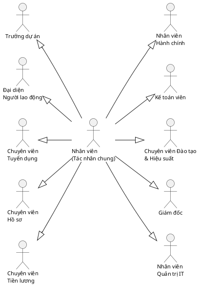
_Hình 2.1. Biểu đồ cây phân cấp Tác nhân (Actor Generalization) — "Nhân viên" làm tác nhân chung, tỏa nhánh ra 10 tác nhân chuyên biệt hóa._

### A.0. Tổng quan hệ thống (48 use case, 10 nhóm)

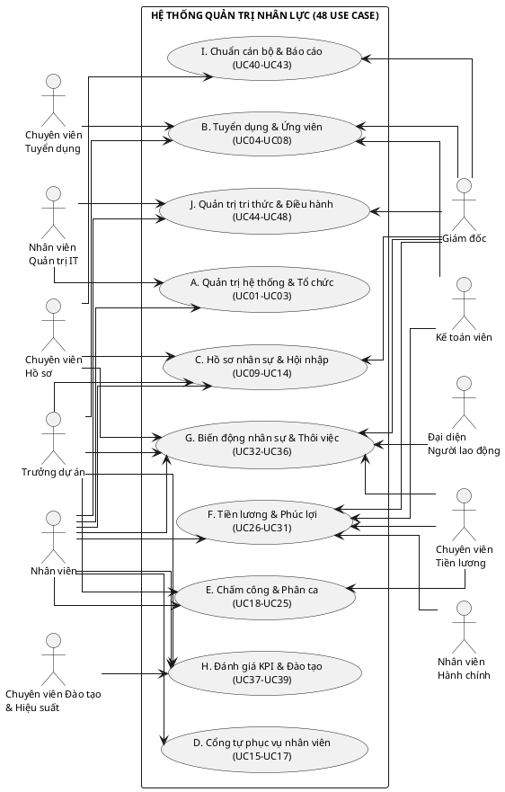
_Hình 2.2. Biểu đồ Use case tổng quan Hệ thống Quản trị nhân lực — 10 nhóm, 48 use case, tác nhân phân bố đều hai bên, đường nối thẳng vuông góc có mũi tên._


### A.A. Nhóm A - Quản trị hệ thống & Tổ chức

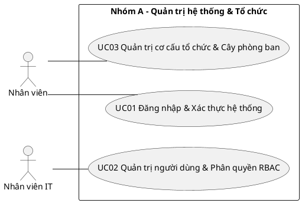
_Hình D.2. Nhóm A - Quản trị hệ thống & Tổ chức (UC01, UC02, UC03)._

### A.B. Nhóm B - Tuyển dụng & Quản lý ứng viên

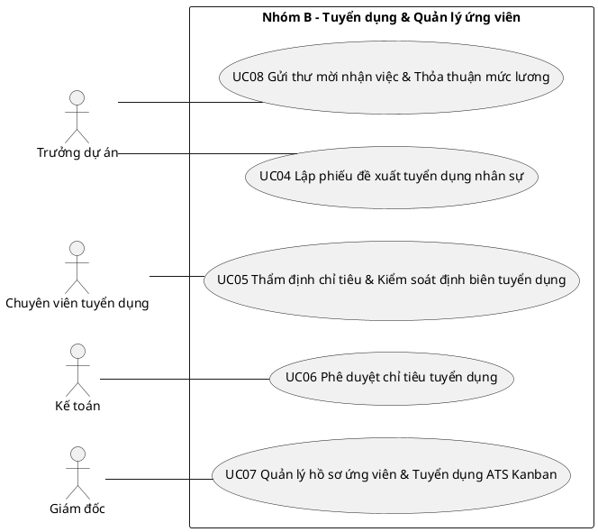
_Hình D.3. Nhóm B - Tuyển dụng & Quản lý ứng viên (UC04, UC05, UC06, UC07, UC08)._

### A.C. Nhóm C - Hồ sơ nhân sự, Hợp đồng & Hội nhập

```plantuml
@startuml
skinparam linetype ortho
skinparam shadowing false
left to right direction
actor "Chuyên viên hồ sơ" as A0
actor "Nhân viên" as A1
actor "Trưởng dự án" as A2
actor "Nhân viên mới" as A3
rectangle "Nhóm C - Hồ sơ nhân sự, Hợp đồng & Hội nhập" {
  (UC09 Quản lý hồ sơ nhân viên toàn diện) as UC09
  (UC10 Quản lý hợp đồng lao động & Phụ lục hợp đồng) as UC10
  (UC11 Quản lý văn bằng, chứng chỉ chuyên môn) as UC11
  (UC12 Mượn - trả hồ sơ, chứng chỉ bản gốc) as UC12
  (UC13 Đánh giá kết quả thử việc & Ký HĐLĐ chính thức) as UC13
  (UC14 Lộ trình hội nhập nhân viên mới (Onboarding Checklist)) as UC14
}
A0 -- UC09
A1 -- UC10
A2 -- UC11
A3 -- UC12
A0 -- UC13
A1 -- UC14
@enduml
```
_Hình D.4. Nhóm C - Hồ sơ nhân sự, Hợp đồng & Hội nhập (UC09, UC10, UC11, UC12, UC13, UC14)._

### A.D. Nhóm D - Cổng tự phục vụ & Phân cấp hồ sơ

```plantuml
@startuml
skinparam linetype ortho
skinparam shadowing false
left to right direction
actor "Toàn thể nhân viên" as A0
actor "Chuyên viên hồ sơ" as A1
actor "Quản trị viên" as A2
rectangle "Nhóm D - Cổng tự phục vụ & Phân cấp hồ sơ" {
  (UC15 Cổng tự phục vụ nhân viên tập trung (ESS Portal)) as UC15
  (UC16 Quản lý thông tin cá nhân phân cấp 3 mức độ) as UC16
  (UC17 Thẩm định & Phê duyệt đề xuất điều chỉnh hồ sơ Mức 2) as UC17
}
A0 -- UC15
A1 -- UC16
A2 -- UC17
@enduml
```
_Hình D.5. Nhóm D - Cổng tự phục vụ & Phân cấp hồ sơ (UC15, UC16, UC17)._

### A.E. Nhóm E - Chấm công, Phân ca & Điểm danh đa nguồn

```plantuml
@startuml
skinparam linetype ortho
skinparam shadowing false
left to right direction
actor "Toàn thể nhân viên" as A0
actor "Chuyên viên hồ sơ" as A1
actor "Chuyên viên tiền lương" as A2
actor "Trưởng dự án" as A3
actor "Quản trị IT" as A4
rectangle "Nhóm E - Chấm công, Phân ca & Điểm danh đa nguồn" {
  (UC18 Ghi nhận sự kiện chấm công & Điểm danh vào/ra ca) as UC18
  (UC19 Điểm danh khuôn mặt qua camera thường) as UC19
  (UC20 Quản trị kết nối thiết bị máy chấm công) as UC20
  (UC21 Đăng ký & Xét duyệt nghỉ phép trực tuyến) as UC21
  (UC22 Đăng ký & Phê duyệt làm thêm giờ (OT)) as UC22
  (UC23 Lập lịch và phân ca làm việc (Shift Scheduling)) as UC23
  (UC24 Giải trình bổ sung giờ công & Xử lý lệch công) as UC24
  (UC25 Tổng hợp & Chốt bảng chấm công tháng) as UC25
}
A0 -- UC18
A0 -- UC19
A1 -- UC20
A4 -- UC20
A0 -- UC21
A3 -- UC21
A1 -- UC21
A0 -- UC22
A2 -- UC22
A3 -- UC22
A3 -- UC23
A0 -- UC24
A2 -- UC24
A3 -- UC24
A2 -- UC25
A3 -- UC25
@enduml
```
_Hình D.6. Nhóm E - Chấm công, Phân ca & Điểm danh đa nguồn (UC18, UC19, UC20, UC21, UC22, UC23, UC24, UC25)._

### A.F. Nhóm F - Tiền lương, Chế độ đãi ngộ & Phúc lợi

```plantuml
@startuml
skinparam linetype ortho
skinparam shadowing false
left to right direction
actor "Chuyên viên tiền lương" as A0
actor "Giám đốc" as A1
actor "Nhân viên" as A2
actor "Kế toán" as A3
actor "Nhân viên hành chính" as A4
rectangle "Nhóm F - Tiền lương, Chế độ đãi ngộ & Phúc lợi" {
  (UC26 Cấu hình công thức và ngạch bậc lương) as UC26
  (UC27 Vận hành chức năng tính lương tự động) as UC27
  (UC28 Phê duyệt, khóa và ghi nhận chi trả kỳ lương) as UC28
  (UC29 Quản lý tạm ứng & Khoản vay phúc lợi nhân viên) as UC29
  (UC30 Quản lý đề xuất công tác & Quyết toán chi phí (T&E)) as UC30
  (UC31 Quản lý cấp phát & Thu hồi tài sản làm việc) as UC31
}
A0 -- UC26
A1 -- UC27
A2 -- UC28
A3 -- UC29
A4 -- UC30
A0 -- UC31
@enduml
```
_Hình D.7. Nhóm F - Tiền lương, Chế độ đãi ngộ & Phúc lợi (UC26, UC27, UC28, UC29, UC30, UC31)._

### A.G. Nhóm G - Biến động nhân sự & Thôi việc

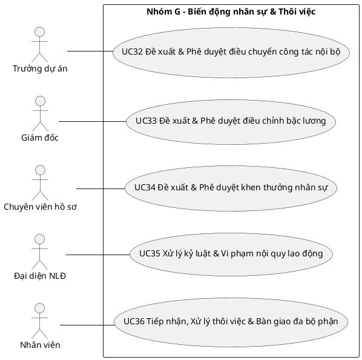
_Hình D.8. Nhóm G - Biến động nhân sự & Thôi việc (UC32, UC33, UC34, UC35, UC36)._

### A.H. Nhóm H - Đánh giá KPI, Đào tạo & Phát triển

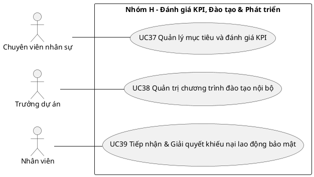
_Hình D.9. Nhóm H - Đánh giá KPI, Đào tạo & Phát triển (UC37, UC38, UC39)._

### A.I. Nhóm I - Chuẩn cán bộ & Báo cáo Nhà nước

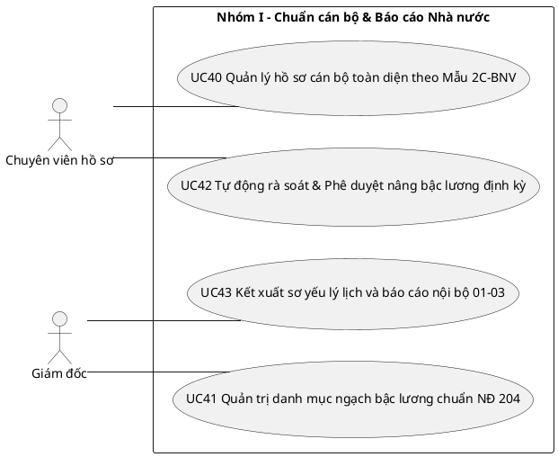
_Hình D.10. Nhóm I - Chuẩn cán bộ & Báo cáo Nhà nước (UC40, UC41, UC42, UC43)._

### A.J. Nhóm J - Quản trị Tri thức & Điều hành hệ thống

```plantuml
@startuml
skinparam linetype ortho
skinparam shadowing false
left to right direction
actor "Toàn thể nhân viên" as A0
actor "Ban Giám đốc" as A1
actor "Nhân viên IT" as A2
rectangle "Nhóm J - Quản trị Tri thức & Điều hành hệ thống" {
  (UC44 Quản lý không gian tri thức số & Tài liệu quy trình SOP) as UC44
  (UC45 Tìm kiếm tri thức toàn văn & Danh bạ chuyên gia) as UC45
  (UC46 Bảng điều khiển phân tích & Thống kê nhân sự (Dashboard)) as UC46
  (UC47 Nhật ký kiểm toán hệ thống & Cấu hình tham số) as UC47
  (UC48 Giám sát trạng thái thiết bị & Sức khỏe hệ thống) as UC48
}
A0 -- UC44
A1 -- UC45
A2 -- UC46
A0 -- UC47
A2 -- UC48
@enduml
```
_Hình D.11. Nhóm J - Quản trị Tri thức & Điều hành hệ thống (UC44, UC45, UC46, UC47, UC48)._

## B. BIỂU ĐỒ TRÌNH TỰ THEO TỪNG USE CASE

### B.UC01. Đăng nhập & Xác thực hệ thống

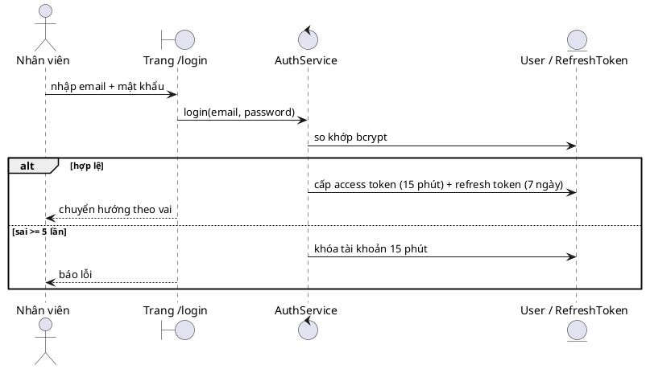
_Hình D.12. Trình tự UC01 - Đăng nhập & Xác thực hệ thống._

### B.UC02. Quản trị người dùng & Phân quyền RBAC

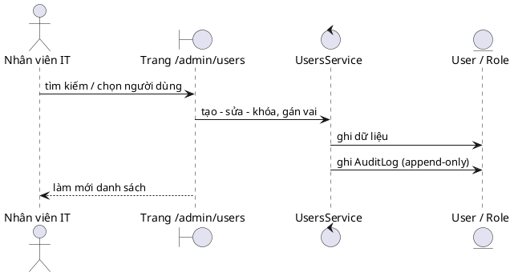
_Hình D.13. Trình tự UC02 - Quản trị người dùng & Phân quyền RBAC._

### B.UC03. Quản trị cơ cấu tổ chức & Cây phòng ban

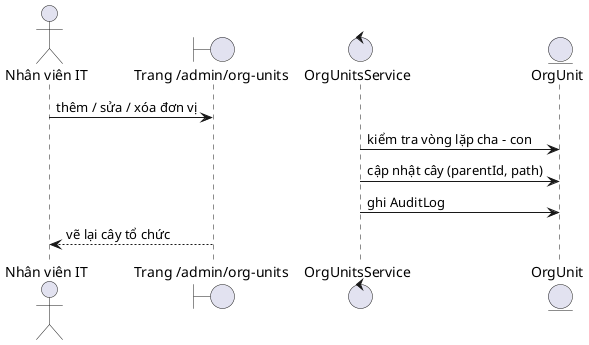
_Hình D.14. Trình tự UC03 - Quản trị cơ cấu tổ chức & Cây phòng ban._

### B.UC04. Lập phiếu đề xuất tuyển dụng nhân sự

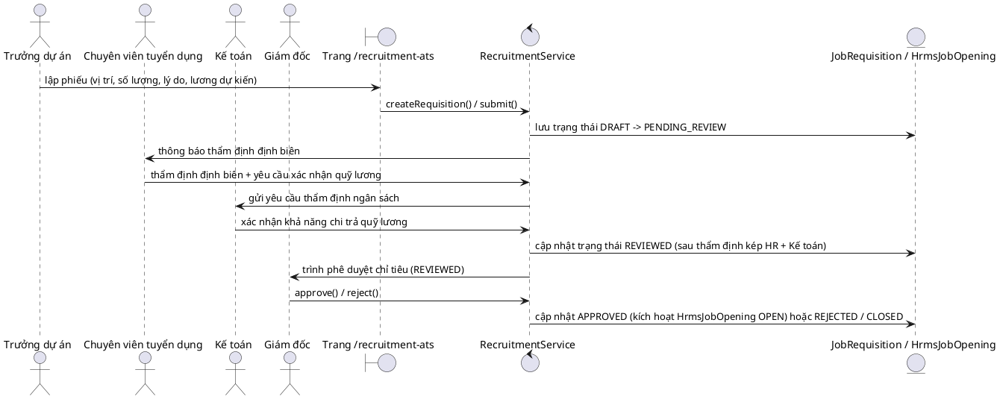
_Hình D.15. Trình tự UC04 - Lập phiếu đề xuất tuyển dụng nhân sự._

### B.UC05. Thẩm định chỉ tiêu & Kiểm soát định biên tuyển dụng

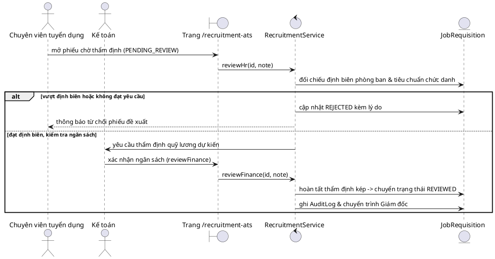
_Hình D.16. Trình tự UC05 - Thẩm định chỉ tiêu & Kiểm soát định biên tuyển dụng._

### B.UC06. Phê duyệt chỉ tiêu tuyển dụng

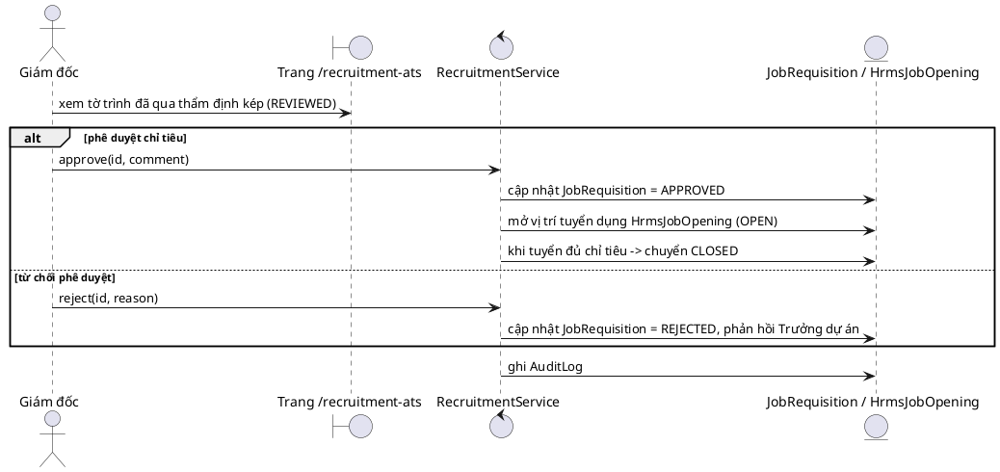
_Hình D.17. Trình tự UC06 - Phê duyệt chỉ tiêu tuyển dụng._

### B.UC07. Quản lý hồ sơ ứng viên & Tuyển dụng ATS Kanban

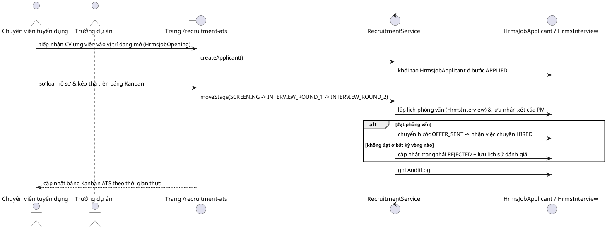
_Hình D.18. Trình tự UC07 - Quản lý hồ sơ ứng viên & Tuyển dụng ATS Kanban._

### B.UC08. Gửi thư mời nhận việc & Thỏa thuận mức lương

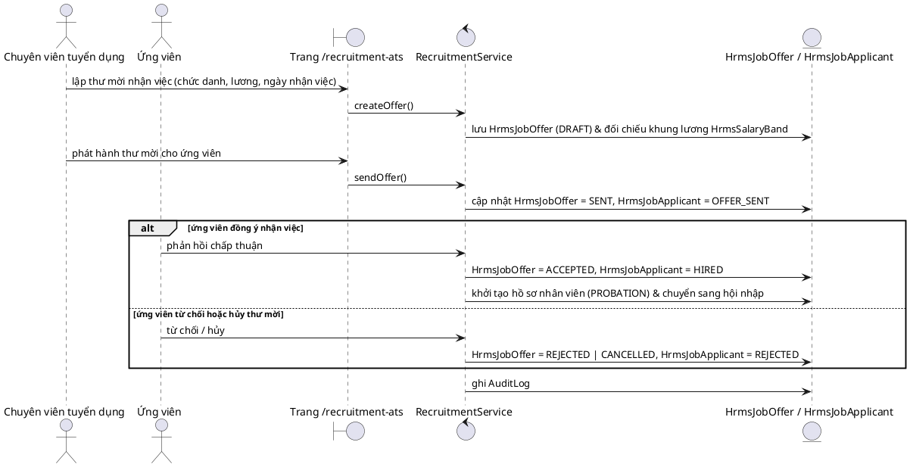
_Hình D.19. Trình tự UC08 - Gửi thư mời nhận việc & Thỏa thuận mức lương._

### B.UC09. Quản lý hồ sơ nhân viên toàn diện

```plantuml
@startuml
skinparam linetype ortho
skinparam shadowing false
actor "Chuyên viên hồ sơ" as A
boundary "Trang /employees" as B
control "EmployeesService" as C
entity "User" as E
A -> B : mở trang quản lý
B -> C : truy vấn danh sách
C -> E : SELECT phân trang
alt Thêm / Sửa / Xóa
A -> B : nhập dữ liệu
B -> C : validate DTO + lưu
C -> E : ghi + AuditLog
end
B --> A : làm mới danh sách
@enduml
```
_Hình D.20. Trình tự UC09 - Quản lý hồ sơ nhân viên toàn diện._

### B.UC10. Quản lý hợp đồng lao động & Phụ lục hợp đồng

```plantuml
@startuml
skinparam linetype ortho
skinparam shadowing false
actor "Chuyên viên hồ sơ" as A
boundary "Trang /employees/:id" as B
control "EmployeesService" as C
entity "Contract" as E
A -> B : mở trang quản lý
B -> C : truy vấn danh sách
C -> E : SELECT phân trang
alt Thêm / Sửa / Xóa
A -> B : nhập dữ liệu
B -> C : validate DTO + lưu
C -> E : ghi + AuditLog
end
B --> A : làm mới danh sách
@enduml
```
_Hình D.21. Trình tự UC10 - Quản lý hợp đồng lao động & Phụ lục hợp đồng._

### B.UC11. Quản lý văn bằng, chứng chỉ chuyên môn

```plantuml
@startuml
skinparam linetype ortho
skinparam shadowing false
actor "Chuyên viên hồ sơ" as A
boundary "Trang /employees/:id" as B
control "EmployeesService" as C
entity "Certificate" as E
A -> B : mở trang quản lý
B -> C : truy vấn danh sách
C -> E : SELECT phân trang
alt Thêm / Sửa / Xóa
A -> B : nhập dữ liệu
B -> C : validate DTO + lưu
C -> E : ghi + AuditLog
end
B --> A : làm mới danh sách
@enduml
```
_Hình D.22. Trình tự UC11 - Quản lý văn bằng, chứng chỉ chuyên môn._

### B.UC12. Mượn - trả hồ sơ, chứng chỉ bản gốc

```plantuml
@startuml
skinparam linetype ortho
skinparam shadowing false
actor "Nhân viên" as NV
actor "Chuyên viên hồ sơ" as HR
boundary "Trang /employees/:id" as B
control "EmployeesService" as C
entity "PhysicalRecordLoan" as E
NV -> B : gửi phiếu đăng ký mượn bản gốc (lý do, ngày hẹn trả)
B -> C : requestLoan()
C -> E : lưu PhysicalRecordLoan trạng thái REQUESTED
alt phê duyệt cho mượn
  HR -> C : approveLoan()
  C -> E : chuyển trạng thái APPROVED
  HR -> C : confirmHandover() (bàn giao bản gốc vật lý)
  C -> E : chuyển trạng thái BORROWED
  NV -> B : gửi yêu cầu hoàn trả bản gốc
  B -> C : requestReturn()
  C -> E : chuyển trạng thái RETURN_REQUESTED
  HR -> C : confirmReturn() (kiểm tra tình trạng & nhập kho tủ hồ sơ)
  C -> E : chuyển trạng thái RETURNED
else từ chối cho mượn
  HR -> C : rejectLoan(reason)
  C -> E : chuyển trạng thái REJECTED kèm lý do
end
C -> E : ghi AuditLog
@enduml
```
_Hình D.23. Trình tự UC12 - Mượn - trả hồ sơ, chứng chỉ bản gốc._

### B.UC13. Đánh giá kết quả thử việc & Ký HĐLĐ chính thức

```plantuml
@startuml
skinparam linetype ortho
skinparam shadowing false
actor "Trưởng dự án" as PM
boundary "Trang /lifecycle" as B
control "HrmsLifecycleService" as C
entity "Contract / HrmsLifecycleEvent" as E
PM -> B : điền phiếu đánh giá thử việc
B -> C : submitEvaluation()
alt đạt
  C -> E : sinh nhiệm vụ ký HĐ chính thức + xếp lương (>= 85%)
  C -> E : PROBATION -> ACTIVE
else không đạt
  C -> E : sinh nhiệm vụ chấm dứt hợp đồng thử việc
end
@enduml
```
_Hình D.24. Trình tự UC13 - Đánh giá kết quả thử việc & Ký HĐLĐ chính thức._

### B.UC14. Lộ trình hội nhập nhân viên mới (Onboarding Checklist)

```plantuml
@startuml
skinparam linetype ortho
skinparam shadowing false
actor "Nhân viên mới" as NV
actor "Chuyên viên hồ sơ" as HR
boundary "Trang /onboarding" as B
control "OnboardingService" as C
entity "OnboardingPath / OnboardingAssignment / OnboardingItemProgress" as E
HR -> B : thiết lập khuôn mẫu lộ trình theo vị trí/phòng ban
B -> C : assignPath(userId, pathId)
C -> E : tạo OnboardingAssignment & danh sách hạng mục hội nhập
loop từng hạng mục tài liệu quy chế / nhiệm vụ bắt buộc
  NV -> B : đọc tài liệu SOP / hoàn thành hạng mục & đánh dấu xác nhận
  B -> C : completeItem(assignmentId, itemId)
  C -> E : cập nhật OnboardingItemProgress (completedAt)
end
alt hoàn tất 100% hạng mục bắt buộc
  C -> E : đánh dấu hoàn thành lộ trình hội nhập (completedAt)
  C -> E : ghi AuditLog
else còn hạng mục quá hạn chưa hoàn thành
  C --> HR : hiển thị cảnh báo tiến độ hội nhập chậm
end
@enduml
```
_Hình D.25. Trình tự UC14 - Lộ trình hội nhập nhân viên mới (Onboarding Checklist)._

### B.UC15. Cổng tự phục vụ nhân viên tập trung (ESS Portal)

```plantuml
@startuml
skinparam linetype ortho
skinparam shadowing false
actor "Nhân viên" as A
boundary "Trang /ess" as B
control "DashboardService" as C
entity "LeaveBalance, Payslip, HrmsAssetAllocation" as E
A -> B : thao tác
B -> C : gọi service
C -> E : đọc/ghi dữ liệu
C -> E : ghi AuditLog
B --> A : kết quả
@enduml
```
_Hình D.26. Trình tự UC15 - Cổng tự phục vụ nhân viên tập trung (ESS Portal)._

### B.UC16. Quản lý thông tin cá nhân phân cấp 3 mức độ

```plantuml
@startuml
skinparam linetype ortho
skinparam shadowing false
actor "Nhân viên" as A
boundary "Trang /profile" as B
control "DashboardService, LeaveService" as C
entity "LeaveBalance, Payslip" as E
A -> B : thao tác
B -> C : gọi service
C -> E : đọc/ghi dữ liệu
C -> E : ghi AuditLog
B --> A : kết quả
@enduml
```
_Hình D.27. Trình tự UC16 - Quản lý thông tin cá nhân phân cấp 3 mức độ._

### B.UC17. Thẩm định & Phê duyệt đề xuất điều chỉnh hồ sơ Mức 2

```plantuml
@startuml
skinparam linetype ortho
skinparam shadowing false
actor "Chuyên viên nhân sự (HR-OPS)" as HR
boundary "Trang /profile (ReviewQueue)" as B
control "ProfileChangeRequestsService" as C
entity "ProfileChangeRequest / User / AuditLog" as E
HR -> B : mở hàng đợi thẩm định
B -> C : lấy danh sách chờ duyệt (listPending)
C -> E : truy vấn ProfileChangeRequest (PENDING)
E --> B : danh sách đề xuất kèm minh chứng
HR -> B : đối chiếu thông tin cũ/mới & xem tệp minh chứng
HR -> B : bấm Chấp thuận (hoặc Từ chối kèm lý do)
B -> C : approveRequest() / rejectRequest()
C -> E : atomic transaction: cập nhật User/ComprehensiveProfile
C -> E : đổi trạng thái APPROVED / REJECTED
C -> E : ghi AuditLog truy vết bất biến
C --> B : kết quả thẩm định thành công
@enduml
```
_Hình D.28. Trình tự UC17 - Thẩm định & Phê duyệt đề xuất điều chỉnh hồ sơ Mức 2._

### B.UC18. Ghi nhận sự kiện chấm công & Điểm danh vào/ra ca

```plantuml
@startuml
skinparam linetype ortho
skinparam shadowing false
actor "Nhân viên" as NV
actor "Máy chấm công" as MC
boundary "Trang /attendance" as B
control "AttendanceService" as C
entity "AttendanceEvent / AttendanceDay" as E
NV -> B : điểm danh web
MC -> C : webhook HMAC / import CSV
C -> E : INSERT sự kiện thô (append-only)
C -> E : tổng hợp bảng công ngày (vào/ra, muộn/sớm)
C --> B : hiển thị bảng công, đánh dấu bản ghi lệch
@enduml
```
_Hình D.29. Trình tự UC18 - Ghi nhận sự kiện chấm công & Điểm danh vào/ra ca._

### B.UC19. Điểm danh khuôn mặt qua camera thường

```plantuml
@startuml
skinparam linetype ortho
skinparam shadowing false
actor "Nhân viên" as NV
boundary "Trang /check-in" as B
control "Trình duyệt: HOG/LBP" as V
control "AttendanceService" as S
control "FaceCryptoService" as F
entity "FaceEmbedding / AttendanceEvent / AttendanceDay" as E
NV -> B : đồng ý xử lý dữ liệu
NV -> B : đăng ký 3 mẫu qua camera thường
B -> V : lấy khung giữa 64×64, tạo vector 256 chiều
V -> S : POST /face/enroll
S -> F : mã hóa vector AES-256-GCM
F -> E : lưu FaceEmbedding (không lưu ảnh gốc)
NV -> B : bật camera và điểm danh
B -> V : tạo vector từ khung hình hiện tại
V -> S : POST /check-in (method = FACE)
S -> E : đọc mẫu đã đăng ký
S -> F : giải mã mẫu và so cosine similarity
alt đạt ngưỡng cấu hình
  S -> E : ghi AttendanceEvent nguồn FACE
  S -> E : tính lại AttendanceDay
  S --> NV : xác nhận lượt vào/ra
else chưa đạt ngưỡng hoặc thiếu điều kiện
  S --> NV : từ chối và hiển thị lý do
end
@enduml
```
_Hình D.30. Trình tự UC19 - Điểm danh khuôn mặt qua camera thường._

### B.UC20. Quản trị kết nối thiết bị máy chấm công

```plantuml
@startuml
skinparam linetype ortho
skinparam shadowing false
actor "Thiết bị / CV hồ sơ" as DEV
boundary "Giao diện /admin/attendance" as B
control "AttendanceDevicesService" as C
control "AttendanceService" as S
entity "AttendanceDevice / AttendanceEvent" as E
DEV -> C : Webhook POST / CSV / Simulator
C -> C : Verify HMAC-SHA256 signature / parse CSV
alt Chữ ký hợp lệ & thiết bị ACTIVE
  C -> E : INSERT sự kiện (nguồn MACHINE / SIMULATOR)
  C -> S : Kích hoạt tổng hợp bảng công ngày
  C --> DEV : 200 OK (ghi nhận thành công)
else Lỗi xác thực hoặc định dạng sai
  C --> DEV : 400 Bad Request / 401 Unauthorized
end
@enduml
```
_Hình D.31. Trình tự UC20 - Quản trị kết nối thiết bị máy chấm công._

### B.UC21. Đăng ký & Xét duyệt nghỉ phép trực tuyến

```plantuml
@startuml
skinparam linetype ortho
skinparam shadowing false
actor "Nhân viên" as NV
actor "Chuyên viên nhân sự" as HR
actor "Kế toán / Quản trị" as FIN
boundary "Trang /leave" as B
control "LeaveService" as C
entity "LeaveRequest / LeaveBalance" as E
NV -> B : tạo đơn (loại, từ ngày, đến ngày)
B -> C : checkBalance()
alt quỹ đủ
  C -> E : lưu PENDING, thông báo HR
  HR -> C : approve()
  C -> E : trừ quỹ NGAY + ghi công phép vào bảng công
else quỹ không đủ
  C --> NV : từ chối kèm số dư còn lại
end
@enduml
```
_Hình D.32. Trình tự UC21 - Đăng ký & Xét duyệt nghỉ phép trực tuyến._

### B.UC22. Đăng ký & Phê duyệt làm thêm giờ (OT)

```plantuml
@startuml
skinparam linetype ortho
skinparam shadowing false
actor "Nhân viên" as A
boundary "Trang /overtime" as B
control "OvertimeService" as C
entity "OvertimeRequest" as E
A -> B : nhập đề xuất
B -> C : submit()
C -> E : lưu PENDING + thông báo duyệt
alt duyệt
C -> E : APPROVED + phát sinh hiệu lực
else từ chối
C -> E : REJECTED kèm lý do
end
C -> E : ghi AuditLog
@enduml
```
_Hình D.33. Trình tự UC22 - Đăng ký & Phê duyệt làm thêm giờ (OT)._

### B.UC23. Lập lịch và phân ca làm việc (Shift Scheduling)

```plantuml
@startuml
skinparam linetype ortho
skinparam shadowing false
actor "Chuyên viên tiền lương" as A
boundary "Trang /shifts" as B
control "HrmsShiftsService" as C
entity "HrmsShiftType, HrmsShiftAssignment" as E
A -> B : mở trang quản lý
B -> C : truy vấn danh sách
C -> E : SELECT phân trang
alt Thêm / Sửa / Xóa
A -> B : nhập dữ liệu
B -> C : validate DTO + lưu
C -> E : ghi + AuditLog
end
B --> A : làm mới danh sách
@enduml
```
_Hình D.34. Trình tự UC23 - Lập lịch và phân ca làm việc (Shift Scheduling)._

### B.UC24. Giải trình bổ sung giờ công & Xử lý lệch công

```plantuml
@startuml
skinparam linetype ortho
skinparam shadowing false
actor "Nhân viên" as NV
actor "Quản lý" as QL
boundary "Trang /ess" as B
control "HrmsRegularizationService" as C
entity "HrmsAttendanceRegularization" as E
NV -> B : chọn ngày thiếu công, nhập giờ mong muốn + lý do
B -> C : submit()
C -> E : lưu PENDING, thông báo quản lý
QL -> C : duyệt / từ chối
alt duyệt
  C -> E : bù công vào bảng chấm công
else từ chối
  C -> E : lưu lý do
end
@enduml
```
_Hình D.35. Trình tự UC24 - Giải trình bổ sung giờ công & Xử lý lệch công._

### B.UC25. Tổng hợp & Chốt bảng chấm công tháng

```plantuml
@startuml
skinparam linetype ortho
skinparam shadowing false
actor "Chuyên viên tiền lương" as CV
actor "Trưởng dự án" as PM
boundary "Trang /attendance" as B
control "AttendanceService" as C
entity "AttendanceDay" as E
CV -> B : hợp nhất bảng công tháng
C -> E : tổng hợp sự kiện, xử lý bản ghi lệch
PM -> B : xác nhận bảng công nhóm
CV -> B : chốt ngày 25, khóa bảng công
C -> E : khóa dữ liệu công chuyển sang tính lương
@enduml
```
_Hình D.36. Trình tự UC25 - Tổng hợp & Chốt bảng chấm công tháng._

### B.UC26. Cấu hình công thức và ngạch bậc lương

```plantuml
@startuml
skinparam linetype ortho
skinparam shadowing false
actor "Chuyên viên tiền lương" as A
boundary "Trang /payroll-engine" as B
control "HrmsPayrollService" as C
entity "HrmsSalaryComponent, HrmsSalaryStructure" as E
A -> B : mở trang quản lý
B -> C : truy vấn danh sách
C -> E : SELECT phân trang
alt Thêm / Sửa / Xóa
A -> B : nhập dữ liệu
B -> C : validate DTO + lưu
C -> E : ghi + AuditLog
end
B --> A : làm mới danh sách
@enduml
```
_Hình D.37. Trình tự UC26 - Cấu hình công thức và ngạch bậc lương._

### B.UC27. Vận hành chức năng tính lương tự động

```plantuml
@startuml
skinparam linetype ortho
skinparam shadowing false
actor "Chuyên viên tiền lương" as CV
boundary "Trang /payroll-engine" as B
control "PayrollService" as C
entity "Payslip / PayrollPeriod" as E
CV -> B : bấm tính lương kỳ đã chốt công
C -> E : nạp lương hợp đồng ACTIVE + OT đã duyệt
C -> E : tính BH/thuế theo năm và chính sách hiệu lực + khoản vay đã ủy quyền
C -> E : sinh Payslip từng nhân viên
CV -> B : đối chiếu
alt khớp
  CV -> C : trình duyệt
else lệch
  C -> E : ghi chú, tính lại (giữ vết audit)
end
@enduml
```
_Hình D.38. Trình tự UC27 - Vận hành chức năng tính lương tự động._

### B.UC28. Phê duyệt, khóa và ghi nhận chi trả kỳ lương

```plantuml
@startuml
skinparam linetype ortho
skinparam shadowing false
actor "Chuyên viên tiền lương" as CV
actor "Người đối soát HR/Kế toán" as RV
actor "Giám đốc" as BOD
actor "Kế toán chi trả" as ACC
boundary "Trang /payroll-engine" as B
control "PayrollService" as C
entity "HrmsPayrollRun + phiếu lương" as E
CV -> B : POST /runs · tính lương
B -> C : tạo kỳ từ công đã chốt
C -> E : tạo snapshot + PROCESSED
RV -> B : POST /runs/:id/review
B -> C : yêu cầu đối soát
C -> E : REVIEWED (RV ≠ CV)
BOD -> B : POST /runs/:id/approve
B -> C : yêu cầu phê duyệt
C -> E : APPROVED (BOD ≠ RV, CV)
BOD -> B : POST /runs/:id/lock
B -> C : yêu cầu khóa
C -> E : LOCKED (không sửa trực tiếp)
ACC -> B : POST /runs/:id/pay
B -> C : nhập phương thức + mã giao dịch/chứng từ
C -> E : PAID + áp dụng khấu trừ vay đủ điều kiện
alt hủy kỳ để lập lại
  B -> C : POST /runs/:id/cancel-for-recalculation
  C -> E : CANCELLED; giữ kỳ cũ, không đảo giao dịch ngân hàng
  note over C,E : Bị chặn nếu kỳ đã hạch toán khoản vay.
end
note over ACC,E : Lưu mã tham chiếu; chưa xác minh trực tiếp với ngân hàng.
@enduml
```
_Hình D.39. Trình tự UC28 - Phê duyệt, khóa và ghi nhận chi trả kỳ lương._

### B.UC29. Quản lý tạm ứng & Khoản vay phúc lợi nhân viên

```plantuml
@startuml
skinparam linetype ortho
skinparam shadowing false
actor "Nhân viên" as NV
actor "Chuyên viên C&B" as HR
actor "Kế toán" as FIN
boundary "Trang /loans" as B
control "HrmsLoansService" as C
entity "HrmsEmployeeLoan / PayrollLoanDeduction" as E
NV -> B : tạo đơn vay (số tiền, kỳ hạn trả, đồng ý khấu trừ lương)
B -> C : createLoan()
C -> E : tính EMI hàng tháng & kiểm tra chấp thuận khấu trừ
alt đã ghi nhận chấp thuận khấu trừ hợp lệ
  C -> E : lưu trạng thái PENDING
  HR -> C : approveLoan() / rejectLoan()
  alt phê duyệt khoản vay
    C -> E : chuyển trạng thái APPROVED (chưa giải ngân, chưa khấu trừ)
    FIN -> C : disburseLoan(method, referenceCode)
    C -> E : chuyển trạng thái DISBURSED, lưu thời điểm & mã chứng từ
    C -> E : kỳ lương sau tự động trích nợ (PayrollLoanDeduction) đến khi dư nợ = 0 -> PAID (hoặc COMPLETED)
    note over C,E : Khi thôi việc (UC36), hệ thống chặn đóng bàn giao nếu còn khoản vay APPROVED hoặc DISBURSED có dư nợ > 0
  else từ chối khoản vay
    C -> E : chuyển trạng thái REJECTED
  end
else thiếu ủy quyền khấu trừ
  C --> NV : chặn tạo đơn kèm thông báo
end
@enduml
```
_Hình D.40. Trình tự UC29 - Quản lý tạm ứng & Khoản vay phúc lợi nhân viên._

### B.UC30. Quản lý đề xuất công tác & Quyết toán chi phí (T&E)

```plantuml
@startuml
skinparam linetype ortho
skinparam shadowing false
actor "Nhân viên" as NV
actor "Trưởng dự án / C&B" as HR
actor "Kế toán" as FIN
boundary "Trang /expense-claims" as B
control "HrmsExpensesService" as C
entity "HrmsTravelRequest / HrmsExpenseClaim / HrmsClaimApprovalStep" as E
NV -> B : tạo đề xuất công tác & bảng kê chi phí kèm chứng từ
B -> C : createClaim() / submitClaim()
C -> E : chuyển trạng thái DRAFT -> SUBMITTED, khởi tạo HrmsClaimApprovalStep
alt phê duyệt đề nghị thanh toán
  HR -> C : approveClaim()
  C -> E : cập nhật HrmsExpenseClaim = APPROVED
  FIN -> C : payClaim() / ghi nhận ExpenseSettlement
  C -> E : cập nhật HrmsExpenseClaim = PAID, đồng bộ kỳ lương / kế toán
else từ chối đề nghị thanh toán
  HR -> C : rejectClaim(reason)
  C -> E : cập nhật HrmsExpenseClaim = REJECTED kèm lý do
end
C -> E : ghi AuditLog
@enduml
```
_Hình D.41. Trình tự UC30 - Quản lý đề xuất công tác & Quyết toán chi phí (T&E)._

### B.UC31. Quản lý cấp phát & Thu hồi tài sản làm việc

```plantuml
@startuml
skinparam linetype ortho
skinparam shadowing false
actor "Nhân viên hành chính" as HC
actor "Nhân viên" as NV
boundary "Trang /assets" as B
control "HrmsAssetsService" as C
entity "HrmsAsset / HrmsAssetAllocation / AssetCustodyEvent" as E
HC -> B : đăng ký tài sản mới vào kho
B -> C : createAsset()
C -> E : lưu HrmsAsset trạng thái AVAILABLE
HC -> B : lập phiếu cấp phát tài sản cho nhân viên
B -> C : allocateAsset()
C -> E : chuyển trạng thái PENDING_ACK (chờ nhân viên xác nhận bàn giao)
NV -> B : xác nhận đã nhận bàn giao tài sản
B -> C : acknowledgeAsset()
C -> E : chuyển trạng thái ALLOCATED + ghi AssetCustodyEvent
HC -> B : thu hồi khi điều chuyển / thôi việc hoặc chuyển bảo trì / thanh lý
B -> C : returnAsset() / updateStatus()
C -> E : chuyển về AVAILABLE (hoặc MAINTENANCE | DISPOSED)
@enduml
```
_Hình D.42. Trình tự UC31 - Quản lý cấp phát & Thu hồi tài sản làm việc._

### B.UC32. Đề xuất & Phê duyệt điều chuyển công tác nội bộ

```plantuml
@startuml
skinparam linetype ortho
skinparam shadowing false
actor "Trưởng dự án" as A
boundary "Trang /personnel" as B
control "PersonnelActionsService" as C
entity "PersonnelAction" as E
A -> B : nhập đề xuất
B -> C : submit()
C -> E : lưu PENDING + thông báo duyệt
alt duyệt
C -> E : APPROVED + phát sinh hiệu lực
else từ chối
C -> E : REJECTED kèm lý do
end
C -> E : ghi AuditLog
@enduml
```
_Hình D.43. Trình tự UC32 - Đề xuất & Phê duyệt điều chuyển công tác nội bộ._

### B.UC33. Đề xuất & Phê duyệt điều chỉnh bậc lương

```plantuml
@startuml
skinparam linetype ortho
skinparam shadowing false
actor "Trưởng dự án" as A
boundary "Trang /personnel" as B
control "PersonnelActionsService" as C
entity "PersonnelAction" as E
A -> B : nhập đề xuất
B -> C : submit()
C -> E : lưu PENDING + thông báo duyệt
alt duyệt
C -> E : APPROVED + phát sinh hiệu lực
else từ chối
C -> E : REJECTED kèm lý do
end
C -> E : ghi AuditLog
@enduml
```
_Hình D.44. Trình tự UC33 - Đề xuất & Phê duyệt điều chỉnh bậc lương._

### B.UC34. Đề xuất & Phê duyệt khen thưởng nhân sự

```plantuml
@startuml
skinparam linetype ortho
skinparam shadowing false
actor "Trưởng dự án" as A
boundary "Trang /personnel" as B
control "PersonnelActionsService" as C
entity "PersonnelAction" as E
A -> B : nhập đề xuất
B -> C : submit()
C -> E : lưu PENDING + thông báo duyệt
alt duyệt
C -> E : APPROVED + phát sinh hiệu lực
else từ chối
C -> E : REJECTED kèm lý do
end
C -> E : ghi AuditLog
@enduml
```
_Hình D.45. Trình tự UC34 - Đề xuất & Phê duyệt khen thưởng nhân sự._

### B.UC35. Xử lý kỷ luật & Vi phạm nội quy lao động

```plantuml
@startuml
skinparam linetype ortho
skinparam shadowing false
actor "Trưởng dự án" as A
boundary "Trang /personnel" as B
control "PersonnelActionsService" as C
entity "PersonnelAction" as E
A -> B : nhập đề xuất
B -> C : submit()
C -> E : lưu PENDING + thông báo duyệt
alt duyệt
C -> E : APPROVED + phát sinh hiệu lực
else từ chối
C -> E : REJECTED kèm lý do
end
C -> E : ghi AuditLog
@enduml
```
_Hình D.46. Trình tự UC35 - Xử lý kỷ luật & Vi phạm nội quy lao động._

### B.UC36. Tiếp nhận, Xử lý thôi việc & Bàn giao đa bộ phận

```plantuml
@startuml
skinparam linetype ortho
skinparam shadowing false
actor "Nhân viên" as NV
actor "Các bộ phận xác nhận" as BP
actor "Quản trị viên / HR" as AD
boundary "Trang /personnel, /handover" as B
control "PersonnelActionsService / HandoverService" as C
entity "PersonnelAction / HandoverChecklist / User" as E
NV -> B : nộp đơn thôi việc (PersonnelAction = TERMINATION)
AD -> C : approve() đơn thôi việc
C -> E : tự sinh HandoverChecklist (OPEN) gồm các hạng mục liên bộ phận
BP -> C : lần lượt xác nhận bàn giao công việc, tài sản, tài khoản IT, công nợ
alt đủ 100% hạng mục & không còn tài sản ALLOCATED hay khoản vay APPROVED/DISBURSED còn dư nợ
  C -> E : đóng HandoverChecklist = CLOSED, phát hành quyết định chấm dứt HĐLĐ
  C -> E : cập nhật User.employmentStatus = RESIGNED (hoặc RETIRED), User.status = DISABLED
else còn mục thiếu hoặc còn công nợ khoản vay / tài sản chưa trả
  C --> BP : chặn đóng hồ sơ & thông báo hạng mục / công nợ còn tồn đọng
end
C -> E : ghi AuditLog
@enduml
```
_Hình D.47. Trình tự UC36 - Tiếp nhận, Xử lý thôi việc & Bàn giao đa bộ phận._

### B.UC37. Quản lý mục tiêu và đánh giá KPI

```plantuml
@startuml
skinparam linetype ortho
skinparam shadowing false
actor "Chuyên viên nhân sự" as HR
actor "Nhân viên" as NV
actor "Quản lý trực tiếp" as QL
boundary "Trang /performance" as B
control "HrmsPerformanceService" as C
entity "HrmsAppraisalCycle / Goal / Evidence" as E
HR -> B : tạo chu kỳ KPI
B -> C : lưu chu kỳ
QL -> B : giao KPI, chỉ số đo, mức cần đạt, trọng số
B -> C : kiểm tra tổng trọng số = 100%
NV -> B : cập nhật kết quả thực tế và minh chứng
B -> C : lưu minh chứng theo mục tiêu
QL -> B : xem kết quả, chấm KPI từ 0 đến 100
B -> C : lưu điểm quản lý
C -> E : tính điểm chu kỳ theo trọng số KPI
C -> E : lưu kết quả, người chấm và lịch sử thao tác
note over C,E
  Điểm KPI không tự tạo thưởng hoặc thay đổi lương.
  Đánh giá công chức/viên chức được xử lý ở nhánh công vụ riêng.
end note
@enduml
```
_Hình D.48. Trình tự UC37 - Quản lý mục tiêu và đánh giá KPI._

### B.UC38. Quản trị chương trình đào tạo nội bộ

```plantuml
@startuml
skinparam linetype ortho
skinparam shadowing false
actor "Chuyên viên đào tạo" as HR
actor "Nhân viên" as NV
boundary "Trang /training-grievance" as B
control "HrmsTrainingService" as C
entity "HrmsTrainingProgram / HrmsTrainingEnrollment / Certificate" as E
HR -> B : thiết lập chương trình đào tạo (sĩ số tối đa, giảng viên, thời gian)
B -> C : createProgram()
C -> E : lưu HrmsTrainingProgram (PLANNED / OPEN)
NV -> B : đăng ký tham gia khóa học
B -> C : enroll(programId, userId)
alt còn chỉ tiêu sĩ số & chưa ghi danh trùng
  C -> E : tạo HrmsTrainingEnrollment (ENROLLED)
  NV -> B : hoàn thành khóa học & gửi khảo sát đánh giá (HrmsTrainingFeedback)
  HR -> B : chấm điểm kết quả đào tạo (completeEnrollment)
  B -> C : completeEnrollment(enrollmentId, score)
  C -> E : cập nhật COMPLETED + lưu điểm số
  alt điểm đánh giá score >= 50
    C -> E : tự động cấp chứng chỉ hoàn thành vào hồ sơ (Certificate)
  end
else lớp đã đủ sĩ số tối đa
  C --> NV : chặn ghi danh & thông báo hết chỗ
end
C -> E : ghi AuditLog
@enduml
```
_Hình D.49. Trình tự UC38 - Quản trị chương trình đào tạo nội bộ._

### B.UC39. Tiếp nhận & Giải quyết khiếu nại lao động bảo mật

```plantuml
@startuml
skinparam linetype ortho
skinparam shadowing false
actor "Nhân viên" as NV
actor "Chuyên viên nhân sự / Thanh tra" as HR
boundary "Trang /training-grievance" as B
control "HrmsTrainingService" as C
entity "HrmsGrievance" as E
NV -> B : gửi đơn kiến nghị / khiếu nại bảo mật (tiêu đề, nội dung, mức ẩn danh)
B -> C : createGrievance()
C -> E : lưu HrmsGrievance trạng thái OPEN
HR -> B : tiếp nhận hồ sơ & mở phiên xác minh nội bộ
B -> C : updateGrievanceStatus(INVESTIGATING)
C -> E : chuyển trạng thái OPEN -> INVESTIGATING
HR -> B : cập nhật kết luận giải quyết hoặc bác đơn
B -> C : resolveGrievance(id, status, resolutionNote)
alt người xử lý khác người gửi đơn (actor.id !== grievance.userId)
  C -> E : chuyển trạng thái sang RESOLVED hoặc DISMISSED kèm kết luận
  C -> E : ghi AuditLog bảo mật
  B --> NV : thông báo kết quả giải quyết trên cổng cá nhân
else người xử lý trùng người gửi đơn
  C --> HR : chặn thao tác (ForbiddenException - không tự giải quyết đơn của chính mình)
end
@enduml
```
_Hình D.50. Trình tự UC39 - Tiếp nhận & Giải quyết khiếu nại lao động bảo mật._

### B.UC40. Quản lý hồ sơ cán bộ toàn diện theo Mẫu 2C-BNV

```plantuml
@startuml
skinparam linetype ortho
skinparam shadowing false
actor "Chuyên viên hồ sơ" as A
boundary "Trang /employees?tab=civil-servant" as B
control "PersonnelProfilesService" as C
entity "PersonnelComprehensiveProfile + 8 bảng quá trình" as E
A -> B : mở trang quản lý
B -> C : truy vấn danh sách
C -> E : SELECT phân trang
alt Thêm / Sửa / Xóa
A -> B : nhập dữ liệu
B -> C : validate DTO + lưu
C -> E : ghi + AuditLog
end
B --> A : làm mới danh sách
@enduml
```
_Hình D.51. Trình tự UC40 - Quản lý hồ sơ cán bộ toàn diện theo Mẫu 2C-BNV._

### B.UC41. Quản trị danh mục ngạch bậc lương chuẩn NĐ 204

```plantuml
@startuml
skinparam linetype ortho
skinparam shadowing false
actor "Chuyên viên hồ sơ / C&B" as HR
boundary "Trang /salary-ranks" as B
control "PersonnelRanksService" as C
entity "PersonnelRank / MasterCatalogItem" as E
HR -> B : mở trang quản trị danh mục ngạch bậc công vụ
B -> C : listRanks()
C -> E : truy vấn danh sách ngạch (nhóm A0, A1, A2, B, C), thang bậc & hệ số
alt Thêm mới / Cập nhật ngạch bậc lương
  HR -> B : nhập mã ngạch, tên ngạch, mảng hệ số bậc, chu kỳ nâng bậc (36/24 tháng)
  B -> C : upsertRank(dto)
  C -> E : kiểm tra tính hợp lệ của dãy hệ số & quy đổi mức lương theo lương cơ sở 2.340.000đ
  C -> E : lưu PersonnelRank + ghi AuditLog
end
B --> HR : hiển thị bảng tra cứu ngạch bậc, hệ số & phụ cấp vượt khung
@enduml
```
_Hình D.52. Trình tự UC41 - Quản trị danh mục ngạch bậc lương chuẩn NĐ 204._

### B.UC42. Tự động rà soát & Phê duyệt nâng bậc lương định kỳ

```plantuml
@startuml
skinparam linetype ortho
skinparam shadowing false
actor "Chuyên viên hồ sơ" as HR
actor "Giám đốc" as GD
boundary "Trang /salary-progression" as B
control "PersonnelReportsService" as C
entity "PersonnelComprehensiveProfile / PersonnelSalaryHistory" as E
HR -> B : kích hoạt rà soát nâng bậc định kỳ hoặc lập đề xuất nâng bậc trước hạn
B -> C : scanEligibility()
C -> E : đối chiếu thời gian giữ bậc (đủ 36/24 tháng) & kiểm tra không bị kỷ luật trong kỳ
C -> E : lập danh sách đủ điều kiện (nếu chạm bậc trần thì tính phụ cấp vượt khung 5% + 1%/năm)
GD -> B : xem danh sách & phê duyệt quyết định nâng bậc / phụ cấp vượt khung
B -> C : approveProgression(userId, newStep, effectiveDate)
C -> E : cập nhật bậc/hệ số mới trên PersonnelComprehensiveProfile
C -> E : ghi bản ghi mới vào PersonnelSalaryHistory + ghi AuditLog
@enduml
```
_Hình D.53. Trình tự UC42 - Tự động rà soát & Phê duyệt nâng bậc lương định kỳ._

### B.UC43. Kết xuất sơ yếu lý lịch và báo cáo nội bộ 01-03

```plantuml
@startuml
skinparam linetype ortho
skinparam shadowing false
actor "Chuyên viên hồ sơ" as HR
boundary "Trang /personnel-reports" as B
control "PersonnelReportsService" as C
entity "PersonnelComprehensiveProfile" as E
HR -> B : chọn nhân viên, xuất 2C PDF
C -> E : tổng hợp 111 thuộc tính + 8 bảng quá trình
C --> HR : Sơ yếu lý lịch Mẫu 2C-BNV (ngoài phạm vi so khớp mẫu pháp quy theo yêu cầu)
HR -> B : chọn Biểu thống kê
C --> HR : Báo cáo nội bộ 01 / 02 / 03 dạng Excel (không tuyên bố là biểu mẫu pháp quy)
@enduml
```
_Hình D.54. Trình tự UC43 - Kết xuất sơ yếu lý lịch và báo cáo nội bộ 01-03._

### B.UC44. Quản lý không gian tri thức số & Tài liệu quy trình SOP

```plantuml
@startuml
skinparam linetype ortho
skinparam shadowing false
actor "Tác giả" as TG
actor "Quản lý Space" as QL
boundary "Trang /spaces, /review" as B
control "ArticlesService" as C
entity "Article / ArticleVersion / ArticleReview" as E
TG -> B : soạn bài (Markdown + đính kèm)
C -> E : lưu DRAFT
TG -> C : submit()
C -> E : PENDING_REVIEW + thông báo quản lý
alt duyệt
  QL -> C : approve()
  C -> E : PUBLISHED
else yêu cầu chỉnh sửa
  QL -> C : request_changes(kèm ý kiến)
  C -> E : về DRAFT
end
TG -> C : sửa bài
C -> E : sinh phiên bản mới (bất biến), rollback được
@enduml
```
_Hình D.55. Trình tự UC44 - Quản lý không gian tri thức số & Tài liệu quy trình SOP._

### B.UC45. Tìm kiếm tri thức toàn văn & Danh bạ chuyên gia

```plantuml
@startuml
skinparam linetype ortho
skinparam shadowing false
actor "Nhân viên" as NV
boundary "Trang /search, /people" as B
control "SearchService" as C
entity "Article (FTS + pg_trgm)" as E
NV -> B : nhập từ khóa
B -> C : search(q)
C -> E : truy vấn FTS lọc phạm vi quyền ngay trong SQL
C --> NV : kết quả kèm highlight
NV -> B : tìm chuyên gia theo lĩnh vực
B -> C : directory chuyên môn
C --> NV : danh sách chuyên gia + bài viết theo tác giả
@enduml
```
_Hình D.56. Trình tự UC45 - Tìm kiếm tri thức toàn văn & Danh bạ chuyên gia._

### B.UC46. Bảng điều khiển phân tích & Thống kê nhân sự (Dashboard)

```plantuml
@startuml
skinparam linetype ortho
skinparam shadowing false
actor "Toàn bộ vai" as A
boundary "Trang /dashboard" as B
control "DashboardService" as C
entity "User, PayrollRun, PersonnelAction" as E
A -> B : thao tác
B -> C : gọi service
C -> E : đọc/ghi dữ liệu
C -> E : ghi AuditLog
B --> A : kết quả
@enduml
```
_Hình D.57. Trình tự UC46 - Bảng điều khiển phân tích & Thống kê nhân sự (Dashboard)._

### B.UC47. Nhật ký kiểm toán hệ thống & Cấu hình tham số

```plantuml
@startuml
skinparam linetype ortho
skinparam shadowing false
actor "Nhân viên IT" as IT
boundary "Trang /admin/audit, /admin/settings" as B
control "AuditService / SettingsService" as C
entity "AuditLog / Setting" as E
IT -> B : tra cứu audit log
C -> E : đọc append-only (ai, làm gì, trước/sau)
IT -> B : chỉnh tham số key-value
C -> E : lưu Setting (không cần triển khai lại)
C -> E : ghi AuditLog thay đổi
@enduml
```
_Hình D.58. Trình tự UC47 - Nhật ký kiểm toán hệ thống & Cấu hình tham số._

### B.UC48. Giám sát trạng thái thiết bị & Sức khỏe hệ thống

```plantuml
@startuml
skinparam linetype ortho
skinparam shadowing false
actor "Nhân viên IT" as IT
boundary "Trang /admin/attendance, /api/health" as B
control "HealthController / AttendanceDevicesService" as C
entity "AttendanceDevice / PrismaService" as E
IT -> B : kiểm tra trạng thái sức khỏe hệ thống (GET /api/health)
B -> C : checkHealth()
C -> E : thực thi truy vấn thăm dò PostgreSQL (SELECT 1)
C --> B : trả trạng thái dịch vụ (ok, timestamp, độ trễ kết nối DB)
IT -> B : giám sát danh sách thiết bị chấm công & đồng bộ heartbeat
B -> C : listDevices() / pingDevice(deviceId)
C -> E : kiểm tra lastSeenAt & trạng thái thiết bị (ACTIVE / INACTIVE)
alt thiết bị phản hồi hợp lệ
  C -> E : cập nhật lastSeenAt & trạng thái kết nối trực tuyến
else mất kết nối hoặc sai chữ ký HMAC
  C --> IT : hiển thị cảnh báo thiết bị ngoại tuyến & ghi AuditLog
end
@enduml
```
_Hình D.58b. Trình tự UC48 - Giám sát trạng thái thiết bị & Sức khỏe hệ thống._

## C. BIỂU ĐỒ HOẠT ĐỘNG THEO TỪNG USE CASE

### C.UC01. Đăng nhập & Xác thực hệ thống

```plantuml
@startuml
skinparam linetype ortho
skinparam shadowing false
start
:Nhập email + mật khẩu;
:So khớp bcrypt;
if (Hợp lệ?) then (có)
:Cấp access + refresh token;
:Vào giao diện theo vai;
else (không)
:Báo lỗi;
if (Sai >= 5 lần?) then (có)
:Khóa tài khoản 15 phút;
endif
endif
stop
@enduml
```
_Hình D.59. Hoạt động UC01 - Đăng nhập & Xác thực hệ thống._

### C.UC02. Quản trị người dùng & Phân quyền RBAC

```plantuml
@startuml
skinparam linetype ortho
skinparam shadowing false
start
Mở trang quản lý
Tìm kiếm / lọc dữ liệu
alt Thêm / Sửa / Xóa
Nhập dữ liệu trên form
Hệ thống validate DTO
Lưu qua service + ghi AuditLog
Làm mới danh sách
end alt
stop
@enduml
```
_Hình D.60. Hoạt động UC02 - Quản trị người dùng & Phân quyền RBAC._

### C.UC03. Quản trị cơ cấu tổ chức & Cây phòng ban

```plantuml
@startuml
skinparam linetype ortho
skinparam shadowing false
start
Mở trang quản lý
Tìm kiếm / lọc dữ liệu
alt Thêm / Sửa / Xóa
Nhập dữ liệu trên form
Hệ thống validate DTO
Lưu qua service + ghi AuditLog
Làm mới danh sách
end alt
stop
@enduml
```
_Hình D.61. Hoạt động UC03 - Quản trị cơ cấu tổ chức & Cây phòng ban._

### C.UC04. Lập phiếu đề xuất tuyển dụng nhân sự

```plantuml
@startuml
skinparam linetype ortho
skinparam shadowing false
start
:Trưởng dự án lập phiếu đề xuất tuyển dụng (JobRequisition);
:Lưu trạng thái DRAFT -> gửi trình PENDING_REVIEW;
:Chuyên viên Tuyển dụng thẩm định định biên + Kế toán xác nhận quỹ lương;
:Hoàn tất thẩm định kép -> chuyển trạng thái REVIEWED;
:Trình Giám đốc phê duyệt;
if (Giám đốc phê duyệt?) then (có)
  :Cập nhật APPROVED & mở vị trí HrmsJobOpening (OPEN);
  :Khi tuyển đủ chỉ tiêu -> chuyển CLOSED;
else (từ chối)
  :Cập nhật REJECTED kèm lý do;
endif
stop
@enduml
```
_Hình D.62. Hoạt động UC04 - Lập phiếu đề xuất tuyển dụng nhân sự._

### C.UC05. Thẩm định chỉ tiêu & Kiểm soát định biên tuyển dụng

```plantuml
@startuml
skinparam linetype ortho
skinparam shadowing false
start
:Tiếp nhận phiếu đề xuất tuyển dụng (PENDING_REVIEW);
:Chuyên viên Tuyển dụng kiểm tra định biên phòng ban & tiêu chuẩn JD;
if (Đạt định biên & yêu cầu chuyên môn?) then (đạt)
  :Chuyển Kế toán thẩm định ngân sách quỹ lương dự kiến;
  if (Đảm bảo nguồn ngân sách chi trả?) then (đạt)
    :Hoàn tất thẩm định kép (HR + Kế toán);
    :Cập nhật trạng thái phiếu sang REVIEWED;
    :Chuyển tờ trình lên Ban Giám đốc phê duyệt;
  else (vượt ngân sách)
    :Cập nhật trạng thái REJECTED kèm lý do tài chính;
  endif
else (không đạt)
  :Cập nhật trạng thái REJECTED hoặc yêu cầu điều chỉnh;
endif
:Ghi nhật ký kiểm toán AuditLog;
stop
@enduml
```
_Hình D.63. Hoạt động UC05 - Thẩm định chỉ tiêu & Kiểm soát định biên tuyển dụng._

### C.UC06. Phê duyệt chỉ tiêu tuyển dụng

```plantuml
@startuml
skinparam linetype ortho
skinparam shadowing false
start
:Giám đốc mở danh sách tờ trình tuyển dụng đã qua thẩm định kép (REVIEWED);
:Xem chi tiết nhu cầu, định biên và ý kiến thẩm định của HR & Kế toán;
if (Đồng ý phê duyệt chỉ tiêu?) then (phê duyệt)
  :Cập nhật JobRequisition = APPROVED;
  :Tự động kích hoạt vị trí tuyển dụng HrmsJobOpening = OPEN;
  :Khi tuyển đủ số lượng -> đóng phiếu (CLOSED);
else (từ chối)
  :Cập nhật JobRequisition = REJECTED kèm ý kiến chỉ đạo;
  :Thông báo phản hồi cho Trưởng dự án & bộ phận Tuyển dụng;
endif
:Ghi nhật ký kiểm toán AuditLog;
stop
@enduml
```
_Hình D.64. Hoạt động UC06 - Phê duyệt chỉ tiêu tuyển dụng._

### C.UC07. Quản lý hồ sơ ứng viên & Tuyển dụng ATS Kanban

```plantuml
@startuml
skinparam linetype ortho
skinparam shadowing false
start
:Tiếp nhận CV ứng viên vào vị trí tuyển dụng đang mở (HrmsJobOpening);
:Khởi tạo hồ sơ HrmsJobApplicant ở bước APPLIED;
:Sơ loại hồ sơ chuyển sang bước SCREENING;
if (Đạt sàng lọc CV?) then (đạt)
  :Lập lịch phỏng vấn vòng 1 (INTERVIEW_ROUND_1);
  :Lập lịch phỏng vấn chuyên sâu vòng 2 (INTERVIEW_ROUND_2);
  if (Đạt phỏng vấn?) then (đạt)
    :Chuyển sang bước OFFER_SENT (gửi thư mời nhận việc);
    :Ứng viên nhận việc -> chuyển trạng thái HIRED;
  else (không đạt)
    :Chuyển trạng thái REJECTED;
  endif
else (loại)
  :Chuyển trạng thái REJECTED;
endif
:Ghi AuditLog & cập nhật bảng Kanban ATS;
stop
@enduml
```
_Hình D.65. Hoạt động UC07 - Quản lý hồ sơ ứng viên & Tuyển dụng ATS Kanban._

### C.UC08. Gửi thư mời nhận việc & Thỏa thuận mức lương

```plantuml
@startuml
skinparam linetype ortho
skinparam shadowing false
start
:Soạn thư mời nhận việc HrmsJobOffer (DRAFT: chức danh, lương, ngày nhận việc);
:Đối chiếu khung lương HrmsSalaryBand;
:Phát hành thư mời -> HrmsJobOffer = SENT, HrmsJobApplicant = OFFER_SENT;
if (Ứng viên đồng ý nhận việc?) then (chấp thuận)
  :Cập nhật HrmsJobOffer = ACCEPTED;
  :Cập nhật HrmsJobApplicant = HIRED;
  :Khởi tạo hồ sơ nhân sự mới (PROBATION) & kích hoạt lộ trình hội nhập;
else (từ chối / hủy)
  :Cập nhật HrmsJobOffer = REJECTED | CANCELLED;
  :Cập nhật HrmsJobApplicant = REJECTED;
endif
:Ghi nhật ký kiểm toán AuditLog;
stop
@enduml
```
_Hình D.66. Hoạt động UC08 - Gửi thư mời nhận việc & Thỏa thuận mức lương._

### C.UC09. Quản lý hồ sơ nhân viên toàn diện

```plantuml
@startuml
skinparam linetype ortho
skinparam shadowing false
start
Mở trang quản lý
Tìm kiếm / lọc dữ liệu
alt Thêm / Sửa / Xóa
Nhập dữ liệu trên form
Hệ thống validate DTO
Lưu qua service + ghi AuditLog
Làm mới danh sách
end alt
stop
@enduml
```
_Hình D.67. Hoạt động UC09 - Quản lý hồ sơ nhân viên toàn diện._

### C.UC10. Quản lý hợp đồng lao động & Phụ lục hợp đồng

```plantuml
@startuml
skinparam linetype ortho
skinparam shadowing false
start
Mở trang quản lý
Tìm kiếm / lọc dữ liệu
alt Thêm / Sửa / Xóa
Nhập dữ liệu trên form
Hệ thống validate DTO
Lưu qua service + ghi AuditLog
Làm mới danh sách
end alt
stop
@enduml
```
_Hình D.68. Hoạt động UC10 - Quản lý hợp đồng lao động & Phụ lục hợp đồng._

### C.UC11. Quản lý văn bằng, chứng chỉ chuyên môn

```plantuml
@startuml
skinparam linetype ortho
skinparam shadowing false
start
Mở trang quản lý
Tìm kiếm / lọc dữ liệu
alt Thêm / Sửa / Xóa
Nhập dữ liệu trên form
Hệ thống validate DTO
Lưu qua service + ghi AuditLog
Làm mới danh sách
end alt
stop
@enduml
```
_Hình D.69. Hoạt động UC11 - Quản lý văn bằng, chứng chỉ chuyên môn._

### C.UC12. Mượn - trả hồ sơ, chứng chỉ bản gốc

```plantuml
@startuml
skinparam linetype ortho
skinparam shadowing false
start
:Nhân viên gửi yêu cầu mượn hồ sơ/chứng chỉ gốc (PhysicalRecordLoan = REQUESTED);
:Chuyên viên Hồ sơ kiểm tra mục đích mượn & tình trạng lưu kho;
if (Chấp thuận cho mượn?) then (duyệt)
  :Cập nhật trạng thái APPROVED;
  :Bàn giao bản gốc vật lý -> chuyển trạng thái BORROWED;
  :Nhân viên đề nghị hoàn trả bản gốc -> chuyển trạng thái RETURN_REQUESTED;
  :Chuyên viên Hồ sơ kiểm tra bản gốc & nhập lại tủ lưu trữ -> chuyển trạng thái RETURNED;
else (từ chối)
  :Cập nhật trạng thái REJECTED kèm lý do;
endif
:Ghi nhật ký kiểm toán AuditLog;
stop
@enduml
```
_Hình D.70. Hoạt động UC12 - Mượn - trả hồ sơ, chứng chỉ bản gốc._

### C.UC13. Đánh giá kết quả thử việc & Ký HĐLĐ chính thức

```plantuml
@startuml
skinparam linetype ortho
skinparam shadowing false
start
:Trưởng dự án điền phiếu đánh giá thử việc;
if (Đạt?) then (có)
:Sinh nhiệm vụ ký HĐ chính thức + xếp lương;
:PROBATION -> ACTIVE;
else (không)
:Sinh nhiệm vụ chấm dứt hợp đồng thử việc;
endif
stop
@enduml
```
_Hình D.71. Hoạt động UC13 - Đánh giá kết quả thử việc & Ký HĐLĐ chính thức._

### C.UC14. Lộ trình hội nhập nhân viên mới (Onboarding Checklist)

```plantuml
@startuml
skinparam linetype ortho
skinparam shadowing false
start
:Chuyên viên Hồ sơ gán lộ trình hội nhập (OnboardingPath / OnboardingAssignment) theo vị trí;
:Hệ thống khởi tạo danh sách tài liệu SOP & hạng mục hội nhập bắt buộc;
repeat
  :Nhân viên mới đọc tài liệu quy chế & thực hiện hạng mục hội nhập;
  :Đánh dấu hoàn thành hạng mục (OnboardingItemProgress);
repeat while (Còn hạng mục bắt buộc chưa hoàn tất?) is (còn)
:Ghi nhận hoàn tất 100% lộ trình hội nhập (completedAt);
:Ghi nhật ký kiểm toán AuditLog;
stop
@enduml
```
_Hình D.72. Hoạt động UC14 - Lộ trình hội nhập nhân viên mới (Onboarding Checklist)._

### C.UC15. Cổng tự phục vụ nhân viên tập trung (ESS Portal)

```plantuml
@startuml
skinparam linetype ortho
skinparam shadowing false
start
Mở trang
Truy vấn theo phạm vi quyền
Hiển thị dữ liệu
stop
@enduml
```
_Hình D.73. Hoạt động UC15 - Cổng tự phục vụ nhân viên tập trung (ESS Portal)._

### C.UC16. Quản lý thông tin cá nhân phân cấp 3 mức độ

```plantuml
@startuml
skinparam linetype ortho
skinparam shadowing false
start
Mở trang
Truy vấn theo phạm vi quyền
Hiển thị dữ liệu
stop
@enduml
```
_Hình D.74. Hoạt động UC16 - Quản lý thông tin cá nhân phân cấp 3 mức độ._

### C.UC17. Thẩm định & Phê duyệt đề xuất điều chỉnh hồ sơ Mức 2

```plantuml
@startuml
skinparam linetype ortho
skinparam shadowing false
start
:Mở hàng đợi thẩm định hồ sơ (/profile);
:Tải danh sách đề xuất Mức 2 (PENDING);
:Đối chiếu thông tin hiện tại với giá trị mới đề xuất;
:Mở xem tài liệu minh chứng pháp lý (CCCD, bằng cấp...);
if (Hồ sơ minh chứng hợp lệ?) then (Đạt)
  :Bấm Chấp thuận (Approve);
  :Cập nhật User và ComprehensiveProfile;
  :Chuyển trạng thái APPROVED;
  :Ghi nhật ký kiểm toán AuditLog;
else (Không đạt)
  :Nhập lý do từ chối;
  :Chuyển trạng thái REJECTED;
  :Gửi phản hồi cho nhân viên;
endif
stop
@enduml
```
_Hình D.75. Hoạt động UC17 - Thẩm định & Phê duyệt đề xuất điều chỉnh hồ sơ Mức 2._

### C.UC18. Ghi nhận sự kiện chấm công & Điểm danh vào/ra ca

```plantuml
@startuml
skinparam linetype ortho
skinparam shadowing false
start
fork
:Điểm danh web ESS;
fork again
:Điểm danh bằng khuôn mặt qua camera thường;
fork again
:Máy chấm công đẩy webhook/CSV/Simulator;
end fork
:INSERT sự kiện thô (bất biến);
:Tổng hợp bảng công ngày;
if (Thiếu vào/ra?) then (có)
:Đánh dấu lệch vào hàng đợi;
else (không)
:Công chuẩn;
endif
stop
@enduml
```
_Hình D.76. Hoạt động UC18 - Ghi nhận sự kiện chấm công & Điểm danh vào/ra ca._

### C.UC19. Điểm danh khuôn mặt qua camera thường

```plantuml
@startuml
skinparam linetype ortho
skinparam shadowing false
start
:Đồng ý xử lý dữ liệu và đăng ký 3 mẫu;
:Trình duyệt trích vector từ camera thường;
:Máy chủ mã hóa và lưu mẫu FaceEmbedding;
:Mở camera, tạo vector điểm danh;
:Máy chủ so cosine similarity với mẫu;
if (Đạt ngưỡng cấu hình?) then (có)
:Ghi AttendanceEvent nguồn FACE;
:Tính lại AttendanceDay;
else (không)
:Từ chối và hiển thị lý do;
endif
stop
@enduml
```
_Hình D.77. Hoạt động UC19 - Điểm danh khuôn mặt qua camera thường._

### C.UC20. Quản trị kết nối thiết bị máy chấm công

```plantuml
@startuml
skinparam linetype ortho
skinparam shadowing false
start
:Thiết bị chấm công hoặc Chuyên viên nạp dữ liệu;
if (Phương thức?) then (Webhook API)
  :Nhận payload POST có chữ ký HMAC-SHA256;
  :Kiểm tra chữ ký theo khóa bí mật của thiết bị;
else (Tệp CSV)
  :Tải lên tệp CSV hoặc kích hoạt Simulator;
  :Phân tích cú pháp dòng dữ liệu quẹt thẻ;
endif
if (Hợp lệ và thiết bị ACTIVE?) then (có)
  :INSERT sự kiện thô bất biến (nguồn MACHINE / SIMULATOR);
  :Tổng hợp bảng công ngày;
  :Phản hồi kết quả đồng bộ thành công;
else (không)
  :Từ chối và ghi log lỗi thiết bị;
endif
stop
@enduml
```
_Hình D.78. Hoạt động UC20 - Quản trị kết nối thiết bị máy chấm công._

### C.UC21. Đăng ký & Xét duyệt nghỉ phép trực tuyến

```plantuml
@startuml
skinparam linetype ortho
skinparam shadowing false
start
:Nhân viên tạo đơn nghỉ phép;
:Kiểm tra quỹ phép;
if (Quỹ đủ?) then (có)
:Lưu PENDING, báo chuyên viên;
if (Duyệt?) then (có)
:Trừ quỹ NGAY + ghi công phép;
else (không)
:Lưu lý do từ chối;
endif
else (không)
:Chặn đơn kèm số dư còn lại;
endif
stop
@enduml
```
_Hình D.79. Hoạt động UC21 - Đăng ký & Xét duyệt nghỉ phép trực tuyến._

### C.UC22. Đăng ký & Phê duyệt làm thêm giờ (OT)

```plantuml
@startuml
skinparam linetype ortho
skinparam shadowing false
start
Mở trang
Truy vấn theo phạm vi quyền
Hiển thị dữ liệu
stop
@enduml
```
_Hình D.80. Hoạt động UC22 - Đăng ký & Phê duyệt làm thêm giờ (OT)._

### C.UC23. Lập lịch và phân ca làm việc (Shift Scheduling)

```plantuml
@startuml
skinparam linetype ortho
skinparam shadowing false
start
Mở trang quản lý
Tìm kiếm / lọc dữ liệu
alt Thêm / Sửa / Xóa
Nhập dữ liệu trên form
Hệ thống validate DTO
Lưu qua service + ghi AuditLog
Làm mới danh sách
end alt
stop
@enduml
```
_Hình D.81. Hoạt động UC23 - Lập lịch và phân ca làm việc (Shift Scheduling)._

### C.UC24. Giải trình bổ sung giờ công & Xử lý lệch công

```plantuml
@startuml
skinparam linetype ortho
skinparam shadowing false
start
:Chọn ngày thiếu công;
:Nhập giờ vào/ra mong muốn + lý do;
:Gửi giải trình;
if (Quản lý duyệt?) then (có)
:Bù công vào bảng chấm công;
else (không)
:Lưu lý do từ chối;
endif
stop
@enduml
```
_Hình D.82. Hoạt động UC24 - Giải trình bổ sung giờ công & Xử lý lệch công._

### C.UC25. Tổng hợp & Chốt bảng chấm công tháng

```plantuml
@startuml
skinparam linetype ortho
skinparam shadowing false
start
Mở trang
Truy vấn theo phạm vi quyền
Hiển thị dữ liệu
stop
@enduml
```
_Hình D.83. Hoạt động UC25 - Tổng hợp & Chốt bảng chấm công tháng._

### C.UC26. Cấu hình công thức và ngạch bậc lương

```plantuml
@startuml
skinparam linetype ortho
skinparam shadowing false
start
Mở trang quản lý
Tìm kiếm / lọc dữ liệu
alt Thêm / Sửa / Xóa
Nhập dữ liệu trên form
Hệ thống validate DTO
Lưu qua service + ghi AuditLog
Làm mới danh sách
end alt
stop
@enduml
```
_Hình D.84. Hoạt động UC26 - Cấu hình công thức và ngạch bậc lương._

### C.UC27. Vận hành chức năng tính lương tự động

```plantuml
@startuml
skinparam linetype ortho
skinparam shadowing false
start
:Chốt dữ liệu công + OT đã duyệt;
:Nạp lương hợp đồng ACTIVE;
:Tính gross theo cấu trúc lương;
:Tính BH/thuế theo chính sách của kỳ, OT đêm và khoản vay đã được ủy quyền;
:Sinh phiếu lương từng nhân viên;
:Đối chiếu;
if (Khớp?) then (có)
:ADMIN khóa kỳ LOCKED (chặn 409);
:Xuất bảng kê ngân hàng;
else (không)
:Ghi chú, tính lại giữ vết;
endif
stop
@enduml
```
_Hình D.85. Hoạt động UC27 - Vận hành chức năng tính lương tự động._

### C.UC28. Phê duyệt, khóa và ghi nhận chi trả kỳ lương

```plantuml
@startuml
skinparam linetype ortho
skinparam shadowing false
start
:Tạo kỳ lương từ công đã chốt;
:Đối soát; người đối soát khác người tính;
if (Điều kiện đối soát hợp lệ?) then (có)
  :REVIEWED;
else (không)
  :Từ chối thao tác;
  stop
endif
:Phê duyệt; người duyệt khác người tính và người đối soát;
if (Điều kiện phê duyệt hợp lệ?) then (có)
  :APPROVED;
else (không)
  :Từ chối thao tác;
  stop
endif
:Khóa kỳ - LOCKED;
:Kế toán nhập phương thức và mã giao dịch/chứng từ;
:PAID; hạch toán khoản vay đủ điều kiện;
note right
Kỳ đã khóa hoặc đã trả có thể hủy để lập lại.
Không đảo giao dịch ngân hàng; chặn nếu
đã hạch toán khoản vay.
end note
stop
@enduml
```
_Hình D.86. Hoạt động UC28 - Phê duyệt, khóa và ghi nhận chi trả kỳ lương._

### C.UC29. Quản lý tạm ứng & Khoản vay phúc lợi nhân viên

```plantuml
@startuml
skinparam linetype ortho
skinparam shadowing false
start
:Nhân viên gửi đơn vay và chấp thuận lịch khấu trừ;
:Hệ thống lưu consent, phiên bản và ngày giờ; trạng thái PENDING;
if (Người có thẩm quyền duyệt?) then (duyệt)
  :APPROVED — chưa giải ngân, chưa khấu trừ;
  :Kế toán ghi phương thức chi và mã chứng từ;
  :Chuyển trạng thái DISBURSED;
  if (Đã giải ngân + có consent + còn dư nợ?) then (đủ điều kiện)
    :Kỳ lương sau tự động xét khoản khấu trừ (PayrollLoanDeduction);
    :Cập nhật số đã thu và dư nợ còn lại;
    if (Dư nợ bằng 0?) then (đã tất toán)
      :Chuyển trạng thái PAID (hoặc COMPLETED);
    else (còn dư nợ)
      :Tiếp tục kỳ sau (chặn đóng bàn giao thôi việc UC36 nếu còn khoản vay APPROVED / DISBURSED có dư nợ > 0);
    endif
  else (không đủ điều kiện)
    :Không đưa vào bảng lương;
  endif
else (từ chối)
  :Chuyển trạng thái REJECTED;
endif
stop
@enduml
```
_Hình D.87. Hoạt động UC29 - Quản lý tạm ứng & Khoản vay phúc lợi nhân viên._

### C.UC30. Quản lý đề xuất công tác & Quyết toán chi phí (T&E)

```plantuml
@startuml
skinparam linetype ortho
skinparam shadowing false
start
:Nhân viên tạo đề xuất công tác & bảng kê chi phí (HrmsExpenseClaim = DRAFT);
:Đính kèm chứng từ hóa đơn & gửi trình duyệt -> chuyển trạng thái SUBMITTED;
:Khởi tạo các bước phê duyệt HrmsClaimApprovalStep;
if (Quản lý / C&B phê duyệt?) then (duyệt)
  :Cập nhật trạng thái APPROVED;
  :Kế toán đối soát tạm ứng, ghi nhận quyết toán (ExpenseSettlement);
  :Chi trả hoàn ứng & cập nhật trạng thái PAID;
else (từ chối)
  :Cập nhật trạng thái REJECTED kèm lý do;
endif
:Ghi nhật ký kiểm toán AuditLog;
stop
@enduml
```
_Hình D.88. Hoạt động UC30 - Quản lý đề xuất công tác & Quyết toán chi phí (T&E)._

### C.UC31. Quản lý cấp phát & Thu hồi tài sản làm việc

```plantuml
@startuml
skinparam linetype ortho
skinparam shadowing false
start
:Đăng ký tài sản mới vào kho (HrmsAsset = AVAILABLE);
:Lập phiếu cấp phát cho nhân viên -> chuyển trạng thái PENDING_ACK;
:Nhân viên xác nhận nhận bàn giao trên cổng ESS;
:Cập nhật trạng thái ALLOCATED & ghi sự kiện AssetCustodyEvent;
if (Phát sinh thu hồi / bảo trì / thanh lý?) then (thu hồi về kho)
  :Nhân viên bàn giao lại -> cập nhật trạng thái AVAILABLE;
elseif (hỏng hóc cần sửa chữa?) then (bảo trì)
  :Cập nhật trạng thái MAINTENANCE;
elseif (hết khấu hao / hỏng hoàn toàn?) then (thanh lý)
  :Cập nhật trạng thái DISPOSED;
else (đang sử dụng)
  :Duy trì trạng thái ALLOCATED;
endif
:Ghi nhật ký kiểm toán AuditLog;
stop
@enduml
```
_Hình D.89. Hoạt động UC31 - Quản lý cấp phát & Thu hồi tài sản làm việc._

### C.UC32. Đề xuất & Phê duyệt điều chuyển công tác nội bộ

```plantuml
@startuml
skinparam linetype ortho
skinparam shadowing false
start
Mở trang
Truy vấn theo phạm vi quyền
Hiển thị dữ liệu
stop
@enduml
```
_Hình D.90. Hoạt động UC32 - Đề xuất & Phê duyệt điều chuyển công tác nội bộ._

### C.UC33. Đề xuất & Phê duyệt điều chỉnh bậc lương

```plantuml
@startuml
skinparam linetype ortho
skinparam shadowing false
start
Mở trang
Truy vấn theo phạm vi quyền
Hiển thị dữ liệu
stop
@enduml
```
_Hình D.91. Hoạt động UC33 - Đề xuất & Phê duyệt điều chỉnh bậc lương._

### C.UC34. Đề xuất & Phê duyệt khen thưởng nhân sự

```plantuml
@startuml
skinparam linetype ortho
skinparam shadowing false
start
Mở trang
Truy vấn theo phạm vi quyền
Hiển thị dữ liệu
stop
@enduml
```
_Hình D.92. Hoạt động UC34 - Đề xuất & Phê duyệt khen thưởng nhân sự._

### C.UC35. Xử lý kỷ luật & Vi phạm nội quy lao động

```plantuml
@startuml
skinparam linetype ortho
skinparam shadowing false
start
Mở trang
Truy vấn theo phạm vi quyền
Hiển thị dữ liệu
stop
@enduml
```
_Hình D.93. Hoạt động UC35 - Xử lý kỷ luật & Vi phạm nội quy lao động._

### C.UC36. Tiếp nhận, Xử lý thôi việc & Bàn giao đa bộ phận

```plantuml
@startuml
skinparam linetype ortho
skinparam shadowing false
start
:Nhân viên nộp đơn thôi việc (PersonnelAction = TERMINATION);
:Quản lý & Ban Giám đốc phê duyệt đơn thôi việc;
:Hệ thống tự sinh HandoverChecklist (OPEN) gồm các hạng mục liên bộ phận;
repeat
  :Từng bộ phận (Dự án, Hành chính, IT, C&B, Kế toán) xác nhận hạng mục bàn giao;
  :Kiểm tra không còn tài sản ALLOCATED và không còn khoản vay APPROVED/DISBURSED có dư nợ > 0;
repeat while (Đủ 100% hạng mục & hết công nợ/tài sản?) is (chưa đủ -> chặn đóng)
:Đóng HandoverChecklist (CLOSED) & phát hành quyết định chấm dứt HĐLĐ;
:Cập nhật User.employmentStatus = RESIGNED (hoặc RETIRED) và User.status = DISABLED;
:Ghi nhật ký kiểm toán AuditLog;
stop
@enduml
```
_Hình D.94. Hoạt động UC36 - Tiếp nhận, Xử lý thôi việc & Bàn giao đa bộ phận._

### C.UC37. Quản lý mục tiêu và đánh giá KPI

```plantuml
@startuml
skinparam linetype ortho
skinparam shadowing false
start
:HR tạo chu kỳ đánh giá KPI;
:Quản lý giao KPI, chỉ số đo, mức cần đạt và trọng số;
:Kiểm tra tổng trọng số từng nhân viên bằng 100%;
:Nhân viên cập nhật kết quả thực tế và minh chứng;
:Quản lý đối chiếu kết quả, chấm từng KPI từ 0 đến 100;
:Tính điểm chu kỳ theo trọng số KPI;
:Lưu kết quả và lịch sử thao tác;
:HR hoặc quản lý đóng chu kỳ theo quyền;
stop
@enduml
```
_Hình D.95. Hoạt động UC37 - Quản lý mục tiêu và đánh giá KPI._

### C.UC38. Quản trị chương trình đào tạo nội bộ

```plantuml
@startuml
skinparam linetype ortho
skinparam shadowing false
start
:Chuyên viên Đào tạo lập chương trình HrmsTrainingProgram (giới hạn sĩ số, thời gian);
if (Lớp còn chỗ & nhân viên chưa ghi danh trùng?) then (còn chỗ)
  :Nhân viên đăng ký tham gia -> lưu HrmsTrainingEnrollment (ENROLLED);
  :Tham gia khóa học & gửi phản hồi khảo sát HrmsTrainingFeedback;
  :Chuyên viên Đào tạo chấm điểm hoàn thành (completeEnrollment);
  :Cập nhật trạng thái COMPLETED;
  if (Điểm đánh giá cuối khóa score >= 50?) then (đạt)
    :Tự động cấp chứng chỉ hoàn thành vào bảng Certificate;
  else (chưa đạt ngưỡng cấp chứng chỉ)
    :Chỉ lưu kết quả tham gia khóa học;
  endif
else (hết chỗ / trùng)
  :Chặn ghi danh & hiển thị thông báo;
endif
:Ghi nhật ký kiểm toán AuditLog;
stop
@enduml
```
_Hình D.96. Hoạt động UC38 - Quản trị chương trình đào tạo nội bộ._

### C.UC39. Tiếp nhận & Giải quyết khiếu nại lao động bảo mật

```plantuml
@startuml
skinparam linetype ortho
skinparam shadowing false
start
:Nhân viên gửi đơn kiến nghị / khiếu nại bảo mật;
:Hệ thống khởi tạo HrmsGrievance ở trạng thái OPEN;
:Chuyên viên Nhân sự / Thanh tra tiếp nhận hồ sơ;
:Chuyển trạng thái sang INVESTIGATING & tiến hành xác minh nội bộ;
if (Người xử lý khác người gửi đơn: actor.id !== grievance.userId?) then (hợp lệ)
  if (Kết quả xác minh có cơ sở?) then (giải quyết)
    :Cập nhật trạng thái RESOLVED kèm nội dung kết luận xử lý;
  else (không đủ căn cứ / bác đơn)
    :Cập nhật trạng thái DISMISSED kèm lý do phản hồi;
  endif
  :Ghi nhật ký kiểm toán AuditLog;
else (trùng người gửi đơn)
  :Chặn thao tác (không được tự giải quyết đơn khiếu nại của chính mình);
endif
stop
@enduml
```
_Hình D.97. Hoạt động UC39 - Tiếp nhận & Giải quyết khiếu nại lao động bảo mật._

### C.UC40. Quản lý hồ sơ cán bộ toàn diện theo Mẫu 2C-BNV

```plantuml
@startuml
skinparam linetype ortho
skinparam shadowing false
start
Mở trang quản lý
Tìm kiếm / lọc dữ liệu
alt Thêm / Sửa / Xóa
Nhập dữ liệu trên form
Hệ thống validate DTO
Lưu qua service + ghi AuditLog
Làm mới danh sách
end alt
stop
@enduml
```
_Hình D.98. Hoạt động UC40 - Quản lý hồ sơ cán bộ toàn diện theo Mẫu 2C-BNV._

### C.UC41. Quản trị danh mục ngạch bậc lương chuẩn NĐ 204

```plantuml
@startuml
skinparam linetype ortho
skinparam shadowing false
start
:Mở trang quản trị danh mục ngạch bậc công vụ (/salary-ranks);
:Truy vấn danh sách PersonnelRank (nhóm ngạch A0, A1, A2, B, C) & bảng hệ số bậc;
if (Thêm mới hoặc cập nhật ngạch lương?) then (có)
  :Nhập mã ngạch, tên ngạch, mảng hệ số từng bậc, chu kỳ nâng bậc (36/24 tháng);
  :Kiểm tra tính hợp lệ của dãy hệ số & quy đổi mức lương theo lương cơ sở 2.340.000đ;
  :Lưu PersonnelRank / MasterCatalogItem & ghi AuditLog;
else (chỉ tra cứu)
  :Hiển thị bảng hệ số lương và phụ cấp thâm niên vượt khung;
endif
stop
@enduml
```
_Hình D.99. Hoạt động UC41 - Quản trị danh mục ngạch bậc lương chuẩn NĐ 204._

### C.UC42. Tự động rà soát & Phê duyệt nâng bậc lương định kỳ

```plantuml
@startuml
skinparam linetype ortho
skinparam shadowing false
start
:Chuyên viên Hồ sơ kích hoạt quét rà soát thời gian giữ bậc hoặc đề xuất nâng bậc trước hạn;
:Đối chiếu ngày hưởng bậc hiện tại với chu kỳ 36 tháng (ngạch A/B) hoặc 24 tháng (ngạch C) và điều kiện không bị kỷ luật;
if (Đủ điều kiện nâng bậc định kỳ hoặc có thành tích nâng bậc trước hạn?) then (đủ điều kiện)
  if (Đã chạm bậc cuối cùng của ngạch?) then (bậc trần)
    :Tính phụ cấp thâm niên vượt khung (5% năm đầu + 1% mỗi năm tiếp theo);
  else (chưa chạm trần)
    :Đề xuất nâng lên bậc kế tiếp trong ngạch;
  endif
  if (Cấp có thẩm quyền phê duyệt?) then (duyệt)
    :Cập nhật bậc, hệ số và ngày hưởng mới trên PersonnelComprehensiveProfile;
    :Lưu bản ghi lịch sử vào PersonnelSalaryHistory & ghi AuditLog;
  else (tạm hoãn / từ chối)
    :Giữ nguyên bậc hiện tại & lưu lý do;
  endif
else (chưa đủ điều kiện)
  :Báo cáo chưa phát sinh hồ sơ đến hạn nâng bậc;
endif
stop
@enduml
```
_Hình D.100. Hoạt động UC42 - Tự động rà soát & Phê duyệt nâng bậc lương định kỳ._

### C.UC43. Kết xuất sơ yếu lý lịch và báo cáo nội bộ 01-03

```plantuml
@startuml
skinparam linetype ortho
skinparam shadowing false
start
:Chọn nhân viên / loại biểu mẫu;
:Tổng hợp 111 thuộc tính + 8 bảng quá trình;
alt SYLL 2C
:Xuất sơ yếu lý lịch Mẫu 2C-BNV PDF (ngoài phạm vi so khớp);
else Biểu thống kê
:Xuất báo cáo quản trị nội bộ 01/02/03 Excel;
endif
stop
@enduml
```
_Hình D.101. Hoạt động UC43 - Kết xuất sơ yếu lý lịch và báo cáo nội bộ 01-03._

### C.UC44. Quản lý không gian tri thức số & Tài liệu quy trình SOP

```plantuml
@startuml
skinparam linetype ortho
skinparam shadowing false
start
:Soạn bài trong Space;
:Lưu DRAFT;
:Trình duyệt -> PENDING_REVIEW;
if (Duyệt?) then (có)
:PUBLISHED;
else (yêu cầu chỉnh sửa)
:Về DRAFT kèm ý kiến;
endif
:Sửa bài sinh phiên bản mới bất biến;
stop
@enduml
```
_Hình D.102. Hoạt động UC44 - Quản lý không gian tri thức số & Tài liệu quy trình SOP._

### C.UC45. Tìm kiếm tri thức toàn văn & Danh bạ chuyên gia

```plantuml
@startuml
skinparam linetype ortho
skinparam shadowing false
start
:Nhập từ khóa;
:Truy vấn FTS + pg_trgm lọc phạm vi quyền;
:Trả kết quả có highlight;
:Tra cứu directory chuyên gia;
stop
@enduml
```
_Hình D.103. Hoạt động UC45 - Tìm kiếm tri thức toàn văn & Danh bạ chuyên gia._

### C.UC46. Bảng điều khiển phân tích & Thống kê nhân sự (Dashboard)

```plantuml
@startuml
skinparam linetype ortho
skinparam shadowing false
start
Mở trang
Truy vấn theo phạm vi quyền
Hiển thị dữ liệu
stop
@enduml
```
_Hình D.104. Hoạt động UC46 - Bảng điều khiển phân tích & Thống kê nhân sự (Dashboard)._

### C.UC47. Nhật ký kiểm toán hệ thống & Cấu hình tham số

```plantuml
@startuml
skinparam linetype ortho
skinparam shadowing false
start
:Nhập tiêu chí tra cứu;
:Đọc AuditLog append-only;
:Chỉnh tham số key-value;
:Ghi vết thay đổi;
stop
@enduml
```
_Hình D.105. Hoạt động UC47 - Nhật ký kiểm toán hệ thống & Cấu hình tham số._

### C.UC48. Giám sát trạng thái thiết bị & Sức khỏe hệ thống

```plantuml
@startuml
skinparam linetype ortho
skinparam shadowing false
start
:Nhân viên IT mở trang giám sát thiết bị (/admin/attendance) hoặc gọi /api/health;
:Thực thi kiểm tra kết nối cơ sở dữ liệu PostgreSQL (SELECT 1);
:Kiểm tra danh sách máy chấm công (AttendanceDevice) & thời điểm đồng bộ gần nhất (lastSeenAt);
if (Thiết bị phản hồi đúng hạn & chữ ký HMAC hợp lệ?) then (trực tuyến)
  :Hiển thị trạng thái ACTIVE / Trực tuyến;
else (quá hạn heartbeat / lỗi kết nối)
  :Đánh dấu cảnh báo thiết bị ngoại tuyến (OFFLINE / INACTIVE);
  :Ghi nhận sự kiện vào nhật ký hệ thống;
endif
stop
@enduml
```
_Hình D.105b. Hoạt động UC48 - Giám sát trạng thái thiết bị & Sức khỏe hệ thống._

## D. BIỂU ĐỒ TRẠNG THÁI THEO ĐỐI TƯỢNG

### D.1. Vòng đời Nhân viên (User.employmentStatus & User.status)

```plantuml
@startuml
skinparam linetype ortho
skinparam shadowing false
[*] --> PROBATION : tiếp nhận thử việc (User.status = ACTIVE)
PROBATION --> ACTIVE : đánh giá đạt + ký HĐ chính thức
PROBATION --> RESIGNED : chấm dứt thử việc (User.status = DISABLED)
ACTIVE --> ACTIVE : thăng chức / điều chuyển / khen thưởng / kỷ luật
ACTIVE --> RESIGNED : thôi việc hoàn tất bàn giao 5 mục (User.status = DISABLED)
ACTIVE --> RETIRED : nghỉ hưu theo chế độ (User.status = DISABLED)
RESIGNED --> [*] : lưu trữ hồ sơ bất biến
RETIRED --> [*] : lưu trữ hồ sơ bất biến
@enduml
```
_Hình D.106. Trạng thái - Vòng đời Nhân viên (User.employmentStatus & User.status)._

### D.2. Phiếu tuyển dụng (JobRequisition)

```plantuml
@startuml
skinparam linetype ortho
skinparam shadowing false
[*] --> DRAFT : tạo bản nháp
DRAFT --> PENDING_REVIEW : gửi trình thẩm định
PENDING_REVIEW --> REVIEWED : hoàn tất thẩm định kép (HR + Kế toán)
PENDING_REVIEW --> REJECTED : từ chối ở bước thẩm định
REVIEWED --> APPROVED : Giám đốc phê duyệt (mở HrmsJobOpening)
REVIEWED --> REJECTED : Giám đốc từ chối
APPROVED --> CLOSED : tuyển đủ chỉ tiêu / đóng đợt tuyển
REJECTED --> [*]
CLOSED --> [*]
@enduml
```
_Hình D.107. Trạng thái - Phiếu tuyển dụng (JobRequisition)._

### D.3. Đơn nghỉ phép (LeaveRequest)

```plantuml
@startuml
skinparam linetype ortho
skinparam shadowing false
[*] --> PENDING : gửi (kiểm quỹ)
PENDING --> APPROVED : duyệt, trừ quỹ NGAY
PENDING --> REJECTED : từ chối
PENDING --> CANCELLED : hủy
APPROVED --> [*]
@enduml
```
_Hình D.108. Trạng thái - Đơn nghỉ phép (LeaveRequest)._

### D.4. Đơn làm thêm giờ (OvertimeRequest)

```plantuml
@startuml
skinparam linetype ortho
skinparam shadowing false
[*] --> PENDING : đăng ký
PENDING --> APPROVED : duyệt (mới tính tiền)
PENDING --> REJECTED : từ chối
APPROVED --> [*] : nạp bảng lương
@enduml
```
_Hình D.109. Trạng thái - Đơn làm thêm giờ (OvertimeRequest)._

### D.5. Kỳ lương (PayrollPeriod)

```plantuml
@startuml
skinparam linetype ortho
skinparam shadowing false
[*] --> OPEN
OPEN --> CALCULATED : tính
CALCULATED --> REVIEWED : đối chiếu
REVIEWED --> LOCKED : ADMIN khóa (chặn 409)
LOCKED --> [*] : bất biến
@enduml
```
_Hình D.110. Trạng thái - Kỳ lương (PayrollPeriod)._

### D.6. Khoản vay phúc lợi (HrmsEmployeeLoan)

```plantuml
@startuml
skinparam linetype ortho
skinparam shadowing false
[*] --> PENDING : tạo đề nghị + đồng ý khấu trừ theo lịch
PENDING --> APPROVED : người có thẩm quyền duyệt
PENDING --> REJECTED : từ chối
APPROVED --> DISBURSED : kế toán giải ngân (ghi phương thức & mã chứng từ)
DISBURSED --> DISBURSED : khấu trừ/hoàn trả từng kỳ, còn dư nợ > 0
DISBURSED --> PAID : tất toán dư nợ bằng 0 (hoặc COMPLETED)
REJECTED --> [*]
PAID --> [*]
@enduml
```
_Hình D.111. Trạng thái - Khoản vay phúc lợi (HrmsEmployeeLoan)._

### D.7. Tài sản (HrmsAsset / HrmsAssetAllocation)

```plantuml
@startuml
skinparam linetype ortho
skinparam shadowing false
[*] --> AVAILABLE : nhập kho sẵn sàng
AVAILABLE --> PENDING_ACK : lập phiếu cấp phát (chờ nhân viên xác nhận)
PENDING_ACK --> ALLOCATED : nhân viên xác nhận nhận bàn giao
PENDING_ACK --> AVAILABLE : hủy phiếu cấp phát
ALLOCATED --> AVAILABLE : thu hồi về kho
ALLOCATED --> MAINTENANCE : chuyển bảo trì / sửa chữa
MAINTENANCE --> AVAILABLE : hoàn tất bảo trì
AVAILABLE --> DISPOSED : thanh lý tài sản
ALLOCATED --> DISPOSED : thanh lý / báo mất
DISPOSED --> [*]
@enduml
```
_Hình D.112. Trạng thái - Tài sản (HrmsAsset / HrmsAssetAllocation)._

### D.8. Công tác phí (HrmsExpenseClaim)

```plantuml
@startuml
skinparam linetype ortho
skinparam shadowing false
[*] --> DRAFT : tạo bảng kê nháp
DRAFT --> SUBMITTED : gửi trình duyệt (khởi tạo HrmsClaimApprovalStep)
SUBMITTED --> APPROVED : phê duyệt chi phí
SUBMITTED --> REJECTED : từ chối thanh toán
APPROVED --> PAID : kế toán quyết toán & chi trả (ExpenseSettlement)
REJECTED --> [*]
PAID --> [*]
@enduml
```
_Hình D.113. Trạng thái - Công tác phí (HrmsExpenseClaim)._

### D.9. Giải trình giờ công (HrmsAttendanceRegularization)

```plantuml
@startuml
skinparam linetype ortho
skinparam shadowing false
[*] --> PENDING : nhân viên gửi
PENDING --> APPROVED : duyệt, bù công
PENDING --> REJECTED : từ chối
APPROVED --> [*]
@enduml
```
_Hình D.114. Trạng thái - Giải trình giờ công (HrmsAttendanceRegularization)._

### D.10. Bài viết tri thức (Article)

```plantuml
@startuml
skinparam linetype ortho
skinparam shadowing false
[*] --> DRAFT : soạn
DRAFT --> PENDING_REVIEW : trình
PENDING_REVIEW --> PUBLISHED : duyệt
PENDING_REVIEW --> DRAFT : yêu cầu chỉnh sửa
PUBLISHED --> ARCHIVED : lưu trữ
ARCHIVED --> PUBLISHED : khôi phục
@enduml
```
_Hình D.115. Trạng thái - Bài viết tri thức (Article)._

### D.11. Khiếu nại (HrmsGrievance)

```plantuml
@startuml
skinparam linetype ortho
skinparam shadowing false
[*] --> OPEN : nhân viên gửi đơn bảo mật
OPEN --> INVESTIGATING : HR / Thanh tra tiếp nhận xác minh
INVESTIGATING --> RESOLVED : ban hành kết luận giải quyết (actor.id !== userId)
INVESTIGATING --> DISMISSED : bác đơn kèm lý do (actor.id !== userId)
RESOLVED --> [*]
DISMISSED --> [*]
@enduml
```
_Hình D.116. Trạng thái - Khiếu nại (HrmsGrievance)._

### D.12. Checklist bàn giao (HandoverChecklist)

```plantuml
@startuml
skinparam linetype ortho
skinparam shadowing false
[*] --> OPEN : duyệt thôi việc tự sinh
OPEN --> OPEN : từng mục DONE (5 mục)
OPEN --> CLOSED : đủ 5/5 xác nhận
CLOSED --> [*] : đóng hồ sơ
@enduml
```
_Hình D.117. Trạng thái - Checklist bàn giao (HandoverChecklist)._

## E. LUỒNG DỮ LIỆU ĐẦU-CUỐI LIÊN PHÂN HỆ

### E.1. Luồng Tuyển dụng đến Ngày nhận việc

```plantuml
@startuml
skinparam linetype ortho
start
:Trưởng dự án lập phiếu đề xuất;
:HR thẩm định + Kế toán xác nhận quỹ;
:Giám đốc duyệt chỉ tiêu;
:Đăng tin đa kênh - tiếp nhận ứng viên;
:Kéo-thả pipeline Sàng lọc -> PV1 -> PV2 -> Offer;
if (Nhận việc?) then (có)
  :Chuyển thành nhân viên;
  fork
    :Tổ hồ sơ: giấy tờ gốc + HĐ thử việc;
  fork again
    :IT: cấp email/Git/VPN;
  fork again
    :Hành chính: chỗ ngồi + laptop;
  end fork
  :Lộ trình hội nhập bắt đầu;
else (rớt)
  :Lưu REJECTED;
endif
stop
@enduml
```

_Hình D.118. Luồng Tuyển dụng đến Ngày nhận việc._

### E.2. Luồng Chấm công đến Tiền lương

```plantuml
@startuml
skinparam linetype ortho
start
fork
  :Web ESS;
fork again
  :Mẫu vector khuôn mặt từ camera thường (AES-256-GCM);
fork again
  :Máy chấm công Webhook HMAC / CSV / Simulator;
end fork
:Sự kiện thô append-only;
:Tổng hợp bảng công ngày;
:Cộng OT đã duyệt - trừ phép đã duyệt;
:Tính gross -> BH/thuế theo chính sách năm -> khoản vay có ủy quyền;
:Sinh phiếu lương;
:Đối chiếu -> ADMIN khóa LOCKED (409);
:Phiếu lương điện tử + bảng kê ngân hàng;
stop
@enduml
```

_Hình D.119. Luồng Chấm công đến Tiền lương._

### E.3. Luồng Thôi việc

```plantuml
@startuml
skinparam linetype ortho
start
:Nhân viên nộp đơn (báo trước 30/45 ngày);
:ADMIN duyệt;
:Tự sinh checklist 5 mục;
fork
  :Trưởng DA: bàn giao việc;
fork again
  :Hành chính: thu hồi tài sản;
fork again
  :IT: thu hồi tài khoản;
fork again
  :Kế toán: quyết toán;
fork again
  :Xóa mẫu khuôn mặt;
end fork
if (Đủ 5/5?) then (có)
  :Phát hành quyết định chấm dứt HĐ;
  :Hồ sơ lưu trữ bất biến;
else (chưa)
  :Chờ các bên xác nhận;
endif
stop
@enduml
```

_Hình D.120. Luồng Thôi việc._

### E.4. Luồng Xuất bản tri thức

```plantuml
@startuml
skinparam linetype ortho
start
:Tác giả soạn bài trong Space;
:Lưu DRAFT (Markdown + đính kèm);
:Trình duyệt -> PENDING_REVIEW;
if (Quản lý Space duyệt?) then (có)
  :PUBLISHED (tìm thấy bằng FTS);
else (yêu cầu chỉnh sửa)
  :Về DRAFT kèm ý kiến;
endif
:Sửa bài = phiên bản mới bất biến;
:Bình luận hỏi đáp + đánh giá hữu ích;
stop
@enduml
```

_Hình D.121. Luồng Xuất bản tri thức._

## F. BIỂU ĐỒ GÓI (PACKAGE DIAGRAM)

### F.0. Tổng quan các gói hệ thống

```plantuml
@startuml
skinparam linetype ortho
skinparam shadowing false
package "HRMIS - 10 Nhóm chức năng" {
  package "Nhóm A - Quản trị hệ thống & Tổ chức" {
    [Boundary_A]
    [Control_A]
    [Entity_A]
  }
  package "Nhóm B - Tuyển dụng & Quản lý ứng viên" {
    [Boundary_B]
    [Control_B]
    [Entity_B]
  }
  package "Nhóm C - Hồ sơ nhân sự, Hợp đồng & Hội nhập" {
    [Boundary_C]
    [Control_C]
    [Entity_C]
  }
  package "Nhóm D - Cổng tự phục vụ & Phân cấp hồ sơ" {
    [Boundary_D]
    [Control_D]
    [Entity_D]
  }
  package "Nhóm E - Chấm công, Phân ca & Điểm danh đa nguồn" {
    [Boundary_E]
    [Control_E]
    [Entity_E]
  }
  package "Nhóm F - Tiền lương, Chế độ đãi ngộ & Phúc lợi" {
    [Boundary_F]
    [Control_F]
    [Entity_F]
  }
  package "Nhóm G - Biến động nhân sự & Thôi việc" {
    [Boundary_G]
    [Control_G]
    [Entity_G]
  }
  package "Nhóm H - Đánh giá KPI, Đào tạo & Phát triển" {
    [Boundary_H]
    [Control_H]
    [Entity_H]
  }
  package "Nhóm I - Chuẩn cán bộ & Báo cáo Nhà nước" {
    [Boundary_I]
    [Control_I]
    [Entity_I]
  }
  package "Nhóm J - Quản trị Tri thức & Điều hành hệ thống" {
    [Boundary_J]
    [Control_J]
    [Entity_J]
  }
}
@enduml
```
_Hình D.123. Biểu đồ gói tổng quan 10 nhóm._

### F.A. Gói Nhóm A - Quản trị hệ thống & Tổ chức (mỗi use case một gói con)

```plantuml
@startuml
skinparam linetype ortho
skinparam shadowing false
package "Nhóm A - Quản trị hệ thống & Tổ chức" {
  package "UC01 - Đăng nhập & Xác thực hệ thống" {
    [Boundary: UC01]
    [Control: UC01Service]
    [Entity: UC01Entity]
  }
  package "UC02 - Quản trị người dùng & Phân quyền RBAC" {
    [Boundary: UC02]
    [Control: UC02Service]
    [Entity: UC02Entity]
  }
  package "UC03 - Quản trị cơ cấu tổ chức & Cây phòng ban" {
    [Boundary: UC03]
    [Control: UC03Service]
    [Entity: UC03Entity]
  }
}
@enduml
```
_Hình D.106. Gói Nhóm A - Quản trị hệ thống & Tổ chức, mỗi use case một gói con Boundary-Control-Entity._

### F.B. Gói Nhóm B - Tuyển dụng & Quản lý ứng viên (mỗi use case một gói con)

```plantuml
@startuml
skinparam linetype ortho
skinparam shadowing false
package "Nhóm B - Tuyển dụng & Quản lý ứng viên" {
  package "UC04 - Lập phiếu đề xuất tuyển dụng nhân sự" {
    [Boundary: UC04]
    [Control: UC04Service]
    [Entity: UC04Entity]
  }
  package "UC05 - Thẩm định chỉ tiêu & Kiểm soát định biên tuyển dụng" {
    [Boundary: UC05]
    [Control: UC05Service]
    [Entity: UC05Entity]
  }
  package "UC06 - Phê duyệt chỉ tiêu tuyển dụng" {
    [Boundary: UC06]
    [Control: UC06Service]
    [Entity: UC06Entity]
  }
  package "UC07 - Quản lý hồ sơ ứng viên & Tuyển dụng ATS Kanban" {
    [Boundary: UC07]
    [Control: UC07Service]
    [Entity: UC07Entity]
  }
  package "UC08 - Gửi thư mời nhận việc & Thỏa thuận mức lương" {
    [Boundary: UC08]
    [Control: UC08Service]
    [Entity: UC08Entity]
  }
}
@enduml
```
_Hình D.107. Gói Nhóm B - Tuyển dụng & Quản lý ứng viên, mỗi use case một gói con Boundary-Control-Entity._

### F.C. Gói Nhóm C - Hồ sơ nhân sự, Hợp đồng & Hội nhập (mỗi use case một gói con)

```plantuml
@startuml
skinparam linetype ortho
skinparam shadowing false
package "Nhóm C - Hồ sơ nhân sự, Hợp đồng & Hội nhập" {
  package "UC09 - Quản lý hồ sơ nhân viên toàn diện" {
    [Boundary: UC09]
    [Control: UC09Service]
    [Entity: UC09Entity]
  }
  package "UC10 - Quản lý hợp đồng lao động & Phụ lục hợp đồng" {
    [Boundary: UC10]
    [Control: UC10Service]
    [Entity: UC10Entity]
  }
  package "UC11 - Quản lý văn bằng, chứng chỉ chuyên môn" {
    [Boundary: UC11]
    [Control: UC11Service]
    [Entity: UC11Entity]
  }
  package "UC12 - Mượn - trả hồ sơ, chứng chỉ bản gốc" {
    [Boundary: UC12]
    [Control: UC12Service]
    [Entity: UC12Entity]
  }
  package "UC13 - Đánh giá kết quả thử việc & Ký HĐLĐ chính thức" {
    [Boundary: UC13]
    [Control: UC13Service]
    [Entity: UC13Entity]
  }
  package "UC14 - Lộ trình hội nhập nhân viên mới (Onboarding Checklist)" {
    [Boundary: UC14]
    [Control: UC14Service]
    [Entity: UC14Entity]
  }
}
@enduml
```
_Hình D.108. Gói Nhóm C - Hồ sơ nhân sự, Hợp đồng & Hội nhập, mỗi use case một gói con Boundary-Control-Entity._

### F.D. Gói Nhóm D - Cổng tự phục vụ & Phân cấp hồ sơ (mỗi use case một gói con)

```plantuml
@startuml
skinparam linetype ortho
skinparam shadowing false
package "Nhóm D - Cổng tự phục vụ & Phân cấp hồ sơ" {
  package "UC15 - Cổng tự phục vụ nhân viên tập trung (ESS Portal)" {
    [Boundary: UC15]
    [Control: UC15Service]
    [Entity: UC15Entity]
  }
  package "UC16 - Quản lý thông tin cá nhân phân cấp 3 mức độ" {
    [Boundary: UC16]
    [Control: UC16Service]
    [Entity: UC16Entity]
  }
  package "UC17 - Thẩm định & Phê duyệt đề xuất điều chỉnh hồ sơ Mức 2" {
    [Boundary: UC17]
    [Control: UC17Service]
    [Entity: UC17Entity]
  }
}
@enduml
```
_Hình D.109. Gói Nhóm D - Cổng tự phục vụ & Phân cấp hồ sơ, mỗi use case một gói con Boundary-Control-Entity._

### F.E. Gói Nhóm E - Chấm công, Phân ca & Điểm danh đa nguồn (mỗi use case một gói con)

```plantuml
@startuml
skinparam linetype ortho
skinparam shadowing false
package "Nhóm E - Chấm công, Phân ca & Điểm danh đa nguồn" {
  package "UC18 - Ghi nhận sự kiện chấm công & Điểm danh vào/ra ca" {
    [Boundary: UC18]
    [Control: UC18Service]
    [Entity: UC18Entity]
  }
  package "UC19 - Điểm danh khuôn mặt qua camera thường" {
    [Boundary: UC19]
    [Control: UC19Service]
    [Entity: UC19Entity]
  }
  package "UC20 - Quản trị kết nối thiết bị máy chấm công" {
    [Boundary: UC20]
    [Control: UC20Service]
    [Entity: UC20Entity]
  }
  package "UC21 - Đăng ký & Xét duyệt nghỉ phép trực tuyến" {
    [Boundary: UC21]
    [Control: UC21Service]
    [Entity: UC21Entity]
  }
  package "UC22 - Đăng ký & Phê duyệt làm thêm giờ (OT)" {
    [Boundary: UC22]
    [Control: UC22Service]
    [Entity: UC22Entity]
  }
  package "UC23 - Lập lịch và phân ca làm việc (Shift Scheduling)" {
    [Boundary: UC23]
    [Control: UC23Service]
    [Entity: UC23Entity]
  }
  package "UC24 - Giải trình bổ sung giờ công & Xử lý lệch công" {
    [Boundary: UC24]
    [Control: UC24Service]
    [Entity: UC24Entity]
  }
  package "UC25 - Tổng hợp & Chốt bảng chấm công tháng" {
    [Boundary: UC25]
    [Control: UC25Service]
    [Entity: UC25Entity]
  }
}
@enduml
```
_Hình D.110. Gói Nhóm E - Chấm công, Phân ca & Điểm danh đa nguồn, mỗi use case một gói con Boundary-Control-Entity._

### F.F. Gói Nhóm F - Tiền lương, Chế độ đãi ngộ & Phúc lợi (mỗi use case một gói con)

```plantuml
@startuml
skinparam linetype ortho
skinparam shadowing false
package "Nhóm F - Tiền lương, Chế độ đãi ngộ & Phúc lợi" {
  package "UC26 - Cấu hình công thức và ngạch bậc lương" {
    [Boundary: UC26]
    [Control: UC26Service]
    [Entity: UC26Entity]
  }
  package "UC27 - Vận hành chức năng tính lương tự động" {
    [Boundary: UC27]
    [Control: UC27Service]
    [Entity: UC27Entity]
  }
  package "UC28 - Phê duyệt, khóa và ghi nhận chi trả kỳ lương" {
    [Boundary: UC28]
    [Control: UC28Service]
    [Entity: UC28Entity]
  }
  package "UC29 - Quản lý tạm ứng & Khoản vay phúc lợi nhân viên" {
    [Boundary: UC29]
    [Control: UC29Service]
    [Entity: UC29Entity]
  }
  package "UC30 - Quản lý đề xuất công tác & Quyết toán chi phí (T&E)" {
    [Boundary: UC30]
    [Control: UC30Service]
    [Entity: UC30Entity]
  }
  package "UC31 - Quản lý cấp phát & Thu hồi tài sản làm việc" {
    [Boundary: UC31]
    [Control: UC31Service]
    [Entity: UC31Entity]
  }
}
@enduml
```
_Hình D.111. Gói Nhóm F - Tiền lương, Chế độ đãi ngộ & Phúc lợi, mỗi use case một gói con Boundary-Control-Entity._

### F.G. Gói Nhóm G - Biến động nhân sự & Thôi việc (mỗi use case một gói con)

```plantuml
@startuml
skinparam linetype ortho
skinparam shadowing false
package "Nhóm G - Biến động nhân sự & Thôi việc" {
  package "UC32 - Đề xuất & Phê duyệt điều chuyển công tác nội bộ" {
    [Boundary: UC32]
    [Control: UC32Service]
    [Entity: UC32Entity]
  }
  package "UC33 - Đề xuất & Phê duyệt điều chỉnh bậc lương" {
    [Boundary: UC33]
    [Control: UC33Service]
    [Entity: UC33Entity]
  }
  package "UC34 - Đề xuất & Phê duyệt khen thưởng nhân sự" {
    [Boundary: UC34]
    [Control: UC34Service]
    [Entity: UC34Entity]
  }
  package "UC35 - Xử lý kỷ luật & Vi phạm nội quy lao động" {
    [Boundary: UC35]
    [Control: UC35Service]
    [Entity: UC35Entity]
  }
  package "UC36 - Tiếp nhận, Xử lý thôi việc & Bàn giao đa bộ phận" {
    [Boundary: UC36]
    [Control: UC36Service]
    [Entity: UC36Entity]
  }
}
@enduml
```
_Hình D.112. Gói Nhóm G - Biến động nhân sự & Thôi việc, mỗi use case một gói con Boundary-Control-Entity._

### F.H. Gói Nhóm H - Đánh giá KPI, Đào tạo & Phát triển (mỗi use case một gói con)

```plantuml
@startuml
skinparam linetype ortho
skinparam shadowing false
package "Nhóm H - Đánh giá KPI, Đào tạo & Phát triển" {
  package "UC37 - Quản lý mục tiêu và đánh giá KPI" {
    [Boundary: UC37]
    [Control: UC37Service]
    [Entity: UC37Entity]
  }
  package "UC38 - Quản trị chương trình đào tạo nội bộ" {
    [Boundary: UC38]
    [Control: UC38Service]
    [Entity: UC38Entity]
  }
  package "UC39 - Tiếp nhận & Giải quyết khiếu nại lao động bảo mật" {
    [Boundary: UC39]
    [Control: UC39Service]
    [Entity: UC39Entity]
  }
}
@enduml
```
_Hình D.113. Gói Nhóm H - Đánh giá KPI, Đào tạo & Phát triển, mỗi use case một gói con Boundary-Control-Entity._

### F.I. Gói Nhóm I - Chuẩn cán bộ & Báo cáo Nhà nước (mỗi use case một gói con)

```plantuml
@startuml
skinparam linetype ortho
skinparam shadowing false
package "Nhóm I - Chuẩn cán bộ & Báo cáo Nhà nước" {
  package "UC40 - Quản lý hồ sơ cán bộ toàn diện theo Mẫu 2C-BNV" {
    [Boundary: UC40]
    [Control: UC40Service]
    [Entity: UC40Entity]
  }
  package "UC41 - Quản trị danh mục ngạch bậc lương chuẩn NĐ 204" {
    [Boundary: UC41]
    [Control: UC41Service]
    [Entity: UC41Entity]
  }
  package "UC42 - Tự động rà soát & Phê duyệt nâng bậc lương định kỳ" {
    [Boundary: UC42]
    [Control: UC42Service]
    [Entity: UC42Entity]
  }
  package "UC43 - Kết xuất sơ yếu lý lịch và báo cáo nội bộ 01-03" {
    [Boundary: UC43]
    [Control: UC43Service]
    [Entity: UC43Entity]
  }
}
@enduml
```
_Hình D.114. Gói Nhóm I - Chuẩn cán bộ & Báo cáo Nhà nước, mỗi use case một gói con Boundary-Control-Entity._

### F.J. Gói Nhóm J - Quản trị Tri thức & Điều hành hệ thống (mỗi use case một gói con)

```plantuml
@startuml
skinparam linetype ortho
skinparam shadowing false
package "Nhóm J - Quản trị Tri thức & Điều hành hệ thống" {
  package "UC44 - Quản lý không gian tri thức số & Tài liệu quy trình SOP" {
    [Boundary: UC44]
    [Control: UC44Service]
    [Entity: UC44Entity]
  }
  package "UC45 - Tìm kiếm tri thức toàn văn & Danh bạ chuyên gia" {
    [Boundary: UC45]
    [Control: UC45Service]
    [Entity: UC45Entity]
  }
  package "UC46 - Bảng điều khiển phân tích & Thống kê nhân sự (Dashboard)" {
    [Boundary: UC46]
    [Control: UC46Service]
    [Entity: UC46Entity]
  }
  package "UC47 - Nhật ký kiểm toán hệ thống & Cấu hình tham số" {
    [Boundary: UC47]
    [Control: UC47Service]
    [Entity: UC47Entity]
  }
  package "UC48 - Giám sát trạng thái thiết bị & Sức khỏe hệ thống" {
    [Boundary: UC48]
    [Control: UC48Service]
    [Entity: UC48Entity]
  }
}
@enduml
```
_Hình D.115. Gói Nhóm J - Quản trị Tri thức & Điều hành hệ thống (UC44-UC48), mỗi use case một gói con Boundary-Control-Entity._

## G. BIỂU ĐỒ LỚP THEO NHÓM (GÁN RÕ USE CASE)

### G.A. Lớp Nhóm A - Quản trị hệ thống & Tổ chức

```plantuml
@startuml
skinparam linetype ortho
skinparam shadowing false
package "Boundary (Next.js)" {
  class "<<Boundary>> Page_UC01" as B_UC01
  class "<<Boundary>> Page_UC02" as B_UC02
  class "<<Boundary>> Page_UC03" as B_UC03
}
package "Control (NestJS Service)" {
  class "<<Control>> Service_UC01" as C_UC01
  class "<<Control>> Service_UC02" as C_UC02
  class "<<Control>> Service_UC03" as C_UC03
}
package "Entity (Prisma Model)" {
  class "<<Entity>> Model_UC01" as E_UC01
  class "<<Entity>> Model_UC02" as E_UC02
  class "<<Entity>> Model_UC03" as E_UC03
}
B_UC01 ..> C_UC01
C_UC01 ..> E_UC01
B_UC02 ..> C_UC02
C_UC02 ..> E_UC02
B_UC03 ..> C_UC03
C_UC03 ..> E_UC03
note bottom of C_UC01
  Phục vụ use case: UC01=Đăng nhập & Xác thực hệ thống; UC02=Quản trị người dùng & Phân quyền RBAC; UC03=Quản trị cơ cấu tổ chức & Cây phòng ban
end note
@enduml
```
_Hình D.116. Lớp Nhóm A - Quản trị hệ thống & Tổ chức - gán use case: UC01, UC02, UC03._

### G.B. Lớp Nhóm B - Tuyển dụng & Quản lý ứng viên

```plantuml
@startuml
skinparam linetype ortho
skinparam shadowing false
package "Boundary (Next.js)" {
  class "<<Boundary>> Page_UC04" as B_UC04
  class "<<Boundary>> Page_UC05" as B_UC05
  class "<<Boundary>> Page_UC06" as B_UC06
  class "<<Boundary>> Page_UC07" as B_UC07
  class "<<Boundary>> Page_UC08" as B_UC08
}
package "Control (NestJS Service)" {
  class "<<Control>> Service_UC04" as C_UC04
  class "<<Control>> Service_UC05" as C_UC05
  class "<<Control>> Service_UC06" as C_UC06
  class "<<Control>> Service_UC07" as C_UC07
  class "<<Control>> Service_UC08" as C_UC08
}
package "Entity (Prisma Model)" {
  class "<<Entity>> Model_UC04" as E_UC04
  class "<<Entity>> Model_UC05" as E_UC05
  class "<<Entity>> Model_UC06" as E_UC06
  class "<<Entity>> Model_UC07" as E_UC07
  class "<<Entity>> Model_UC08" as E_UC08
}
B_UC04 ..> C_UC04
C_UC04 ..> E_UC04
B_UC05 ..> C_UC05
C_UC05 ..> E_UC05
B_UC06 ..> C_UC06
C_UC06 ..> E_UC06
B_UC07 ..> C_UC07
C_UC07 ..> E_UC07
B_UC08 ..> C_UC08
C_UC08 ..> E_UC08
note bottom of C_UC04
  Phục vụ use case: UC04=Lập phiếu đề xuất tuyển dụng nhân sự; UC05=Thẩm định chỉ tiêu & Kiểm soát định biên tuyển dụng; UC06=Phê duyệt chỉ tiêu tuyển dụng; UC07=Quản lý hồ sơ ứng viên & Tuyển dụng ATS Kanban; UC08=Gửi thư mời nhận việc & Thỏa thuận mức lương
end note
@enduml
```
_Hình D.117. Lớp Nhóm B - Tuyển dụng & Quản lý ứng viên - gán use case: UC04, UC05, UC06, UC07, UC08._

### G.C. Lớp Nhóm C - Hồ sơ nhân sự, Hợp đồng & Hội nhập

```plantuml
@startuml
skinparam linetype ortho
skinparam shadowing false
package "Boundary (Next.js)" {
  class "<<Boundary>> Page_UC09" as B_UC09
  class "<<Boundary>> Page_UC10" as B_UC10
  class "<<Boundary>> Page_UC11" as B_UC11
  class "<<Boundary>> Page_UC12" as B_UC12
  class "<<Boundary>> Page_UC13" as B_UC13
  class "<<Boundary>> Page_UC14" as B_UC14
}
package "Control (NestJS Service)" {
  class "<<Control>> Service_UC09" as C_UC09
  class "<<Control>> Service_UC10" as C_UC10
  class "<<Control>> Service_UC11" as C_UC11
  class "<<Control>> Service_UC12" as C_UC12
  class "<<Control>> Service_UC13" as C_UC13
  class "<<Control>> Service_UC14" as C_UC14
}
package "Entity (Prisma Model)" {
  class "<<Entity>> Model_UC09" as E_UC09
  class "<<Entity>> Model_UC10" as E_UC10
  class "<<Entity>> Model_UC11" as E_UC11
  class "<<Entity>> Model_UC12" as E_UC12
  class "<<Entity>> Model_UC13" as E_UC13
  class "<<Entity>> Model_UC14" as E_UC14
}
B_UC09 ..> C_UC09
C_UC09 ..> E_UC09
B_UC10 ..> C_UC10
C_UC10 ..> E_UC10
B_UC11 ..> C_UC11
C_UC11 ..> E_UC11
B_UC12 ..> C_UC12
C_UC12 ..> E_UC12
B_UC13 ..> C_UC13
C_UC13 ..> E_UC13
B_UC14 ..> C_UC14
C_UC14 ..> E_UC14
note bottom of C_UC09
  Phục vụ use case: UC09=Quản lý hồ sơ nhân viên toàn diện; UC10=Quản lý hợp đồng lao động & Phụ lục hợp đồng; UC11=Quản lý văn bằng, chứng chỉ chuyên môn; UC12=Mượn - trả hồ sơ, chứng chỉ bản gốc; UC13=Đánh giá kết quả thử việc & Ký HĐLĐ chính thức; UC14=Lộ trình hội nhập nhân viên mới (Onboarding Checklist)
end note
@enduml
```
_Hình D.118. Lớp Nhóm C - Hồ sơ nhân sự, Hợp đồng & Hội nhập - gán use case: UC09, UC10, UC11, UC12, UC13, UC14._

### G.D. Lớp Nhóm D - Cổng tự phục vụ & Phân cấp hồ sơ

```plantuml
@startuml
skinparam linetype ortho
skinparam shadowing false
package "Boundary (Next.js)" {
  class "<<Boundary>> Page_UC15" as B_UC15
  class "<<Boundary>> Page_UC16" as B_UC16
  class "<<Boundary>> Page_UC17" as B_UC17
}
package "Control (NestJS Service)" {
  class "<<Control>> Service_UC15" as C_UC15
  class "<<Control>> Service_UC16" as C_UC16
  class "<<Control>> Service_UC17" as C_UC17
}
package "Entity (Prisma Model)" {
  class "<<Entity>> Model_UC15" as E_UC15
  class "<<Entity>> Model_UC16" as E_UC16
  class "<<Entity>> Model_UC17" as E_UC17
}
B_UC15 ..> C_UC15
C_UC15 ..> E_UC15
B_UC16 ..> C_UC16
C_UC16 ..> E_UC16
B_UC17 ..> C_UC17
C_UC17 ..> E_UC17
note bottom of C_UC15
  Phục vụ use case: UC15=Cổng tự phục vụ nhân viên tập trung (ESS Portal); UC16=Quản lý thông tin cá nhân phân cấp 3 mức độ; UC17=Thẩm định & Phê duyệt đề xuất điều chỉnh hồ sơ Mức 2
end note
@enduml
```
_Hình D.119. Lớp Nhóm D - Cổng tự phục vụ & Phân cấp hồ sơ - gán use case: UC15, UC16, UC17._

### G.E. Lớp Nhóm E - Chấm công, Phân ca & Điểm danh đa nguồn

```plantuml
@startuml
skinparam linetype ortho
skinparam shadowing false
package "Boundary (Next.js)" {
  class "<<Boundary>> Page_UC18" as B_UC18
  class "<<Boundary>> Page_UC19" as B_UC19
  class "<<Boundary>> Page_UC20" as B_UC20
  class "<<Boundary>> Page_UC21" as B_UC21
  class "<<Boundary>> Page_UC22" as B_UC22
  class "<<Boundary>> Page_UC23" as B_UC23
  class "<<Boundary>> Page_UC24" as B_UC24
  class "<<Boundary>> Page_UC25" as B_UC25
}
package "Control (NestJS Service)" {
  class "<<Control>> Service_UC18" as C_UC18
  class "<<Control>> Service_UC19" as C_UC19
  class "<<Control>> Service_UC20" as C_UC20
  class "<<Control>> Service_UC21" as C_UC21
  class "<<Control>> Service_UC22" as C_UC22
  class "<<Control>> Service_UC23" as C_UC23
  class "<<Control>> Service_UC24" as C_UC24
  class "<<Control>> Service_UC25" as C_UC25
}
package "Entity (Prisma Model)" {
  class "<<Entity>> Model_UC18" as E_UC18
  class "<<Entity>> Model_UC19" as E_UC19
  class "<<Entity>> Model_UC20" as E_UC20
  class "<<Entity>> Model_UC21" as E_UC21
  class "<<Entity>> Model_UC22" as E_UC22
  class "<<Entity>> Model_UC23" as E_UC23
  class "<<Entity>> Model_UC24" as E_UC24
  class "<<Entity>> Model_UC25" as E_UC25
}
B_UC18 ..> C_UC18
C_UC18 ..> E_UC18
B_UC19 ..> C_UC19
C_UC19 ..> E_UC19
B_UC20 ..> C_UC20
C_UC20 ..> E_UC20
B_UC21 ..> C_UC21
C_UC21 ..> E_UC21
B_UC22 ..> C_UC22
C_UC22 ..> E_UC22
B_UC23 ..> C_UC23
C_UC23 ..> E_UC23
B_UC24 ..> C_UC24
C_UC24 ..> E_UC24
B_UC25 ..> C_UC25
C_UC25 ..> E_UC25
note bottom of C_UC18
  Phục vụ use case: UC18=Ghi nhận sự kiện chấm công & Điểm danh vào/ra ca; UC19=Điểm danh khuôn mặt qua camera thường; UC20=Quản trị kết nối thiết bị máy chấm công; UC21=Đăng ký & Xét duyệt nghỉ phép trực tuyến; UC22=Đăng ký & Phê duyệt làm thêm giờ (OT); UC23=Lập lịch và phân ca làm việc (Shift Scheduling); UC24=Giải trình bổ sung giờ công & Xử lý lệch công; UC25=Tổng hợp & Chốt bảng chấm công tháng
end note
@enduml
```
_Hình D.120. Lớp Nhóm E - Chấm công, Phân ca & Điểm danh đa nguồn - gán use case: UC18, UC19, UC20, UC21, UC22, UC23, UC24, UC25._

### G.F. Lớp Nhóm F - Tiền lương, Chế độ đãi ngộ & Phúc lợi

```plantuml
@startuml
skinparam linetype ortho
skinparam shadowing false
package "Boundary (Next.js)" {
  class "<<Boundary>> Page_UC26" as B_UC26
  class "<<Boundary>> Page_UC27" as B_UC27
  class "<<Boundary>> Page_UC28" as B_UC28
  class "<<Boundary>> Page_UC29" as B_UC29
  class "<<Boundary>> Page_UC30" as B_UC30
  class "<<Boundary>> Page_UC31" as B_UC31
}
package "Control (NestJS Service)" {
  class "<<Control>> Service_UC26" as C_UC26
  class "<<Control>> Service_UC27" as C_UC27
  class "<<Control>> Service_UC28" as C_UC28
  class "<<Control>> Service_UC29" as C_UC29
  class "<<Control>> Service_UC30" as C_UC30
  class "<<Control>> Service_UC31" as C_UC31
}
package "Entity (Prisma Model)" {
  class "<<Entity>> Model_UC26" as E_UC26
  class "<<Entity>> Model_UC27" as E_UC27
  class "<<Entity>> Model_UC28" as E_UC28
  class "<<Entity>> Model_UC29" as E_UC29
  class "<<Entity>> Model_UC30" as E_UC30
  class "<<Entity>> Model_UC31" as E_UC31
}
B_UC26 ..> C_UC26
C_UC26 ..> E_UC26
B_UC27 ..> C_UC27
C_UC27 ..> E_UC27
B_UC28 ..> C_UC28
C_UC28 ..> E_UC28
B_UC29 ..> C_UC29
C_UC29 ..> E_UC29
B_UC30 ..> C_UC30
C_UC30 ..> E_UC30
B_UC31 ..> C_UC31
C_UC31 ..> E_UC31
note bottom of C_UC26
  Phục vụ use case: UC26=Cấu hình công thức và ngạch bậc lương; UC27=Vận hành chức năng tính lương tự động; UC28=Phê duyệt, khóa và ghi nhận chi trả kỳ lương; UC29=Quản lý tạm ứng & Khoản vay phúc lợi nhân viên; UC30=Quản lý đề xuất công tác & Quyết toán chi phí (T&E); UC31=Quản lý cấp phát & Thu hồi tài sản làm việc
end note
@enduml
```
_Hình D.121. Lớp Nhóm F - Tiền lương, Chế độ đãi ngộ & Phúc lợi - gán use case: UC26, UC27, UC28, UC29, UC30, UC31._

### G.G. Lớp Nhóm G - Biến động nhân sự & Thôi việc

```plantuml
@startuml
skinparam linetype ortho
skinparam shadowing false
package "Boundary (Next.js)" {
  class "<<Boundary>> Page_UC32" as B_UC32
  class "<<Boundary>> Page_UC33" as B_UC33
  class "<<Boundary>> Page_UC34" as B_UC34
  class "<<Boundary>> Page_UC35" as B_UC35
  class "<<Boundary>> Page_UC36" as B_UC36
}
package "Control (NestJS Service)" {
  class "<<Control>> Service_UC32" as C_UC32
  class "<<Control>> Service_UC33" as C_UC33
  class "<<Control>> Service_UC34" as C_UC34
  class "<<Control>> Service_UC35" as C_UC35
  class "<<Control>> Service_UC36" as C_UC36
}
package "Entity (Prisma Model)" {
  class "<<Entity>> Model_UC32" as E_UC32
  class "<<Entity>> Model_UC33" as E_UC33
  class "<<Entity>> Model_UC34" as E_UC34
  class "<<Entity>> Model_UC35" as E_UC35
  class "<<Entity>> Model_UC36" as E_UC36
}
B_UC32 ..> C_UC32
C_UC32 ..> E_UC32
B_UC33 ..> C_UC33
C_UC33 ..> E_UC33
B_UC34 ..> C_UC34
C_UC34 ..> E_UC34
B_UC35 ..> C_UC35
C_UC35 ..> E_UC35
B_UC36 ..> C_UC36
C_UC36 ..> E_UC36
note bottom of C_UC32
  Phục vụ use case: UC32=Đề xuất & Phê duyệt điều chuyển công tác nội bộ; UC33=Đề xuất & Phê duyệt điều chỉnh bậc lương; UC34=Đề xuất & Phê duyệt khen thưởng nhân sự; UC35=Xử lý kỷ luật & Vi phạm nội quy lao động; UC36=Tiếp nhận, Xử lý thôi việc & Bàn giao đa bộ phận
end note
@enduml
```
_Hình D.122. Lớp Nhóm G - Biến động nhân sự & Thôi việc - gán use case: UC32, UC33, UC34, UC35, UC36._

### G.H. Lớp Nhóm H - Đánh giá KPI, Đào tạo & Phát triển

```plantuml
@startuml
skinparam linetype ortho
skinparam shadowing false
package "Boundary (Next.js)" {
  class "<<Boundary>> Page_UC37" as B_UC37
  class "<<Boundary>> Page_UC38" as B_UC38
  class "<<Boundary>> Page_UC39" as B_UC39
}
package "Control (NestJS Service)" {
  class "<<Control>> Service_UC37" as C_UC37
  class "<<Control>> Service_UC38" as C_UC38
  class "<<Control>> Service_UC39" as C_UC39
}
package "Entity (Prisma Model)" {
  class "<<Entity>> Model_UC37" as E_UC37
  class "<<Entity>> Model_UC38" as E_UC38
  class "<<Entity>> Model_UC39" as E_UC39
}
B_UC37 ..> C_UC37
C_UC37 ..> E_UC37
B_UC38 ..> C_UC38
C_UC38 ..> E_UC38
B_UC39 ..> C_UC39
C_UC39 ..> E_UC39
note bottom of C_UC37
  Phục vụ use case: UC37=Quản lý mục tiêu và đánh giá KPI; UC38=Quản trị chương trình đào tạo nội bộ; UC39=Tiếp nhận & Giải quyết khiếu nại lao động bảo mật
end note
@enduml
```
_Hình D.123. Lớp Nhóm H - Đánh giá KPI, Đào tạo & Phát triển - gán use case: UC37, UC38, UC39._

### G.I. Lớp Nhóm I - Chuẩn cán bộ & Báo cáo Nhà nước

```plantuml
@startuml
skinparam linetype ortho
skinparam shadowing false
package "Boundary (Next.js)" {
  class "<<Boundary>> Page_UC40" as B_UC40
  class "<<Boundary>> Page_UC41" as B_UC41
  class "<<Boundary>> Page_UC42" as B_UC42
  class "<<Boundary>> Page_UC43" as B_UC43
}
package "Control (NestJS Service)" {
  class "<<Control>> Service_UC40" as C_UC40
  class "<<Control>> Service_UC41" as C_UC41
  class "<<Control>> Service_UC42" as C_UC42
  class "<<Control>> Service_UC43" as C_UC43
}
package "Entity (Prisma Model)" {
  class "<<Entity>> Model_UC40" as E_UC40
  class "<<Entity>> Model_UC41" as E_UC41
  class "<<Entity>> Model_UC42" as E_UC42
  class "<<Entity>> Model_UC43" as E_UC43
}
B_UC40 ..> C_UC40
C_UC40 ..> E_UC40
B_UC41 ..> C_UC41
C_UC41 ..> E_UC41
B_UC42 ..> C_UC42
C_UC42 ..> E_UC42
B_UC43 ..> C_UC43
C_UC43 ..> E_UC43
note bottom of C_UC40
  Phục vụ use case: UC40=Quản lý hồ sơ cán bộ toàn diện theo Mẫu 2C-BNV; UC41=Quản trị danh mục ngạch bậc lương chuẩn NĐ 204; UC42=Tự động rà soát & Phê duyệt nâng bậc lương định kỳ; UC43=Kết xuất sơ yếu lý lịch và báo cáo nội bộ 01-03
end note
@enduml
```
_Hình D.124. Lớp Nhóm I - Chuẩn cán bộ & Báo cáo Nhà nước - gán use case: UC40, UC41, UC42, UC43._

### G.J. Lớp Nhóm J - Quản trị Tri thức & Điều hành hệ thống

```plantuml
@startuml
skinparam linetype ortho
skinparam shadowing false
package "Boundary (Next.js)" {
  class "<<Boundary>> Page_UC44" as B_UC44
  class "<<Boundary>> Page_UC45" as B_UC45
  class "<<Boundary>> Page_UC46" as B_UC46
  class "<<Boundary>> Page_UC47" as B_UC47
  class "<<Boundary>> Page_UC48" as B_UC48
}
package "Control (NestJS Service)" {
  class "<<Control>> Service_UC44" as C_UC44
  class "<<Control>> Service_UC45" as C_UC45
  class "<<Control>> Service_UC46" as C_UC46
  class "<<Control>> Service_UC47" as C_UC47
  class "<<Control>> Service_UC48" as C_UC48
}
package "Entity (Prisma Model)" {
  class "<<Entity>> Model_UC44" as E_UC44
  class "<<Entity>> Model_UC45" as E_UC45
  class "<<Entity>> Model_UC46" as E_UC46
  class "<<Entity>> Model_UC47" as E_UC47
  class "<<Entity>> Model_UC48" as E_UC48
}
B_UC44 ..> C_UC44
C_UC44 ..> E_UC44
B_UC45 ..> C_UC45
C_UC45 ..> E_UC45
B_UC46 ..> C_UC46
C_UC46 ..> E_UC46
B_UC47 ..> C_UC47
C_UC47 ..> E_UC47
B_UC48 ..> C_UC48
C_UC48 ..> E_UC48
note bottom of C_UC44
  Phục vụ use case: UC44=Quản lý không gian tri thức số & Tài liệu quy trình SOP; UC45=Tìm kiếm tri thức toàn văn & Danh bạ chuyên gia; UC46=Bảng điều khiển phân tích & Thống kê nhân sự (Dashboard); UC47=Nhật ký kiểm toán hệ thống & Cấu hình tham số; UC48=Giám sát trạng thái thiết bị & Sức khỏe hệ thống
end note
@enduml
```
_Hình D.125. Lớp Nhóm J - Quản trị Tri thức & Điều hành hệ thống - gán use case: UC44, UC45, UC46, UC47, UC48._

