# ĐỀ CƯƠNG ÔN TẬP VẤN ĐÁP: HỆ THỐNG THÔNG TIN TÁC NGHIỆP

| Thông tin đề thi | Chi tiết |
|---|---|
| **Đơn vị đào tạo** | Trường Đại học Nội vụ Hà Nội — Trung tâm Tin học - Ngoại ngữ |
| **Học phần** | Hệ thống thông tin tác nghiệp |
| **Bậc / Ngành đào tạo** | Đại học — Ngành Hệ thống thông tin |
| **Hình thức thi** | Vấn đáp (Thời gian chuẩn bị: **15 phút**, không được phép sử dụng tài liệu) |
| **Người ra đề / Duyệt đề** | Người ra đề: **Bùi Xuân Diện** · KT. Giám đốc – Phó Giám đốc: **Nguyễn Thị Thúy Hoa** |
| **Cơ sở biên soạn** | Ưu tiên chuẩn giáo trình chuyên ngành (MIS, Công nghệ phần mềm, Thương mại điện tử, An toàn thông tin) và văn bản quy phạm pháp luật hiện hành của Việt Nam; kết hợp dẫn chứng thực tế từ tài liệu học tập trong dự án `tailieuhoctap` (`Hệ thống thông tin tác nghiệp/140926.md`, `24826.md`, `Quản trị hệ thống thông tin/Tai_Lieu_Hoc_Quan_Tri_HTTT.md`, `De_cuong_van_dap_2026/DE_CUONG_VAN_DAP.md`, `Công nghệ phần mềm/on-thi-ly-thuyet-cnpm-notion.md`). |

---

## CHIẾN LƯỢC CHUẨN BỊ 15 PHÚT & KỸ NĂNG TRẢ LỜI VẤN ĐÁP

1. **Phân bổ 15 phút chuẩn bị trên giấy nháp:**
   - **Phút 1 – 3 (Đọc kỹ đề & bóc tách vế hỏi):** Đề vấn đáp thường có **2–3 vế** (ví dụ: *"Trình bày... + Thành phần nào quan trọng nhất? Vì sao? + Cho ví dụ"*). Gạch chân từng vế để không bỏ sót ý ăn điểm.
   - **Phút 4 – 11 (Lập dàn ý từ khóa & vẽ sơ đồ):** Không chép cả đoạn văn dài; chỉ ghi **Khái niệm chốt (1 câu)** → **Các ý đánh số (1, 2, 3...)** → **Vẽ khung sơ đồ/bảng so sánh** → **1 ví dụ cụ thể gắn thực tế**.
   - **Phút 12 – 15 (Nhẩm lời mở đầu & câu hỏi phụ):** Tự đọc nhẩm mạch trình bày theo cấu trúc 4 bước, dự trù trước câu hỏi mở rộng của giảng viên (ví dụ: so sánh các mô hình, cập nhật Nghị định/Luật mới).
2. **Công thức trả lời miệng chuẩn 4 bước:**
   `Khái niệm/Mở ý trực diện` → `Nội dung cốt lõi (theo từng nhóm/bước/tiêu chí)` → `Ưu nhược điểm hoặc Đánh giá/Lập luận (nếu đề hỏi)` → `Ví dụ minh họa cụ thể`.
3. **Mẹo ghi điểm cộng với giảng viên:**
   - Với các câu về **Chính phủ điện tử / Hành chính điện tử / Portal / TMĐT**, nắm chắc mốc nền tảng (ví dụ: Khung Kiến trúc CPĐT 1.0 theo **Công văn 1178/BTTTT-THH ngày 21/4/2015**, Nghị định **52/2013/NĐ-CP** & **85/2021/NĐ-CP** về TMĐT) đồng thời nêu thêm bước tiến mới nhất (như Khung kiến trúc Chính phủ số 4.0 theo QĐ 292/QĐ-BKHCN năm 2025, Cổng DVC Quốc gia hợp nhất từ 01/7/2025, Luật Giao dịch điện tử 2023) ở phần ghi chú mở rộng.
   - Khi đề hỏi *"Thành phần nào quan trọng nhất? Vì sao?"*, luôn **chọn rõ một thành phần trụ cột**, giải thích logic vai trò của nó, rồi bổ sung mối quan hệ phối hợp với các thành phần còn lại để tránh câu trả lời phiến diện.

---

## MỤC LỤC NHANH 40 CÂU HỎI

- **Nhóm I — Phát triển, vai trò & phân loại HTTT (Câu 1 – 5):** [Câu 1](#câu-1) · [Câu 2](#câu-2) · [Câu 3](#câu-3) · [Câu 4](#câu-4) · [Câu 5](#câu-5)
- **Nhóm II — Giao dịch điện tử, Cổng TTĐT, Portal & Khung kiến trúc CPĐT (Câu 6 – 9, 15):** [Câu 6](#câu-6) · [Câu 7](#câu-7) · [Câu 8](#câu-8) · [Câu 9](#câu-9) · [Câu 15](#câu-15)
- **Nhóm III — Thương mại điện tử & Hành chính điện tử tổng quan (Câu 10 – 14):** [Câu 10](#câu-10) · [Câu 11](#câu-11) · [Câu 12](#câu-12) · [Câu 13](#câu-13) · [Câu 14](#câu-14)
- **Nhóm IV — Công nghệ Web động, Web Service & Giải pháp tác nghiệp (Câu 16 – 19, 24 – 25):** [Câu 16](#câu-16) · [Câu 17](#câu-17) · [Câu 18](#câu-18) · [Câu 19](#câu-19) · [Câu 24](#câu-24) · [Câu 25](#câu-25)
- **Nhóm V — Bảo mật & An toàn hệ thống thông tin tác nghiệp (Câu 20 – 23):** [Câu 20](#câu-20) · [Câu 21](#câu-21) · [Câu 22](#câu-22) · [Câu 23](#câu-23)
- **Nhóm VI — Thương mại điện tử chuyên sâu (Câu 26 – 34):** [Câu 26](#câu-26) · [Câu 27](#câu-27) · [Câu 28](#câu-28) · [Câu 29](#câu-29) · [Câu 30](#câu-30) · [Câu 31](#câu-31) · [Câu 32](#câu-32) · [Câu 33](#câu-33) · [Câu 34](#câu-34)
- **Nhóm VII — Hành chính điện tử & Chính phủ điện tử chuyên sâu (Câu 35 – 40):** [Câu 35](#câu-35) · [Câu 36](#câu-36) · [Câu 37](#câu-37) · [Câu 38](#câu-38) · [Câu 39](#câu-39) · [Câu 40](#câu-40)

---

## NỘI DUNG CHI TIẾT 40 CÂU HỎI ÔN TẬP

### Câu 1: Anh (chị) hãy mô tả quy trình phát triển hệ thống thông tin theo quy trình thác nước?

**1. Khái niệm**
- **Mô hình thác nước (Waterfall Model)** — do Winston W. Royce đề xuất năm 1970 — **là mô hình phát triển hệ thống thông tin cổ điển theo trình tự tuyến tính nối tiếp; kết quả đầu ra (tài liệu, sản phẩm) của giai đoạn trước là điều kiện đầu vào để thực hiện giai đoạn kế tiếp**, giống như dòng nước chảy từ trên xuống. Trong thực hành chuẩn, cho phép quay vòng phản hồi về pha liền kề trước đó khi phát hiện sai sót.

**2. Sơ đồ quy trình thác nước**

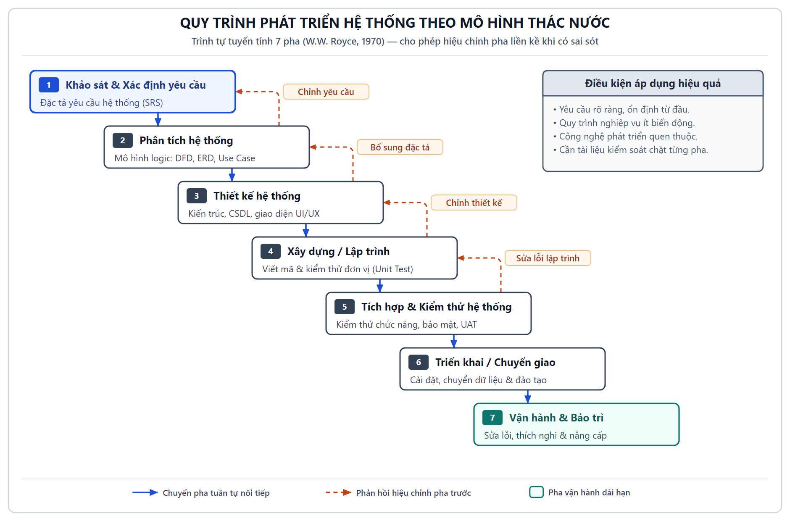

*Hình 1: Quy trình phát triển hệ thống thông tin theo mô hình thác nước (7 pha tuần tự và vòng phản hồi pha liền kề).*

**3. Mô tả chi tiết từng giai đoạn**
1. **Khảo sát và xác định yêu cầu:** Đánh giá tính khả thi, thu thập nhu cầu nghiệp vụ từ người dùng và ban lãnh đạo; chốt tài liệu đặc tả yêu cầu hệ thống (SRS) gồm yêu cầu chức năng và phi chức năng.
2. **Phân tích hệ thống:** Mô hình hóa quy trình nghiệp vụ và dữ liệu logic (sơ đồ DFD, ERD, Use Case) để hiểu rõ *"hệ thống cần làm gì"* mà chưa phụ thuộc công nghệ cụ thể.
3. **Thiết kế hệ thống:** Chuyển đổi mô hình phân tích thành giải pháp kỹ thuật (*"làm như thế nào"*): thiết kế kiến trúc phần mềm, thiết kế cơ sở dữ liệu (bảng, khóa, chỉ mục), giao diện người dùng (UI/UX) và đặc tả bảo mật.
4. **Xây dựng (Lập trình) và kiểm thử đơn vị:** Đội ngũ lập trình viết mã nguồn cho từng mô-đun theo đúng tài liệu thiết kế và thực hiện kiểm thử đơn vị (Unit Test) cho từng chức năng độc lập.
5. **Tích hợp và kiểm thử hệ thống:** Ghép nối các mô-đun lại thành hệ thống hoàn chỉnh; kiểm thử tích hợp, kiểm thử chức năng (hộp đen), kiểm thử hiệu năng, bảo mật và kiểm thử chấp nhận người dùng (UAT).
6. **Triển khai và chuyển giao:** Cài đặt hệ thống lên môi trường vận hành chính thức, chuyển đổi dữ liệu cũ, đào tạo người sử dụng và bàn giao tài liệu hướng dẫn.
7. **Vận hành và bảo trì:** Theo dõi hoạt động thực tế, khắc phục lỗi phát sinh (bảo trì sửa lỗi), thích nghi môi trường mới và nâng cấp tính năng theo thời gian.

**4. Phạm vi áp dụng & Đánh giá nhanh**
- **Ưu điểm:** Giai đoạn, mốc kiểm soát, sản phẩm bàn giao và trách nhiệm rõ ràng; dễ lập kế hoạch, quản lý tiến độ và hồ sơ tài liệu; phát hiện lỗi sớm về mặt đặc tả nếu kiểm duyệt chặt từng pha.
- **Nhược điểm:** Ít linh hoạt khi yêu cầu thay đổi giữa chừng; người dùng tiếp cận sản phẩm chạy thật ở giai đoạn muộn; dễ xảy ra trạng thái chờ đợi giữa các pha (blocking states).
- **Khi nào áp dụng:** Dự án có phạm vi và yêu cầu **rõ ràng, ổn định ngay từ đầu**, quy trình nghiệp vụ ít biến động và công nghệ đã quen thuộc (ví dụ: xây dựng hệ thống kế toán theo chuẩn mực Thông tư cố định hoặc hệ thống quản lý điểm thi theo quy chế ổn định của trường đại học).

> *Mẹo chốt ý vấn đáp:* Nhấn mạnh **2 từ khóa** là *"tuần tự nối tiếp"* và *"tính ổn định của yêu cầu"*; đồng thời nhớ không tuyệt đối hóa rằng thác nước cấm hoàn toàn quay lại pha trước — vẫn có vòng phản hồi hiệu chỉnh giữa hai pha kế tiếp.

---

### Câu 2: Anh (chị) hãy nêu ưu, nhược điểm của hệ thống thông tin phát triển theo quy trình tăng trưởng?

**1. Khái niệm và cơ chế vận hành**
- **Mô hình phát triển tăng trưởng / gia tăng (Incremental Model) là phương pháp chia hệ thống lớn thành nhiều phần chức năng độc lập để xây dựng và bàn giao qua nhiều phiên bản (bản phát hành); mỗi phiên bản mới sẽ bổ sung và tích hợp thêm chức năng mới trên nền phiên bản trước đó** cho đến khi hoàn thiện toàn bộ hệ thống.

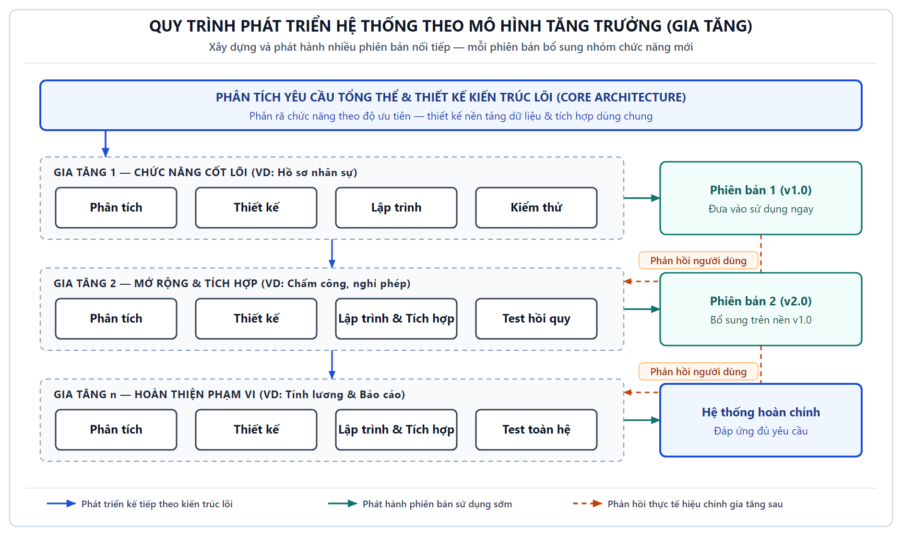

*Hình 2: Quy trình phát triển hệ thống thông tin theo mô hình tăng trưởng / gia tăng.*

**2. Ưu điểm của quy trình tăng trưởng**
1. **Cung cấp giá trị sử dụng sớm:** Người dùng có thể vận hành ngay các phân hệ cốt lõi ở phiên bản đầu tiên mà không phải chờ hoàn thành 100% dự án.
2. **Tiếp nhận phản hồi và phát hiện sai sót sớm:** Phản hồi thực tế sau mỗi lần phát hành giúp hiệu chỉnh kịp thời ở các gia tăng tiếp theo, tránh sai lệch yêu cầu kéo dài.
3. **Chia nhỏ phạm vi và giảm thiểu rủi ro:** Chia dự án lớn thành từng gói nhỏ giúp dễ kiểm soát tiến độ, ngân sách và giảm nguy cơ thất bại toàn cục.
4. **Linh hoạt ưu tiên nguồn lực và thích nghi thay đổi:** Các chức năng có mức độ ưu tiên cao được làm trước; các gia tăng chưa triển khai có thể điều chỉnh lại yêu cầu hoặc công nghệ mà không phá vỡ phần đã làm.
5. **Dễ kiểm thử và đào tạo từng phần:** Quy mô mỗi gia tăng nhỏ gọn nên kiểm thử trực tiếp dễ hơn và người dùng thích nghi dần với hệ thống theo từng đợt.

**3. Nhược điểm của quy trình tăng trưởng**
1. **Đòi hỏi kiến trúc nền tảng và cách phân chia mô-đun rất chặt chẽ:** Nếu thiết kế kiến trúc lõi hoặc phân rã chức năng ban đầu sai lệch, việc tích hợp các gia tăng sau sẽ xung đột dữ liệu.
2. **Phát sinh chi phí tích hợp và kiểm thử hồi quy (Regression Testing):** Mỗi lần bổ sung gia tăng mới phải kiểm thử lại toàn bộ chức năng cũ để bảo đảm không làm hỏng hệ thống đang chạy.
3. **Phức tạp trong quản lý nhiều phiên bản và chuyển đổi dữ liệu:** Phải quản lý cấu hình song song giữa phiên bản đang vận hành và phiên bản đang phát triển; dữ liệu cũ phải liên tục được nâng cấp lược đồ (migration).
4. **Nguy cơ suy giảm cấu trúc phần mềm (Architecture Erosion):** Nếu liên tục vá hoặc thêm tính năng thiếu kiểm soát thiết kế tổng thể, mã nguồn và cơ sở dữ liệu dễ trở nên chắp vá, khó bảo trì lâu dài.

**4. Ví dụ minh họa**
- Khi xây dựng **Hệ thống thông tin quản lý nhân sự (HRIS)** cho cơ quan:
  - *Gia tăng 1:* Phát hành trước phân hệ **Hồ sơ nhân sự & cơ cấu tổ chức** để đơn vị số hóa danh sách cán bộ.
  - *Gia tăng 2:* Tích hợp thêm phân hệ **Chấm công, nghỉ phép và biến động nhân sự**.
  - *Gia tăng 3:* Bổ sung phân hệ **Tính lương, bảo hiểm và báo cáo thống kê**.

> *Mẹo chốt ý vấn đáp:* Lưu ý thuật ngữ **"tăng trưởng"** trong giáo trình tiếng Việt tương ứng với **Incremental (gia tăng)**. Phân biệt ngắn với *Lặp (Iterative)*: Tăng trưởng là giao từng phần chức năng hoàn chỉnh ghép dần lại; Lặp là xây tổng thể rồi tinh chỉnh chất lượng dần qua các vòng.

---

### Câu 3: Anh (chị) hãy nêu ưu, nhược điểm của hệ thống thông tin phát triển theo quy trình xoắn ốc?

**1. Khái niệm và cơ chế vận hành**
- **Mô hình xoắn ốc (Spiral Model)** — do Barry Boehm đề xuất (1986) — **là mô hình phát triển hệ thống có tính chu kỳ lặp, trong đó mọi lựa chọn hoạt động và giải pháp ở từng vòng đều được định hướng bởi việc nhận diện, phân tích và giảm thiểu rủi ro**.

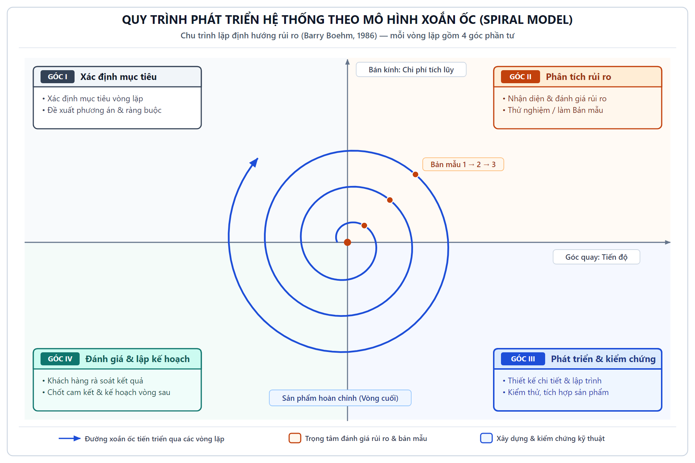

*Hình 3: Quy trình phát triển hệ thống thông tin theo mô hình xoắn ốc (4 góc phần tư định hướng rủi ro).*

Mỗi vòng xoắn gồm 4 góc phần tư: *(1) Xác định mục tiêu, phương án, ràng buộc* → *(2) Phân tích rủi ro & làm bản mẫu* → *(3) Phát triển và kiểm chứng* → *(4) Đánh giá và lập kế hoạch vòng tiếp theo*. Bán kính vòng xoắn thể hiện chi phí tích lũy, góc quay thể hiện tiến độ hoàn thành.

**2. Ưu điểm của quy trình xoắn ốc**
1. **Kiểm soát và giảm thiểu rủi ro từ rất sớm:** Rủi ro về công nghệ, yêu cầu, hiệu năng hay bảo mật được đánh giá liên tục ở mọi vòng lặp trước khi đầu tư sâu, hạn chế rủi ro sụp đổ dự án ở giai đoạn cuối.
2. **Linh hoạt cao trước sự thay đổi:** Sau mỗi vòng đều có bước rà soát và lập kế hoạch lại, dễ dàng bổ sung hoặc thay đổi yêu cầu theo thực tế nghiệp vụ.
3. **Khách hàng được tham gia và đánh giá liên tục:** Thông qua bản mẫu (prototype) và sản phẩm kiểm chứng từng vòng, người dùng phát hiện sớm điểm chưa phù hợp.
4. **Phù hợp với các dự án lớn, phức tạp, độ bất định cao:** Đặc biệt hiệu quả khi triển khai công nghệ mới chưa từng có tiền lệ, đòi hỏi độ tin cậy và an toàn cao.

**3. Nhược điểm của quy trình xoắn ốc**
1. **Chi phí quản lý cao và quy trình phức tạp:** Việc lặp đi lặp lại các hoạt động đánh giá rủi ro, lập bản mẫu và nghiệm thu từng vòng làm tăng khối lượng công tác quản trị.
2. **Phụ thuộc lớn vào năng lực chuyên gia đánh giá rủi ro:** Nếu người quản lý dự án đánh giá sai rủi ro hoặc bỏ sót rủi ro cốt lõi, dự án vẫn có thể thất bại nặng nề.
3. **Khó xác định trước mốc thời gian và tổng ngân sách cố định:** Số vòng xoắn chưa chốt cứng ngay từ đầu nên khó áp dụng cho các hợp đồng khoán gọn giá và thời hạn cứng.
4. **Không phù hợp cho dự án nhỏ, ít rủi ro:** Áp dụng mô hình xoắn ốc cho bài toán đơn giản sẽ gây cồng kềnh, lãng phí thời gian và nhân lực.

**4. Ví dụ minh họa**
- Khi triển khai **Hệ thống Cổng dịch vụ công hoặc giao dịch ngân hàng tích hợp xác thực sinh trắc học khuôn mặt (eKYC/AI)**: ở *Vòng 1*, nhóm phát triển nhận diện rủi ro *"giả mạo ảnh tĩnh/deepfake hoặc sai lệch nhận diện ánh sáng yếu"* nên làm bản mẫu thử nghiệm độ chính xác và chống giả mạo trước khi quyết định đầu tư hạ tầng chính thức ở các vòng sau.

> *Mẹo chốt ý vấn đáp:* Điểm cốt tử của mô hình xoắn ốc là **"Định hướng rủi ro (Risk-driven)"**. Nếu thiếu phân tích rủi ro ở góc phần tư thứ 2, mô hình không còn là xoắn ốc đúng nghĩa.

---

### Câu 4: Anh (chị) hãy nêu vai trò của hệ thống thông tin trong tổ chức? Các nhân tố tác động đến hệ thống thông tin là gì?

**1. Khái niệm mở đầu**
- **Hệ thống thông tin (HTTT)** là một tập hợp có tổ chức gồm con người, phần cứng, phần mềm, dữ liệu, mạng truyền thông và quy trình phối hợp nhau để **thu thập, xử lý, lưu trữ và phân phối thông tin** phục vụ hoạt động điều hành, phối hợp và ra quyết định trong tổ chức.

**2. Vai trò của hệ thống thông tin trong tổ chức**
Có thể khái quát thành **2 nhóm vai trò lớn** (tác nghiệp – gia tăng giá trị và chiến lược):
1. **Hỗ trợ hoạt động tác nghiệp và tối ưu hóa quy trình:** Tự động hóa các giao dịch lặp đi lặp lại hàng ngày (chấm công, kế toán, bán hàng, tiếp nhận hồ sơ một cửa), giảm sai sót thủ công, rút ngắn thời gian xử lý và tiết kiệm chi phí nhân lực.
2. **Hỗ trợ ra quyết định và kiểm soát theo từng cấp quản lý:**
   - *Cấp tác nghiệp:* Cung cấp dữ liệu chi tiết tức thời phục vụ xử lý giao dịch hàng ngày.
   - *Cấp chiến thuật (trung gian):* Cung cấp báo cáo tổng hợp định kỳ, cảnh báo sai lệch kế hoạch (MIS, DSS).
   - *Cấp chiến lược (lãnh đạo):* Cung cấp bảng điều khiển tổng quan (Dashboard), phân tích xu hướng và dự báo dài hạn (EIS/BI).
3. **Liên kết các bộ phận và mở rộng kết nối liên tổ chức:** Xóa bỏ "ốc đảo dữ liệu" giữa các phòng ban (như kết nối Bán hàng – Kho – Kế toán trong ERP) và chia sẻ thông tin với đối tác, khách hàng, cơ quan quản lý.
4. **Cải thiện chất lượng sản phẩm/dịch vụ và nâng cao trải nghiệm người dùng:** Phản hồi nhanh nhu cầu khách hàng/người dân, cá thể hóa dịch vụ và phục vụ 24/7.
5. **Khai thác dữ liệu tạo tri thức mới, tạo lợi thế cạnh tranh và thúc đẩy chuyển đổi số:** Biến dữ liệu lịch sử thành tài sản chiến lược giúp tổ chức đổi mới mô hình hoạt động, tăng năng lực bảo mật và tuân thủ pháp luật.

**3. Các nhân tố tác động đến hệ thống thông tin**
Theo các giáo trình Hệ thống thông tin quản lý, sự hình thành, vận hành và thành công của HTTT chịu tác động bởi **hai nhóm nhân tố**:

- **Nhóm A — Các nhân tố bên trong (thuộc về Tổ chức & Kỹ thuật nội tại):**
  1. **Cơ cấu tổ chức:** Tổ chức phân cấp nhiều tầng hay cơ cấu phẳng, phân tán địa lý hay tập trung sẽ quyết định kiến trúc luồng dữ liệu và cơ chế phân quyền của HTTT.
  2. **Quy trình nghiệp vụ và chiến lược kinh doanh:** HTTT phải bám sát quy trình nghiệp vụ và phục vụ mục tiêu chiến lược (tối ưu chi phí, khác biệt hóa dịch vụ hay cải cách hành chính).
  3. **Văn hóa tổ chức và con người:** Sự cam kết của lãnh đạo cấp cao, trình độ công nghệ, thái độ tiếp nhận hay tâm lý ngại thay đổi của nhân sự vận hành là nhân tố quyết định thành bại.
  4. **Chất lượng công nghệ, dữ liệu và nguồn lực tài chính:** Độ ổn định, thân thiện của phần mềm/hạ tầng, chất lượng dữ liệu đầu vào (*"Garbage In – Garbage Out"*), công tác đào tạo và ngân sách đầu tư duy trì.

- **Nhóm B — Các nhân tố bên ngoài (thuộc về Môi trường):**
  1. **Hành lang pháp lý, chính sách và quy định nhà nước:** Luật Giao dịch điện tử, Luật An toàn thông tin, Luật Bảo vệ dữ liệu cá nhân, chuẩn mực kế toán, thuế... buộc HTTT phải thiết kế tuân thủ ngay từ đầu.
  2. **Sự phát triển của khoa học – công nghệ:** Xu hướng điện toán đám mây, AI, Big Data, IoT, thanh toán số thúc đẩy tổ chức nâng cấp hoặc thay đổi kiến trúc HTTT.
  3. **Môi trường cạnh tranh và đối tác chuỗi cung ứng:** Áp lực từ đối thủ buộc doanh nghiệp đầu tư CRM/ERP/TMĐT; đối tác đòi hỏi kết nối EDI/API.
  4. **Nhu cầu của khách hàng, người dân và hạ tầng xã hội:** Thói quen tiêu dùng số, kỳ vọng dịch vụ nhanh và mức độ phủ sóng Internet tại địa bàn.

**4. Ví dụ minh họa ngắn**
- Tại bộ phận mua sắm – thanh toán vật tư của doanh nghiệp, khi áp lực minh bạch chi phí và nhu cầu rút ngắn thời gian duyệt chi tăng lên (nhân tố tổ chức & cạnh tranh), tổ chức triển khai cổng tác nghiệp số có chữ ký số; kết quả là HTTT giúp tự động kiểm tra hạn mức ngân sách, cắt giảm tình trạng hồ sơ nằm chờ phê duyệt thủ công và lưu vết kiểm toán minh bạch.

> *Mẹo chốt ý vấn đáp:* Nêu đủ **5 vai trò** (Tác nghiệp → Quyết định → Liên kết → Dịch vụ → Chiến lược/Cạnh tranh) và tách mạch lạc **2 nhóm nhân tố (Bên trong vs Bên ngoài)** để câu trả lời có chiều sâu học thuật.

---

### Câu 5: Các cách phân loại hệ thống thông tin là gì? Cho ví dụ?

**1. Nguyên tắc tiếp cận**
- Trong thực tế và giáo trình chuyên ngành, **không chỉ có một cách phân loại duy nhất**; tùy theo góc độ nghiên cứu (cấp quản lý, nghiệp vụ chức năng, phạm vi tổ chức, ngành nghề hay mức độ tích hợp công nghệ), hệ thống thông tin được phân loại theo **5 cách phổ biến sau**:

**2. Các cách phân loại hệ thống thông tin và ví dụ**

1. **Phân loại theo cấp quản lý và mục đích phục vụ (Mô hình Kim tự tháp HTTT):**
   - **Hệ thống xử lý giao dịch (TPS):** Ghi nhận và xử lý các giao dịch tác nghiệp chi tiết hàng ngày ở tầng đáy. *Ví dụ:* Hệ thống POS quét mã vạch tính tiền tại siêu thị WinMart hoặc hệ thống tiếp nhận hồ sơ một cửa cấp phường/xã.
   - **Hệ thống thông tin quản lý (MIS):** Tổng hợp dữ liệu từ TPS để lập báo cáo định kỳ phục vụ nhà quản lý cấp trung theo dõi, kiểm soát. *Ví dụ:* Hệ thống xuất báo cáo doanh thu, tồn kho hàng tháng của trưởng cửa hàng.
   - **Hệ thống hỗ trợ ra quyết định (DSS):** Phân tích dữ liệu, chạy mô hình và kịch bản *"Nếu – Thì" (What-if)* cho các quyết định bán cấu trúc ở cấp trung/cao. *Ví dụ:* Hệ thống phân tích dự báo nhu cầu mở thêm lớp học phần hoặc tối ưu tuyến đường giao hàng.
   - **Hệ thống hỗ trợ điều hành cấp cao (EIS / ESS):** Trực quan hóa dữ liệu tổng hợp qua Dashboard và chỉ số KPI chiến lược cho lãnh đạo cấp cao. *Ví dụ:* Bảng điều hành KPI doanh thu, thị phần của Tổng giám đốc hoặc Trung tâm điều hành thông minh (IOC) của UBND tỉnh.
   - *(Bổ sung nhóm hỗ trợ tri thức/văn phòng:)* **Hệ thống tự động hóa văn phòng (OAS)** như *eOffice* quản lý văn bản đến/đi và **Hệ thống quản trị tri thức (KWS/KMS)**.

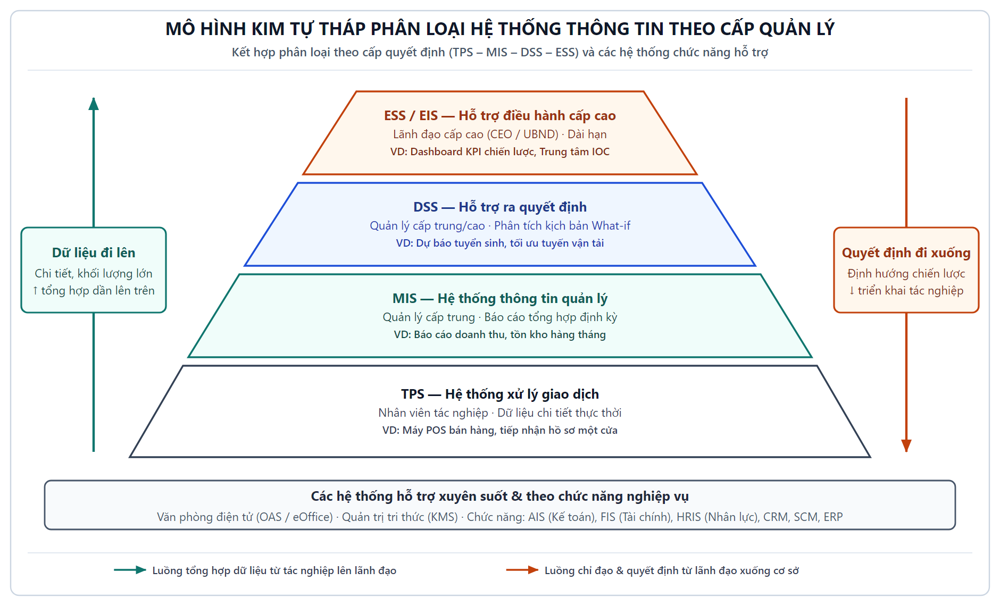

*Hình 5: Mô hình Kim tự tháp phân loại hệ thống thông tin theo cấp quản lý (TPS – MIS – DSS – ESS) và các hệ thống hỗ trợ.*

2. **Phân loại theo lĩnh vực chức năng nghiệp vụ trong tổ chức:**
   - **HTTT Kế toán (AIS):** Ghi nhận chứng từ thu chi, sổ cái, lập báo cáo tài chính (*Ví dụ:* Phần mềm kế toán MISA SME/AMIS, SAP FI).
   - **HTTT Tài chính (FIS):** Quản lý dòng tiền, dự toán ngân sách, nguồn vốn và đầu tư (*Ví dụ:* Hệ thống TABMIS quản lý ngân sách và kho bạc nhà nước).
   - **HTTT Quản lý nguồn nhân lực (HRIS):** Quản lý hồ sơ nhân sự, tuyển dụng, chấm công, tính lương, đánh giá KPI (*Ví dụ:* Phần mềm VNPT CCVC quản lý cán bộ công chức viên chức).
   - **HTTT Sản xuất (Manufacturing IS):** Lập lịch sản xuất, quản lý nguyên vật liệu MRP, kiểm soát chất lượng (*Ví dụ:* Hệ thống MES tại nhà máy VinFast).
   - **HTTT Bán hàng và Tiếp thị (Sales & Marketing IS):** Quản lý chiến dịch, khách hàng tiềm năng, đơn hàng và chăm sóc khách hàng (*Ví dụ:* Hệ thống CRM Salesforce, HubSpot).

3. **Phân loại theo phạm vi hoạt động (quy mô triển khai):**
   - **HTTT cá nhân / nhóm làm việc:** Phục vụ một cá nhân hoặc một nhóm nhỏ (*Ví dụ:* Ứng dụng quản lý công việc cá nhân, bảng tính quản lý chi tiêu).
   - **HTTT cấp phòng ban:** Phục vụ nghiệp vụ riêng của một phòng chuyên môn (*Ví dụ:* Phần mềm quản lý tuyển dụng của Phòng Nhân sự).
   - **HTTT cấp doanh nghiệp / tổ chức:** Tích hợp dữ liệu dùng chung xuyên suốt mọi phòng ban (*Ví dụ:* Hệ thống ERP của Tập đoàn Điện lực EVN).
   - **HTTT liên tổ chức (IOS):** Kết nối và chia sẻ dữ liệu vượt ra ngoài ranh giới một tổ chức (*Ví dụ:* Nền tảng tích hợp, chia sẻ dữ liệu quốc gia NDXP kết nối giữa các Bộ/Tỉnh hoặc hệ thống EDI kết nối nhà sản xuất với chuỗi siêu thị).

4. **Phân loại theo lĩnh vực / ngành nghề ứng dụng:**
   - HTTT hành chính công (*Ví dụ:* Cổng Dịch vụ công Quốc gia `dichvucong.gov.vn`).
   - HTTT y tế (*Ví dụ:* Hệ thống quản lý bệnh viện HIS và bệnh án điện tử EMR).
   - HTTT giáo dục (*Ví dụ:* Cổng thông tin đào tạo tín chỉ và LMS của trường đại học).
   - HTTT tài chính – ngân hàng (*Ví dụ:* Hệ thống Core Banking của Vietcombank).
   - HTTT thương mại điện tử (*Ví dụ:* Sàn giao dịch Shopee).

5. **Phân loại theo mức độ tự động hóa hoặc mức độ tích hợp quy trình:**
   - *Theo công cụ thực hiện:* HTTT thủ công (sổ sách giấy tờ) → HTTT tự động hóa dựa trên máy tính (bán tự động / tự động hóa hoàn toàn như thu phí không dừng ePass/VETC).
   - *Theo mức độ tích hợp ứng dụng:* Hệ thống đơn lẻ vs Hệ thống tích hợp doanh nghiệp (**ERP** – hoạch định nguồn lực, **CRM** – quan hệ khách hàng, **SCM** – chuỗi cung ứng, **BI** – phân tích thông minh).

> *Mẹo chốt ý vấn đáp:* Khi trả lời miệng, luôn chốt **2 cách phân loại kinh điển nhất** đầu tiên là *(1) Theo cấp quản lý (TPS – MIS – DSS – EIS)* và *(2) Theo chức năng (AIS, FIS, HRIS, Sản xuất, Marketing)*, sau đó bổ sung nhanh 3 cách còn lại để thể hiện kiến thức toàn diện.

---

### Câu 6: Những đối tượng tham gia giao dịch điện tử là gì? Có bao nhiêu mô hình giao dịch trong tác nghiệp điện tử?

**1. Những đối tượng tham gia giao dịch điện tử**
Trong một hệ sinh thái giao dịch và tác nghiệp điện tử, có **4 nhóm chủ thể trực tiếp thực hiện giao dịch** và **nhóm các tổ chức trung gian hỗ trợ hạ tầng/pháp lý**:

- **4 chủ thể trực tiếp tham gia giao dịch:**
  1. **Chính phủ / Cơ quan nhà nước (Government — viết tắt `G`):** Cơ quan hành chính các cấp, đơn vị cung cấp dịch vụ công hoặc cơ quan ban hành chính sách, kiểm soát thuế, hải quan, pháp lý.
  2. **Doanh nghiệp / Tổ chức kinh tế (Business — viết tắt `B`):** Các công ty, nhà sản xuất, nhà cung cấp dịch vụ tham gia mua bán hàng hóa, đấu thầu hoặc thực hiện nghĩa vụ hành chính trực tuyến.
  3. **Người tiêu dùng / Công dân (Consumer / Citizen — viết tắt `C`):** Cá nhân thực hiện giao dịch mua sắm trực tuyến, thanh toán hóa đơn hoặc nộp hồ sơ thủ tục hành chính công.
  4. **Cán bộ, công chức / Nhân viên trong tổ chức (Employee — viết tắt `E`):** Người lao động tương tác với cơ quan/doanh nghiệp qua các cổng nội bộ (Intranet, eOffice, HRIS).

- **Các tổ chức trung gian hỗ trợ (theo Luật Giao dịch điện tử số 20/2023/QH15 và thực tiễn):**
  - *Chủ quản hệ thống thông tin phục vụ giao dịch điện tử / nền tảng số trung gian* (như sàn TMĐT, Cổng DVC Quốc gia); *ngân hàng và cổng thanh toán điện tử*; *tổ chức cung cấp dịch vụ chứng thực chữ ký số (CA), cấp dấu thời gian*; và *đơn vị bưu chính – vận chuyển (logistics)*.

**2. Có bao nhiêu mô hình giao dịch trong tác nghiệp điện tử?**
- Nếu xét **3 chủ thể cơ bản (`B`, `C`, `G`)**, việc ghép cặp hai chiều giữa bên khởi tạo/cung cấp và bên tiếp nhận tạo thành ma trận **3 × 3 = 9 mô hình giao dịch điện tử cơ bản**.
- Nếu mở rộng thêm chủ thể nội bộ **`E` (Employee)** trong tác nghiệp điện tử của cơ quan/doanh nghiệp, sẽ có thêm **2 mô hình tác nghiệp nội bộ phổ biến là `G2E` và `B2E`** (tổng cộng **11 mô hình**, trong đó **6–7 mô hình cốt lõi** xuất hiện thường xuyên nhất trong giáo trình: `B2B, B2C, C2C, G2C, G2B, G2G, G2E`).

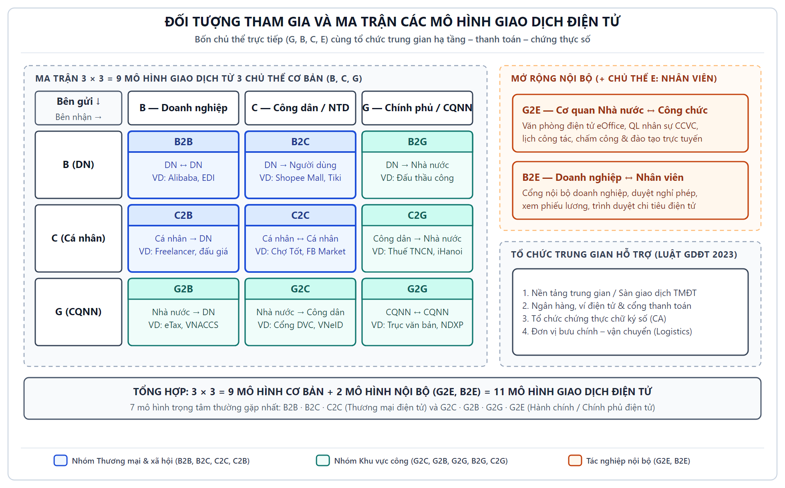

*Hình 6: Đối tượng tham gia giao dịch điện tử và ma trận 3×3 (9 mô hình cơ bản) cùng 2 mô hình nội bộ (`G2E`, `B2E`).*

**Bảng tổng hợp các mô hình giao dịch điện tử:**

| Nhóm | Ký hiệu | Tên đầy đủ | Bản chất & Ví dụ minh họa |
|---|---|---|---|
| **Thương mại & xã hội** | **B2B** | Business to Business | Giao dịch giữa doanh nghiệp với doanh nghiệp (nhà máy đặt mua linh kiện qua sàn Alibaba hoặc hệ thống EDI). |
| | **B2C** | Business to Consumer | Doanh nghiệp bán lẻ trực tiếp cho người tiêu dùng (mua điện thoại trên web Thế Giới Di Động, gian hàng Mall). |
| | **C2C** | Consumer to Consumer | Cá nhân giao dịch với cá nhân qua nền tảng trung gian (bán đồ cũ trên Chợ Tốt, Facebook Marketplace). |
| | **C2B** | Consumer to Business | Cá nhân cung cấp sản phẩm/dịch vụ hoặc định giá cho doanh nghiệp (freelancer bán ảnh/thiết kế cho công ty, khách hàng trả giá trên nền tảng). |
| **Khu vực công & tương tác nhà nước** | **G2C** | Government to Citizen | Nhà nước cung cấp thông tin, dịch vụ công cho công dân (nộp hồ sơ đổi GPLX, đăng ký khai sinh trên Cổng DVC Quốc gia). |
| | **G2B** | Government to Business | Nhà nước phục vụ và quản lý doanh nghiệp trực tuyến (kê khai thuế eTax, hải quan điện tử VNACCS, đăng ký doanh nghiệp). |
| | **G2G** | Government to Government | Liên thông văn bản, chia sẻ dữ liệu giữa các cơ quan nhà nước (gửi văn bản qua Trục liên thông quốc gia, tra cứu CSDL dân cư qua NDXP). |
| | **B2G** | Business to Government | Doanh nghiệp cung cấp hàng hóa, phần mềm, dịch vụ cho cơ quan nhà nước (đấu thầu trên `muasamcong.mpi.gov.vn`). |
| | **C2G** | Citizen to Government | Công dân chủ động gửi nghĩa vụ tài chính, kiến nghị, phản ánh tới nhà nước (nộp thuế thu nhập cá nhân, phản ánh trên iHanoi). |
| **Tác nghiệp nội bộ** | **G2E** | Government to Employee | Tương tác giữa cơ quan nhà nước với cán bộ, công chức qua eOffice, quản lý hồ sơ CCVC, chấm công, đào tạo trực tuyến. |
| | **B2E** | Business to Employee | Doanh nghiệp cung cấp cổng nội bộ cho nhân viên (đăng ký nghỉ phép, xem phiếu lương, duyệt đề xuất mua sắm nội bộ). |

> *Mẹo chốt ý vấn đáp:* Nêu rõ quy tắc ma trận **3 × 3 = 9 mô hình** từ `{B, C, G}` và mở rộng thêm **`G2E / B2E`** khi xét tác nghiệp nội bộ; cách trả lời này bao quát được cả thầy cô dạy theo giáo trình TMĐT lẫn giáo trình Chính phủ điện tử.

---

### Câu 7: Hãy trình bày các thành phần của cổng thông tin điện tử? Theo anh (chị) thành phần nào quan trọng nhất? Vì sao?

**1. Khái niệm mở đầu**
- **Cổng thông tin điện tử (Portal)** là điểm truy cập tập trung, duy nhất trên nền tảng mạng giúp kết nối người dùng với hệ thống thông tin, kho dữ liệu, dịch vụ trực tuyến và các ứng dụng tác nghiệp của một tổ chức hoặc cơ quan nhà nước (theo Nghị định 42/2022/NĐ-CP và chuẩn kiến trúc Portal).

**2. Các thành phần của Cổng thông tin điện tử**
Một Cổng thông tin điện tử hoàn chỉnh bao gồm **5 nhóm thành phần chính** (từ nội dung – nghiệp vụ bên ngoài đến hạ tầng kỹ thuật bên trong):

1. **Thành phần Nội dung thông tin và Dữ liệu (Information & Content):**
   - Thông tin giới thiệu chức năng, nhiệm vụ, cơ cấu tổ chức, lãnh đạo; văn bản quy phạm pháp luật, văn bản chỉ đạo điều hành; tin tức sự kiện, quy hoạch, dự án, thông tin liên hệ và các chuyên trang/chuyên mục thành phần; kho dữ liệu mở.
2. **Thành phần Dịch vụ trực tuyến và Ứng dụng tác nghiệp (Services & Applications / Portlets):**
   - Các dịch vụ công trực tuyến (nộp hồ sơ, tra cứu tiến độ, thanh toán trực tuyến, nhận kết quả số) hoặc các ứng dụng nghiệp vụ nội bộ (eOffice, lịch công tác, trình ký mua sắm, tra cứu nhân sự) được nhúng dưới dạng các *Portlet* chuyên biệt.
3. **Thành phần Tương tác và Tiện ích hỗ trợ người dùng (Interaction & Utilities):**
   - Công cụ tìm kiếm thông minh toàn văn, mục Hỏi – Đáp, tiếp nhận phản ánh kiến nghị, lấy ý kiến góp ý dự thảo/thăm dò dư luận, bản đồ số, hộp thư/thông báo, hỗ trợ người khuyết tật và trợ lý ảo (Chatbot).
4. **Thành phần Kiến trúc giao diện và Bố cục trình bày (UI/UX & Layout):**
   - Gồm *Phần đầu (Header)*: Quốc huy/Logo, tên cơ quan chủ quản, thanh điều hướng, chuyển đổi ngôn ngữ; *Phần thân (Body)*: lưới hiển thị tin tức, liên kết dịch vụ công và các Portlet cá nhân hóa; *Phần chân (Footer)*: thông tin bản quyền, đầu mối quản trị, liên kết cổng thành phần; bảo đảm hiển thị đa thiết bị (PC, di động).
5. **Thành phần Hạ tầng kỹ thuật, Quản trị, Tích hợp và An toàn thông tin (Technical, CMS, Integration & Security):**
   - Tên miền chuẩn (như `.gov.vn`), hệ thống quản trị nội dung (**CMS**), cơ chế xác thực tập trung một lần (**SSO**) và phân quyền theo vai trò (**RBAC**), cổng kết nối API/Web Service liên thông dữ liệu với CSDL bên ngoài, cùng lớp tường lửa, mã hóa SSL/TLS, sao lưu dự phòng.

**3. Thành phần nào quan trọng nhất? Vì sao?**
- **Lựa chọn cốt lõi:** **Thành phần Dịch vụ trực tuyến / Ứng dụng tác nghiệp gắn với Dữ liệu lõi (và lớp Bảo mật – Xác thực đi kèm)** là thành phần quan trọng nhất quyết định giá trị sống còn của một Cổng thông tin điện tử.
- **Lý giải 3 ý thuyết phục:**
  1. *Tạo ra giá trị thực chất và phân biệt Portal với Website thường:* Nếu chỉ có giao diện đẹp và tin tức một chiều thì đó chỉ là một trang thông tin tĩnh (Website). Chính các dịch vụ công trực tuyến và phân hệ tác nghiệp kết nối dữ liệu thực giúp người dân giải quyết thủ tục không phải đi lại và cán bộ xử lý công việc nhanh, minh bạch.
  2. *Là động lực thu hút người dùng quay lại thường xuyên:* Người dùng truy cập Cổng chủ yếu để giải quyết nhu cầu thực tế (nộp hồ sơ, thanh toán, tra cứu trạng thái công việc, ký duyệt văn bản).
  3. *Gắn liền điều kiện tiên quyết là Xác thực – An toàn thông tin:* Không có dữ liệu sạch, liên thông và cơ chế bảo mật/phân quyền tin cậy thì mọi dịch vụ tác nghiệp trực tuyến không thể vận hành hợp pháp và an toàn.

> *Mẹo chốt ý vấn đáp:* Trong vấn đáp, câu hỏi *"thành phần nào quan trọng nhất"* không có đáp án cứng nhắc duy nhất — bạn có thể bảo vệ **Dịch vụ trực tuyến & Dữ liệu tích hợp** (góc độ giá trị nghiệp vụ) hoặc **An toàn bảo mật & Xác thực** (góc độ độ tin cậy), miễn là lập luận gắn chặt vào bản chất điểm truy cập tập trung của Portal.

---

### Câu 8: Hãy trình bày các thành phần chính trong sơ đồ tổng thể Khung Kiến trúc Chính phủ điện tử Việt Nam 1.0? Thành phần nào là quan trọng nhất? Vì sao?

**1. Căn cứ pháp lý chuẩn xác**
- **Khung Kiến trúc Chính phủ điện tử Việt Nam, phiên bản 1.0** được Bộ Thông tin và Truyền thông ban hành kèm theo **Công văn số 1178/BTTTT-THH ngày 21/4/2015** *(lưu ý phân biệt với phiên bản 2.0 năm 2019, phiên bản 3.0 năm 2023 và phiên bản 4.0 năm 2025)*.

**2. Sơ đồ tổng thể Khung Kiến trúc Chính phủ điện tử Việt Nam 1.0**

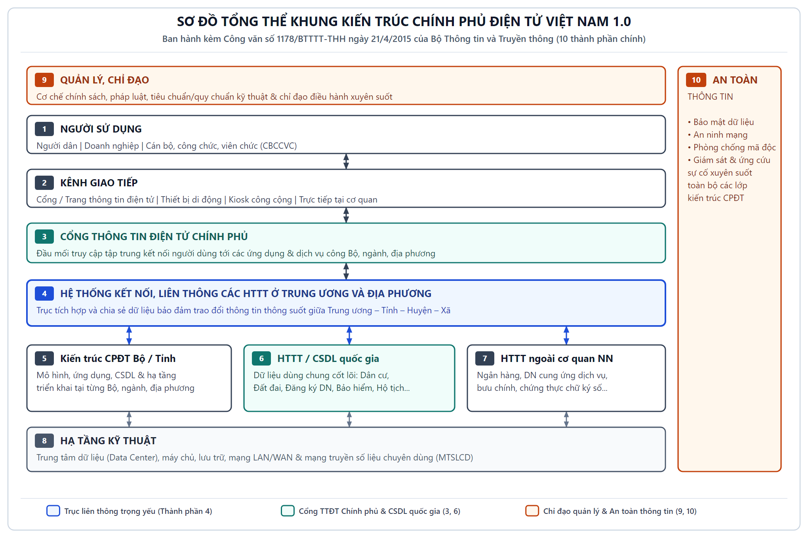

*Hình 8: Sơ đồ tổng thể 10 thành phần chính của Khung Kiến trúc Chính phủ điện tử Việt Nam phiên bản 1.0 (Công văn 1178/BTTTT-THH ngày 21/4/2015).*

**3. Trình bày 10 thành phần chính trong sơ đồ tổng thể 1.0**
1. **Người sử dụng (Users):** Gồm Người dân, Doanh nghiệp, và Cán bộ, công chức, viên chức (CBCCVC) trong các cơ quan nhà nước — là đối tượng trực tiếp sử dụng dịch vụ và vận hành hệ thống.
2. **Kênh giao tiếp (Channels):** Phương tiện, môi trường giúp người sử dụng tiếp cận hệ thống (Cổng/trang TTĐT, điện thoại/thiết bị di động, thiết bị truy cập công cộng Kiosk, giao tiếp trực tiếp tại Bộ phận Một cửa).
3. **Cổng thông tin điện tử Chính phủ:** Đóng vai trò đầu mối tập trung kết nối người sử dụng tới các dịch vụ công và thông tin của các Bộ, ngành, địa phương.
4. **Hệ thống kết nối, liên thông các hệ thống thông tin ở Trung ương và địa phương:** Trục tích hợp, truyền dẫn và chia sẻ dữ liệu bảo đảm thông tin lưu chuyển thông suốt giữa Chính phủ, các Bộ/ngành và địa phương các cấp.
5. **Kiến trúc Chính phủ điện tử của Bộ / Tỉnh:** Các mô hình, hệ thống ứng dụng, CSDL và hạ tầng riêng được xây dựng tại từng Bộ, cơ quan ngang Bộ và UBND cấp tỉnh trên cơ sở tuân thủ Khung kiến trúc quốc gia.
6. **Các hệ thống thông tin / Cơ sở dữ liệu (CSDL) quốc gia:** Kho dữ liệu nền tảng dùng chung quy mô quốc gia (Dân cư, Đất đai, Đăng ký doanh nghiệp, Bảo hiểm, Tài chính, Hộ tịch...) phục vụ mọi Bộ, ngành, địa phương.
7. **Các hệ thống thông tin ngoài cơ quan nhà nước:** Hệ thống của ngân hàng, doanh nghiệp bưu chính, tổ chức xã hội, đơn vị cung ứng dịch vụ thanh toán, chữ ký số có kết nối phục vụ dịch vụ công.
8. **Hạ tầng kỹ thuật (Infrastructure):** Trung tâm dữ liệu (Data Center), máy chủ, hệ thống lưu trữ, mạng LAN/WAN, mạng truyền số liệu chuyên dùng (MTSLCD) làm nền tảng vật lý.
9. **Quản lý, chỉ đạo (Management & Governance):** Khối cơ chế chính sách, văn bản pháp luật, tiêu chuẩn/quy chuẩn kỹ thuật, mô hình quản trị và sự chỉ đạo điều hành xuyên suốt.
10. **An toàn thông tin (Information Security):** Thành phần bao trùm toàn bộ kiến trúc nhằm bảo đảm bảo mật, toàn vẹn, sẵn sàng, phòng chống tấn công mạng và ứng cứu sự cố.

**4. Thành phần nào là quan trọng nhất? Vì sao?**
- **Lập luận trọng tâm (Góc độ kiến trúc hệ thống):** **Hệ thống kết nối, liên thông các HTTT ở Trung ương và địa phương (gắn với các CSDL quốc gia dùng chung)** là thành phần cốt lõi, quan trọng nhất vì:
  1. Nếu thiếu trục kết nối liên thông và CSDL dùng chung, hệ thống của các Bộ/Tỉnh chỉ là những *"ốc đảo công nghệ"* rời rạc, dẫn đến tình trạng người dân phải khai báo lại nhiều lần và cơ quan nhà nước không thể phối hợp giải quyết thủ tục liên ngành.
  2. Đây chính là yếu tố tạo ra bản chất **"Chính phủ điện tử thống nhất"** thay vì tập hợp rời rạc các trang web riêng lẻ.
- **Bổ sung góc nhìn toàn diện khi vấn đáp:** Về mặt *thể chế* thì **Quản lý, chỉ đạo** quyết định việc các cơ quan có chịu tuân thủ chuẩn chung hay không; về mặt *vận hành tin cậy* thì **An toàn thông tin** là điều kiện sống còn xuyên suốt mọi lớp.

> *Ghi chú cập nhật ăn điểm:* Sau phiên bản 1.0 (Công văn 1178/BTTTT-THH ngày 21/4/2015), Việt Nam đã lần lượt nâng cấp lên phiên bản **2.0** (QĐ 2323/QĐ-BTTTT, 2019), phiên bản **3.0** (QĐ 2568/QĐ-BTTTT, 2023) và **Khung kiến trúc Chính phủ số Việt Nam phiên bản 4.0** (QĐ 292/QĐ-BKHCN, 2025) cập nhật mô hình chính quyền địa phương 2 cấp, Trung tâm dữ liệu quốc gia và định hướng AI.

---

### Câu 9: Hãy trình bày về công nghệ và các thành phần cấu thành nên Portal?

**1. Khái niệm mở đầu**
- **Portal (Cổng thông tin điện tử)** là một nền tảng web tích hợp đóng vai trò điểm truy cập tập trung (Single Point of Entry), cho phép hợp nhất nhiều nguồn thông tin, dữ liệu và ứng dụng nghiệp vụ từ nhiều hệ thống khác nhau vào một giao diện thống nhất, có khả năng phân quyền và cá nhân hóa theo từng người dùng.

**2. Các công nghệ nền tảng xây dựng Portal**
1. **Công nghệ Portlet và chuẩn tích hợp giao diện:**
   - Các ứng dụng hiển thị trên Portal được đóng gói thành các **Portlet** (các khối chức năng độc lập như khung tin tức, hộp thư, tra cứu hồ sơ, phê duyệt công việc).
   - Tuân thủ các chuẩn mở như **JSR-168 / JSR-286** (trong hệ sinh thái Java) và chuẩn **WSRP (Web Services for Remote Portlets)** cho phép nhúng Portlet từ máy chủ từ xa mà không cần viết lại mã.
2. **Công nghệ Web Services, API và Trục tích hợp (SOA / ESB):**
   - Sử dụng **SOAP (XML/WSDL)** hoặc **RESTful API (JSON/HTTP)** và **ESB (Enterprise Service Bus)** để kết nối Portal với các hệ thống lõi phía sau (ERP, CRM, HRM, hệ thống một cửa, CSDL quốc gia).
3. **Công nghệ xác thực tập trung và phân quyền (Identity & Access Management):**
   - **Đăng nhập một lần (SSO - Single Sign-On)** thông qua các chuẩn **SAML, OAuth 2.0, OpenID Connect (OIDC)** kết hợp thư mục người dùng **LDAP / Active Directory** và kiểm soát truy cập theo vai trò (**RBAC**).
4. **Công nghệ quản trị nội dung và tìm kiếm (CMS / Search Engine):**
   - Hệ thống quản trị nội dung (**CMS / ECM**) hỗ trợ quy trình xuất bản (biên tập → duyệt → đăng bài) và công cụ lập chỉ mục tìm kiếm toàn văn tốc độ cao (**Apache Solr, Elasticsearch**).
5. **Công nghệ giao diện Web hiện đại & Nền tảng Portal:**
   - **Frontend:** HTML5, CSS3, JavaScript, AJAX/SPA và thiết kế đáp ứng (Responsive Web Design) chạy mượt trên cả máy tính và điện thoại.
   - **Nền tảng Portal tiêu biểu:** Liferay Portal, Microsoft SharePoint, IBM WebSphere Portal, Oracle WebCenter hoặc các nền tảng nguồn mở/tùy biến trên Java/.NET.

**3. Các thành phần cấu thành nên Portal (Kiến trúc 4 tầng)**

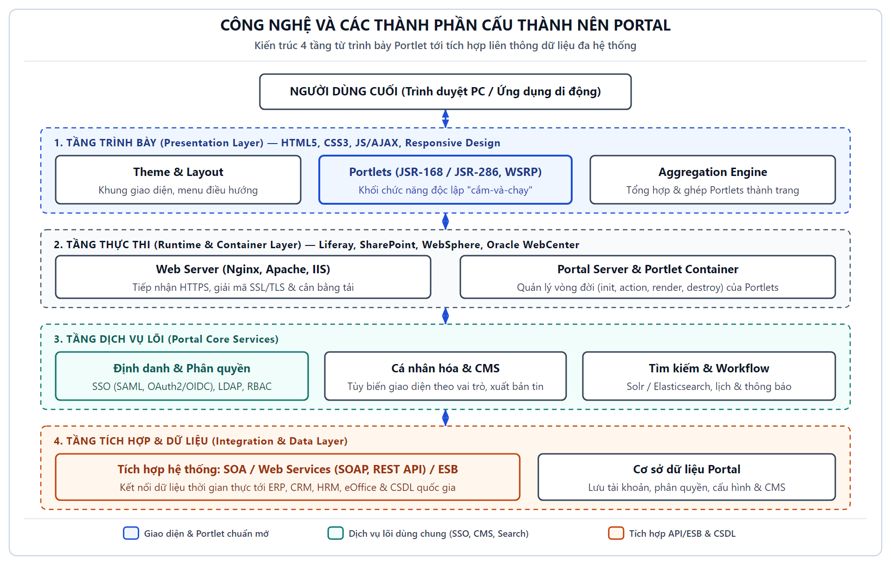

*Hình 9: Kiến trúc 4 tầng và các công nghệ nền tảng cấu thành nên Portal.*

**4. Ví dụ minh họa ngắn**
- **Cổng thông tin sinh viên của trường đại học** là một Portal gồm: đăng nhập một lần **SSO**, khung cá nhân hóa theo tài khoản sinh viên, cùng các **Portlet** độc lập như *Portlet Thời khóa biểu, Portlet Kết quả học tập, Portlet Đăng ký tín chỉ, Portlet Thanh toán học phí* kết nối trực tiếp tới CSDL đào tạo và tài chính phía sau.

> *Mẹo chốt ý vấn đáp:* Nhớ bộ đôi từ khóa đặc trưng nhất của công nghệ Portal là **"Portlet (JSR-168/286)"** và **"SSO + API/SOA tích hợp đa hệ thống"**.

---

### Câu 10: Hãy trình bày khái niệm và đặc trưng của thương mại điện tử? Cho ví dụ minh họa?

**1. Khái niệm Thương mại điện tử (E-Commerce)**
- **Theo nghĩa hẹp:** Thương mại điện tử là hoạt động **mua bán hàng hóa, cung ứng dịch vụ và thanh toán trực tuyến qua mạng Internet** và các phương tiện điện tử.
- **Theo nghĩa rộng (WTO & Nghị định 52/2013/NĐ-CP):** **Thương mại điện tử là việc tiến hành một phần hoặc toàn bộ quy trình của hoạt động thương mại bằng phương tiện điện tử có kết nối với mạng Internet, mạng viễn thông di động hoặc các mạng mở khác** (bao gồm từ trưng bày giới thiệu, tiếp thị, đàm phán, ký hợp đồng, thanh toán đến giao nhận và chăm sóc sau bán hàng).

**2. Các đặc trưng cơ bản của thương mại điện tử**
1. **Tính phi tiếp xúc (Không gặp mặt trực tiếp):** Các bên giao dịch không cần gặp gỡ trực tiếp tại cửa hàng vật lý; mọi thao tác xem hàng, đặt mua và trao đổi đều diễn ra trên môi trường số.
2. **Không bị giới hạn bởi không gian và thời gian (24/7 và toàn cầu):** Giao dịch có thể diễn ra bất kỳ lúc nào (24 giờ/ngày, 7 ngày/tuần) và vượt qua ranh giới địa lý, lãnh thổ quốc gia thông qua Internet.
3. **Có sự tham gia của tối thiểu ba chủ thể:** Ngoài *Bên bán* và *Bên mua* như thương mại truyền thống, TMĐT bắt buộc có sự tham gia của **bên thứ ba cung cấp hạ tầng/dịch vụ trung gian** (nhà mạng Internet, sàn giao dịch, ngân hàng/cổng thanh toán, đơn vị chuyển phát logistics, tổ chức chứng thực điện tử).
4. **Quy trình dựa trên phương tiện điện tử và chứng từ điện tử:** Hợp đồng, đơn đặt hàng, hóa đơn và chứng từ giao dịch được số hóa dưới dạng thông điệp dữ liệu, chữ ký điện tử có giá trị pháp lý.
5. **Tính tương tác cao, tốc độ nhanh và khả năng cá nhân hóa mạnh:** Người mua dễ dàng so sánh giá, đọc đánh giá cộng đồng, trò chuyện trực tiếp với người bán; hệ thống ứng dụng dữ liệu lớn/AI để gợi ý sản phẩm theo hành vi từng cá nhân.
6. **Chi phí giao dịch và phân phối biên thấp:** Giảm mạnh chi phí thuê mặt bằng trưng bày, in ấn danh mục và nhân viên bán hàng trực tiếp so với mô hình bán lẻ truyền thống.

**3. Ví dụ minh họa**
- **Ví dụ mua sắm trên sàn TMĐT (Shopee / Tiki):** Một sinh viên ở Hà Nội lúc 23 giờ đêm mở ứng dụng Shopee đặt mua sách giáo trình từ một nhà sách ở TP.HCM; sinh viên xem đánh giá người mua trước, áp mã giảm giá, thanh toán không tiền mặt qua ví điện tử (hoặc ngân hàng số) và theo dõi trạng thái vận chuyển theo thời gian thực cho tới khi nhận hàng tận nhà. Giao dịch này thể hiện rõ tính **24/7, xóa nhòa khoảng cách địa lý, chứng từ số và vai trò của bên trung gian (sàn + cổng thanh toán + đơn vị vận chuyển)**.
- **Ví dụ sản phẩm số:** Khách hàng mua vé máy bay trực tuyến trên website Vietnam Airlines hoặc mua phần mềm bản quyền Microsoft 365 — toàn bộ quy trình từ đặt chỗ, thanh toán đến nhận vé điện tử/mã kích hoạt đều hoàn tất 100% trên mạng trong vài phút.

---

### Câu 11: Hãy so sánh hành chính điện tử và thương mại điện tử?

**1. Điểm giống nhau cơ bản**
- Cả **Hành chính điện tử (HCĐT)** và **Thương mại điện tử (TMĐT)** đều là sự ứng dụng **công nghệ thông tin, mạng Internet và các hệ thống số** để chuyển đổi quy trình giao dịch từ thủ công/giấy tờ sang môi trường điện tử.
- Đều sử dụng chung nhiều nền tảng công nghệ cốt lõi: **Cổng thông tin điện tử (Portal), cơ sở dữ liệu, xác thực định danh, chữ ký số, thanh toán trực tuyến và hạ tầng an toàn bảo mật**.
- Đều hướng đến mục tiêu **tiết kiệm thời gian, giảm chi phí giao dịch, xóa bỏ giới hạn không gian – thời gian** và nâng cao trải nghiệm người dùng.

**2. Bảng so sánh sự khác nhau giữa Hành chính điện tử và Thương mại điện tử**

| Tiêu chí so sánh | Hành chính điện tử (E-Administration) | Thương mại điện tử (E-Commerce) |
|---|---|---|
| **Bản chất** | Ứng dụng CNTT-TT vào hoạt động quản lý, điều hành, xử lý thủ tục nội bộ và cung cấp dịch vụ công của cơ quan nhà nước. | Thực hiện một phần hoặc toàn bộ quy trình mua bán hàng hóa, cung ứng dịch vụ thương mại qua phương tiện điện tử. |
| **Chủ thể tham gia** | Cơ quan nhà nước với Công dân (**G2C**), Doanh nghiệp (**G2B**), giữa các cơ quan nhà nước (**G2G**) và với Cán bộ công chức (**G2E**). | Chủ yếu là Doanh nghiệp với Doanh nghiệp (**B2B**), Doanh nghiệp với Người tiêu dùng (**B2C**), Cá nhân với nhau (**C2C**). |
| **Mục tiêu cốt lõi** | **Phi lợi nhuận**: nâng cao hiệu lực – hiệu quả quản lý nhà nước, công khai minh bạch, cải cách hành chính và phục vụ xã hội. | **Tối đa hóa lợi nhuận**: tăng doanh thu, mở rộng thị phần, giảm chi phí bán hàng và cạnh tranh trên thị trường. |
| **Đối tượng giao dịch** | Hồ sơ hành chính, giấy phép, chứng từ công vụ, văn bản chỉ đạo điều hành, thông tin pháp luật và dịch vụ công. | Hàng hóa vật lý (quần áo, điện tử...), hàng hóa số (phần mềm, vé điện tử) và dịch vụ thương mại. |
| **Cơ chế tài chính** | Vận hành từ **ngân sách nhà nước**; người dân chỉ nộp phí, lệ phí theo biểu mức nhà nước quy định hoặc được miễn phí. | Dòng tiền vận hành theo **cơ chế thị trường** (định giá linh hoạt, khuyến mại, trả giá, hoàn tiền) gắn với lãi – lỗ. |
| **Tính cạnh tranh và quyền lựa chọn** | **Tính độc quyền công quyền**: người dân/doanh nghiệp bắt buộc thực hiện thủ tục tại cơ quan có thẩm quyền theo luật định. | **Cạnh tranh tự do gay gắt**: người mua có quyền tự do lựa chọn giữa hàng nghìn nhà cung cấp khác nhau. |
| **Khung pháp lý điều chỉnh** | Luật Chuyển đổi số / Luật Giao dịch điện tử, Nghị định 42/2022/NĐ-CP, Nghị định 118/2025/NĐ-CP, quy chế văn thư lưu trữ và TTHC. | Luật Thương mại, Luật Giao dịch điện tử, Nghị định 52/2013/NĐ-CP và Nghị định 85/2021/NĐ-CP về TMĐT, Luật Bảo vệ quyền lợi người tiêu dùng. |
| **Phạm vi tiếp cận** | Chủ yếu trong phạm vi lãnh thổ hành chính quốc gia, tỉnh, xã theo thẩm quyền quản lý. | Vượt biên giới quốc gia rất mạnh (TMĐT xuyên biên giới), không bị bó hẹp bởi địa giới hành chính. |

**3. Ví dụ minh họa đối chiếu**
- *Hành chính điện tử:* Công dân nộp hồ sơ cấp đổi giấy phép lái xe trực tuyến trên **Cổng Dịch vụ công Quốc gia**, lệ phí theo mức quy định nhà nước, do cơ quan có thẩm quyền giải quyết.
- *Thương mại điện tử:* Khách hàng tự chọn cửa hàng có giá tốt nhất trên **Shopee** để mua điện thoại, áp mã giảm giá và có thể hủy/đổi sang người bán khác bất kỳ lúc nào.

> *Mẹo chốt ý vấn đáp:* Khi trả lời miệng, luôn nêu **2 điểm giống nhau** trước rồi mới kẻ bảng hoặc đọc theo cặp tiêu chí đối lập: *Mục tiêu (Phi lợi nhuận vs Lợi nhuận)*, *Tính chất (Độc quyền công quyền vs Cạnh tranh thị trường)*, *Chủ thể (G2C/G2B/G2G vs B2B/B2C/C2C)*.

---

### Câu 12: Hãy so sánh hai hình thức thương mại điện tử B2B và B2C?

**1. Điểm giống nhau cơ bản**
- Cả **B2B (Business-to-Business)** và **B2C (Business-to-Consumer)** đều là mô hình giao dịch thương mại điện tử, sử dụng mạng Internet, website/ứng dụng và các công cụ điện tử để thực hiện hoạt động mua bán, trao đổi giá trị nhằm mục tiêu kinh doanh và sinh lợi cho doanh nghiệp.

**2. Bảng so sánh chi tiết mô hình B2B và B2C**

| Tiêu chí so sánh | TMĐT B2B (Business-to-Business) | TMĐT B2C (Business-to-Consumer) |
|---|---|---|
| **Khách hàng / Đối tượng mua** | Các **doanh nghiệp, tổ chức, đại lý phân phối** (mua để sản xuất, kinh doanh lại hoặc vận hành nội bộ). | **Cá nhân, hộ gia đình** là người tiêu dùng cuối cùng (mua phục vụ nhu cầu tiêu dùng cá nhân). |
| **Quy mô và giá trị đơn hàng** | **Rất lớn**, mua theo lô, số lượng nhiều, giá trị hợp đồng cao. | **Nhỏ lẻ**, thường mua từng món hoặc vài sản phẩm, giá trị đơn hàng thấp đến trung bình. |
| **Tần suất và chu kỳ giao dịch** | Tần suất mua thưa hơn nhưng ổn định định kỳ; chu kỳ ra quyết định **dài** (nhiều ngày đến nhiều tháng). | Tần suất mua thường xuyên, lặp lại nhanh; chu kỳ ra quyết định **rất ngắn** (vài phút đến vài giờ). |
| **Quy trình ra quyết định mua** | **Phức tạp, mang tính lý trí cao**, có quy trình đấu thầu/chào giá, cần thẩm định kỹ thuật và **nhiều cấp phê duyệt** (Phòng mua hàng, Tài chính, Ban Giám đốc). | **Đơn giản, chịu ảnh hưởng cảm xúc/xu hướng**, do một cá nhân hoặc gia đình tự quyết định ngay. |
| **Cơ chế giá cả** | Giá thường **linh hoạt theo hợp đồng**, chiết khấu theo sản lượng, công nợ và điều khoản thương thảo riêng. | Giá **niêm yết công khai, cố định** (kèm mã giảm giá, flash sale đại trà), ít thương lượng riêng. |
| **Phương thức thanh toán** | Chuyển khoản hợp đồng, **L/C (thư tín dụng)**, thanh toán theo kỳ công nợ (trả chậm 30–90 ngày), ủy nhiệm chi. | Thanh toán tức thời qua **thẻ ngân hàng, ví điện tử, VietQR, Internet Banking hoặc COD** (trả tiền khi nhận hàng). |
| **Mối quan hệ giữa hai bên** | Quan hệ đối tác chiến lược **gắn bó lâu dài**, dựa trên niềm tin và hợp đồng khung. | Quan hệ giao dịch rời rạc hoặc trung thành theo thương hiệu/trải nghiệm và chương trình tích điểm. |
| **Kênh và công nghệ giao dịch** | Sàn B2B, cổng đặt hàng đại lý (B2B Portal), hệ thống **EDI**, tích hợp trực tiếp **ERP/SCM**. | Website bán lẻ, ứng dụng di động (App), sàn TMĐT bán lẻ, mạng xã hội (Social Commerce). |
| **Hoạt động tiếp thị (Marketing)** | Tiếp thị quan hệ, hội chợ chuyên ngành, chào hàng trực tiếp (Sales B2B), hồ sơ năng lực kỹ thuật. | Quảng cáo đại chúng, SEO/SEM, KOL/KOC, Livestream, khuyến mại đại trà. |
| **Ví dụ minh họa** | Sàn **Alibaba.com**, **MISA** cung cấp phần mềm kế toán cho doanh nghiệp, nhà máy đặt mua thép/linh kiện từ nhà cung cấp qua cổng EDI. | Khách hàng cá nhân mua giày trên web **Nike**, mua sắm trên **Shopee Mall / Tiki**, đặt phòng trên **Agoda**. |

> *Mẹo chốt ý vấn đáp:* Chỉ cần nhớ trục đối lập cốt lõi: **B2B = Khách hàng là Tổ chức → Đơn lớn → Quyết định nhiều cấp → Hợp đồng & Giá thỏa thuận → Quan hệ dài hạn**; còn **B2C = Khách hàng là Cá nhân → Đơn nhỏ → Quyết định nhanh/cảm xúc → Giá niêm yết & Thanh toán ngay**.

---

### Câu 13: Hãy so sánh hành chính điện tử và chính quyền điện tử?

**1. Điểm giống nhau và mối quan hệ bao hàm**
- Cả **Hành chính điện tử (E-Administration)** và **Chính quyền điện tử / Chính phủ điện tử (E-Government)** đều sử dụng công nghệ thông tin – truyền thông (ICT) nhằm hiện đại hóa khu vực công, giảm giấy tờ, tăng hiệu quả quản lý nhà nước và minh bạch hóa thông tin.
- Về mặt cấu trúc, **Hành chính điện tử là một cấu phần cốt lõi (hạt nhân nội bộ) nằm bên trong Chính quyền điện tử**: không thể có Chính quyền điện tử vận hành hiệu quả nếu quy trình hành chính bên trong các cơ quan vẫn làm thủ công trên giấy.

**2. Bảng so sánh điểm khác nhau giữa Hành chính điện tử và Chính quyền điện tử**

| Tiêu chí so sánh | Hành chính điện tử (E-Administration) | Chính quyền điện tử (E-Government) |
|---|---|---|
| **Phạm vi bao hàm** | **Hẹp hơn**: tập trung vào các hoạt động quản lý, điều hành và quy trình tác nghiệp **bên trong nội bộ** bộ máy hành chính nhà nước. | **Rộng hơn, toàn diện**: bao gồm cả hành chính điện tử ở bên trong và **toàn bộ hệ sinh thái tương tác với xã hội** ở bên ngoài. |
| **Trọng tâm hoạt động** | Tự động hóa công tác văn phòng, xử lý văn bản đi/đến, quản lý hồ sơ công vụ, phân công điều hành và phối hợp liên phòng ban/liên cơ quan. | Vừa tối ưu quản trị nội bộ, vừa cung cấp **dịch vụ công trực tuyến**, công khai thông tin, lắng nghe phản ánh và tăng cường sự tham gia của người dân vào quản trị công. |
| **Đối tượng phục vụ chính** | Chủ yếu là **cán bộ, công chức, viên chức (G2E)** và sự phối hợp giữa **các cơ quan nhà nước với nhau (G2G)**. | Toàn xã hội: **Người dân (G2C)**, **Doanh nghiệp (G2B)**, đồng thời bao hàm **G2G** và **G2E**. |
| **Mục tiêu trọng yếu** | Giảm văn bản giấy, rút ngắn thời gian luân chuyển hồ sơ nội bộ, tăng năng suất lao động công vụ và rõ trách nhiệm cá nhân. | Đổi mới phương thức quản trị quốc gia, minh bạch hóa nền công vụ, phòng chống tham nhũng, cải thiện môi trường kinh doanh và phục vụ người dân 24/7. |
| **Hệ thống / Công cụ tiêu biểu** | Hệ thống **văn phòng điện tử (eOffice)**, Trục liên thông văn bản quốc gia, phần mềm quản lý cán bộ công chức (CCVC), hệ thống ERP tài chính công (TABMIS), họp trực tuyến không giấy tờ. | **Cổng Dịch vụ công Quốc gia**, hệ thống Một cửa điện tử (TPSC), hệ thống thuế/hải quan điện tử, định danh số **VNeID**, cổng dữ liệu mở (`data.gov.vn`), kênh phản ánh kiến nghị (`iHanoi`). |

**3. Ví dụ minh họa phân biệt rõ**
- *Hành chính điện tử:* Lãnh đạo UBND tỉnh ký số phê duyệt công văn chỉ đạo trên phần mềm **eOffice** và gửi điện tử qua Trục liên thông tới UBND cấp xã chỉ trong vài phút, toàn bộ quy trình diễn ra nội bộ giữa các cơ quan và cán bộ.
- *Chính quyền điện tử:* Người dân ở nhà đăng nhập **VNeID** lên **Cổng Dịch vụ công Quốc gia** nộp hồ sơ khai sinh – thường trú – BHYT liên thông cho con, thanh toán trực tuyến và nhận kết quả bản điện tử (trong đó bước các cơ quan nội bộ thẩm định và chuyển hồ sơ cho nhau chính là phần hành chính điện tử chạy phía sau).

> *Mẹo chốt ý vấn đáp:* Nhấn mạnh công thức nhớ nhanh: **Hành chính điện tử = Hướng nội (tối ưu bộ máy công vụ G2E, G2G)**; **Chính quyền điện tử = Hướng nội + Hướng ngoại (bao trùm cả G2C, G2B, minh bạch và phục vụ xã hội)**.

---

### Câu 14: Hãy trình bày các giai đoạn phát triển và các loại hình giao dịch trong hành chính điện tử?

**1. Các giai đoạn phát triển của Hành chính điện tử (và Chính phủ điện tử)**
Theo mô hình chuẩn quốc tế phổ biến (**Gartner / Liên hợp quốc**), quá trình phát triển từ hành chính truyền thống lên hành chính/chính phủ điện tử thường trải qua **4 giai đoạn tiến hóa từ thấp đến cao**:

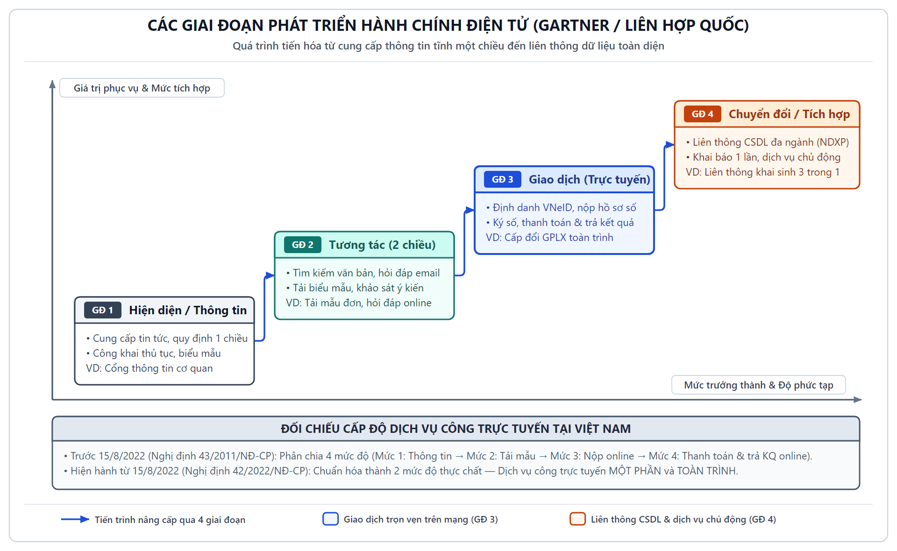

*Hình 14: 4 giai đoạn phát triển hành chính điện tử và đối chiếu cấp độ dịch vụ công tại Việt Nam.*

- **Giai đoạn 1 — Hiện diện / Thông tin (Information / Presence):** Cơ quan nhà nước thiết lập trang/cổng thông tin điện tử để công khai thông tin cơ bản một chiều (chức năng, cơ cấu tổ chức, văn bản pháp luật, danh mục thủ tục hành chính, giờ làm việc).
- **Giai đoạn 2 — Tương tác (Interaction):** Cho phép giao tiếp hai chiều ở mức cơ bản qua công cụ tìm kiếm văn bản, hộp thư điện tử, diễn đàn hỏi đáp, khảo sát ý kiến và tải về (download) biểu mẫu điện tử để điền trước rồi nộp trực tiếp.
- **Giai đoạn 3 — Giao dịch (Transaction):** Thực hiện trọn vẹn quy trình nghiệp vụ và dịch vụ công trên môi trường mạng: xác thực định danh điện tử, nộp hồ sơ trực tuyến, luân chuyển xử lý nội bộ bằng chữ ký số, thanh toán phí/lệ phí điện tử và trả kết quả điện tử có giá trị pháp lý.
- **Giai đoạn 4 — Chuyển đổi / Tích hợp toàn diện (Transformation / Integration):** Tái cấu trúc hoàn toàn quy trình hành chính, phá bỏ rào cản cục bộ giữa các cơ quan thông qua trục liên thông dữ liệu quốc gia (NDXP); áp dụng nguyên tắc *"khai báo một lần, sử dụng trọn đời"*, liên thông đa thủ tục theo vòng đời công dân và từng bước ứng dụng dữ liệu lớn, AI để phục vụ chủ động.
- *(Liên hệ thực tiễn Việt Nam: Trước 2022 phân chia dịch vụ công thành **4 mức độ** theo NĐ 43/2011/NĐ-CP; từ 15/8/2022 theo **Nghị định 42/2022/NĐ-CP** chuẩn hóa thành **2 mức độ**: Dịch vụ công trực tuyến **một phần** và **toàn trình**).*

**2. Các loại hình giao dịch trong Hành chính điện tử**
Trong giáo trình và thực tiễn hành chính điện tử, các loại hình giao dịch được nhận diện theo **4 nhóm quan hệ chủ thể cốt lõi** (và **5 nhóm theo nội dung nghiệp vụ**):

- **Phân loại theo đối tượng / chủ thể tham gia (4 loại hình chính):**
  1. **G2C (Government to Citizen — Cơ quan nhà nước với Công dân):** Cung cấp dịch vụ công trực tuyến, thông tin pháp luật, tiếp nhận phản ánh kiến nghị (*Ví dụ:* cấp đổi GPLX, khai sinh – thường trú – BHYT trên Cổng DVC Quốc gia; phản ánh hiện trường trên iHanoi).
  2. **G2B (Government to Business — Cơ quan nhà nước với Doanh nghiệp):** Hỗ trợ thủ tục đầu tư, kinh doanh, thuế, hải quan, đấu thầu công (*Ví dụ:* kê khai thuế qua eTax, thông quan hải quan tự động VNACCS, đăng ký doanh nghiệp qua mạng, đấu thầu trên `muasamcong.mpi.gov.vn`). *(Chiều doanh nghiệp cung ứng cho nhà nước gọi là B2G).*
  3. **G2G (Government to Government — Cơ quan nhà nước với Cơ quan nhà nước):** Trao đổi văn bản điện tử, phối hợp giải quyết thủ tục liên thông, chia sẻ dữ liệu giữa các Bộ/ngành/địa phương (*Ví dụ:* gửi nhận văn bản qua Trục liên thông văn bản quốc gia; chia sẻ dữ liệu qua NDXP giữa Bộ Công an, Tư pháp, Bảo hiểm xã hội).
  4. **G2E (Government to Employee — Cơ quan nhà nước với Cán bộ, công chức, viên chức):** Giao dịch điều hành và quản trị công vụ nội bộ (*Ví dụ:* xử lý văn bản, giao việc, ký số trên **eOffice**, quản lý hồ sơ và tiền lương công chức trên **VNPT CCVC**).

- **Phân loại bổ sung theo tính chất nghiệp vụ tác nghiệp:**
  - *(i)* Giao dịch cung cấp, tra cứu thông tin công và dữ liệu mở; *(ii)* Giao dịch giải quyết thủ tục hành chính và cấp phép trực tuyến; *(iii)* Giao dịch trao đổi văn bản điện tử và điều hành công vụ; *(iv)* Giao dịch nghĩa vụ tài chính công (thuế, phí, lệ phí, kho bạc); *(v)* Giao dịch mua sắm công điện tử và tiếp nhận phản ánh, giám sát xã hội.

> *Mẹo chốt ý vấn đáp:* Nhớ rõ cấu trúc câu hỏi có 2 vế tách bạch: **4 Giai đoạn** (*Thông tin → Tương tác → Giao dịch → Chuyển đổi/Tích hợp*) và **4 Loại hình giao dịch** (*G2C, G2B, G2G, G2E*).

---

### Câu 15: Phân biệt điểm khác biệt giữa Website và Portal?

**1. Khái niệm định vị**
- **Website (Trang thông tin điện tử):** Là tập hợp các trang web (HTML, CSS, JS, đa phương tiện) đặt dưới một tên miền chung, chủ yếu dùng để giới thiệu, cung cấp thông tin hoặc thực hiện một mục đích chuyên biệt đơn lẻ (tin tức, bán hàng, giới thiệu công ty).
- **Portal (Cổng thông tin điện tử):** Là một hệ thống web bậc cao đóng vai trò **điểm truy cập tập trung duy nhất (Single Point of Entry)**, tích hợp nhiều nguồn thông tin, cơ sở dữ liệu và ứng dụng nghiệp vụ khác nhau thông qua các **Portlet**, có khả năng **xác thực một lần (SSO), phân quyền chi tiết và cá nhân hóa** cho từng người dùng.

**2. Bảng phân biệt điểm khác biệt giữa Website và Portal**

| Tiêu chí phân biệt | Website (Trang web thông thường) | Portal (Cổng thông tin điện tử) |
|---|---|---|
| **Vai trò và bản chất** | Điểm cung cấp thông tin hoặc dịch vụ đơn lẻ (thường mang tính đại trà). | Điểm truy cập tập trung tích hợp đa ứng dụng, đa dịch vụ và nhiều hệ thống thành phần. |
| **Chiều tương tác** | Chủ yếu là **1 chiều** (đăng tải thông tin cho người đọc xem) hoặc tương tác đơn giản (form liên hệ, bình luận, giỏ hàng đơn lẻ). | **Đa chiều, chuyên sâu**: người dùng vừa tra cứu vừa trực tiếp tác nghiệp, phê duyệt quy trình, trao đổi dữ liệu với nhiều phân hệ lõi. |
| **Đăng nhập và phân quyền** | Phần lớn xem tự do không cần tài khoản; nếu có đăng nhập thì phân quyền đơn giản (Khách hàng / Admin). | Bắt buộc có quản lý danh tính chặt chẽ, hỗ trợ **đăng nhập một lần (SSO)** và **phân quyền theo vai trò (RBAC)** tới từng chức năng/dữ liệu. |
| **Khả năng cá nhân hóa** | Mọi người truy cập đều thấy giao diện và bố cục giống nhau. | **Cá nhân hóa cao**: mỗi đối tượng thấy nội dung, menu, **Portlet** và công việc đúng với vai trò của riêng mình (thậm chí tự sắp xếp lại bố cục). |
| **Cấu trúc và tích hợp hệ thống** | Cấu trúc đơn giản; cơ sở dữ liệu riêng biệt ít kết nối liên hệ thống. | Kiến trúc phân tầng phức tạp dựa trên **Portlet Container**, tích hợp sâu qua **API / Web Services / ESB** với ERP, HRM, eOffice, CSDL quốc gia. |
| **Quy trình quản trị nội dung** | Cập nhật trực tiếp khá đơn giản bởi một vài quản trị viên. | Có hệ thống **CMS phân cấp** với luồng kiểm duyệt nhiều bước (Biên tập viên → Kiểm duyệt → Xuất bản) từ nhiều đơn vị thành viên. |
| **Chi phí đầu tư và vận hành** | Chi phí xây dựng thấp, triển khai nhanh, bảo trì đơn giản. | Chi phí đầu tư hạ tầng, bản quyền, tích hợp và bảo mật cao; đòi hỏi đội ngũ vận hành chuyên trách. |
| **Ví dụ minh họa** | Trang web giới thiệu một công ty luật, blog cá nhân, trang tin tức điện tử VnExpress. | **Cổng Dịch vụ công Quốc gia** (`dichvucong.gov.vn`), **Cổng thông tin sinh viên** tích hợp đăng ký tín chỉ – xem điểm – đóng học phí, cổng tác nghiệp nội bộ doanh nghiệp. |

> *Mẹo chốt ý vấn đáp:* Ghi nhớ **3 từ khóa "ăn đứt"** của Portal so với Website thường: **(1) Điểm truy cập tập trung tích hợp đa hệ thống (Portlets)**, **(2) Đăng nhập một lần SSO & Phân quyền chặt chẽ**, **(3) Cá nhân hóa giao diện và nghiệp vụ theo từng người dùng**.

---

### Câu 16: Vẽ mô hình mô tả nguyên tắc hoạt động của web động và giải thích nguyên tắc hoạt động của web động?

**1. Khái niệm Web động**
- **Web động (Dynamic Web)** là trang web có nội dung hiển thị không cố định sẵn trong tệp HTML tĩnh, mà **được tạo lập tức thời theo thời gian thực ở phía máy chủ (hoặc kết hợp phía trình duyệt) dựa trên yêu cầu cụ thể của người dùng, trạng thái phiên làm việc và dữ liệu truy xuất từ cơ sở dữ liệu**.

**2. Mô hình mô tả nguyên tắc hoạt động của Web động**

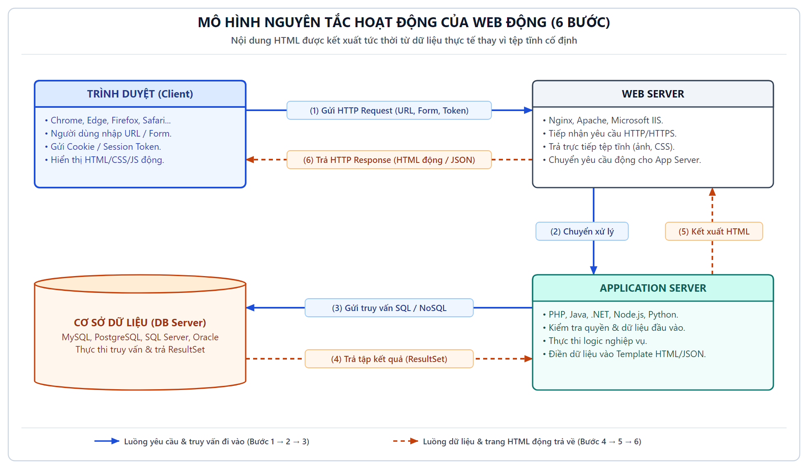

*Hình 16: Mô hình và nguyên tắc hoạt động 6 bước của Web động (Client – Web Server – Application Server – Database).*

**3. Giải thích nguyên tắc hoạt động chi tiết qua 6 bước**
1. **Bước 1 — Người dùng gửi yêu cầu (Request):** Thông qua trình duyệt (Chrome, Edge...), người dùng nhập URL, nhấn liên kết hoặc gửi biểu mẫu (ví dụ: tìm kiếm sản phẩm, đăng nhập, tra cứu mã hồ sơ). Trình duyệt đóng gói yêu cầu theo giao thức **HTTP/HTTPS** kèm tham số đầu vào và Cookie/Token gửi tới **Web Server**.
2. **Bước 2 — Web Server tiếp nhận và phân loại yêu cầu:** Web Server kiểm tra loại tài nguyên được yêu cầu. Nếu là tệp tĩnh (ảnh, CSS) thì trả về ngay; nếu là yêu cầu xử lý động (`.php`, `.jsp`, `.aspx` hoặc route API), Web Server chuyển tiếp yêu cầu sang **Application Server / Bộ thông dịch mã nguồn**.
3. **Bước 3 — Xử lý logic nghiệp vụ và truy vấn Cơ sở dữ liệu:** Mã chương trình phía máy chủ kiểm tra quyền truy cập, tính hợp lệ của dữ liệu đầu vào, xử lý quy tắc nghiệp vụ và sinh câu lệnh truy vấn (như `SELECT`, `INSERT`, `UPDATE`) gửi tới **Database Server**.
4. **Bước 4 — Database Server trả về dữ liệu:** Hệ quản trị CSDL thực thi truy vấn, trích xuất hoặc cập nhật các bản ghi tương ứng rồi trả tập dữ liệu kết quả về cho Application Server.
5. **Bước 5 — Tổng hợp và kết xuất trang HTML động:** Application Server lấy dữ liệu vừa nhận ghép vào các khuôn mẫu giao diện (Template) để dựng nên một trang HTML hoàn chỉnh mang nội dung riêng biệt cho yêu cầu đó (hoặc xuất dữ liệu JSON để JavaScript phía trình duyệt tự dựng giao diện theo mô hình CSR/SPA), sau đó gửi lại cho Web Server.
6. **Bước 6 — Trả kết quả về Client và hiển thị:** Web Server gửi phản hồi **HTTP Response** chứa mã HTML động về trình duyệt. Trình duyệt phân tích cú pháp HTML/CSS/JS và hiển thị giao diện kết quả cho người dùng.

**4. Đánh giá nhanh và Ví dụ minh họa**
- **Ưu điểm:** Nội dung cập nhật theo thời gian thực, hỗ trợ tương tác hai chiều, cá nhân hóa theo từng tài khoản, dễ quản trị và mở rộng quy mô dữ liệu lớn.
- **Nhược điểm:** Tốn tài nguyên CPU/RAM máy chủ để xử lý và truy vấn CSDL; tốc độ tải có thể chậm nếu không tối ưu bộ nhớ đệm (Cache); tiềm ẩn lỗ hổng bảo mật (như SQL Injection, XSS) nếu lập trình thiếu kiểm soát đầu vào.
- **Ví dụ thực tế:** Khi hai sinh viên cùng truy cập vào **Cổng thông tin đào tạo** tại cùng một địa chỉ `/xem-diem`, hệ thống dựa vào phiên đăng nhập (`MaSV`) của từng người để truy vấn bảng điểm tương ứng trong CSDL và trả về bảng điểm hoàn toàn khác nhau cho mỗi sinh viên.

> *Mẹo chốt ý vấn đáp:* Khi lên bảng hoặc vẽ nháp, bắt buộc phải vẽ đủ **4 khối chính** (`Client/Browser` → `Web Server` → `Application Server` → `Database Server`) và đánh số rõ **6 mũi tên khép kín hai chiều** từ Request đến Response.

---

### Câu 17: Web service là gì? Có thể xác định Web Service qua những cách nào?

**1. Khái niệm Web Service**
- Theo định nghĩa chuẩn của Tổ chức W3C (World Wide Web Consortium): **Web Service (Dịch vụ web) là một hệ thống phần mềm được thiết kế để hỗ trợ khả năng tương tác máy-với-máy (machine-to-machine) qua mạng**, cho phép các ứng dụng khác nhau (viết bằng ngôn ngữ lập trình và chạy trên hệ điều hành khác nhau) giao tiếp, gọi hàm và trao đổi dữ liệu một cách chuẩn hóa.

**2. Có thể xác định một Web Service qua những cách nào?**
Để trả lời trọn vẹn câu hỏi này theo chuẩn học phần, cần trình bày cả **2 góc độ**: *(a) Cách định vị, mô tả và khám phá một Web Service trong kỹ thuật* và *(b) Dấu hiệu nhận diện bản chất của một Web Service*.

- **A. Các cách xác định, định vị và mô tả Web Service về mặt kỹ thuật (4 phương thức chính):**
  1. **Xác định địa chỉ truy cập qua URI / URL (Endpoint):** Mỗi Web Service được định danh bằng một địa chỉ tài nguyên duy nhất trên mạng (ví dụ: `https://api.example.gov.vn/services/TraCuuHoSo`) để các ứng dụng khách biết nơi gửi yêu cầu.
  2. **Xác định cấu trúc dịch vụ qua tài liệu mô tả WSDL (hoặc OpenAPI/Swagger):**
     - Với Web Service chuẩn SOAP: sử dụng tệp **WSDL (Web Services Description Language)** viết bằng XML (thường truy cập qua đường dẫn `?wsdl`) để biết dịch vụ có những hàm nào, tham số đầu vào và kiểu dữ liệu trả về ra sao.
     - Với RESTful Web Service hiện đại: xác định qua tài liệu **OpenAPI / Swagger** (YAML/JSON) mô tả từng Endpoint, phương thức HTTP (`GET, POST, PUT, DELETE`) và cấu trúc JSON.
  3. **Xác định và tìm kiếm qua danh bạ dịch vụ UDDI (hoặc API Registry / Cổng tích hợp):**
     - Theo mô hình truyền thống, nhà cung cấp đăng ký dịch vụ lên thư mục **UDDI (Universal Description, Discovery, and Integration)** (hoặc WSIL); ứng dụng khách truy vấn UDDI để tìm ra dịch vụ phù hợp và lấy liên kết tới tệp WSDL. Trong kiến trúc hiện đại, việc này thực hiện qua **API Gateway / API Catalog** (như danh mục dịch vụ trên Trục NDXP).
  4. **Xác định qua giao thức và thông điệp trao đổi chuẩn hóa (SOAP / REST trên HTTP):** Quan sát cách dịch vụ nhận và trả gói tin XML theo chuẩn **SOAP** hoặc dữ liệu **JSON/XML** qua giao thức **HTTP/HTTPS**.

- **B. Cách nhận diện bản chất của một Web Service (4 tiêu chí chuẩn W3C):**
  1. **Truy cập được qua mạng** (Internet hoặc Intranet) thông qua giao thức web chuẩn (`HTTP/HTTPS`).
  2. **Sử dụng định dạng dữ liệu chuẩn mở, độc lập nền tảng** (`XML` hoặc `JSON`).
  3. **Có mô tả giao diện tách biệt mà máy tính tự đọc hiểu được** (như `WSDL`, `XSD` hoặc `OpenAPI`).
  4. **Giao tiếp trực tiếp giữa ứng dụng với ứng dụng** (không phải trang web HTML để người dùng nhìn bằng mắt thường).

**3. Ví dụ minh họa**
- Khi một Website thương mại điện tử muốn tích hợp tính năng tính cước giao hàng của Giao Hàng Nhanh hoặc Viettel Post: lập trình viên tìm trong **API Catalog** (tương đương vai trò tìm kiếm của UDDI), lấy địa chỉ **Endpoint URL**, đọc tài liệu mô tả tham số đầu vào/đầu ra (**WSDL/OpenAPI**), rồi viết code gửi gói tin **JSON/XML** qua **HTTPS** để nhận về cước phí tự động.

> *Mẹo chốt ý vấn đáp:* Nhớ ngay bộ tứ định danh kỹ thuật trong giáo trình: **URI** (ở đâu?) + **WSDL** (làm được gì & gọi thế nào?) + **UDDI** (tìm thấy ở đâu?) + **XML/SOAP** (nói chuyện bằng ngôn ngữ gì?).

---

### Câu 18: Kể tên các thành phần của Web Service? Nêu ưu, nhược điểm của Web service?

**1. Các thành phần của Web Service**
Một hệ thống Web Service chuẩn được cấu thành bởi **3 vai trò kiến trúc** phối hợp theo chu trình **Publish – Find – Bind** và **4 thành phần công nghệ cốt lõi**:

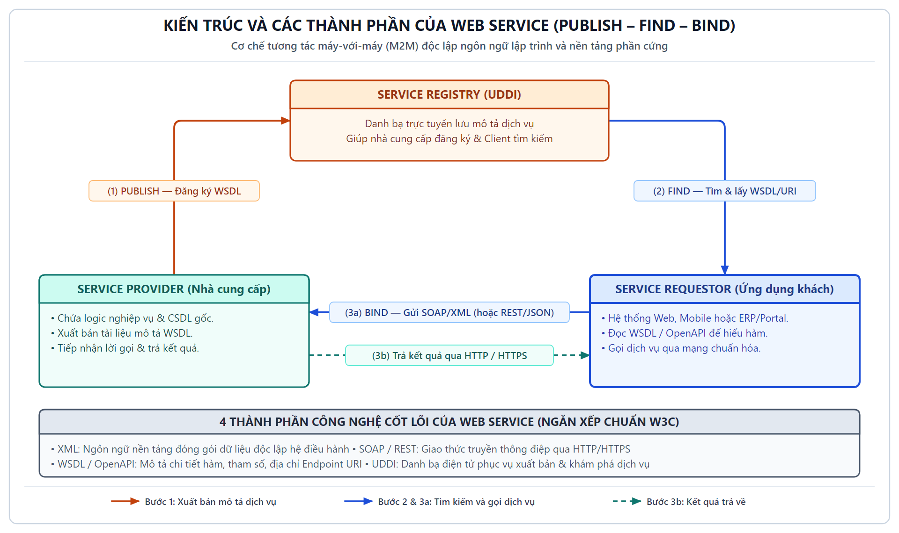

*Hình 18: Mô hình kiến trúc 3 vai trò (Publish – Find – Bind) và 4 thành phần công nghệ cốt lõi của Web Service.*

- **4 thành phần công nghệ cốt lõi (Ngăn xếp Web Service truyền thống):**
  1. **XML (eXtensible Markup Language):** Ngôn ngữ đánh dấu chuẩn làm nền tảng định dạng, mã hóa toàn bộ dữ liệu trao đổi và tài liệu mô tả để mọi hệ thống khác nhau đều đọc hiểu được.
  2. **SOAP (Simple Object Access Protocol):** Giao thức truyền thông điệp dựa trên XML chạy qua HTTP/HTTPS, gồm 3 phần: *Envelope* (vỏ bọc), *Header* (thông tin xác thực/điều khiển) và *Body* (nội dung gọi hàm & tham số). *(Trong kiến trúc hiện đại còn có phong cách **REST** dùng trực tiếp HTTP + JSON gọn nhẹ).*
  3. **WSDL (Web Services Description Language):** Tài liệu chuẩn XML đóng vai trò "bản hợp đồng kỹ thuật" mô tả vị trí địa chỉ (Endpoint URI), danh sách hàm/phương thức, định dạng dữ liệu đầu vào và đầu ra của dịch vụ.
  4. **UDDI (Universal Description, Discovery, and Integration):** Hệ thống danh bạ trực tuyến cho phép nhà cung cấp **xuất bản (Publish)** dịch vụ và ứng dụng khách **tìm kiếm (Find)** dịch vụ sẵn có.

**2. Ưu điểm của Web Service**
1. **Độc lập hoàn toàn với ngôn ngữ lập trình và nền tảng hệ điều hành:** Ứng dụng viết bằng Java trên Linux có thể giao tiếp mượt mà với hệ thống viết bằng C#/.NET trên Windows hay Python thông qua chuẩn XML/JSON và HTTP.
2. **Khả năng tương tác và tích hợp liên hệ thống (Interoperability) rất cao:** Là cầu nối lý tưởng để liên thông các hệ thống cũ (legacy) với hệ thống mới (như nối phần mềm một cửa với CSDL dân cư hoặc nối website TMĐT với cổng thanh toán ngân hàng).
3. **Tái sử dụng cao (Reusability):** Một dịch vụ viết một lần (ví dụ: dịch vụ xác thực OTP, tính phí vận chuyển, tra cứu mã số thuế) có thể được nhiều ứng dụng web, di động và đối tác cùng gọi lại.
4. **Dễ dàng đi qua tường lửa (Firewall-friendly):** Do chạy trên giao thức phổ thông **HTTP/HTTPS (cổng 80/443)** nên không cần mở các cổng kết nối phức tạp và rủi ro như các giao thức phân tán cũ (CORBA, DCOM).
5. **Dựa trên các chuẩn mở quốc tế (W3C, OASIS):** Không bị khóa chặt vào công nghệ độc quyền của một nhà cung cấp đơn lẻ.

**3. Nhược điểm của Web Service**
1. **Hiệu năng truyền tải và xử lý chậm hơn giao tiếp nhị phân nội bộ:** Đặc biệt với SOAP/XML, việc đóng gói thêm nhiều thẻ XML làm kích thước gói tin phình to, tốn băng thông và tốn CPU phân tích cú pháp (parse XML).
2. **Phụ thuộc vào sự ổn định của mạng và bên cung cấp dịch vụ:** Nếu đường truyền gián đoạn hoặc máy chủ của đối tác gặp sự cố/thay đổi cấu trúc giao diện, hệ thống gọi dịch vụ cũng bị ảnh hưởng trực tiếp.
3. **Phức tạp về bảo mật và quản lý giao dịch phân tán:** Việc bảo đảm an toàn đầu-cuối (WS-Security), xác thực, chống tấn công DDoS vào API và xử lý hoàn tác giao dịch (rollback) khi lỗi giữa nhiều hệ thống đòi hỏi kỹ thuật cao.
4. **Hạn chế tính giao dịch tức thời với dữ liệu quá lớn:** Không phù hợp để truyền tải luồng dữ liệu khổng lồ hoặc thời gian thực siêu thấp (ví dụ truyền video hay xử lý đồng bộ hàng triệu bản ghi cùng lúc).

> *Mẹo chốt ý vấn đáp:* Liệt kê ngắn gọn **4 thành phần công nghệ (`XML – SOAP – WSDL – UDDI`)** kèm **3 vai trò (`Provider – Registry – Requestor`)**, sau đó chốt 4 ưu – 3 nhược thật gọn gàng.

---

### Câu 19: Anh (chị) hãy nêu quy trình xây dựng giải pháp tác nghiệp trên cổng thông tin điện tử? Cho ví dụ cụ thể?

**1. Khái niệm mở đầu**
- **Giải pháp tác nghiệp trên Cổng thông tin điện tử** là việc số hóa, chuẩn hóa và tích hợp các quy trình nghiệp vụ hàng ngày của tổ chức/cơ quan lên nền tảng Portal dưới dạng các phân hệ (Portlet/Module) có luồng phê duyệt tự động, phân quyền và kết nối dữ liệu đồng bộ.

**2. Quy trình 7 bước xây dựng giải pháp tác nghiệp trên Cổng thông tin điện tử**

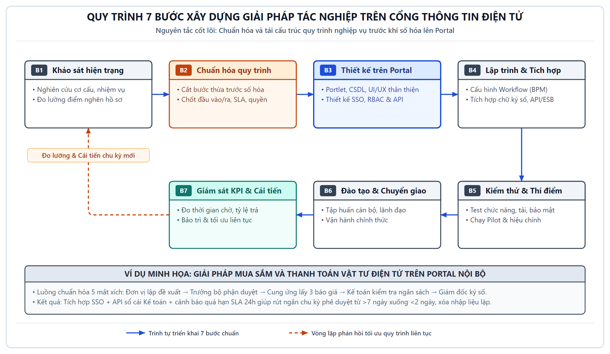

*Hình 19: Quy trình 7 bước xây dựng giải pháp tác nghiệp trên Cổng thông tin điện tử.*

1. **Bước 1 — Khảo sát hiện trạng và nhận diện điểm nghẽn:** Nghiên cứu cơ cấu tổ chức, chức năng nhiệm vụ và quy trình làm việc thực tế; đo lường các điểm tắc nghẽn (thời gian chờ bàn giao, nhập liệu trùng lặp, bước duyệt thủ công rườm rà, thất lạc hồ sơ).
2. **Bước 2 — Chuẩn hóa quy trình nghiệp vụ và xác định yêu cầu:** Tái cấu trúc, cắt giảm bước trung gian thừa (nguyên tắc *chuẩn hóa trước khi số hóa*); xác định rõ đầu vào, đầu ra, hạn mức thời gian xử lý tại từng trạm (SLA), ma trận phân quyền người dùng và yêu cầu pháp lý/bảo mật.
3. **Bước 3 — Thiết kế giải pháp kỹ thuật trên Portal:**
   - Thiết kế **Portlet / Module nghiệp vụ** bám chuẩn Portal và giao diện thân thiện (UI/UX).
   - Thiết kế **Cơ sở dữ liệu** chuẩn hóa, biểu mẫu nhập liệu có kiểm tra hợp lệ tự động (validation).
   - Thiết kế cơ chế **đăng nhập một lần (SSO), phân quyền theo vai trò (RBAC)** và **API tích hợp** với các hệ thống lõi (ERP, Kế toán, CSDL quốc gia, chữ ký số).
4. **Bước 4 — Xây dựng, cấu hình luồng công việc (Workflow) và tích hợp:** Lập trình Portlet; cấu hình bộ máy điều phối quy trình (**BPM/Workflow Engine**) tự động đẩy hồ sơ, đếm ngược thời hạn và cảnh báo trễ hạn; tích hợp chữ ký số (PKI) và cổng kết nối dữ liệu (API/Web Service).
5. **Bước 5 — Kiểm thử và vận hành thí điểm (Pilot):** Thực hiện kiểm thử chức năng, tải lớn, bảo mật và kiểm thử chấp nhận người dùng (UAT); triển khai thí điểm tại một đơn vị/nhóm thủ tục để thu thập phản hồi và hiệu chỉnh thực tế.
6. **Bước 6 — Đào tạo, chuyển giao và vận hành chính thức:** Tổ chức tập huấn cho cán bộ tác nghiệp, lãnh đạo ký duyệt và quản trị viên; ban hành quy chế vận hành trên môi trường số (thay thế dần hồ sơ giấy).
7. **Bước 7 — Theo dõi hiệu năng, bảo trì và cải tiến:** Theo dõi nhật ký xử lý, chỉ số KPI (tỷ lệ đúng hạn, thời gian chờ, tỷ lệ trả lại hồ sơ) để tiếp tục tối ưu hóa quy trình và nâng cấp giải pháp.

**3. Ví dụ cụ thể: Xây dựng giải pháp "Quy trình mua sắm và thanh toán vật tư điện tử" trên Cổng tác nghiệp nội bộ doanh nghiệp**
- **Bước 1 (Khảo sát):** Hiện trạng giấy tờ tồn đọng trung bình 48 giờ tại Bộ phận Cung ứng và 72 giờ chờ lãnh đạo đi công tác ký giấy; Kế toán phải nhập tay lại số liệu từ file Excel vào phần mềm kế toán gây sai sót.
- **Bước 2 (Chuẩn hóa & Yêu cầu):** Chốt luồng điện tử 5 mắt xích: *Đơn vị yêu cầu lập phiếu → Trưởng bộ phận duyệt cấp thiết → Bộ phận Cung ứng lấy 3 báo giá → Kế toán đối soát hạn mức ngân sách → Ban Giám đốc ký số theo phân cấp hạn mức chi*; quy định SLA tối đa 24 giờ/bước.
- **Bước 3 & 4 (Thiết kế & Xây dựng trên Portal):** Xây dựng Portlet *"Đề xuất mua sắm"* gắn SSO theo tài khoản nhân sự; tích hợp API kiểm tra tự động số dư ngân sách từ hệ thống Kế toán; nhúng chữ ký số để Giám đốc duyệt mọi lúc trên điện thoại; cấu hình thông báo nhắc việc khi quá 24 giờ.
- **Bước 5 – 7 (Thí điểm, Vận hành & Đo lường):** Chạy thử 1 tháng tại Phòng Hành chính trước khi mở toàn công ty; sau triển khai rút ngắn tổng chu kỳ duyệt mua sắm từ hơn 7 ngày xuống dưới 2 ngày và loại bỏ hoàn toàn việc nhập liệu thủ công hai lần.

> *Mẹo chốt ý vấn đáp:* Nêu bật triết lý cốt lõi: **"Phải chuẩn hóa và tái cấu trúc quy trình trước khi đưa lên Portal"** — nếu bê nguyên quy trình rườm rà trên giấy lên phần mềm thì chỉ tạo ra *"số hóa hình thức"*.

---

### Câu 20: Anh (chị) hãy nêu tên những thành phần cần bảo vệ trong một hệ thống thông tin? Cho 1 ví dụ minh họa?

**1. Nguyên tắc tiếp cận**
- Theo chuẩn quản lý an toàn thông tin (như **ISO/IEC 27001**) và cấu trúc của một hệ thống thông tin hiện đại, muốn hệ thống an toàn toàn diện phải bảo vệ đồng bộ **6 thành phần cấu thành** sau:

**2. Tên những thành phần cần bảo vệ trong một hệ thống thông tin**
1. **Dữ liệu và Cơ sở dữ liệu (Data / Database):** Là tài sản giá trị nhất cần bảo vệ (hồ sơ khách hàng/công dân, số liệu tài chính – kế toán, hợp đồng, bí mật kinh doanh, khóa mã hóa, tệp sao lưu), cả khi **đang lưu trữ (at rest)** và **đang truyền tải (in transit)**.
2. **Phần cứng và Hạ tầng vật lý (Hardware & Physical Infrastructure):** Bao gồm máy chủ (Server), máy trạm người dùng, thiết bị lưu trữ, thiết bị mạng (Router, Switch, Firewall), hệ thống nguồn điện, làm mát và phòng máy chủ trước nguy cơ trộm cắp, phá hoại vật lý, cháy nổ.
3. **Phần mềm (Software):** Bao gồm hệ điều hành, hệ quản trị cơ sở dữ liệu (DBMS), máy chủ ứng dụng và các phần mềm tác nghiệp/cổng thông tin trước các lỗ hổng bảo mật, mã độc (virus, trojan, ransomware) và việc sửa đổi mã nguồn trái phép.
4. **Mạng truyền thông (Networks):** Bao gồm mạng nội bộ (LAN, Wi-Fi), mạng diện rộng (WAN), đường truyền Internet và các giao diện kết nối API/Web Service trước nguy cơ nghe lén, giả mạo, tấn công từ chối dịch vụ (DDoS) và xâm nhập trái phép.
5. **Con người và Tài khoản định danh (People & Identities):** Bao gồm người dùng cuối, lãnh đạo phê duyệt và quản trị viên hệ thống (cùng thông tin đăng nhập, mật khẩu, chữ ký số, dữ liệu sinh trắc học) — thường là mắt xích dễ bị tấn công nhất thông qua lừa đảo (phishing) hoặc lạm quyền nội bộ.
6. **Quy trình nghiệp vụ, Tài liệu và Nhật ký hệ thống (Procedures, Documentation & Audit Logs):** Các quy chuẩn vận hành, chính sách phân quyền, tài liệu thiết kế kiến trúc và hệ thống nhật ký ghi vết thao tác (Log) nhằm bảo đảm tính pháp lý và khả năng điều tra sự cố.

**3. Ví dụ minh họa (Xuyên suốt 6 thành phần trong "Hệ thống tác nghiệp mua sắm & thanh toán vật tư điện tử")**
Giả sử doanh nghiệp đang vận hành cổng mua sắm và thanh toán nội bộ, việc bảo vệ 6 thành phần được thực hiện cụ thể như sau:
- **Bảo vệ Dữ liệu:** Mã hóa bảng dữ liệu báo giá thầu, tài khoản ngân hàng nhà cung cấp trong CSDL và thực hiện sao lưu tự động theo quy tắc **3-2-1** để chống mã độc tống tiền xóa dữ liệu.
- **Bảo vệ Phần cứng:** Đặt máy chủ tại Trung tâm dữ liệu có kiểm soát thẻ từ ra vào, camera giám sát, hệ thống lưu điện (UPS) và khóa cổng USB vật lý trên máy trạm kế toán.
- **Bảo vệ Phần mềm:** Thường xuyên cập nhật bản vá cho hệ điều hành và ứng dụng cổng mua sắm, rà quét lỗ hổng SQL Injection trước khi phát hành.
- **Bảo vệ Mạng truyền thông:** Chia tách phân vùng mạng (mạng máy trạm tách khỏi vùng máy chủ CSDL), triển khai tường lửa, kênh truyền mã hóa **HTTPS/TLS** và **VPN** khi lãnh đạo phê duyệt từ xa.
- **Bảo vệ Con người & Tài khoản:** Bắt buộc xác thực đa nhân tố (**MFA**) và **chữ ký số** đối với Ban Giám đốc khi duyệt lệnh chi, kết hợp đào tạo nhân viên không nhấp vào email giả mạo (Phishing).
- **Bảo vệ Quy trình & Nhật ký:** Áp dụng nguyên tắc kiểm soát chéo (người lập đề xuất không được tự duyệt chi) và đẩy nhật ký phê duyệt về máy chủ **Audit Log bất biến** để phục vụ thanh tra, kiểm toán khi có tranh chấp.

> *Mẹo chốt ý vấn đáp:* Dùng chính **6 thành phần cấu thành HTTT** (`Dữ liệu – Phần cứng – Phần mềm – Mạng – Con người – Quy trình`) làm danh sách các thành phần cần bảo vệ vừa chuẩn lý thuyết vừa không bao giờ bị sót ý, rồi minh họa cả 6 thành phần đó trên **cùng 1 ví dụ thực tế**.

---

### Câu 21: Những yêu cầu về bảo mật hệ thống là gì? Cho ví dụ minh họa?

**1. Khái niệm mở đầu**
- **Yêu cầu bảo mật hệ thống** là tập hợp các tiêu chuẩn kỹ thuật và kiểm soát bắt buộc mà một hệ thống thông tin phải đáp ứng nhằm bảo vệ dữ liệu, hạ tầng và giao dịch trước các truy cập trái phép, sai lệch hoặc gián đoạn. Nền tảng cốt lõi là **bộ ba CIA** kết hợp với **4 yêu cầu bảo đảm giao dịch mở rộng**.

**2. Các yêu cầu bảo mật cốt lõi (Mô hình CIA + Mở rộng)**

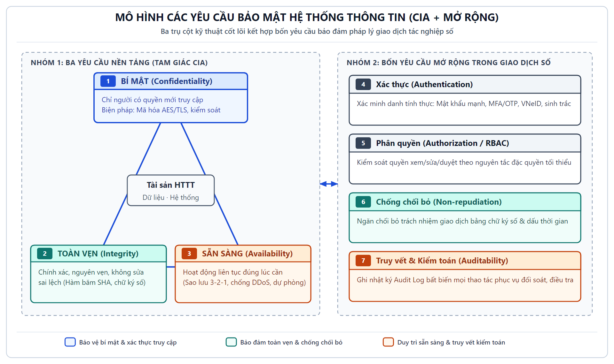

*Hình 21: Mô hình tam giác bảo mật nền tảng CIA và 4 yêu cầu mở rộng trong giao dịch số.*

- **Nhóm 1 — Ba yêu cầu nền tảng (Tam giác CIA):**
  1. **Tính bí mật (Confidentiality):** Dữ liệu và tài nguyên hệ thống chỉ được phép truy cập bởi những cá nhân, tổ chức hoặc tiến trình đã được cấp quyền hợp lệ; ngăn chặn hoàn toàn việc nghe lén, đọc trộm hoặc rò rỉ thông tin nhạy cảm. *(Biện pháp: mã hóa dữ liệu AES/TLS, phân quyền, kiểm soát truy cập).*
  2. **Tính toàn vẹn (Integrity):** Dữ liệu và quy trình xử lý phải được bảo đảm chính xác, đầy đủ và nguyên vẹn trong suốt quá trình lưu trữ cũng như truyền tải; không bị sửa đổi, chèn, xóa trái phép hoặc sai lệch ngoài ý muốn. *(Biện pháp: hàm băm SHA, chữ ký số, kiểm tra checksum, ràng buộc cơ sở dữ liệu).*
  3. **Tính sẵn sàng (Availability):** Hệ thống, dữ liệu và dịch vụ phải luôn trong trạng thái sẵn sàng hoạt động ổn định, đáp ứng đúng thời hạn khi người dùng hợp pháp cần truy cập, kể cả khi xảy ra sự cố hay tấn công mạng. *(Biện pháp: sao lưu dự phòng, cân bằng tải, chống DDoS, máy chủ dự phòng).*

- **Nhóm 2 — Bốn yêu cầu mở rộng trong giao dịch tác nghiệp số:**
  4. **Tính xác thực (Authentication):** Xác minh chắc chắn danh tính thực của chủ thể (người dùng, thiết bị hoặc hệ thống đối tác) trước khi cho phép truy cập hay giao dịch (qua mật khẩu mạnh, OTP, xác thực đa nhân tố MFA, VNeID, sinh trắc học).
  5. **Tính kiểm soát truy cập / Phân quyền (Authorization / Access Control):** Quy định rõ ai được phép xem, thêm, sửa, xóa hay phê duyệt tài nguyên nào theo nguyên tắc **đặc quyền tối thiểu (Least Privilege)**.
  6. **Tính chống chối bỏ (Non-repudiation):** Bảo đảm chủ thể đã thực hiện một hành động (ký duyệt, đặt hàng, chuyển tiền) không thể chối bỏ trách nhiệm sau này nhờ bằng chứng mật mã học (chữ ký số, chứng thư số, dấu thời gian).
  7. **Tính truy vết và kiểm toán (Accountability / Auditability):** Mọi thao tác truy cập, chỉnh sửa và phê duyệt phải được ghi lại đầy đủ trong nhật ký hệ thống (Audit Log) gắn kèm thời gian, địa chỉ IP và định danh để phục vụ thanh tra, đối soát.

**3. Ví dụ minh họa (Giao dịch chuyển khoản / thanh toán trực tuyến trên hệ thống Ngân hàng số)**
- **Tính xác thực:** Khách hàng phải đăng nhập bằng mật khẩu/sinh trắc học khuôn mặt kết hợp mã Smart OTP (MFA) mới thực hiện được lệnh chuyển tiền.
- **Tính bí mật:** Số tài khoản, mật khẩu và số tiền giao dịch được mã hóa đầu-cuối qua giao thức HTTPS/TLS để kẻ gian không thể nghe lén trên đường truyền Wi-Fi công cộng.
- **Tính toàn vẹn:** Khi khách hàng nhập lệnh chuyển *5.000.000 VNĐ* tới tài khoản A, hệ thống sử dụng chữ ký giao dịch và kiểm tra toàn vẹn bảo đảm số tiền và số tài khoản nhận không bị thay đổi thành *50.000.000 VNĐ* trên đường truyền.
- **Tính sẵn sàng:** Hạ tầng ngân hàng có máy chủ dự phòng hoạt động liên tục 24/7, tránh sập hệ thống vào các ngày cao điểm trả lương hay lễ Tết.
- **Tính chống chối bỏ & Truy vết:** Sau khi xác nhận thành công, hệ thống lưu biên lai điện tử và nhật ký giao dịch không thể sửa xóa, làm bằng chứng đối soát nếu phát sinh khiếu nại.

> *Mẹo chốt ý vấn đáp:* Luôn bắt đầu bằng **"3 trụ cột CIA (Bí mật – Toàn vẹn – Sẵn sàng)"**, rồi cộng thêm **"4 yêu cầu giao dịch (Xác thực – Phân quyền – Chống chối bỏ – Truy vết)"**; đây là công thức đạt điểm tối đa ở mọi môn liên quan đến HTTT và An toàn thông tin.

---

### Câu 22: Anh (chị) hãy nêu những mục tiêu bảo mật trong hệ thống thông tin tác nghiệp? Cho ví dụ minh họa?

**1. Khái niệm và góc độ tiếp cận**
- Nếu *yêu cầu bảo mật* (như CIA) thiên về tiêu chuẩn kỹ thuật của hệ thống, thì **mục tiêu bảo mật trong hệ thống thông tin tác nghiệp** hướng thẳng vào **giá trị vận hành, tính pháp lý và sự an toàn của quy trình nghiệp vụ hàng ngày** trong tổ chức/doanh nghiệp hay cơ quan nhà nước.

**2. Những mục tiêu bảo mật cốt lõi trong HTTT tác nghiệp**
1. **Bảo đảm tính bí mật, toàn vẹn và sẵn sàng cho dữ liệu giao dịch hàng ngày:** Ngăn chặn rò rỉ bí mật kinh doanh, dữ liệu khách hàng/công dân; bảo đảm chứng từ, bảng giá, đơn hàng, số dư tài chính không bị sửa sai; và bảo đảm hệ thống không bị tê liệt giữa ca làm việc.
2. **Duy trì tính liên tục trong hoạt động vận hành (Business Continuity):** Bảo vệ dây chuyền tác nghiệp (tiếp nhận hồ sơ, bán hàng, mua sắm, kế toán, sản xuất) không bị đình trệ trước sự cố phần cứng, mất điện hay tấn công mã độc tống tiền (Ransomware).
3. **Chống giả mạo danh tính và ngăn ngừa gian lận nội bộ qua kiểm soát chéo:** Bảo đảm mọi lệnh điều hành, phê duyệt chi tiêu hay cấp phép điện tử đều do đúng người có thẩm quyền thực hiện; thực thi nguyên tắc phân quyền theo vai trò (**RBAC**) và tách biệt trách nhiệm (người tạo lập không thể tự phê duyệt).
4. **Bảo đảm giá trị pháp lý, tính giải trình và tuân thủ quy định kiểm toán:** Mọi thao tác tác nghiệp trên môi trường số phải có dấu vết bất biến (Audit Trail) và chữ ký số hợp lệ để làm bằng chứng pháp lý trước cơ quan quản lý, kiểm toán hoặc tòa án; tuân thủ luật pháp (Luật An toàn thông tin, Luật Giao dịch điện tử, Nghị định bảo vệ dữ liệu cá nhân).
5. **Bảo vệ tài sản, doanh thu và uy tín của tổ chức:** Giảm thiểu tổn thất tài chính trực tiếp do thanh toán khống, mất dữ liệu hoặc phạt vi phạm hợp đồng; đồng thời giữ vững niềm tin của khách hàng, đối tác và người dân.

**3. Ví dụ minh họa (Bảo mật trong hệ thống tác nghiệp Mua sắm & Thanh toán vật tư điện tử)**
- **Chống gian lận nội bộ & giả mạo phê duyệt:** Hệ thống tác nghiệp thiết lập **RBAC** tách bạch 4 vai trò *(Người khởi tạo đề xuất → Bộ phận Cung ứng lấy báo giá → Kế toán đối soát ngân sách → Ban Giám đốc phê duyệt)*; khi duyệt lệnh chi vượt hạn mức bắt buộc dùng **xác thực đa nhân tố (MFA) và chữ ký số** để ngăn kẻ gian hoặc nhân viên mượn tài khoản lãnh đạo ký duyệt thanh toán khống.
- **Bảo đảm chứng cứ pháp lý & chống lộ lọt dữ liệu:** Hệ thống đẩy toàn bộ lịch sử xem báo giá thầu và phê duyệt về **máy chủ Audit Log bất biến (ghi một lần, đọc nhiều lần)**, kết hợp **công cụ chống thất thoát dữ liệu (DLP)** chặn việc xuất danh sách nhà cung cấp hoặc đơn giá mật gửi qua email cá nhân/USB, đồng thời áp dụng **sao lưu dự phòng 3-2-1** để kịp thời khôi phục nếu bị mã độc tấn công.

> *Mẹo chốt ý vấn đáp:* Phân biệt khéo với Câu 21: khi thầy cô hỏi **"Mục tiêu bảo mật trong HTTT tác nghiệp"**, hãy nhấn mạnh các yếu tố gắn với **nghiệp vụ vận hành** như *tính liên tục công việc, chống gian lận phê duyệt (kiểm soát chéo), giá trị pháp lý chứng từ số và bảo vệ tài sản/uy tín*.

---

### Câu 23: Anh (chị) hãy kể tên những mối đe dọa đến an toàn của một hệ thống thông tin?

**1. Khái niệm mở đầu**
- **Mối đe dọa (Threat)** đối với an toàn hệ thống thông tin là **bất kỳ tác nhân, sự kiện hoặc hành vi nào (cố ý hoặc vô ý, từ bên ngoài hoặc bên trong) có khả năng khai thác lỗ hổng để gây tổn hại đến tính bí mật, toàn vẹn hoặc sẵn sàng của hệ thống thông tin**.

**2. Phân loại 5 nhóm mối đe dọa chủ yếu đến an toàn của một hệ thống thông tin**

1. **Tấn công mạng và mã độc từ bên ngoài (Cyberattacks & Malware):**
   - **Mã độc (Malware):** Virus, sâu mạng (Worm), Trojan, phần mềm gián điệp (Spyware) và đặc biệt là **mã độc tống tiền (Ransomware)** mã hóa toàn bộ cơ sở dữ liệu làm tê liệt hệ thống.
   - **Tấn công từ chối dịch vụ (DoS / DDoS):** Làm tràn ngập băng thông hoặc tài nguyên máy chủ khiến người dùng hợp pháp không thể truy cập cổng thông tin hay hệ thống bán hàng.
   - **Khai thác lỗ hổng ứng dụng và đường truyền:** Tấn công chèn mã SQL (**SQL Injection**) để đánh cắp hoặc xóa CSDL, chèn mã độc trình duyệt (**XSS**), tấn công nghe lén trung gian (**Man-in-the-Middle — MITM**) trên đường truyền không mã hóa.

2. **Tấn công kỹ nghệ xã hội và đánh cắp danh tính (Social Engineering & Phishing):**
   - Giả mạo email cơ quan nhà nước, ngân hàng, lãnh đạo (**Phishing / Spear-phishing**), gửi đường link độc hại hoặc mã QR giả mạo để lừa người dùng cung cấp mật khẩu, mã OTP nhằm chiếm đoạt tài khoản phê duyệt.

3. **Mối đe dọa từ nội bộ tổ chức (Insider Threats — cố ý và vô ý):**
   - **Cố ý (ác ý / vụ lợi):** Nhân viên bất mãn hoặc nội gián lợi dụng quyền truy cập hợp pháp để sao chép, bán dữ liệu khách hàng/hồ sơ đấu thầu ra ngoài, sửa đổi số liệu kế toán hoặc phá hoại hệ thống.
   - **Vô ý (bất cẩn):** Rời bàn làm việc không khóa màn hình, dùng mật khẩu yếu/dùng chung tài khoản, gửi nhầm tài liệu mật ra email công cộng, cắm USB lạ chứa mã độc vào máy trạm nội bộ, hoặc không thu hồi quyền truy cập cũ khi nhân viên thuyên chuyển/nghỉ việc.

4. **Lỗi phần mềm, cấu hình sai và sự cố kỹ thuật – phần cứng:**
   - Lỗi lập trình (bug), chậm cập nhật bản vá bảo mật, cấu hình sai phân quyền đám mây/CSDL làm lộ dữ liệu công khai; hỏng ổ cứng, lỗi nguồn điện, đứt cáp quang, mất kết nối mạng.

5. **Thiên tai, thảm họa môi trường và xâm nhập vật lý:**
   - Hỏa hoạn, lũ lụt, động đất, sét đánh làm hư hại trung tâm dữ liệu; hoặc kẻ xấu đột nhập trực tiếp vào phòng máy chủ để đánh cắp thiết bị lưu trữ.

**3. Ví dụ minh họa ngắn**
- Một nhân viên kế toán nhận được email giả mạo thông báo cập nhật hóa đơn điện tử (*Phishing*), nhấp vào tệp đính kèm chứa mã độc *Ransomware*; vì máy trạm nối thẳng mạng nội bộ thiếu phân vùng, mã độc lan sang máy chủ làm mã hóa toàn bộ cơ sở dữ liệu tác nghiệp của công ty.

> *Mẹo chốt ý vấn đáp:* Nên kể đủ cả **tấn công bên ngoài** (Malware/Ransomware, DDoS, SQLi, Phishing) lẫn **nguy cơ nội bộ & sự cố kỹ thuật/thiên tai** — đặc biệt nhấn mạnh **"con người và nội bộ thường là mắt xích dễ tổn thương nhất"**.

---

### Câu 24: Các yếu tố cần quan tâm đến khi xây dựng giải pháp tác nghiệp cho hệ thống thông tin điện tử?

**1. Khái niệm mở đầu**
- Xây dựng **giải pháp tác nghiệp cho hệ thống thông tin điện tử** không chỉ là bài toán mua phần mềm hay viết mã, mà là bài toán tổng hòa giữa **nghiệp vụ – pháp lý – công nghệ – dữ liệu – bảo mật – con người – hiệu quả kinh tế**.

**2. 7 yếu tố cốt lõi cần quan tâm khi xây dựng giải pháp tác nghiệp**

1. **Chuẩn hóa và tái cấu trúc quy trình nghiệp vụ (Business Process Standardization):**
   - Phải rà soát, đơn giản hóa quy trình trước khi đưa lên môi trường số; xác định rạch ròi các bước thực hiện, đầu vào – đầu ra, luồng rẽ nhánh ngoại lệ, thời hạn xử lý tối đa (SLA) tại mỗi khâu và trách nhiệm giải trình của từng vị trí. Tránh tình trạng bê nguyên quy trình rườm rà trên giấy thành *"số hóa hình thức"*.
2. **Tính tuân thủ pháp lý, chính sách và tiêu chuẩn kỹ thuật:**
   - Giải pháp phải tuân thủ đúng luật pháp (Luật Giao dịch điện tử 2023, quy định về chữ ký số, chứng từ điện tử, bảo vệ dữ liệu cá nhân, Nghị định 42/2022/NĐ-CP và 118/2025/NĐ-CP đối với khu vực công) cũng như quy chế nội bộ, tiêu chuẩn dữ liệu và Khung kiến trúc chung.
3. **Kiến trúc công nghệ, khả năng tích hợp liên thông và mở rộng (Scalability & Integration):**
   - Thiết kế kiến trúc mô-đun mở, hỗ trợ giao diện kết nối chuẩn (**API, Web Services, ESB**) để liên thông mượt mà với các hệ thống sẵn có (ERP, Kế toán, HRM, Cổng DVC Quốc gia, NDXP), tránh tạo thêm *"ốc đảo dữ liệu"* hoặc buộc nhân viên phải nhập lại dữ liệu thủ công giữa các phần mềm. Hệ thống phải chịu tải và mở rộng được khi lượng giao dịch tăng đột biến.
4. **Chất lượng và tính chuẩn hóa của dữ liệu (Data Quality & Governance):**
   - Áp dụng cơ chế kiểm tra tính hợp lệ (validation) ngay từ điểm nhập liệu, chuẩn hóa danh mục dùng chung theo nguyên tắc **"Đúng, đủ, sạch, sống, thống nhất, dùng chung"** và **"khai báo một lần"** (tái sử dụng dữ liệu sẵn có).
5. **An toàn thông tin, bảo mật và tính liên tục (Security & Continuity):**
   - Tích hợp an toàn ngay từ khâu thiết kế (*Security by Design*): xác thực mạnh (MFA, VNeID, chữ ký số), phân quyền chặt chẽ (**RBAC** + kiểm soát chéo), mã hóa lưu trữ & đường truyền, nhật ký kiểm toán bất biến (Audit Log) và phương án sao lưu – dự phòng thảm họa.
6. **Yếu tố con người, trải nghiệm người dùng (UI/UX) và quản trị thay đổi:**
   - Giao diện phải trực quan, giảm thao tác lặp cho cán bộ/nhân viên và dễ tiếp cận với người dân; đồng thời chú trọng **sự cam kết của lãnh đạo**, công tác **đào tạo tập huấn** và truyền thông tháo gỡ tâm lý ngại thay đổi thói quen giấy tờ.
7. **Nguồn lực đầu tư, hiệu quả kinh tế và cơ chế đo lường (KPIs):**
   - Cân đối ngân sách đầu tư – chi phí duy trì (lựa chọn tự xây dựng hay thuê dịch vụ điện toán đám mây); tích hợp sẵn các chỉ số đo lường hiệu suất luồng công việc (thời gian xử lý thực, thời gian chờ trong hàng đợi, tỷ lệ trả hồ sơ, tỷ lệ đúng hạn) để đánh giá hiệu quả thực chất sau vận hành.

**3. Ví dụ minh họa ngắn**
- Khi triển khai **hệ thống Một cửa điện tử giải quyết TTHC**, nếu chỉ chú trọng giao diện web (yếu tố công nghệ) mà bỏ qua **tích hợp API với CSDL dân cư** (yếu tố liên thông) và **quy định SLA nhắc việc quá hạn** (yếu tố quy trình), cán bộ vẫn phải bắt người dân nộp bản sao giấy tờ và hồ sơ vẫn ùn ứ.

> *Mẹo chốt ý vấn đáp:* Nhóm nhanh thành câu thần chú **4 trụ + 3 bổ trợ**: *Quy trình – Pháp lý – Công nghệ/Liên thông – Dữ liệu* + *Bảo mật – Con người – Chi phí/KPI*.

---

### Câu 25: Những trở ngại trong quá trình thu thập và lưu trữ thông tin của các hệ thống thông tin tác nghiệp hiện nay?

**1. Khái niệm mở đầu**
- **Thu thập** (tiếp nhận, số hóa, nhập liệu) và **lưu trữ** (tổ chức CSDL, bảo quản, sao lưu, chia sẻ) là hai khâu đầu vào – nền tảng của mọi HTTT tác nghiệp. Nếu khâu này gặp trở ngại, toàn bộ hệ thống sẽ rơi vào quy luật **"Rác vào – Rác ra" (Garbage In – Garbage Out)**.

**2. 6 trở ngại lớn trong quá trình thu thập và lưu trữ thông tin hiện nay**

1. **Dữ liệu phân tán, cát cứ và thiếu chuẩn hóa cấu trúc:**
   - Nhiều tổ chức sử dụng đồng thời các phần mềm độc lập, không có API đồng bộ khiến dữ liệu nằm rải rác ở nhiều nơi, định dạng không thống nhất (một người nhưng mỗi hệ thống lưu mã định danh, địa chỉ hoặc chuẩn ngày tháng khác nhau), rất khó tổng hợp và đối chiếu.
2. **Sai sót do nhập liệu thủ công và thiếu kiểm soát chất lượng đầu vào:**
   - Ở khâu thu thập, nhân sự vẫn phải nhập tay lại số liệu từ giấy tờ hoặc xuất file Excel từ phần mềm này nhập sang phần mềm khác; nhiều biểu mẫu điện tử không ràng buộc trường bắt buộc hoặc quy tắc kiểm tra định dạng nên dữ liệu sai, thiếu hoặc trùng lặp dễ lọt vào hệ thống.
3. **Tình trạng vừa "thiếu thông tin sạch" vừa "quá tải thông tin nhiễu" (dữ liệu phi cấu trúc):**
   - Khối lượng văn bản scan, hình ảnh, email, tệp đính kèm (dữ liệu phi cấu trúc) tăng bùng nổ khiến hệ thống lưu trữ phình to, chậm chạp và khó tìm kiếm, trong khi thông tin chính xác, có cấu trúc để phân tích ra quyết định lại bị thiếu hoặc cập nhật chậm.
4. **Rào cản từ quy trình, thói quen giấy tờ và tâm lý "giữ dữ liệu" (Văn hóa tổ chức):**
   - Nhiều đơn vị vẫn duy trì *"số hóa hình thức"* (nộp hồ sơ qua mạng nhưng vẫn yêu cầu lưu song song bản giấy), trao đổi thông tin qua kênh phi chính thức (tin nhắn cá nhân, gọi điện không lưu vết), hoặc phòng ban ngại chia sẻ dữ liệu do sợ mất quyền kiểm soát hay lộ sai sót nội bộ.
5. **Chi phí đầu tư hạ tầng lưu trữ, sao lưu và bảo quản dài hạn cao:**
   - Dữ liệu tác nghiệp phát sinh liên tục với khối lượng lớn đòi hỏi chi phí cao về máy chủ, không gian lưu trữ đám mây, băng thông đồng bộ, cơ chế sao lưu dự phòng nhiều tầng và xử lý bài toán chuyển đổi định dạng lưu trữ điện tử lâu dài.
6. **Rủi ro an toàn thông tin, lộ lọt dữ liệu cá nhân và áp lực tuân thủ pháp lý:**
   - Việc thu thập và tập trung lượng lớn dữ liệu nhạy cảm (số CCCD, tài khoản ngân hàng, hồ sơ bệnh án, đơn giá hợp đồng) biến kho lưu trữ thành mục tiêu tấn công của tin tặc, mã độc tống tiền (Ransomware) hoặc nguy cơ kết xuất trộm từ nội bộ; đồng thời hệ thống phải đáp ứng các quy định nghiêm ngặt về bảo vệ dữ liệu cá nhân và thời hạn lưu trữ theo luật định.

**3. Ví dụ minh họa ngắn**
- Tại khâu nghiệm thu và thanh toán mua sắm ở nhiều doanh nghiệp hiện nay, dù đã có cổng văn phòng điện tử nhưng lại thiếu kết nối API sang phần mềm kế toán; cán bộ phải tải hóa đơn, gõ lại thủ công vào sổ kế toán gây độ trễ hàng ngày và tỷ lệ sai lệch số liệu phải trả lại hồ sơ cao; đồng thời bản scan PDF lưu rời rạc khiến việc tra cứu lại hợp đồng cũ rất khó khăn.

> *Mẹo chốt ý vấn đáp:* Tách ý rõ khi nói: **3 trở ngại khâu thu thập** (*sai sót nhập tay, dữ liệu thiếu chuẩn/rời rạc, thói quen né tránh nhập chuẩn*) + **3 trở ngại khâu lưu trữ** (*quá tải dữ liệu phi cấu trúc, chi phí hạ tầng & bảo quản, rủi ro mất/lộ dữ liệu*).

---

### Câu 26: Lợi ích của thương mại điện tử là gì? Cho ví dụ?

**1. Khái niệm mở đầu**
- Thương mại điện tử mang lại giá trị kinh tế và xã hội to lớn nhờ khả năng tự động hóa giao dịch, kết nối không biên giới 24/7 và giảm thiểu các khâu trung gian truyền thống. Lợi ích được thể hiện rõ trên **3 góc độ**: **Doanh nghiệp, Người tiêu dùng và Xã hội**.

**2. Lợi ích của Thương mại điện tử theo 3 chủ thể**

- **A. Đối với Doanh nghiệp (Người bán / Tổ chức kinh doanh):**
  1. **Mở rộng thị trường toàn cầu và hoạt động 24/7:** Tiếp cận khách hàng ở mọi vùng miền, quốc gia mà không cần mở thêm chi nhánh vật lý.
  2. **Giảm mạnh chi phí vận hành và tiếp thị:** Tiết kiệm chi phí thuê mặt bằng, kho bãi, nhân viên bán hàng trực tiếp, in ấn catalog; giảm chi phí xử lý giấy tờ nhờ hóa đơn điện tử, hợp đồng số.
  3. **Tối ưu hóa chuỗi cung ứng và quản trị tồn kho:** Giảm lượng hàng tồn kho dư thừa nhờ sản xuất/nhập hàng theo đơn đặt thực tế (mô hình *Just-in-Time* / bán hàng trực tiếp tới người dùng).
  4. **Cá nhân hóa sản phẩm và chăm sóc khách hàng hiệu quả:** Thu thập dữ liệu hành vi mua sắm để gợi ý sản phẩm đúng nhu cầu, tăng tỷ lệ chuyển đổi và lòng trung thành.
  5. **Tạo cơ hội cạnh tranh bình đẳng cho doanh nghiệp vừa và nhỏ (SMEs):** Doanh nghiệp nhỏ với số vốn ít vẫn có thể tiếp cận hàng triệu khách hàng trên sàn TMĐT ngang hàng với các tập đoàn lớn.

- **B. Đối với Người tiêu dùng (Người mua):**
  1. **Mua sắm mọi lúc, mọi nơi (Tiện lợi 24/7):** Không mất công di chuyển, không chịu giới hạn giờ mở cửa cửa hàng, hàng hóa được giao tận nhà.
  2. **Đa dạng lựa chọn và dễ dàng so sánh:** Tiếp cận hàng triệu mặt hàng từ nhiều nhà cung cấp; dễ dàng so sánh giá cả, thông số kỹ thuật và đọc đánh giá thực tế từ cộng đồng người mua trước.
  3. **Giá cả cạnh tranh và nhiều ưu đãi:** Nhờ cắt giảm khâu trung gian và cạnh tranh minh bạch trên sàn, người mua thường hưởng mức giá rẻ hơn, kèm mã giảm giá, miễn phí vận chuyển.
  4. **Tiếp nhận sản phẩm số và thông tin tức thì:** Với sách điện tử, khóa học, phần mềm, vé máy bay, người mua có thể sử dụng ngay lập tức sau vài giây thanh toán.

- **C. Đối với Xã hội và Nền kinh tế:**
  1. **Thúc đẩy tăng trưởng kinh tế số và thanh toán không tiền mặt:** Tạo ra nhiều mô hình kinh doanh mới, ngành nghề mới (logistics, tiếp thị số, phát triển nền tảng).
  2. **Tạo công ăn việc làm và hỗ trợ vùng sâu, vùng xa:** Giúp nông dân, làng nghề đưa đặc sản địa phương lên sàn tiêu thụ toàn quốc; người dân vùng xa tiếp cận hàng hóa, dịch vụ chất lượng tương đương đô thị.
  3. **Giảm ùn tắc giao thông, ô nhiễm môi trường và tiết kiệm năng lượng:** Giảm lượng người trực tiếp di chuyển mua sắm, giảm tiêu thụ giấy tờ in ấn và phát triển hạ tầng dịch vụ công – an sinh hiện đại.

**3. Ví dụ minh họa**
- **Ví dụ thực tế tại Việt Nam:** Một hợp tác xã nông sản ở Tây Bắc hoặc Đồng bằng sông Cửu Long đưa sản phẩm OCOP (gạo, trái cây sấy, mật ong) lên sàn **Shopee / TikTok Shop** hoặc kết nối qua các sàn B2B: họ không cần tốn hàng tỷ đồng mở chuỗi cửa hàng tại Hà Nội hay TP.HCM (*lợi ích doanh nghiệp*), người tiêu dùng tại thành phố mua được đặc sản tận gốc giá hợp lý kèm đánh giá chất lượng minh bạch (*lợi ích người tiêu dùng*), đồng thời góp phần giải quyết đầu ra bền vững cho nông nghiệp địa phương (*lợi ích xã hội*).

> *Mẹo chốt ý vấn đáp:* Chia ngay thành **3 cột/3 nhóm (`Doanh nghiệp` – `Người tiêu dùng` – `Xã hội`)**, mỗi nhóm nêu 3–4 ý ngắn gọn sắc nét rồi chốt bằng 1 ví dụ bao quát cả 3 nhóm đó.

---

### Câu 27: Mô tả đặc điểm hình thức hoạt động trong của mô hình thương mại điện tử B2B?

**1. Khái niệm mô hình TMĐT B2B**
- **B2B (Business-to-Business)** là mô hình thương mại điện tử trong đó **giao dịch mua bán hàng hóa, nguyên vật liệu, linh kiện, thiết bị hoặc cung ứng dịch vụ diễn ra trực tiếp giữa các doanh nghiệp/tổ chức với nhau** qua nền tảng mạng điện tử. *(Lưu ý: tỷ trọng giá trị giao dịch B2B chiếm phần áp đảo trong tổng kim ngạch TMĐT toàn cầu).*

**2. Đặc điểm nổi bật của mô hình B2B**
1. **Quy mô đơn hàng lớn và giá trị hợp đồng cao:** Giao dịch thường tính theo lô hàng, container hoặc gói dịch vụ dài hạn thay vì từng sản phẩm đơn lẻ.
2. **Quy trình mua hàng phức tạp, có tính lý trí và nhiều cấp phê duyệt:** Trước khi đặt hàng phải trải qua khảo sát nhà cung cấp, yêu cầu báo giá (RFQ), thẩm định năng lực kỹ thuật, đối soát ngân sách và trình Ban Giám đốc phê duyệt theo hợp đồng chặt chẽ.
3. **Chính sách giá linh hoạt và thanh toán theo công nợ/hợp đồng:** Giá ít niêm yết cứng mà được thương lượng theo sản lượng, chiết khấu đại lý; thanh toán thường qua chuyển khoản hợp đồng, thư tín dụng (L/C), bảo lãnh ngân hàng hoặc trả chậm theo chu kỳ 30–90 ngày.
4. **Quan hệ đối tác chiến lược và gắn bó lâu dài:** Hai bên thường xây dựng mối quan hệ hợp tác ổn định trong chuỗi cung ứng, tích hợp chặt chẽ hệ thống quản trị (ERP, SCM, EDI) để đặt hàng bổ sung tự động.
5. **Yêu cầu cao về tiêu chuẩn kỹ thuật, hóa đơn chứng từ và tuân thủ pháp lý:** Bắt buộc gắn chặt với hợp đồng điện tử, hóa đơn giá trị gia tăng (GTGT) điện tử, chứng từ xuất nhập khẩu (CO/CQ) và điều khoản phạt vi phạm hợp đồng.

**3. Các hình thức hoạt động chính trong mô hình B2B**
Trong thực tiễn, TMĐT B2B vận hành theo **4 hình thức hoạt động chủ yếu**:

1. **Mô hình thiên về Bên bán (Sell-side B2B E-Marketplace / Cổng đại lý):**
   - Một doanh nghiệp lớn (nhà sản xuất/nhà phân phối độc quyền) tự xây dựng website/cổng B2B riêng để bán hàng cho hàng trăm doanh nghiệp mua hoặc hệ thống đại lý.
   - *Ví dụ:* Cổng đặt hàng trực tuyến dành cho đại lý của **Vinamilk**, **Dell Premier** (doanh nghiệp tự cấu hình và đặt lô máy tính cho công ty), hoặc cổng cung cấp giải pháp phần mềm **SAP / MISA** cho doanh nghiệp.
2. **Mô hình thiên về Bên mua (Buy-side B2B E-Marketplace / Đấu thầu mua sắm điện tử):**
   - Một doanh nghiệp/tập đoàn lớn thiết lập cổng thu mua riêng và mời nhiều nhà cung cấp vào **đấu thầu ngược (Reverse Auction)** hoặc chào giá cạnh tranh nhằm chọn nhà cung cấp có giá và chất lượng tốt nhất.
   - *Ví dụ:* Cổng đấu thầu nhà cung cấp (e-Procurement) của các tập đoàn sản xuất như **Samsung, Toyota**, hoặc cổng mời thầu của chuỗi bán lẻ lớn.
3. **Sàn giao dịch B2B trung gian (Third-Party B2B E-Exchange / Alibaba model):**
   - Do bên thứ ba xây dựng và vận hành làm nơi quy tụ hàng nghìn doanh nghiệp bán và hàng nghìn doanh nghiệp mua gặp gỡ, gửi yêu cầu báo giá (RFQ), kiểm chứng nhà cung cấp và giao dịch qua cơ chế ký quỹ bảo đảm.
   - *Ví dụ:* **Alibaba.com**, **Amazon Business**, **EC21** hoặc các sàn giao dịch nguyên vật liệu, nông sản B2B.
4. **Thương mại cộng tác và Trao đổi dữ liệu điện tử (Collaborative Commerce & EDI / Extranet):**
   - Các doanh nghiệp trong cùng chuỗi cung ứng kết nối trực tiếp hệ thống phần mềm (**EDI / API / Extranet**) để chia sẻ dự báo nhu cầu, tồn kho, thiết kế sản phẩm và tự động phát lệnh cung ứng vật tư mà không cần thao tác đặt hàng thủ công.
   - *Ví dụ:* Hệ thống kết nối tồn kho tự động giữa nhà sản xuất hàng tiêu dùng nhanh (FMCG) với hệ thống siêu thị **Co.opmart / WinCommerce**.

> *Mẹo chốt ý vấn đáp:* Nhớ 2 phần rõ ràng: **5 đặc điểm cốt lõi** (*Đơn lớn → Duyệt nhiều cấp → Giá đàm phán/Công nợ → Hợp tác dài hạn → Tích hợp ERP/EDI*) và **4 hình thức hoạt động** (*Sell-side, Buy-side, Sàn trung gian, Thương mại cộng tác*).

---

### Câu 28: Mô tả hình thức hoạt động trong của mô hình thương mại điện tử B2C?

**1. Khái niệm mô hình TMĐT B2C**
- **B2C (Business-to-Consumer)** là mô hình thương mại điện tử trong đó **doanh nghiệp bán hàng hóa hoặc cung ứng dịch vụ trực tiếp đến tay người tiêu dùng cuối cùng** thông qua môi trường Internet và các thiết bị kết nối.

**2. Đặc điểm và Quy trình hoạt động chuẩn của mô hình B2C**
- **Đặc điểm nhận diện:** Số lượng khách hàng cá nhân rất lớn, giá trị mỗi đơn hàng nhỏ lẻ, giá cả niêm yết công khai, chu kỳ quyết định mua nhanh (chịu tác động mạnh từ đánh giá người mua, hình ảnh, khuyến mại), giao tiếp chuẩn hóa qua giỏ hàng và thanh toán trực tuyến/COD.
- **Quy trình 6 bước vận hành cơ bản:**
  `Khách hàng tìm kiếm/xem danh mục sản phẩm → Chọn cấu hình & thêm vào Giỏ hàng điện tử → Nhập địa chỉ nhận & mã giảm giá → Chọn phương thức thanh toán (Thẻ/Ví/VietQR/COD) → Doanh nghiệp xác nhận, đóng gói & bàn giao đơn vị vận chuyển → Khách hàng nhận hàng, đánh giá & sử dụng dịch vụ hậu mãi.`

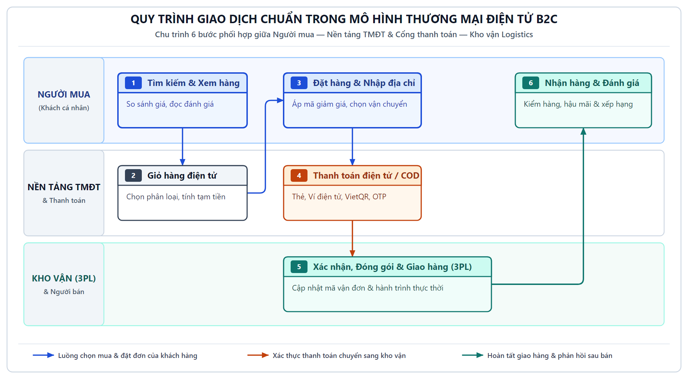

*Hình 28: Lưu đồ quy trình giao dịch 6 bước trong mô hình thương mại điện tử B2C.*

**3. 5 hình thức hoạt động phổ biến của mô hình B2C hiện nay**
1. **Bán lẻ trực tiếp qua Website / App của thương hiệu (Direct-to-Consumer — E-tailers):**
   - Doanh nghiệp tự xây dựng website hoặc ứng dụng di động riêng để trưng bày danh mục điện tử, bán trực tiếp sản phẩm do mình sản xuất hoặc phân phối độc quyền mà không qua sàn trung gian.
   - *Ví dụ:* Website bán hàng của **Thế Giới Di Động** (`thegioididong.com`), **Apple Store trực tuyến**, hãng thời trang **Routine / Canifa** hoặc **Vietnam Airlines** bán vé trực tiếp cho hành khách.
2. **Bán hàng qua Sàn giao dịch TMĐT trung gian (Online Marketplaces):**
   - Doanh nghiệp mở gian hàng chính hãng (Official Store / Mall) trên các sàn TMĐT lớn để tận dụng lưu lượng truy cập khổng lồ, hệ thống thanh toán và hạ tầng vận chuyển có sẵn của sàn.
   - *Ví dụ:* Gian hàng chính hãng Samsung Mall, Unilever trên **Shopee, Lazada, Tiki**.
3. **B2C kết hợp Mạng xã hội và Bán hàng trực tiếp qua phát sóng (Social Commerce & Livestream):**
   - Doanh nghiệp bán sản phẩm trực tiếp cho người tiêu dùng ngay trên nền tảng mạng xã hội hoặc phiên phát sóng trực tiếp có gắn giỏ hàng tương tác tức thời.
   - *Ví dụ:* Nhãn hàng mỹ phẩm hoặc thời trang mở phiên **TikTok Shop / Facebook Live** để chốt đơn tự động ngay trong lúc tư vấn cho người xem.
4. **Mô hình B2C cung cấp nội dung số và thuê bao định kỳ (Digital Content & Subscription):**
   - Doanh nghiệp bán quyền truy cập nội dung số, phần mềm hoặc gói dịch vụ thu phí định kỳ hàng tháng/năm cho người dùng cá nhân.
   - *Ví dụ:* **Netflix, Spotify, FPT Play**, ứng dụng học ngoại ngữ **ELSA Speak**, gói **Microsoft 365** cá nhân.
5. **Mô hình trung gian dịch vụ / Quảng cáo & So sánh giá (Online Service Intermediaries & Ad-supported):**
   - Doanh nghiệp vận hành nền tảng B2C kết nối dịch vụ (đặt xe, đặt phòng, đặt đồ ăn) hoặc cung cấp dịch vụ miễn phí cho người dùng cuối nhưng thu phí hoa hồng/quảng cáo.
   - *Ví dụ:* **Grab, Booking.com, Traveloka** (người tiêu dùng đặt phòng khách sạn, vé du lịch trọn gói trên ứng dụng).

> *Mẹo chốt ý vấn đáp:* Nêu khái niệm + 6 bước luồng mua sắm B2C + **5 hình thức hoạt động thực tế** (*Web bán lẻ hãng D2C, Sàn Mall, Social/Livestream, Thuê bao nội dung số, Nền tảng đặt dịch vụ*) kèm ví dụ quen thuộc tại Việt Nam.

---

### Câu 29: Kể tên các hình thức thanh toán điện tử và các rủi ro trong thương mại điện tử? Cho ví dụ?

**1. Các hình thức thanh toán điện tử trong Thương mại điện tử**
**Thanh toán điện tử (E-Payment)** là việc thực hiện nghĩa vụ thanh toán tài chính giữa bên mua và bên bán thông qua các phương tiện và hạ tầng điện tử, không sử dụng tiền mặt trực tiếp:

1. **Thanh toán bằng Thẻ ngân hàng (Payment Cards):** Bao gồm *Thẻ tín dụng (Credit Card)* (Visa, Mastercard, JCB — chi tiêu trước, trả sau), *Thẻ ghi nợ nội địa/quốc tế (Debit Card / ATM)* trừ tiền trực tiếp từ tài khoản, và *Thẻ trả trước (Prepaid Card)*.
2. **Thanh toán qua Ví điện tử (E-Wallets):** Ứng dụng trung gian liên kết với tài khoản ngân hàng cho phép nạp/rút tiền, quét mã và thanh toán một chạm kèm ưu đãi (*Ví dụ:* MoMo, ZaloPay, VNPay, ShopeePay, Apple Pay).
3. **Chuyển khoản ngân hàng trực tuyến & Quét mã QR (Internet Banking / Mobile Banking / VietQR):** Chuyển tiền tức thời 24/7 qua ứng dụng ngân hàng số hoặc quét mã VietQR động tích hợp sẵn số tiền và mã đơn hàng.
4. **Thanh toán qua Cổng thanh toán trung gian (Payment Gateway):** Hạ tầng phần mềm kết nối website/ứng dụng TMĐT với mạng lưới nhiều ngân hàng và thẻ quốc tế để xử lý, mã hóa và xác thực giao dịch an toàn (*Ví dụ:* VNPay, OnePay, Payoo, PayPal, Stripe).
5. **Thanh toán qua Tiền di động (Mobile Money) và Tiền điện tử hợp pháp / Thẻ cào trả trước:** Phù hợp cho người dùng ở vùng nông thôn chưa có tài khoản ngân hàng hoặc thanh toán các khoản vi mô (nội dung số, cước viễn thông).
- *(Lưu ý phân biệt: Phương thức **COD — Cash on Delivery (Thanh toán tiền mặt khi nhận hàng)** rất phổ biến ở Việt Nam nhưng là hình thức thanh toán truyền thống kết hợp đặt hàng trực tuyến, **không phải** thanh toán điện tử thuần túy).*

**2. Các rủi ro trong Thương mại điện tử (và Ví dụ minh họa)**
1. **Rủi ro an ninh mạng và gian lận thanh toán (Payment Fraud):** Kẻ gian đánh cắp thông tin thẻ tín dụng, chiếm quyền ví điện tử, gửi trang thanh toán giả mạo (Phishing) để rút tiền của người mua; hoặc đối tượng dùng thẻ đánh cắp để mua hàng gây thiệt hại hoàn tiền (chargeback) cho người bán.
   - *Ví dụ:* Người mua bấm vào đường link giả mạo thông báo *"nhận hoàn tiền đơn hàng"* dẫn tới trang đăng nhập ngân hàng giả, nhập mật khẩu và mã OTP nên bị chiếm đoạt tiền trong tài khoản.
2. **Rủi ro lộ lọt thông tin và xâm phạm dữ liệu cá nhân:** Cơ sở dữ liệu khách hàng (họ tên, số điện thoại, địa chỉ, lịch sử mua sắm) trên website TMĐT bị tin tặc tấn công SQL Injection hoặc nhân viên nội bộ bán ra ngoài để phục vụ gọi điện lừa đảo.
   - *Ví dụ:* Ngay sau khi đặt hàng online, khách hàng bị kẻ xấu gọi điện đọc đúng tên sản phẩm, mã vận đơn và địa chỉ nhà để lừa chuyển khoản phí *"giao hàng hỏa tốc"*.
3. **Rủi ro về chất lượng hàng hóa, hàng giả và gian lận thương mại (từ cả hai phía):** Người bán giao hàng kém chất lượng, sai mẫu mã, hàng giả thương hiệu; ngược lại người bán chịu rủi ro khách đặt đơn ảo rồi *"bom hàng"* (từ chối nhận hàng COD) hoặc tráo đổi hàng giả khi hoàn trả.
   - *Ví dụ:* Khách hàng đặt mua tai nghe chính hãng giá cao trên mạng nhưng khi mở hộp lại nhận được hàng nhái kém chất lượng hoặc gạch đá.
4. **Rủi ro kỹ thuật và gián đoạn hệ thống:** Website/sàn TMĐT bị quá tải sập máy chủ vào các đợt khuyến mại lớn (Flash Sale), bị tấn công DDoS, hoặc lỗi đồng bộ thanh toán khiến khách bị trừ tiền hai lần nhưng đơn hàng chưa được ghi nhận.
   - *Ví dụ:* Trong đợt săn sale 11/11, cổng thanh toán nghẽn mạng làm đơn hàng bị hủy tự động dù tài khoản ngân hàng của khách đã báo trừ tiền.
5. **Rủi ro trong khâu giao nhận và vận chuyển (Logistics):** Hàng hóa bị thất lạc, hư hỏng do đóng gói kém, tráo ruột hàng trên đường vận chuyển hoặc giao chậm quá cam kết.
   - *Ví dụ:* Màn hình máy tính đặt mua trực tuyến bị nứt vỡ do quá trình trung chuyển hàng hóa thiếu chống sốc.
6. **Rủi ro pháp lý, thuế và tranh chấp xuyên biên giới:** Mua hàng từ người bán cá nhân không rõ danh tính hoặc trang nước ngoài không đăng ký với Bộ Công Thương nên khi phát sinh lỗi không được bảo hành và rất khó khiếu nại pháp lý.
   - *Ví dụ:* Đặt hàng trên website nước ngoài không rõ pháp nhân, thanh toán trước bằng thẻ nhưng sau đó website đóng cửa biến mất, không thể đòi lại tiền.

> *Mẹo chốt ý vấn đáp:* Nhớ phân biệt rõ **COD không phải thanh toán điện tử** (dù nên nhắc để thể hiện sự tinh tế), và liệt kê cân đối rủi ro cho **cả Người mua lẫn Người bán / Hệ thống**.

---

### Câu 30: Các hình thức hoạt động của thương mại điện tử ngày nay? Cho ví dụ minh họa?

**1. Cơ sở phân loại hiện nay**
- Căn cứ theo **Nghị định 52/2013/NĐ-CP và Nghị định 85/2021/NĐ-CP** của Chính phủ về Thương mại điện tử kết hợp với xu hướng công nghệ số toàn cầu hiện nay, hoạt động TMĐT phát triển đa dạng theo **7 hình thức tiêu biểu sau**:

**2. Các hình thức hoạt động của thương mại điện tử ngày nay và Ví dụ**

1. **Website / Ứng dụng TMĐT bán hàng (E-tailing / Direct Storefront):**
   - Website hoặc App do doanh nghiệp, tổ chức, cá nhân tự thiết lập để xúc tiến thương mại, trưng bày và bán hàng hóa/dịch vụ **của chính mình**.
   - *Ví dụ:* `thegioididong.com`, `dienmayxanh.com`, `vietnamairlines.com`, hoặc ứng dụng đặt đồ ăn riêng của chuỗi Highlands Coffee.
2. **Sàn giao dịch thương mại điện tử (Online Marketplace):**
   - Nền tảng trung gian do thương nhân/tổ chức thiết lập để nhiều người bán khác nhau mở gian hàng, đăng bán sản phẩm và giao dịch trực tiếp với người mua; chủ sàn quản lý quy trình, thanh toán trung gian và giải quyết tranh chấp.
   - *Ví dụ:* **Shopee, Lazada, Tiki** (mô hình B2C/C2C) hoặc **Alibaba.com** (mô hình B2B).
3. **Website / Nền tảng khuyến mại trực tuyến (Online Promotion / Voucher Platforms):**
   - Nền tảng chuyên cung cấp dịch vụ khuyến mại hàng hóa/dịch vụ của các thương nhân khác dưới dạng phiếu mua hàng điện tử (E-voucher), mã giảm giá, mua theo nhóm (Group-buying) hoặc hoàn tiền (Cashback).
   - *Ví dụ:* **Dealtoday, Hotdeal, Traveloka Xperience**, hoặc tính năng săn voucher ăn uống trên **ShopeeFood / GrabFood**.
4. **Website đấu giá trực tuyến (Online Auction):**
   - Nền tảng cho phép người bán đưa hàng hóa lên đấu giá theo khoảng thời gian xác định và các người mua cạnh tranh trả giá công khai qua mạng.
   - *Ví dụ:* **eBay.com** trên thế giới hoặc các sàn đấu giá tài sản, đấu giá biển số xe trực tuyến hợp pháp tại Việt Nam (`vpa.com.vn`).
5. **Thương mại di động (M-Commerce — Mobile Commerce):**
   - Hoạt động TMĐT thực hiện qua điện thoại thông minh và ứng dụng di động tích hợp định vị GPS, thanh toán một chạm, ví điện tử và quét mã QR.
   - *Ví dụ:* Đặt xe công nghệ và gọi đồ ăn trên ứng dụng **Grab / Be**, đặt vé tàu xe trên ví **MoMo / VNPAY**.
6. **Thương mại mạng xã hội và Livestream bán hàng (Social Commerce & Live Commerce):**
   - Kết hợp mạng xã hội (video ngắn, nội dung cộng đồng, phát sóng trực tiếp) với giỏ hàng và thanh toán tích hợp ngay trong một ứng dụng.
   - *Ví dụ:* **TikTok Shop** với các phiên Livestream bán hàng thu hút hàng chục nghìn người xem và chốt đơn tức thời, hoặc bán hàng qua **Facebook Marketplace / Zalo OA**.
7. **Thương mại điện tử xuyên biên giới, Dịch vụ số và Bán lẻ đa kênh hợp nhất (Cross-border E-Commerce & Omnichannel):**
   - Doanh nghiệp bán hàng hóa/dịch vụ số xuyên quốc gia trực tiếp đến tay người tiêu dùng nước ngoài; kết hợp đồng bộ dữ liệu tồn kho – khách hàng giữa cửa hàng vật lý và kênh trực tuyến (*mua online – nhận/đổi trả tại cửa hàng*).
   - *Ví dụ:* Doanh nghiệp Việt Nam xuất khẩu hàng thủ công mỹ nghệ qua **Amazon Global Selling / Etsy**, người dùng Việt đặt hàng quốc tế qua **Shopee International**, hoặc chuỗi **FPT Shop / Con Cưng** kết nối đồng bộ đặt online – nhận tại chi nhánh gần nhất.

> *Mẹo chốt ý vấn đáp:* Nêu chắc **4 hình thức pháp lý cốt lõi theo Nghị định 52/2013 & 85/2021/NĐ-CP** (*Web/App TMĐT bán hàng, Sàn giao dịch TMĐT, Web khuyến mại trực tuyến, Web đấu giá trực tuyến*) rồi bổ sung **3 xu hướng bùng nổ ngày nay** (*M-Commerce, Social/Livestream Commerce, TMĐT xuyên biên giới & Omnichannel*) để câu trả lời vừa chuẩn bài giảng vừa hiện đại.

---

### Câu 31: Anh (chị) cho biết các thành phần của hệ thống thương mại điện tử là gì?

**1. Khái niệm mở đầu**
- **Hệ thống thương mại điện tử** không chỉ là một trang web bán hàng đơn lẻ mà là một **hệ sinh thái hoàn chỉnh** kết hợp giữa con người, công cụ mua sắm, hạ tầng kỹ thuật và các hệ thống hỗ trợ nghiệp vụ để thực hiện trọn vẹn chu trình giao dịch điện tử. Tùy theo góc nhìn học thuật (theo khung **Efraim Turban**) hay góc nhìn kỹ thuật phần mềm, các thành phần được trình bày đầy đủ như sau:

**2. Các thành phần theo khung Hệ sinh thái Thương mại điện tử (Chuẩn giáo trình Turban)**
1. **Các chủ thể tham gia (Participants):**
   - *Người mua (Buyers/Consumers)*, *Người bán (Sellers/Merchants)*, *Các bên trung gian (Intermediaries — sàn giao dịch, môi giới)*, *Đơn vị cung cấp hạ tầng/dịch vụ hỗ trợ (ngân hàng, logistics, CA)* và *Cơ quan quản lý nhà nước (Government)*.
2. **Các cơ chế & giao diện mua sắm (Customer Shopping Mechanisms):**
   - Cửa hàng trực tuyến riêng lẻ (*Electronic Storefronts*), trung tâm mua sắm/sàn TMĐT (*Electronic Malls/Marketplaces*), cổng thông tin (*Web Portals*) và ứng dụng di động (*M-Commerce Apps*).
3. **Các công cụ phần mềm nghiệp vụ cho người bán (Merchant Software):**
   - *Danh mục điện tử (E-Catalogs)* chứa thông tin sản phẩm, *Công cụ tìm kiếm & lọc (Search Engines)*, *Giỏ hàng điện tử (Shopping Cart)*, và *Cơ chế định giá/đấu giá/khuyến mại*.
4. **Cơ sở hạ tầng công nghệ (Technological Infrastructure):**
   - Mạng truyền thông (Internet, WWW, Intranet, Extranet), hệ thống máy chủ – lưu trữ – điện toán đám mây, thiết bị đầu cuối và nền tảng di động.
5. **5 trụ cột dịch vụ hỗ trợ bắt buộc (Support Services / 5 Pillars):**
   - *(i)* Con người & chính sách công/pháp lý; *(ii)* Tiếp thị và quảng cáo số; *(iii)* Hệ thống thanh toán điện tử; *(iv)* Hệ thống hoàn tất đơn hàng & chuỗi cung ứng (Order Fulfillment / Logistics); *(v)* Hệ thống an toàn, bảo mật và chứng thực điện tử (SSL/TLS, chữ ký số, chống gian lận).

**3. Các phân hệ kỹ thuật cấu thành một Hệ thống / Website Thương mại điện tử**
1. **Phân hệ Giao diện người dùng (Front-end / Storefront):** Trang chủ, trang danh mục sản phẩm, trang chi tiết, giỏ hàng, thanh toán (Checkout), quản lý tài khoản và đánh giá của khách hàng.
2. **Phân hệ Quản trị hậu cần (Back-end / Admin CMS & OMS):** Quản lý sản phẩm, giá bán, tồn kho, xử lý đơn hàng (Order Management), quản lý khuyến mại, phân quyền nhân viên và báo cáo thống kê doanh thu.
3. **Hệ thống Cơ sở dữ liệu (Database System):** Lưu trữ dữ liệu sản phẩm, khách hàng, đơn hàng, thanh toán, nhật ký giao dịch.
4. **Phân hệ Thanh toán điện tử (Payment Gateway Integration):** Kết nối API tới các ngân hàng, thẻ quốc tế, ví điện tử, VietQR.
5. **Phân hệ Kết nối Vận chuyển & Kho vận (Logistics / Shipping API):** Kết nối đơn vị giao hàng (GHN, GHTK, Viettel Post) để tính cước, tạo vận đơn và cập nhật hành trình tự động.
6. **Phân hệ Bảo mật, Giám sát và Phân tích (Security & Analytics):** Tường lửa ứng dụng web (WAF), chứng chỉ SSL/TLS, xác thực 2FA và công cụ phân tích hành vi khách hàng/gợi ý sản phẩm.

**4. Ví dụ minh họa ngắn**
- Một hệ thống như **Tiki hoặc Shopee** vận hành đồng thời cả **Front-end** (ứng dụng mua sắm có giỏ hàng, tìm kiếm), **Back-end** (kênh người bán, quản lý đơn hàng), **CSDL** hàng triệu sản phẩm, **Cổng thanh toán** (thẻ/ví), **Hệ thống Logistics** (TikiNOW / SPX Express) và **Hạ tầng bảo mật – pháp lý** bảo vệ giao dịch.

> *Mẹo chốt ý vấn đáp:* Nên trình bày rõ cả **khung hệ sinh thái vĩ mô** (Con người – Công cụ mua sắm – Hạ tầng – 5 trụ cột hỗ trợ) lẫn **6 phân hệ kỹ thuật của một website TMĐT** để giám khảo thấy bạn nắm chắc cả lý thuyết quản trị lẫn kiến trúc hệ thống.

---

### Câu 32: Anh (chị) hãy phân biệt website thương mại điện tử với website bán hàng dựa vào các yếu tố sau nào?

**1. Định vị khái niệm theo pháp lý và thực tiễn**
- Theo **Nghị định 52/2013/NĐ-CP** và **Nghị định 85/2021/NĐ-CP** của Chính phủ, pháp luật chia website TMĐT làm hai nhóm lớn: **(1) Website TMĐT bán hàng** (thường gọi tắt là *"website bán hàng"*) và **(2) Website cung cấp dịch vụ TMĐT** (sàn giao dịch, khuyến mại, đấu giá — thường được gọi chung là *"website/sàn TMĐT"*).
- Ngoài ra, dưới góc độ kỹ thuật kinh doanh thực tiễn, người ta cũng phân biệt **Website TMĐT hoàn chỉnh** (cho phép đặt hàng, thanh toán trực tuyến tự động khép kín) với **Website bán hàng đơn thuần** (chủ yếu giới thiệu sản phẩm, chốt đơn qua hotline/form liên hệ).

**2. Các yếu tố để phân biệt Website Thương mại điện tử (Dịch vụ TMĐT) và Website Bán hàng**

| Yếu tố phân biệt | Website bán hàng *(Website TMĐT bán hàng)* | Website thương mại điện tử *(Website cung cấp dịch vụ TMĐT / Sàn TMĐT)* |
|---|---|---|
| **1. Bản chất & Mục đích thiết lập** | Do chủ thể tự lập ra để giới thiệu, xúc tiến thương mại và **trực tiếp bán hàng hóa/dịch vụ của chính mình**. | Do đơn vị trung gian lập ra để **cung cấp hạ tầng, môi trường cho các thương nhân, tổ chức, cá nhân khác (bên thứ ba)** vào mở gian hàng giao dịch. |
| **2. Chủ thể thiết lập hợp pháp** | **Thương nhân, tổ chức hoặc cá nhân** (có mã số thuế/đăng ký kinh doanh theo quy định) đều có thể thiết lập. | Bắt buộc phải là **thương nhân hoặc tổ chức** có đăng ký kinh doanh phù hợp và đủ năng lực tài chính – kỹ thuật. |
| **3. Chủ thể tham gia giao dịch** | Quan hệ mua bán **2 bên trực tiếp**: *Khách hàng ↔ Chủ sở hữu website*. | Quan hệ giao dịch **đa bên**: *Người mua ↔ Nhiều người bán khác nhau* thông qua *Chủ sàn trung gian*. |
| **4. Quy mô & Chức năng kỹ thuật** | Quy mô vừa và nhỏ; tập trung vào danh mục sản phẩm của một hãng, giỏ hàng đơn giản, chốt đơn hoặc thanh toán cơ bản. *(Nếu chỉ giới thiệu sản phẩm và gọi điện đặt hàng thì là web bán hàng mức cơ bản).* | Quy mô lớn, kiến trúc phức tạp: hỗ trợ **đa gian hàng (Multi-vendor)**, hệ thống tìm kiếm lớn, quản lý ví/thanh toán ký quỹ trung gian, tính cước vận chuyển tự động nhiều đơn vị, phân quyền nhiều vai trò. |
| **5. Thủ tục hành chính với Bộ Công Thương** | Thực hiện thủ tục **THÔNG BÁO** website TMĐT bán hàng trực tuyến với Bộ Công Thương (gắn logo *"Đã thông báo Bộ Công Thương"* màu xanh). | Thực hiện thủ tục **ĐĂNG KÝ** đề án thiết lập website cung cấp dịch vụ TMĐT với quy trình thẩm định chặt chẽ hơn nhiều (gắn logo *"Đã đăng ký Bộ Công Thương"* màu đỏ). |
| **6. Trách nhiệm pháp lý cốt lõi** | Chủ website chịu trách nhiệm **trực tiếp và toàn bộ** về chất lượng hàng hóa, bảo hành, đổi trả và hóa đơn bán hàng. | Chủ sàn chịu trách nhiệm ban hành quy chế sàn, kiểm duyệt người bán, lưu vết giao dịch, **giải quyết tranh chấp**, ngăn chặn hàng giả và phối hợp cơ quan thuế. |
| **7. Ví dụ minh họa** | Website `thegioididong.com`, `canifa.com`, website bán mỹ phẩm tự lập của một cửa hàng/doanh nghiệp. | Sàn **Shopee, Lazada, Tiki, Sendo, Chợ Tốt, Alibaba.com**. |

> *Mẹo chốt ý vấn đáp:* Đây là câu cực kỳ dễ mất điểm nếu nói cảm tính; hãy chốt ngay **6 yếu tố phân biệt theo Nghị định 52/2013 & 85/2021**: *(1) Mục đích tự bán vs làm sân chơi bên thứ ba, (2) Chủ thể lập, (3) Quan hệ giao dịch 2 bên vs đa bên, (4) Tính năng kỹ thuật đơn giản vs đa gian hàng, (5) Thủ tục **Thông báo (tick xanh)** vs **Đăng ký (tick đỏ)** với Bộ Công Thương, (6) Trách nhiệm pháp lý*.

---

### Câu 33: Kể tên các loại cơ sở dữ liệu phụ vụ website thương mại điện tử?

**1. Khái niệm mở đầu**
- Một website thương mại điện tử phải xử lý đồng thời nhiều luồng thông tin có tính chất khác nhau (dữ liệu giao dịch tài chính đòi hỏi chính xác tuyệt đối, dữ liệu mô tả sản phẩm biến đổi linh hoạt, dữ liệu tìm kiếm cần tốc độ mili-giây). Do đó, hệ thống TMĐT hiện đại phân loại cơ sở dữ liệu theo **2 góc độ**: **(A) Theo nhóm dữ liệu nghiệp vụ** và **(B) Theo công nghệ Hệ quản trị CSDL (DBMS)**.

**2. Phân loại theo nội dung nghiệp vụ (7 loại CSDL nghiệp vụ cốt lõi)**
1. **CSDL Sản phẩm và Danh mục (Product & Catalog DB):** Lưu mã sản phẩm (SKU), tên, mô tả, thông số kỹ thuật, hình ảnh/video, giá bán, biến thể (màu sắc, kích cỡ) và phân loại danh mục ngành hàng.
2. **CSDL Khách hàng và Tài khoản (Customer & User DB):** Lưu thông tin định danh, mật khẩu mã hóa, địa chỉ giao hàng, lịch sử đăng nhập, phân hạng thành viên, điểm tích lũy và danh sách yêu thích.
3. **CSDL Đơn hàng và Giỏ hàng (Order & Shopping Cart DB):** Lưu các sản phẩm tạm chọn trong giỏ hàng, mã đơn hàng, chi tiết mặt hàng đặt, trạng thái xử lý đơn (*chờ xác nhận → đang giao → hoàn tất/hủy*).
4. **CSDL Thanh toán và Giao dịch tài chính (Payment & Transaction DB):** Lưu phương thức thanh toán, mã giao dịch ngân hàng/ví điện tử, trạng thái đối soát tiền, lịch sử hoàn tiền và thông tin xuất hóa đơn điện tử.
5. **CSDL Kho hàng và Nhà cung cấp / Gian hàng (Inventory & Vendor DB):** Lưu số lượng tồn kho theo thời gian thực tại từng kho/chi nhánh, thông tin nhà cung cấp hoặc hồ sơ gian hàng trên sàn (Multi-vendor).
6. **CSDL Khuyến mại, Đánh giá và Tương tác (Promotion & Review DB):** Lưu mã giảm giá (voucher), quy tắc chương trình Flash Sale, bình luận, xếp hạng sao của người mua và dữ liệu chăm sóc khách hàng.
7. **CSDL Nhật ký hệ thống và Hành vi người dùng (Log, Session & Analytics DB):** Lưu phiên đăng nhập, lịch sử tìm kiếm, lượt nhấp chuột (Clickstream), nhật ký bảo mật và dữ liệu phục vụ AI gợi ý sản phẩm.

**3. Phân loại theo công nghệ Hệ quản trị CSDL (4 loại công nghệ DBMS phục vụ TMĐT)**
1. **CSDL Quan hệ (Relational Database — SQL):** Dùng làm *"xương sống"* lưu trữ dữ liệu có cấu trúc chặt chẽ và bảo đảm tính toàn vẹn giao dịch (ACID) như đơn hàng, tài khoản, tồn kho, thanh toán. *Ví dụ:* **MySQL / MariaDB, PostgreSQL, Microsoft SQL Server, Oracle**.
2. **CSDL Hướng tài liệu (Document NoSQL Database):** Lưu trữ dữ liệu bán cấu trúc, linh hoạt trường thuộc tính cho hàng nghìn loại sản phẩm có thông số hoàn toàn khác nhau (ví dụ: thông số của áo thun khác thông số của laptop), đánh giá sản phẩm hoặc nội dung CMS. *Ví dụ:* **MongoDB, Couchbase**.
3. **CSDL Khóa – Giá trị trong bộ nhớ (Key-Value / In-Memory Cache Database):** Lưu trữ tạm thời trong RAM giúp truy xuất cực nhanh cho phiên đăng nhập (Session), giỏ hàng tạm thời, bảng xếp hạng sản phẩm bán chạy hoặc giữ bộ đếm Flash Sale chịu tải cao. *Ví dụ:* **Redis, Memcached**.
4. **CSDL Tìm kiếm toàn văn và Phân tích (Search Engine & Analytics DB):** Chuyên lập chỉ mục để tìm kiếm thông minh (tìm không dấu, sửa lỗi chính tả, lọc đa tiêu chí theo giá/hãng) trên hàng triệu sản phẩm và lưu kho dữ liệu phân tích hành vi (Data Warehouse). *Ví dụ:* **Elasticsearch, Apache Solr**.

**4. Ví dụ minh họa ngắn**
- Trên một sàn TMĐT quy mô lớn như **Shopee / Tiki**: thông tin giao dịch **đơn hàng và ví tiền** lưu ở **MySQL/PostgreSQL** (để không bao giờ sai số liệu), **thông số đa dạng của sản phẩm** lưu ở **MongoDB**, **giỏ hàng và trạng thái Flash Sale** lưu trên **Redis**, còn **thanh tìm kiếm sản phẩm** chạy trên **Elasticsearch**.

> *Mẹo chốt ý vấn đáp:* Nên kể đủ **cả 2 chiều** (*7 loại CSDL theo nghiệp vụ* và *4 loại CSDL theo công nghệ SQL/NoSQL/Cache/Search*); cách trả lời này đáp ứng được cả giảng viên hỏi theo hướng Phân tích thiết kế HTTT lẫn giảng viên hỏi theo hướng Kiến trúc hệ thống.

---

### Câu 34: Những rủi ro trong việc mua sắm online là gì? Cho ví dụ minh họa?

**1. Khái niệm mở đầu**
- **Rủi ro trong mua sắm trực tuyến (Online Shopping Risks)** là những tổn thất về tài chính, chất lượng hàng hóa, thông tin cá nhân hoặc trải nghiệm mà **người tiêu dùng** có thể gặp phải do đặc thù giao dịch từ xa, không trực tiếp cầm nắm sản phẩm và phụ thuộc vào nền tảng số.

**2. 7 nhóm rủi ro phổ biến khi mua sắm online và Ví dụ minh họa**

1. **Rủi ro về chất lượng hàng hóa, hàng giả và "treo đầu dê bán thịt chó":**
   - Người mua chỉ nhìn qua ảnh chụp hoặc video đã chỉnh sửa mà không được kiểm tra chất liệu, kích cỡ thực tế, dẫn đến nhận hàng kém chất lượng, hết hạn sử dụng hoặc hàng giả thương hiệu.
   - *Ví dụ:* Đặt mua một chiếc áo khoác da có hình ảnh quảng cáo sang trọng giá 600.000 VNĐ trên mạng xã hội nhưng khi nhận hàng lại là vải mỏng kém chất lượng, đường may lỗi.
2. **Rủi ro lừa đảo tài chính và website/tài khoản giả mạo (Phishing & Scam):**
   - Kẻ gian lập trang web, fanpage hoặc đường link nhái thương hiệu uy tín để lừa khách chuyển khoản đặt cọc trước rồi chặn liên lạc, hoặc lừa đánh cắp mã OTP rút sạch tiền ngân hàng.
   - *Ví dụ:* Người mua bấm vào trang web giả mạo thông báo *"trúng thưởng / nhận mã giảm giá 90%"* của sàn TMĐT, nhập số thẻ ngân hàng và mã OTP nên bị trừ mất toàn bộ số dư trong tài khoản.
3. **Rủi ro lộ lọt dữ liệu và bị quấy rối thông tin cá nhân:**
   - Thông tin nhạy cảm (họ tên, số điện thoại, địa chỉ nhà, thói quen chi tiêu) bị rò rỉ từ shop hoặc đơn vị trung gian, tạo điều kiện cho đối tượng lừa đảo gọi điện giả danh shipper thu tiền.
   - *Ví dụ:* Vừa đặt đơn hàng online xong, khách hàng nhận được cuộc gọi mạo danh nhân viên giao hàng đọc đúng tên sản phẩm và yêu cầu chuyển khoản thanh toán trước qua số tài khoản cá nhân để lừa chiếm đoạt tiền.
4. **Rủi ro trong quá trình vận chuyển và giao nhận (Logistics):**
   - Hàng hóa bị giao chậm trễ lỡ kế hoạch sử dụng, bị móp méo, vỡ hỏng do va đập, thất lạc bưu kiện hoặc bị kẻ gian đánh tráo ruột hàng trên đường vận chuyển.
   - *Ví dụ:* Khách hàng đặt mua điện thoại hoặc đồ gốm sứ làm quà tặng sinh nhật nhưng hàng giao đến trễ 5 ngày và hộp bên ngoài bị ướt rách, sản phẩm bên trong bị nứt.
5. **Rủi ro về chính sách đổi trả, bảo hành và chăm sóc hậu mãi:**
   - Nhiều người bán né tránh trách nhiệm bảo hành, quy trình trả hàng hoàn tiền rườm rà, tốn phí vận chuyển hoàn hàng hoặc hàng điện tử/quốc tế không có trung tâm bảo hành chính hãng.
   - *Ví dụ:* Mua máy lọc không khí từ một shop nhỏ không uy tín; sau 2 tuần máy bị lỗi nhưng shop từ chối bảo hành với lý do không quay video mở hộp từ đầu.
6. **Rủi ro về giá ảo, chi phí ẩn và giao dịch nhầm lẫn:**
   - Một số người bán nâng giá gốc lên cao rồi gắn mác giảm giá sâu (giá ảo), hoặc đến bước thanh toán cuối mới cộng thêm phụ phí đóng gói, phí vận chuyển cao, phí thanh toán thẻ.
   - *Ví dụ:* Sản phẩm niêm yết giá 99.000 VNĐ nhưng phí vận chuyển và phụ phí cồng kềnh lên tới 120.000 VNĐ khiến tổng chi phí đắt hơn mua trực tiếp gần nhà.
7. **Rủi ro tâm lý tiêu dùng quá mức và khó giải quyết tranh chấp pháp lý:**
   - Dễ bị hiệu ứng "săn sale", Livestream kích cầu dẫn đến mua sắm bốc đồng những món đồ không cần thiết; khi mua ở trang cá nhân tự phát ngoài sàn lớn, người mua thiếu bằng chứng hóa đơn để khiếu nại cơ quan chức năng.
   - *Ví dụ:* Mua hàng qua tin nhắn Livestream trên Facebook theo chuyển khoản cá nhân; khi nhận nhầm hàng không được nền tảng trung gian giữ tiền bảo lãnh nên không thể đòi hoàn tiền.

> *Mẹo chốt ý vấn đáp:* Nhớ phân biệt nhẹ với Câu 29: Câu 29 hỏi *rủi ro trong TMĐT nói chung* (cả 2 phía + hệ thống), còn Câu 34 hỏi **"rủi ro trong mua sắm online"** nên cần xoáy sâu vào **trải nghiệm và thiệt hại thực tế của người mua hàng**.

---

### Câu 35: Kể tên các mối quan hệ đặc trưng của hành chính điện tử? Cho ví dụ?

**1. Khái niệm mở đầu**
- Trong hệ thống **Hành chính điện tử** (và Chính phủ điện tử), toàn bộ hoạt động quản lý, điều hành và cung cấp dịch vụ công xoay quanh tương tác giữa **4 nhóm chủ thể**: **Chính phủ/Cơ quan nhà nước (`G`)**, **Công dân (`C`)**, **Doanh nghiệp (`B`)** và **Cán bộ, công chức, viên chức (`E`)**. Từ đó hình thành **4 mối quan hệ đặc trưng cốt lõi** (cùng chiều tương tác ngược lại từ xã hội lên nhà nước).

**2. 4 mối quan hệ đặc trưng của Hành chính điện tử và Ví dụ**

1. **G2G (Government to Government — Cơ quan nhà nước với Cơ quan nhà nước):**
   - **Nội dung:** Là mối quan hệ trao đổi thông tin, văn bản điện tử, phối hợp giải quyết thủ tục liên thông và chia sẻ cơ sở dữ liệu giữa các cơ quan hành chính nhà nước ở các cấp (Trung ương – Tỉnh – Xã) và giữa các Bộ, ngành với nhau. Đây là **"xương sống"** bảo đảm hành chính điện tử vận hành thống nhất.
   - **Ví dụ:** Gửi – nhận văn bản điện tử ký số giữa Văn phòng Chính phủ, các Bộ và UBND các tỉnh qua **Trục liên thông văn bản quốc gia**; hoặc Bộ Tư pháp, Bảo hiểm xã hội kết nối qua **Nền tảng tích hợp, chia sẻ dữ liệu quốc gia (NDXP)** để tra cứu dữ liệu dân cư từ Bộ Công an mà không cần gửi công văn giấy xác minh.
2. **G2E (Government to Employee — Cơ quan nhà nước với Cán bộ, công chức, viên chức):**
   - **Nội dung:** Là mối quan hệ quản trị nội bộ giữa cơ quan nhà nước với đội ngũ nhân sự thực thi công vụ nhằm hiện đại hóa lề lối làm việc, phân công giao việc, quản lý hồ sơ cán bộ, chấm công, đánh giá KPI và đào tạo trực tuyến. *(Đây cùng với G2G là trọng tâm trực tiếp nhất của hành chính điện tử nội bộ).*
   - **Ví dụ:** Cán bộ, công chức xử lý hồ sơ công việc, trình ký số văn bản đi/đến và theo dõi lịch công tác hàng ngày trên hệ thống **Văn phòng điện tử (eOffice)**; hoặc cập nhật hồ sơ công chức, nâng bậc lương trực tuyến trên phần mềm quản lý nhân sự công (**VNPT CCVC**).
3. **G2C (Government to Citizen — Cơ quan nhà nước với Công dân):**
   - **Nội dung:** Là mối quan hệ cung cấp thông tin chính sách, giải quyết thủ tục hành chính và dịch vụ công trực tuyến cho người dân mọi lúc, mọi nơi, minh bạch tiến độ xử lý; đồng thời tiếp nhận phản ánh, kiến nghị từ công dân (*chiều ngược C2G*).
   - **Ví dụ:** Người dân sử dụng tài khoản định danh điện tử **VNeID** đăng nhập **Cổng Dịch vụ công Quốc gia** (`dichvucong.gov.vn`) để nộp hồ sơ cấp đổi giấy phép lái xe, đăng ký khai sinh – thường trú – BHYT liên thông, hoặc gửi phản ánh trật tự đô thị qua ứng dụng **iHanoi**.
4. **G2B (Government to Business — Cơ quan nhà nước với Doanh nghiệp):**
   - **Nội dung:** Là mối quan hệ giữa cơ quan quản lý nhà nước với cộng đồng doanh nghiệp nhằm đơn giản hóa thủ tục gia nhập thị trường, thực hiện nghĩa vụ thuế, hải quan, cấp phép đầu tư và mua sắm công minh bạch *(bao gồm cả chiều doanh nghiệp tham gia đấu thầu/cung cấp cho nhà nước **B2G**)*.
   - **Ví dụ:** Doanh nghiệp kê khai và nộp thuế điện tử trên cổng **eTax**, thông quan hàng hóa xuất nhập khẩu qua hệ thống hải quan tự động **VNACCS**, đăng ký thành lập doanh nghiệp qua mạng hoặc tham gia đấu thầu cung cấp hàng hóa, dịch vụ trên **Hệ thống mạng đấu thầu quốc gia (`muasamcong.mpi.gov.vn`)**.

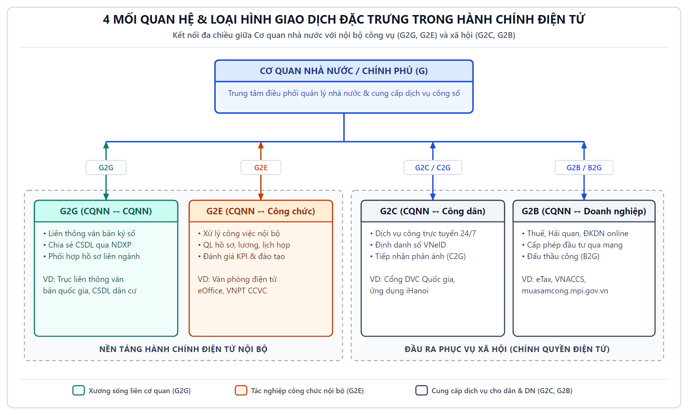

*Hình 35: Sơ đồ 4 mối quan hệ đặc trưng trong hành chính điện tử (`G2G`, `G2E`, `G2C`, `G2B`).*

> *Mẹo chốt ý vấn đáp:* Nêu đủ **4 mối quan hệ (`G2G – G2E – G2C – G2B`)**, lưu ý nhấn mạnh **`G2E` và `G2G` là nền tảng hành chính nội bộ**, còn **`G2C` và `G2B` là đầu ra phục vụ xã hội**, mỗi loại đọc ngay 1–2 tên hệ thống thật tại Việt Nam (eOffice, Trục liên thông văn bản, Cổng DVC Quốc gia, eTax) để ăn điểm tuyệt đối.

---

### Câu 36: Anh (chị) hãy nêu mục tiêu và lợi ích của hành chính điện tử đem lại?

**1. Khái niệm mở đầu**
- **Hành chính điện tử** là việc ứng dụng công nghệ thông tin và truyền thông vào tổ chức, điều hành, xử lý văn bản, quy trình nghiệp vụ và giải quyết thủ tục hành chính trên môi trường số.

**2. Mục tiêu của Hành chính điện tử**
Hành chính điện tử hướng tới **5 mục tiêu cốt lõi**:
1. **Hiện đại hóa và nâng cao hiệu lực, hiệu quả hoạt động của bộ máy hành chính:** Chuẩn hóa và tự động hóa các quy trình xử lý văn bản, hồ sơ nội bộ, chuyển từ làm việc thủ công trên giấy sang điều hành dựa trên dữ liệu số và thời gian thực.
2. **Xây dựng nền hành chính công khai, minh bạch và có trách nhiệm giải trình:** Lưu vết toàn bộ quá trình thụ lý hồ sơ, làm rõ trách nhiệm từng cá nhân/đơn vị, hạn chế tối đa tình trạng đùn đẩy, nhũng nhiễu, tiêu cực.
3. **Cải cách thủ tục hành chính theo hướng lấy người dân, doanh nghiệp làm trung tâm:** Cắt giảm giấy tờ, rút ngắn thời gian giải quyết, thực hiện nguyên tắc *"khai báo một lần"* thông qua liên thông dữ liệu giữa các cơ quan.
4. **Tiết kiệm ngân sách nhà nước và chi phí tuân thủ của xã hội:** Giảm chi phí văn phòng phẩm, in ấn, lưu trữ hồ sơ giấy, đi lại và thời gian chờ đợi.
5. **Tạo nền tảng vững chắc để tiến lên Chính phủ điện tử và Chính phủ số:** Kết nối thông suốt 4 cấp (nay theo mô hình địa phương 2 cấp tỉnh – xã gắn với Trung ương) và bảo đảm an toàn dữ liệu công vụ.

**3. Lợi ích mà Hành chính điện tử đem lại (trên 3 phương diện)**

- **A. Đối với Cơ quan nhà nước và đội ngũ Cán bộ, công chức:**
  - Rút ngắn thời gian luân chuyển văn bản từ nhiều ngày xuống chỉ còn vài phút nhờ **eOffice, chữ ký số và Trục liên thông văn bản quốc gia**.
  - Giám sát chính xác tiến độ xử lý công việc, tỷ lệ hồ sơ đúng hạn/quá hạn của từng phòng ban, phục vụ đánh giá hiệu quả công vụ (KPI) khách quan.
  - Dữ liệu hồ sơ được số hóa và tái sử dụng, giảm gánh nặng nhập liệu trùng lặp và giảm diện tích kho lưu trữ tài liệu giấy.
  - Lãnh đạo có thể họp trực tuyến, ký duyệt điều hành mọi lúc mọi nơi, bảo đảm công việc thông suốt kể cả trong tình huống khẩn cấp.

- **B. Đối với Người dân:**
  - Dễ dàng tra cứu quy định, biểu mẫu và nộp hồ sơ trực tuyến 24/7 tại nhà mà không cần đi lại nhiều lần hay chờ đợi trong giờ hành chính.
  - Theo dõi minh bạch trạng thái hồ sơ qua mã tra cứu, thanh toán lệ phí không tiền mặt và nhận kết quả bản điện tử có giá trị pháp lý tương đương bản giấy.
  - Giảm phiền hà nhờ việc tái sử dụng dữ liệu từ CSDL quốc gia về dân cư (VNeID).

- **C. Đối với Doanh nghiệp và toàn Xã hội:**
  - Giảm mạnh chi phí thời gian và chi phí tuân thủ pháp luật (thuế, hải quan, đăng ký kinh doanh, đấu thầu điện tử), nâng cao năng lực cạnh tranh quốc gia.
  - Tăng niềm tin của người dân và nhà đầu tư đối với bộ máy công quyền, thúc đẩy chuyển đổi số đồng bộ cả kinh tế số và xã hội số.

**4. Ví dụ minh họa ngắn**
- Nhờ triển khai hệ thống văn phòng điện tử (**eOffice**) và **Cổng Dịch vụ công Quốc gia**, các cơ quan nhà nước đã gửi nhận 100% văn bản điện tử ký số không giấy, giúp tiết kiệm hàng nghìn tỷ đồng chi phí giấy tờ, in ấn và đi lại mỗi năm; đồng thời người dân có thể làm thủ tục cấp đổi giấy phép lái xe hoàn toàn trực tuyến tại nhà.

> *Mẹo chốt ý vấn đáp:* Tách rạch ròi 2 vế đề hỏi: **5 Mục tiêu** (về đích muốn đạt tới: *Hiệu quả – Minh bạch – Lấy dân làm trung tâm – Tiết kiệm – Nền tảng Chính phủ số*) và **Lợi ích cho 3 nhóm đối tượng** (*Cơ quan/Công chức – Người dân – Doanh nghiệp/Xã hội*).

---

### Câu 37: Các giai đoạn phát triển hành chính điện tử là gì? Giải thích và cho ví dụ về một giai đoạn?

**1. Các giai đoạn phát triển của Hành chính điện tử**
Theo mô hình phân kỳ chuẩn quốc tế (**Gartner / Liên hợp quốc**) được sử dụng phổ biến trong giảng dạy tại Việt Nam, hành chính điện tử (và chính phủ điện tử) phát triển qua **4 giai đoạn từ thấp đến cao**:

*Hình 37: 4 giai đoạn phát triển hành chính điện tử và đối chiếu cấp độ dịch vụ công tại Việt Nam.*

1. **Giai đoạn 1 — Hiện diện / Thông tin (Information / Emergence):** Xây dựng trang/cổng thông tin điện tử để đăng tải một chiều các thông tin tĩnh về cơ cấu tổ chức, chức năng, văn bản quy phạm pháp luật, hướng dẫn thủ tục hành chính.
2. **Giai đoạn 2 — Tương tác (Interaction):** Bắt đầu tương tác hai chiều cơ bản giữa người dân/doanh nghiệp với cơ quan nhà nước thông qua công cụ tìm kiếm, hộp thư điện tử, hỏi đáp trực tuyến, khảo sát ý kiến và tải về (download) biểu mẫu để tự điền.
3. **Giai đoạn 3 — Giao dịch (Transaction):** Thực hiện trọn vẹn quy trình nghiệp vụ hành chính và dịch vụ công trực tuyến trên mạng: xác thực danh tính điện tử, nộp hồ sơ trực tuyến, luân chuyển thụ lý – ký số nội bộ, thanh toán phí/lệ phí điện tử và trả kết quả điện tử có giá trị pháp lý.
4. **Giai đoạn 4 — Chuyển đổi / Tích hợp toàn diện (Transformation / Integration):** Tái cấu trúc tổng thể quy trình hành chính theo hướng liên thông dữ liệu đa ngành qua nền tảng tích hợp dùng chung (NDXP); người dân không phải khai báo lại thông tin đã có trong CSDL quốc gia; cung cấp dịch vụ cá thể hóa, chủ động (kèm hỗ trợ của dữ liệu lớn và AI) qua một đầu mối duy nhất.

*(Liên hệ thực tế tại Việt Nam: Tương ứng với 4 giai đoạn này, trước năm 2022 Nghị định 43/2011/NĐ-CP chia dịch vụ công thành **4 mức độ (1 → 4)**; từ 15/8/2022 theo **Nghị định 42/2022/NĐ-CP**, quy chuẩn lại thành **2 mức độ** thực chất là Dịch vụ công trực tuyến **một phần** và **toàn trình**).*

**2. Giải thích chi tiết và Ví dụ minh họa về một giai đoạn: GIAI ĐOẠN 3 — GIAO DỊCH (Transaction)**

- **Giải thích bản chất Giai đoạn 3 (Giao dịch):**
  - Đây là bước chuyển mang tính chất lượng cốt lõi, đánh dấu sự thay đổi từ *"chỉ xem và tải mẫu"* sang **"làm thật, giải quyết thật trên môi trường mạng"**.
  - Ở giai đoạn này, công dân và doanh nghiệp không cần đến trực tiếp Bộ phận Một cửa để xếp hàng nộp giấy tờ hay đóng tiền mặt; đồng thời bên trong cơ quan nhà nước, cán bộ và lãnh đạo cũng xử lý, thẩm định và ký duyệt bằng **chữ ký số (PKI)** trên hệ thống một cửa điện tử mà không luân chuyển hồ sơ giấy.
  - Để vận hành được giai đoạn 3, hệ thống bắt buộc phải tích hợp đồng bộ **4 hạ tầng kỹ thuật**: *(i) Cổng xác thực định danh điện tử (VNeID/SSO)*; *(ii) Hệ thống quản lý quy trình nghiệp vụ một cửa điện tử (BPM)*; *(iii) Hạ tầng chữ ký số có giá trị pháp lý*; và *(iv) Cổng thanh toán trực tuyến liên kết ngân hàng/ví điện tử*.

- **Ví dụ cụ thể minh họa cho Giai đoạn 3 (Giao dịch):**
  - **Thủ tục "Cấp đổi Giấy phép lái xe (GPLX) trực tuyến toàn trình" trên Cổng Dịch vụ công Quốc gia (`dichvucong.gov.vn`):**
    1. Công dân đăng nhập bằng tài khoản định danh điện tử **VNeID**, chọn thủ tục cấp đổi GPLX.
    2. Hệ thống tự động truy vấn xác thực nhân thân từ CSDL quốc gia về dân cư và mã giấy khám sức khỏe điện tử từ bệnh viện; người dân tải ảnh chân dung và nộp hồ sơ trực tuyến ngay tại nhà.
    3. Hồ sơ số được chuyển vào hệ thống xử lý của cơ quan giao thông; cán bộ thẩm định, trình lãnh đạo **ký số phê duyệt** gia hạn GPLX.
    4. Người dân thực hiện **thanh toán lệ phí trực tuyến** (qua QR ngân hàng/ví điện tử) và nhận kết quả bản điện tử tích hợp trên VNeID (bản thẻ cứng gửi về tận nhà qua bưu chính công ích).

- **Gợi ý ví dụ dự phòng cho 3 giai đoạn còn lại (nếu giảng viên yêu cầu đổi giai đoạn):**
  - *Giai đoạn 1 (Thông tin):* Người dân vào Cổng thông tin của UBND thành phố để đọc tin tức, xem giờ tiếp dân và tra cứu bảng phí lệ phí.
  - *Giai đoạn 2 (Tương tác):* Doanh nghiệp vào trang web của Sở để tải tệp Word mẫu đơn xin cấp phép rồi in ra điền tay, hoặc gửi email hỏi đáp về quy trình.
  - *Giai đoạn 4 (Chuyển đổi/Tích hợp):* Thủ tục liên thông *"3 trong 1"* khi đăng ký khai sinh (tự động cấp giấy khai sinh + đăng ký thường trú + cấp thẻ BHYT cho trẻ cùng lúc giữa Tư pháp – Công an – Bảo hiểm xã hội thông qua trục NDXP mà cha mẹ chỉ cần khai báo một lần).

> *Mẹo chốt ý vấn đáp:* Chọn phân tích sâu **Giai đoạn 3 (Giao dịch)** hoặc **Giai đoạn 4 (Tích hợp/Chuyển đổi)** vì đây là hai giai đoạn có nhiều thuật ngữ kỹ thuật (VNeID, chữ ký số, thanh toán trực tuyến, NDXP) giúp bạn thể hiện hiểu biết sâu nhất trước giảng viên.

---

### Câu 38: Có bao nhiêu loại hình giao dịch trong hành chính điện tử? Cho ví dụ?

**1. Phân loại theo chủ thể tham gia (Chuẩn phổ biến nhất — 4 loại hình giao dịch chính)**
Trong hành chính điện tử (và chính phủ điện tử), xét theo cặp chủ thể tương tác trực tiếp gồm **Cơ quan nhà nước (`G`)**, **Công dân (`C`)**, **Doanh nghiệp (`B`)** và **Cán bộ, công chức (`E`)**, có **4 loại hình giao dịch cơ bản** (cùng các giao dịch chiều ngược lại từ xã hội lên nhà nước):

1. **G2C (Government to Citizen — Cơ quan nhà nước với Công dân):**
   - *Bản chất:* Cơ quan nhà nước cung cấp thông tin, tiếp nhận và giải quyết thủ tục hành chính, dịch vụ công trực tuyến cho người dân; đồng thời tiếp nhận phản ánh, kiến nghị từ công dân (*C2G*).
   - *Ví dụ:* Công dân đăng nhập Cổng Dịch vụ công Quốc gia bằng VNeID để làm thủ tục cấp đổi giấy phép lái xe, đăng ký khai sinh, cấp phiếu lý lịch tư pháp hoặc nộp phạt vi phạm giao thông trực tuyến.
2. **G2B (Government to Business — Cơ quan nhà nước với Doanh nghiệp):**
   - *Bản chất:* Cơ quan nhà nước cung cấp dịch vụ hành chính, quản lý thuế, hải quan, đăng ký kinh doanh, cấp phép đầu tư cho doanh nghiệp; bao gồm cả chiều doanh nghiệp tham gia đấu thầu cung ứng hàng hóa, dịch vụ cho nhà nước (*B2G*).
   - *Ví dụ:* Doanh nghiệp kê khai và nộp thuế điện tử trên hệ thống **eTax**, làm thủ tục thông quan hàng hóa trên **VNACCS**, đăng ký thành lập doanh nghiệp trực tuyến hoặc dự thầu trên `muasamcong.mpi.gov.vn`.
3. **G2G (Government to Government — Cơ quan nhà nước với Cơ quan nhà nước):**
   - *Bản chất:* Trao đổi văn bản điện tử, phối hợp giải quyết hồ sơ liên thông và chia sẻ dữ liệu giữa các cơ quan hành chính cùng cấp hoặc khác cấp (Trung ương – Tỉnh – Xã), cũng như giữa chính phủ các quốc gia.
   - *Ví dụ:* Các Bộ, UBND tỉnh gửi nhận văn bản chỉ đạo điều hành qua **Trục liên thông văn bản quốc gia**; hoặc cơ quan công an, tư pháp, tài chính chia sẻ dữ liệu xác thực dân cư, đất đai thông qua trục **NDXP**.
4. **G2E (Government to Employee — Cơ quan nhà nước với Cán bộ, công chức, viên chức):**
   - *Bản chất:* Các giao dịch tác nghiệp nội bộ giữa cơ quan nhà nước với đội ngũ cán bộ, công chức trong quản lý văn bản, giao việc, đánh giá nhân sự, tiền lương và đào tạo.
   - *Ví dụ:* Công chức sử dụng hệ thống **Văn phòng điện tử (eOffice)** để tiếp nhận công văn đến, soạn dự thảo trình lãnh đạo ký số, xem lịch công tác hoặc tra cứu hồ sơ công chức trên phần mềm **VNPT CCVC**.

*Hình 38: 4 loại hình giao dịch cơ bản theo chủ thể (`G2G`, `G2E`, `G2C`, `G2B`) trong hành chính điện tử.*

**2. Phân loại bổ sung theo tính chất nghiệp vụ tác nghiệp (5 nhóm giao dịch)**
Nếu xét theo nội dung nghiệp vụ diễn ra trên các hệ thống hành chính điện tử, các giao dịch trên được cụ thể hóa thành **5 nhóm**:
1. *Giao dịch thông tin và dữ liệu mở:* Tra cứu văn bản pháp luật, quy hoạch, thủ tục hành chính, tiếp nhận phản ánh kiến nghị (Ví dụ: Cổng TTĐT Bộ/Tỉnh, ứng dụng iHanoi).
2. *Giao dịch giải quyết thủ tục hành chính và cấp phép:* Nộp hồ sơ, luân chuyển một cửa điện tử và trả kết quả số (Ví dụ: Cổng DVC Quốc gia, Hệ thống Một cửa điện tử TPSC).
3. *Giao dịch văn bản và điều hành công vụ:* Tạo lập, trình ký số và liên thông văn bản điện tử (Ví dụ: eOffice, Trục liên thông văn bản).
4. *Giao dịch tài chính công và nghĩa vụ ngân sách:* Thuế điện tử, phí – lệ phí trực tuyến, giao dịch kho bạc nhà nước (Ví dụ: hệ thống TABMIS, biên lai thu phí điện tử).
5. *Giao dịch mua sắm công điện tử:* Lập kế hoạch đấu thầu, mời thầu và chọn nhà thầu qua mạng (Ví dụ: Hệ thống mạng đấu thầu quốc gia).

> *Mẹo chốt ý vấn đáp:* Khi giám khảo hỏi *"Có bao nhiêu loại hình giao dịch trong HCĐT?"*, hãy chốt dứt khoát câu trả lời chính là **4 loại hình theo chủ thể (`G2C – G2B – G2G – G2E`)** kèm ví dụ từng loại, rồi bổ sung nhanh 5 nhóm theo nội dung nghiệp vụ để câu trả lời đầy đặn nhất.

---

### Câu 39: Lợi ích mà chính phủ điện tử đem lại? Cho ví dụ?

**1. Khái niệm mở đầu**
- **Chính phủ điện tử (E-Government)** là việc ứng dụng toàn diện công nghệ thông tin – truyền thông để đổi mới hoạt động bên trong bộ máy nhà nước và nâng cao chất lượng phục vụ người dân, doanh nghiệp. Lợi ích của Chính phủ điện tử tác động sâu rộng trên **5 phương diện lớn**:

**2. 5 lợi ích chiến lược của Chính phủ điện tử (kèm Ví dụ thực tế tại Việt Nam)**

1. **Nâng cao chất lượng phục vụ người dân và doanh nghiệp, tiết kiệm thời gian – chi phí xã hội:**
   - Người dân và doanh nghiệp thực hiện thủ tục hành chính mọi lúc mọi nơi (24/7), cắt giảm tối đa số lần đi lại, loại bỏ giấy tờ trùng lặp theo nguyên tắc *"khai báo một lần"*.
   - *Ví dụ:* Từ ngày **01/7/2025**, các cổng dịch vụ công địa phương hợp nhất về **"một cửa số duy nhất" là Cổng Dịch vụ công Quốc gia** (`dichvucong.gov.vn`), cho phép đăng nhập bằng **VNeID** để thực hiện thủ tục khai sinh liên thông, cấp đổi giấy phép lái xe hoặc nộp thuế điện tử **eTax** hoàn toàn tại nhà.
2. **Nâng cao hiệu lực, hiệu quả và tốc độ điều hành của bộ máy nhà nước:**
   - Giúp các cơ quan gửi nhận văn bản tức thời, họp trực tuyến không giấy tờ và lãnh đạo ra quyết định kịp thời dựa trên dữ liệu thực tế thay vì báo cáo giấy chậm trễ.
   - *Ví dụ:* **Trục liên thông văn bản quốc gia** kết nối hàng chục nghìn cơ quan từ Trung ương xuống tỉnh, xã giúp luân chuyển văn bản điện tử ký số chỉ trong vài phút, thay vì mất nhiều ngày gửi bưu điện như trước kia.
3. **Tăng cường tính công khai, minh bạch và phòng chống tham nhũng:**
   - Mọi quy trình thụ lý hồ sơ, chi tiêu ngân sách và mua sắm công đều được chuẩn hóa, công khai trạng thái xử lý và lưu vết lịch sử (Audit Trail), hạn chế tối đa tình trạng *"xin – cho"* hay nhũng nhiễu trực tiếp.
   - *Ví dụ:* **Hệ thống mạng đấu thầu quốc gia (`muasamcong.mpi.gov.vn`)** công khai hồ sơ mời thầu, kết quả mở thầu giúp tiết kiệm ngân sách và giảm tiêu cực trong đầu tư công; hoặc tại Hà Nội, hệ thống **iHanoi** tiếp nhận và công khai kết quả xử lý phản ánh của người dân.
4. **Liên thông và tái sử dụng dữ liệu quốc gia phục vụ hoạch định chính sách:**
   - Kết nối các CSDL quốc gia cốt lõi (Dân cư, Doanh nghiệp, Đất đai, Bảo hiểm...) thông qua **Nền tảng NDXP**, giúp nhà nước nắm bắt bức tranh kinh tế – xã hội chính xác theo thời gian thực để điều hành chính sách vĩ mô.
   - *Ví dụ:* Thông qua **Đề án 06** và trục **NDXP**, ngân hàng, bảo hiểm và cơ quan thuế xác thực chính xác danh tính công dân theo CSDL quốc gia về dân cư, góp phần làm sạch dữ liệu và phòng chống gian lận tài chính.
5. **Cải thiện môi trường kinh doanh, thúc đẩy kinh tế số và nâng cao năng lực cạnh tranh quốc gia:**
   - Rút ngắn thời gian gia nhập thị trường cho doanh nghiệp, tạo hạ tầng chuẩn mực thu hút đầu tư nước ngoài và khẳng định vị thế chuyển đổi số của Việt Nam trên trường quốc tế.
   - *Ví dụ:* Nhờ đẩy mạnh Chính phủ điện tử, trong **Báo cáo khảo sát Chính phủ điện tử của Liên hợp quốc (UN E-Government Survey 2024)**, Việt Nam đã tăng 15 bậc từ hạng 86 (năm 2022) lên xếp thứ **71/193 quốc gia** về chỉ số phát triển Chính phủ điện tử (**EGDI**).

> *Mẹo chốt ý vấn đáp:* Nhớ ghép mỗi lợi ích với **1 dẫn chứng thật dễ nhớ của Việt Nam** (*Cổng DVC Quốc gia, VNeID, Trục liên thông văn bản, Đấu thầu qua mạng, xếp hạng EGDI 71/193 năm 2024*) — điều này giúp câu trả lời vấn đáp trở nên cực kỳ thuyết phục.

---

### Câu 40: Anh (chị) hãy nêu những khó khăn trong xây dựng chính phủ điện tử ở Việt Nam hiện nay?

**1. Khái niệm mở đầu**
- Dù Việt Nam đã đạt nhiều bước tiến mạnh mẽ (vươn lên hạng 71/193 thế giới về chỉ số EGDI năm 2024, triển khai Đề án 06, hợp nhất Cổng DVC Quốc gia và ban hành **Luật Chuyển đổi số 148/2025/QH15**, **Chương trình phát triển Chính phủ số theo QĐ 2629/QĐ-TTg**), quá trình xây dựng Chính phủ điện tử hướng tới Chính phủ số vẫn đối mặt với **7 nhóm khó khăn, thách thức lớn sau**:

**2. 7 khó khăn chính trong xây dựng Chính phủ điện tử ở Việt Nam hiện nay**

1. **Dữ liệu còn phân tán, thiếu chuẩn hóa và tâm lý "giữ dữ liệu" cục bộ:**
   - Nhiều cơ sở dữ liệu chuyên ngành trước đây xây dựng riêng rẽ theo tiêu chuẩn khác nhau nên chưa bảo đảm nguyên tắc **"đúng, đủ, sạch, sống, thống nhất, dùng chung"**; một số đơn vị vẫn còn tâm lý ngại chia sẻ dữ liệu hoặc quy trình kết nối xin – cho kéo dài, làm tắc nghẽn dịch vụ công toàn trình ở khâu cuối.
2. **Đầu tư phân tán, thiếu đồng bộ trước đây và chênh lệch hạ tầng vùng miền:**
   - Trước giai đoạn chuẩn hóa tập trung (như hợp nhất cổng DVC tháng 7/2025), nhiều Bộ/tỉnh tự đầu tư phần mềm riêng lẻ gây trùng lặp, tốn kém chi phí bảo trì nhưng chất lượng không đồng đều; hạ tầng mạng băng rộng và thiết bị ở vùng sâu, vùng xa, biên giới, hải đảo vẫn còn hạn chế.
3. **Thiếu hụt và mất cân đối về nguồn nhân lực số:**
   - Đội ngũ chuyên trách CNTT và an toàn thông tin trong khu vực công còn mỏng, đặc biệt là tại cấp cơ sở (cấp xã/phường sau sắp xếp lại đơn vị hành chính hai cấp tỉnh – xã); chế độ đãi ngộ theo ngạch bậc hành chính khó thu hút và giữ chân kỹ sư dữ liệu, AI và an ninh mạng giỏi.
4. **Thói quen làm việc giấy tờ và tình trạng "số hóa hình thức":**
   - Một bộ phận cán bộ, công chức còn ngại thay đổi thói quen xử lý trên giấy hoặc vẫn yêu cầu người dân nộp bản sao giấy tờ để lưu đối chiếu dù đã nộp hồ sơ trực tuyến; người đứng đầu ở một số đơn vị chưa thực sự quyết liệt chỉ đạo điều hành trên môi trường số.
5. **Áp lực rất lớn về an toàn thông tin, an ninh mạng và bảo vệ dữ liệu cá nhân:**
   - Khi mọi dữ liệu công dân, doanh nghiệp và hoạt động điều hành được tập trung lên không gian mạng, bề mặt tấn công mạng mở rộng mạnh (mã độc tống tiền, DDoS, lộ lọt dữ liệu); đồng thời tình trạng lừa đảo trực tuyến giả danh cơ quan nhà nước gây ảnh hưởng tới niềm tin của người dân.
6. **Khoảng cách số và thói quen tiếp cận của người dân:**
   - Tỷ lệ người dân sử dụng thành thạo kỹ năng số ở nông thôn, vùng khó khăn, người cao tuổi hoặc người yếu thế còn thấp; vẫn còn tâm lý e ngại thanh toán trực tuyến hoặc quen ra trực tiếp nhờ cán bộ làm hộ.
7. **Hành lang pháp lý và cơ chế tài chính – mua sắm công chưa theo kịp tốc độ công nghệ:**
   - Quy trình đấu thầu, lập dự toán đầu tư công truyền thống vẫn còn nhiều vướng mắc khi áp dụng cho các mô hình mới như thuê dịch vụ công nghệ thông tin, điện toán đám mây, mua kết quả đầu ra hay thử nghiệm công nghệ mới (AI, dữ liệu lớn).

**3. Định hướng giải pháp gợi mở (nếu giảng viên hỏi thêm)**
- Hoàn thiện thể chế đi trước một bước (Luật Chuyển đổi số, quy định bắt buộc chia sẻ dữ liệu); chuẩn hóa dùng chung các nền tảng số quốc gia từ Trung ương xuống cấp xã; đầu tư cơ chế đặc thù cho nhân lực công nghệ; đẩy mạnh phổ cập kỹ năng số và bảo đảm an toàn thông tin qua hệ thống giám sát tập trung (SOC).

> *Mẹo chốt ý vấn đáp:* Chia 7 khó khăn thành **3 cụm logic để không bao giờ quên**: *(1) Hạ tầng – Dữ liệu – Bảo mật*, *(2) Con người (cán bộ & người dân) – Thói quen giấy tờ*, và *(3) Thể chế – Đầu tư tài chính*.

---

## TÀI LIỆU THAM KHẢO VÀ ĐỐI CHIẾU NGUỒN

Bộ đề cương này được tổng hợp theo nguyên tắc **ưu tiên giáo trình chuyên ngành và văn bản quy phạm pháp luật gốc**, kết hợp đối chiếu thực tiễn từ dự án `tailieuhoctap`:

| Nhóm nguồn | Tài liệu / Văn bản căn cứ | Phạm vi câu hỏi áp dụng |
|---|---|---|
| **Giáo trình & Chuẩn kỹ thuật** | Giáo trình *Hệ thống thông tin quản lý* (Kenneth C. Laudon & Jane P. Laudon; ĐH Kinh tế Quốc dân); *Công nghệ phần mềm* (W.W. Royce, Barry Boehm, IEEE / OpenStax); Giáo trình *Thương mại điện tử* (Efraim Turban); Chuẩn **W3C** (Web Service, XML, SOAP, WSDL, UDDI); Chuẩn **JSR-168 / JSR-286** (Portlet); Chuẩn **ISO/IEC 27001** (An toàn thông tin). | Câu 1–5, 9, 10, 12, 15–18, 20–28, 31, 33–34 |
| **Văn bản pháp lý Việt Nam** | **Công văn 1178/BTTTT-THH** (21/4/2015) về *Khung Kiến trúc CPĐT Việt Nam phiên bản 1.0* (cùng bản 2.0 QĐ 2323/2019, 3.0 QĐ 2568/2023, 4.0 QĐ 292/QĐ-BKHCN 2025); **Nghị định 52/2013/NĐ-CP** & **Nghị định 85/2021/NĐ-CP** về TMĐT; **Nghị định 43/2011/NĐ-CP** & **Nghị định 42/2022/NĐ-CP** về thông tin và dịch vụ công trực tuyến trên môi trường mạng; **Nghị định 118/2025/NĐ-CP** về Bộ phận Một cửa; **Luật Giao dịch điện tử 20/2023/QH15**; **Luật Chuyển đổi số 148/2025/QH15**; **Quyết định 2629/QĐ-TTg** (2025) và **Báo cáo EGDI 2024** của Liên hợp quốc. | Câu 6–8, 10–11, 13–14, 29–30, 32, 35–40 |
| **Tài liệu dự án `tailieuhoctap`** | `Hệ thống thông tin tác nghiệp/140926.md` (quy trình mua sắm – điểm nghẽn – bảo vệ dữ liệu tác nghiệp 2 lớp); `Hệ thống thông tin tác nghiệp/24826.md` (CPĐT, TPSC, eOffice, DVC, ERP công); `Quản trị hệ thống thông tin/Tai_Lieu_Hoc_Quan_Tri_HTTT.md`; `De_cuong_van_dap_2026/DE_CUONG_VAN_DAP.md`; `Công nghệ phần mềm/on-thi-ly-thuyet-cnpm-notion.md`. | Bổ sung ví dụ thực tiễn Việt Nam và đối chiếu cấu trúc ôn tập cho hầu hết 40 câu |
