# TÀI LIỆU HỌC TẬP: QUẢN TRỊ HỆ THỐNG THÔNG TIN

---

## CHƯƠNG 1. TỔNG QUAN VỀ THÔNG TIN VÀ TỔ CHỨC DƯỚI GÓC ĐỘ QUẢN TRỊ HỆ THỐNG THÔNG TIN

### 1.1. Tổng quan về thông tin

#### 1.1.1. Khái niệm thông tin và quản trị
- **Thông tin** là dữ liệu đã được xử lý, tổ chức và cấu trúc theo cách có ý nghĩa và hữu ích cho người nhận. Thông tin đóng vai trò then chốt trong việc hỗ trợ ra quyết định, lập kế hoạch, tổ chức, lãnh đạo và kiểm soát.
- **Quản trị** là quá trình đạt được các mục tiêu của tổ chức thông qua việc lập kế hoạch, tổ chức, lãnh đạo và kiểm soát các nguồn lực. Thông tin là huyết mạch của quản trị, cung cấp cơ sở cho mọi hoạt động quản trị.

#### 1.1.2. Các đặc trưng của thông tin có giá trị
- **Kịp thời:** Thông tin phải có sẵn khi cần thiết để đưa ra quyết định.
- **Chính xác:** Thông tin phải không có lỗi và đáng tin cậy.
- **Phù hợp:** Thông tin phải liên quan đến vấn đề hoặc quyết định đang được xem xét.
- **Đầy đủ:** Thông tin phải đầy đủ và bao quát tất cả các khía cạnh liên quan.
- **Có kiểm chứng:** Thông tin có thể xác minh từ các nguồn đáng tin cậy.
- **An toàn:** Thông tin phải được bảo vệ khỏi sự truy cập trái phép, sửa lỗi hoặc phá huỷ.
- **Khách quan:** Thông tin trình bày một cách không thiên vị, không bị ảnh hưởng bởi ý kiến cá nhân hay cảm xúc. Thông tin khách quan giúp người ra quyết định nhìn nhận vấn đề một cách toàn diện và chính xác hơn; các báo cáo phân tích thị trường nên dựa trên dữ liệu và phương pháp luận rõ ràng, không phải suy đoán.
- **Dễ tiếp cận:** Phải dễ dàng có được khi cần. Điều này bao gồm việc thông tin được lưu trữ ở định dạng phù hợp, có thể truy vấn nhanh chóng và người dùng có quyền truy cập cần thiết. Một kho dữ liệu khổng lồ nhưng không có công cụ tìm kiếm hiệu quả sẽ làm giảm giá trị của thông tin.

#### 1.1.3. Giá trị của thông tin theo cấp quyết định
Giá trị của thông tin thay đổi tùy theo cấp độ ra quyết định trong một tổ chức:
1. **Cấp chiến lược:** Thông tin có giá trị cao nhất khi nó hỗ trợ các quyết định dài hạn, định hướng và mục tiêu tổng thể của tổ chức. Thông tin cần phải tổng hợp, dự báo và có tính chất bên ngoài.
2. **Cấp chiến thuật:** Thông tin ở cấp độ này hỗ trợ các quyết định trung hạn, liên quan đến việc triển khai các chiến lược. Thông tin cần chi tiết hơn, tập trung vào các hoạt động và hiệu suất của các bộ phận.
3. **Cấp tác nghiệp:** Thông tin ở cấp độ thấp nhất, hỗ trợ các quyết định hàng ngày, liên quan đến các hoạt động cụ thể. Thông tin cần rất chi tiết, kịp thời và tập trung vào các giao dịch nội bộ. Phạm vi hẹp, độ chi tiết cao (thông tin thô, chi tiết đến từng giao dịch, từng sự kiện), thời gian ngắn (hàng ngày/tuần/giờ). Nguồn gốc nội bộ, giúp nhân viên và quản lý cấp thấp thực hiện công việc hiệu quả, xử lý vấn đề phát sinh tức thời, đảm bảo hoạt động trơn tru (ví dụ: sản phẩm lỗi trong 1 ca làm việc xảy ra).

---

### 1.2. Tổ chức dưới góc độ quản trị hệ thống thông tin

#### 1.2.1. Khái niệm tổ chức, hệ thống
- **Tổ chức** có thể được định nghĩa là một tập hợp các cá nhân và nguồn lực được sắp xếp một cách có cấu trúc để đạt được mục tiêu chung.
- **Hệ thống** là một tập hợp có tổ chức gồm nhiều thành phần có các mối quan hệ ràng buộc lẫn nhau. Các thành phần tương tác và phụ thuộc lẫn nhau, hoạt động chung để tạo ra một kết quả nhất định:
  - Là **thủ công** nếu dựa vào công cụ như giấy, bút.
  - Là **hệ thống tự động hoá** dựa vào máy tính.
- Trong bối cảnh của quản trị thông tin, **Hệ thống thông tin (HTTT)** là một tập hợp các thành phần thu thập, xử lý, lưu trữ và phân phối thông tin để hỗ trợ việc đưa ra quyết định và kiểm soát trong một tổ chức.
- Khi xem xét một hệ thống, người ta còn đề cập đến các yếu tố và khái niệm liên quan:
  - Môi trường mà hệ thống tồn tại (bao gồm bên trong và bên ngoài).
  - Hệ thống con của hệ thống.
  - Hệ thống đóng nếu nó không quan hệ với môi trường.
  - Hệ thống mở nếu nó có quan hệ với môi trường.

**Chu trình hoạt động của hệ thống:**

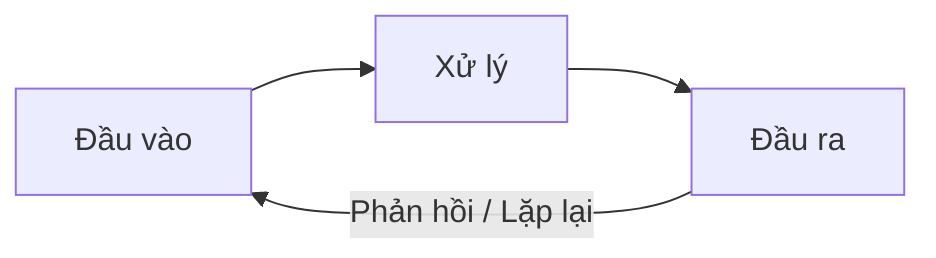

**Quy trình xử lý thông tin trong tổ chức:**

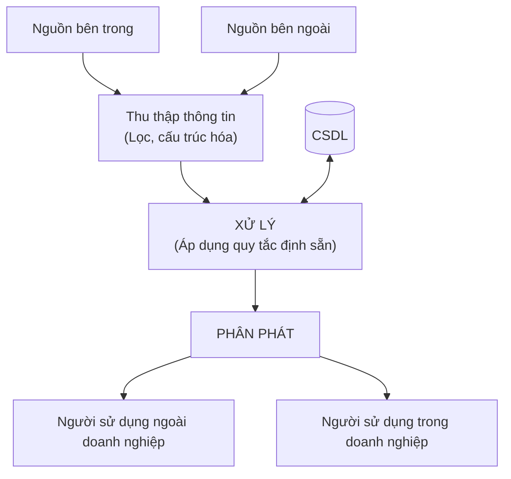

---

#### 1.2.2. Các mô hình cấu trúc tổ chức

| Mô hình cấu trúc | Đặc điểm | Ưu điểm | Hạn chế |
| :--- | :--- | :--- | :--- |
| **1. Mô hình chức năng** | Chia theo nhiệm vụ: Tài chính, nhân sự, sản xuất | Chuyên môn hoá, dễ kiểm soát | Giao tiếp liên phòng ban khó khăn |
| **2. Mô hình dự án** | Chia theo nhóm thực hiện từng dự án | Linh hoạt, phù hợp công nghệ, tối ưu hoá chi phí | Dễ trùng lặp nguồn lực |
| **3. Mô hình ma trận** | Kết hợp chức năng và dự án | Tối ưu hoá nguồn lực, trao đổi nhanh | Quản lý phức tạp, dễ xung đột vai trò |
| **4. Mô hình theo địa lý** | Chia theo khu vực hoạt động | Phù hợp tổ chức quốc tế, đa vùng | Thách thức trong đồng bộ thông tin |
| **5. Mô hình mạng lưới** | Phân tán, kết nối theo chuyên môn | Tận dụng tri thức và dữ liệu phân tán | Đòi hỏi hệ thống thông tin mạnh |

---

## CHƯƠNG 2. HỆ THỐNG THÔNG TIN TRONG TỔ CHỨC

### 2.1. Hệ thống thông tin

#### 2.1.1. Khái niệm
- **Hệ thống thông tin (Information System - IS)** là một tập hợp các thành phần có tổ chức để **thu thập, xử lý, lưu trữ và phân phối thông tin** nhằm hỗ trợ việc ra quyết định, phối hợp và kiểm soát trong một tổ chức.

#### 2.1.2. Lịch sử phát triển

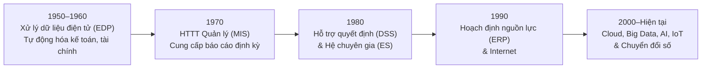

---

### 2.2. Đặc điểm và các mô hình biểu diễn hệ thống thông tin

#### 2.2.1. Đặc điểm và mối quan hệ Hệ thống – Thông tin – Quản lý
- **Đặc điểm của hệ thống thông tin:**
  - Được xây dựng trên nền tảng công nghệ hiện đại (CNTT).
  - Được cấu thành bởi nhiều hệ thống con.
  - Có mục tiêu là cung cấp thông tin cho việc ra quyết định và kiểm soát.
  - Là một kết cấu hệ thống mềm dẻo và có khả năng tiến hóa.
- **Mối quan hệ Hệ thống – Thông tin – Quản lý:** Việc Quản trị hệ thống thông tin (QTHTTT) kết hợp tất cả các hoạt động thông qua việc trao đổi thông tin phục vụ cho mục tiêu quản lý.

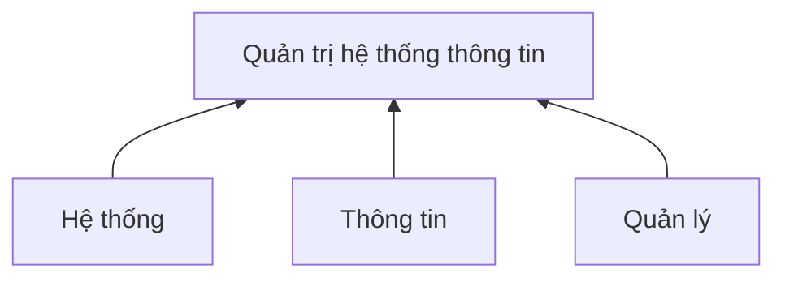

#### 2.2.2. Ba mô hình biểu diễn hệ thống thông tin

##### a. Mô hình Logic (Logical Model)
- Tập trung vào việc mô tả các chức năng và luồng dữ liệu của hệ thống mà không quan tâm đến cách thức triển khai vật lý. Nó thể hiện **"cái gì"** hệ thống làm, chứ không phải **"làm thế nào"**.
- Là bước quan trọng trong quá trình thiết kế hệ thống, giúp chuyển đổi các yêu cầu nghiệp vụ thành cấu trúc dữ liệu và quy trình xử lý phù hợp với ngôn ngữ máy tính, diễn tả luồng thông tin và mối quan hệ giữa các thành phần mà không phụ thuộc công nghệ cụ thể.
- **Thành phần mô tả:**
  - Dữ liệu đầu vào và đầu ra (dữ liệu này cần được chuẩn hóa).
  - Các quy trình xử lý thông tin.
  - Mối liên hệ giữa dữ liệu.
- **Vai trò:**
  - Đảm bảo hệ thống được thiết kế đúng theo nhu cầu thực tế.
  - Là cơ sở để triển khai mô hình vật lý và xây dựng hệ thống phần mềm.
  - Tăng hiệu quả quản lý dữ liệu, giảm lỗi và chi phí bảo trì.

##### b. Mô hình vật lý ngoài (External Physical Model)
- Mô tả cách người dùng tương tác với hệ thống, thể hiện giao diện đầu vào, đầu ra và chức năng truy cập.
- **Thành phần mô tả:**
  - Biểu mẫu nhập liệu.
  - Giao diện báo cáo, màn hình làm việc.
  - Quyền truy cập và vai trò người dùng.
- **Vai trò:** Giúp thiết kế hệ thống thân thiện, đúng nhu cầu thực tế người dùng.
- **Ví dụ:** Trong trường học: giao diện đăng ký môn học, cổng thông tin tra điểm của sinh viên.

##### c. Mô hình vật lý trong (Internal Physical Model)
- Mô tả chi tiết cấu trúc kỹ thuật bên trong hệ thống, liên quan đến phần cứng, phần mềm, mạng, lưu trữ.
- **Thành phần mô tả:**
  - Máy chủ, thiết bị kết nối.
  - Cấu trúc cơ sở dữ liệu (`table`, `index`, `key`).
  - Hệ điều hành, nền tảng công nghệ.
- **Vai trò:** Là cơ sở cho nhóm kỹ thuật triển khai và bảo trì hệ thống thông tin hiệu quả.
- **Ví dụ:** Doanh nghiệp sử dụng ERP triển khai trên server riêng + database Oracle + mạng LAN.

##### d. Bảng so sánh 3 mô hình biểu diễn

| Tiêu chí | Mô hình logic | Mô hình vật lý ngoài | Mô hình vật lý trong |
| :--- | :--- | :--- | :--- |
| **Trọng tâm** | Tập trung vào quy trình và dữ liệu nghiệp vụ | Tập trung vào giao diện và tương tác người dùng | Tập trung vào hạ tầng và cấu trúc kỹ thuật |
| **Đối tượng sử dụng** | Người sử dụng chính là người phân tích thiết kế ra hệ thống | Người sử dụng chính là người thiết kế giao diện và người dùng | Người sử dụng chính là nhóm triển khai kỹ thuật |

---

### 2.3. Vai trò của hệ thống thông tin

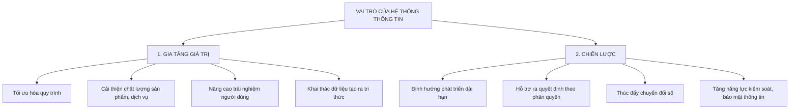

- **Chi tiết vai trò gia tăng giá trị:**
  - **Tối ưu hóa quy trình:** Tự động hóa các bước lặp lại nhằm giảm chi phí, tăng tốc độ.
  - **Cải thiện chất lượng sản phẩm/dịch vụ:** Phân tích dữ liệu để đưa ra quyết định tốt hơn.
  - **Nâng cao trải nghiệm người dùng:** Cung cấp thông tin để phản ứng nhanh với yêu cầu thực tế, hỗ trợ người dùng kịp thời.
  - **Khai thác dữ liệu tạo ra tri thức:** Tạo ra các sản phẩm và dịch vụ mới dựa trên thông tin khai thác được.

---

### 2.4. Phân loại hệ thống thông tin

#### 2.4.1. Phân loại theo phạm vi hoạt động

| Hệ thống cấp phòng ban | Hệ thống cấp tổ chức | Hệ thống liên tổ chức |
| :--- | :--- | :--- |
| Phục vụ nhu cầu thông tin của một phòng ban cụ thể trong tổ chức. | Phục vụ nhu cầu thông tin của toàn bộ tổ chức, tích hợp các phòng ban. | Kết nối và chia sẻ thông tin giữa nhiều tổ chức khác nhau. |

#### 2.4.2. Phân loại theo lĩnh vực hoạt động
Hệ thống thông tin được phân loại dựa trên lĩnh vực mà chúng hoạt động:
- Hệ thống thông tin y tế
- Hệ thống thông tin giáo dục
- Hệ thống thông tin tài chính
- Hệ thống thông tin sản xuất
- Hệ thống thông tin hành chính công

**Ví dụ: Hệ thống thông tin trong bệnh viện (Hospital Information System - HIS)**
- **Chức năng:**
  - Quản lý hồ sơ bệnh nhân điện tử (EMR).
  - Theo dõi đơn thuốc, xét nghiệm, phẫu thuật.
  - Tích hợp với hệ thống bảo hiểm, thanh toán.
- **Ứng dụng tiêu chuẩn chất lượng:**
  - *Hiệu quả:* Giảm thời gian khám chữa, lưu trữ hồ sơ nhanh chóng.
  - *Chính xác:* Tránh sai sót thuốc và điều trị.
  - *Bảo mật:* Bảo vệ dữ liệu bệnh nhân theo tiêu chuẩn y tế như HIPAA.

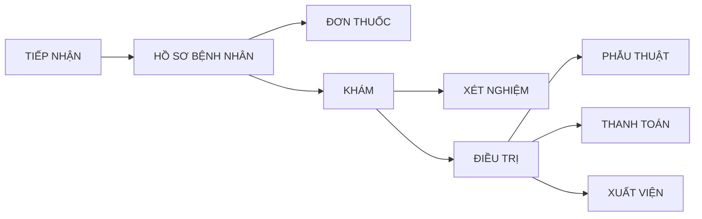

---

#### 2.4.3. Phân loại theo mục đích và đối tượng phục vụ

| Hệ thống | Mô tả |
| :--- | :--- |
| **Hệ thống xử lý giao dịch (TPS)** | Xử lý các giao dịch hàng ngày của tổ chức. |
| **Hệ thống thông tin quản lý (MIS)** | Cung cấp báo cáo và thông tin cho các nhà quản lý cấp trung. |
| **Hệ thống hỗ trợ ra quyết định (DSS)** | Hỗ trợ các nhà quản lý đưa ra quyết định phức tạp. |
| **Hệ thống thông tin điều hành (EIS / ESS)** | Cung cấp thông tin tổng hợp cho các nhà quản lý cấp cao. |

##### a. Hệ thống xử lý giao dịch (Transaction Processing System - TPS)
- Là hệ thống/phần mềm hỗ trợ xử lý các giao dịch trong kinh doanh và công nghệ thông tin. Nó kết hợp phần mềm và phần cứng để thu thập, xử lý, lưu trữ và truyền đạt thông tin giao dịch.
- Duy trì sự cân bằng và kiểm soát quá trình mua hàng hóa và dịch vụ của một tổ chức cụ thể.
- **Trong kinh doanh:** TPS giúp doanh nghiệp xử lý thông tin giao dịch một cách nhanh chóng và chính xác, tăng cường hiệu suất và năng suất làm việc.
- **Trong blockchain:** TPS là chỉ số quan trọng để đánh giá hiệu suất của mạng lưới blockchain, ảnh hưởng đến khả năng mở rộng và chi phí giao dịch.

**Kiến trúc TPS và Lưu đồ xử lý đơn hàng:**

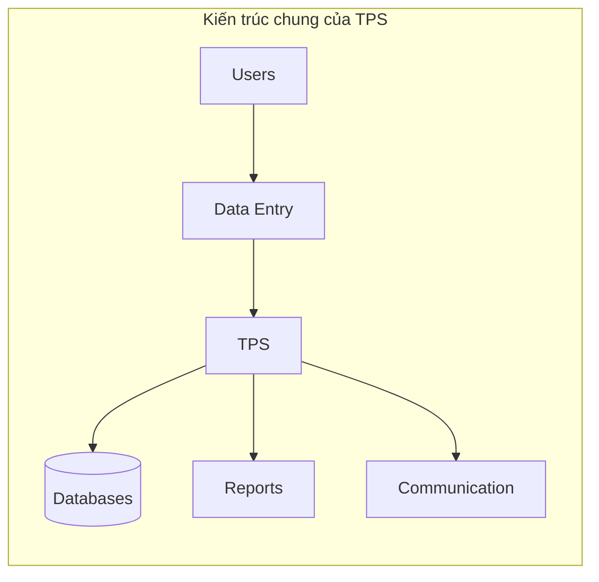

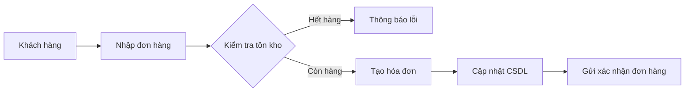

##### b. Mối quan hệ giữa các hệ thống TPS và Hệ thống MIS

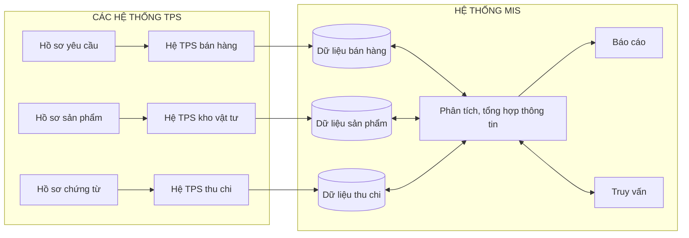

##### c. Hệ thống thông tin quản lý (Management Information System - MIS)
- MIS là hệ thống thông tin tổng hợp, xử lý và trình bày dữ liệu nhằm hỗ trợ quản lý ra quyết định ở cấp trung và cao.
- Là hệ thống bao gồm con người, thiết bị, các dữ liệu, thông tin và các thủ tục quản lý/tổ chức nhằm cung cấp những thông tin cần thiết, lưu trữ và truyền tải những thông tin có giá trị kịp thời, chính xác cho các nhà quản lý ra quyết định.
- **9 yếu tố thành phần của MIS:** `INFORMATION`, `ANALYSIS`, `DATABASE`, `EFFICIENCY`, `SOFTWARE`, `PROCEDURE`, `DECISION`, `PEOPLE`, `SYSTEM`.


##### d. Hệ thống thông tin điều hành (Executive Information System - EIS)
- Đóng vai trò hỗ trợ đắc lực cho ban lãnh đạo doanh nghiệp trong việc đưa ra quyết định chiến lược. Với khả năng cung cấp cái nhìn tổng quan và tóm tắt thông tin từ nhiều nguồn khác nhau, EIS giúp nhà quản lý hiểu rõ hơn về hiệu suất tổng thể của tổ chức và môi trường kinh doanh.
- EIS lọc, tổng hợp và phân tích dữ liệu theo các tiêu chí quản lý; dữ liệu được xử lý theo thời gian thực hoặc định kỳ và được hiển thị dưới dạng biểu đồ, dashboard (bảng điều khiển), báo cáo tổng hợp.
- **EIS giúp lãnh đạo:**
  - Phát hiện xu hướng bất thường.
  - So sánh hiệu suất giữa các phòng ban.
  - Đưa ra chiến lược điều chỉnh nhanh chóng.


---

#### 2.4.4. Phân loại theo lĩnh vực chức năng
1. **Hệ thống thông tin kế toán** *(Accounting Information System – AIS)*
2. **Hệ thống thông tin tài chính** *(Financial Information System – FIS)*
3. **Hệ thống thông tin Quản lý nguồn nhân lực** *(Human Resource Information System – HRIS)*
4. **Hệ thống thông tin sản xuất** *(Manufacturing Information System)*
5. **Hệ thống thông tin bán hàng, tiếp thị** *(Marketing, Sale Information System)*

##### a. Ví dụ: Hệ thống thông tin Marketing

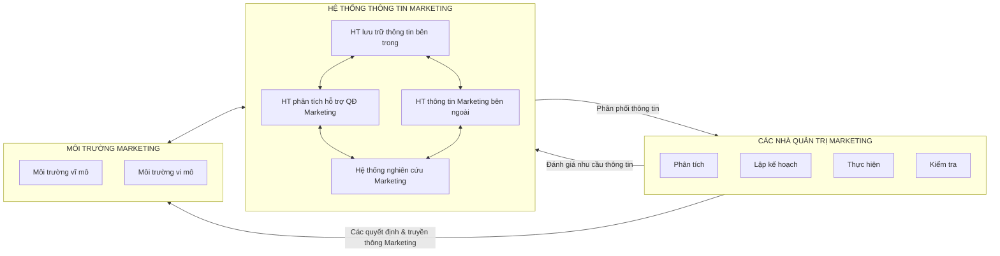

##### b. Ví dụ: Hệ thống thông tin sản xuất (3 tầng)

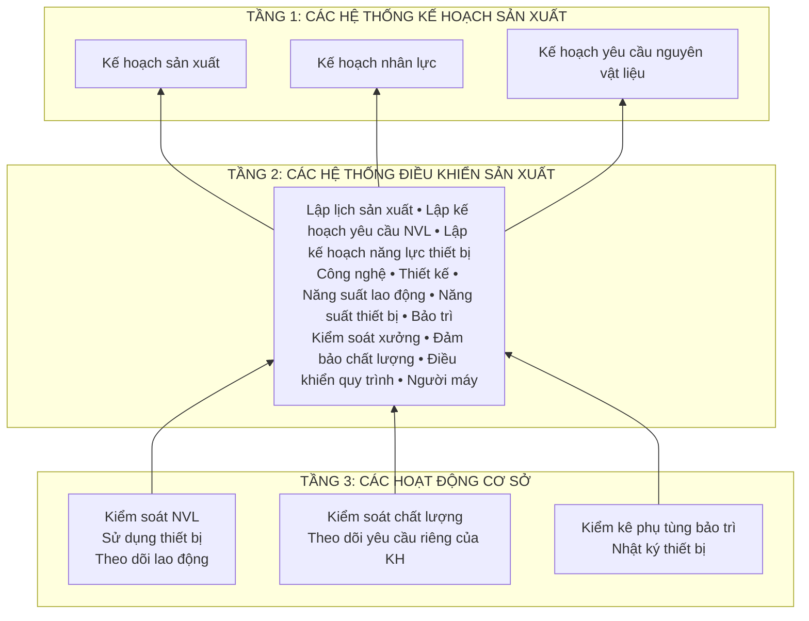

##### c. Ví dụ: Hệ thống thông tin kế toán (AIS)

| Quy trình | Chứng từ đầu vào | Hệ thống xử lý | Sổ kế toán (Lưu trữ 2 chiều) | Báo cáo đầu ra |
| :--- | :--- | :--- | :--- | :--- |
| **1. Quy trình tiêu thụ – doanh thu** | Lệnh bán hàng, Phiếu gửi hàng, Hóa đơn bán hàng, Phiếu thu tiền, Giấy báo trả tiền, Chứng từ hàng trả lại/giảm giá, Phân tích nợ khó đòi | HT ghi nhận đơn đặt hàng, HT giao hàng, HT lập hóa đơn bán hàng, HT thu quỹ | Nhật ký bán hàng, Nhật ký giảm giá hàng bán và trả lại, Nhật ký thu tiền, Sổ chi tiết phải thu khách hàng | Báo cáo khách hàng, Báo cáo phân tích nợ theo thời gian, Báo cáo nhận tiền |
| **2. Quy trình cung cấp – chi phí** | Yêu cầu mua hàng, Đơn đặt hàng, Báo cáo nhận hàng, Chứng từ thanh toán, Séc, Yêu cầu trả lại hàng | HT mua hàng, HT nhận hàng, HT thanh toán hóa đơn mua hàng, HT thu quỹ | Nhật ký ghi chép chứng từ thanh toán, Nhật ký ghi chép séc | Báo cáo hóa đơn chưa xử lý, Báo cáo chứng từ thanh toán, Báo cáo yêu cầu tiền |
| **3. Quy trình sản xuất** | Chứng từ sản xuất | HT tiền lương, HT hàng tồn kho, HT chi phí, HT tài sản cố định | Hệ thống sổ sách kế toán sản xuất | Báo cáo chi phí sản xuất, tồn kho, tài sản |

**Sơ đồ tổng hợp Hệ thống kế toán:**

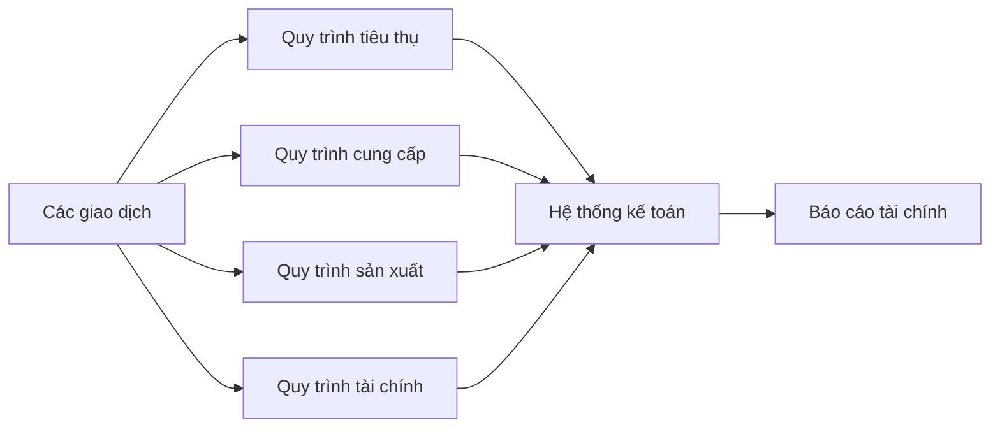

---

### 2.5. Phát triển hệ thống thông tin trong tổ chức

- **Phát triển hệ thống thông tin (ISD)** là quá trình phức tạp và liên tục, nhằm tạo ra hoặc cải tiến các hệ thống thông tin để đáp ứng nhu cầu ngày càng tăng của tổ chức. Quá trình này không chỉ liên quan đến công nghệ mà còn đòi hỏi sự hiểu biết sâu sắc về các quy trình kinh doanh, mục tiêu chiến lược và văn hóa tổ chức. Mục tiêu cuối cùng của ISD là cung cấp các công cụ và thông tin cần thiết để hỗ trợ việc ra quyết định, nâng cao hiệu quả hoạt động và tạo lợi thế cạnh tranh.

#### 2.5.1. Quy trình và các mô hình phát triển hệ thống thông tin

##### a. Quy trình phát triển hệ thống thông tin (7 bước)

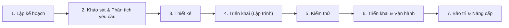

1. **Lập kế hoạch:** Xác định vấn đề, mục tiêu, phạm vi dự án và nguồn lực cần thiết.
2. **Khảo sát – Phân tích yêu cầu:** Thu thập và phân tích các yêu cầu chức năng và phi chức năng từ người dùng và các bên liên quan.
3. **Thiết kế:** Xây dựng kiến trúc hệ thống, thiết kế cơ sở dữ liệu, giao diện người dùng và các thành phần khác.
4. **Triển khai (Lập trình):** Viết mã, phát triển các module và tích hợp chúng thành một hệ thống hoàn chỉnh.
5. **Kiểm thử:** Thực hiện các bài kiểm tra để đảm bảo hệ thống hoạt động đúng chức năng, ổn định và an toàn.
6. **Triển khai và vận hành:** Đưa hệ thống vào sử dụng chính thức, đào tạo người dùng và cung cấp hỗ trợ.
7. **Bảo trì và nâng cấp:** Theo dõi hiệu suất, sửa lỗi, cập nhật và cải tiến hệ thống theo thời gian.

##### b. Mô hình Thác nước (Waterfall Model)

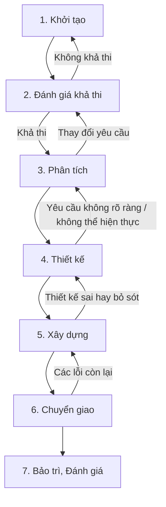

##### c. Mô hình Bản mẫu nhanh (Rapid Prototyping)

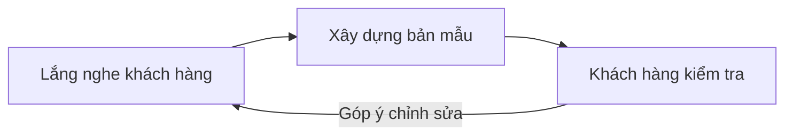

##### d. Mô hình Xoắn ốc (Spiral Model)

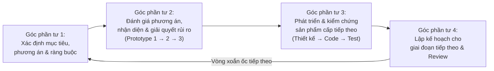

##### e. Mô hình RAD (Rapid Application Development)

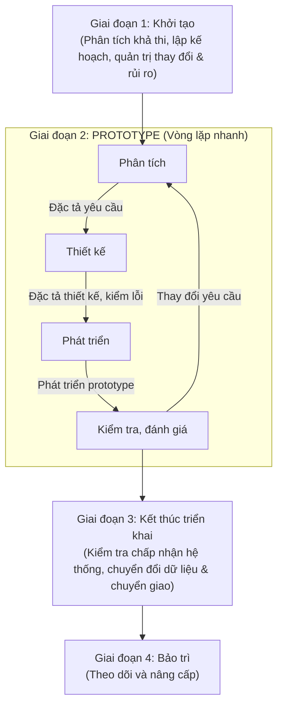

#### 2.5.2. Các chiến lược triển khai hệ thống thông tin

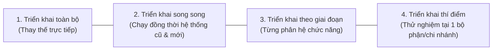

---

## CHƯƠNG 3. QUẢN TRỊ CÁC THÀNH PHẦN CỦA HỆ THỐNG THÔNG TIN

### 3.1. Quản trị hạ tầng công nghệ thông tin

#### 3.1.1. Quản trị phần cứng và phần mềm
Quản trị phần cứng và phần mềm là nền tảng của mọi hệ thống công nghệ. Điều này bao gồm việc giám sát hiệu suất, bảo trì định kỳ, và nâng cấp các thành phần để đảm bảo hoạt động ổn định và hiệu quả.
- **Quản lý máy chủ:** Đảm bảo máy chủ hoạt động liên tục, tối ưu hóa tài nguyên và bảo mật.
- **Quản lý thiết bị đầu cuối:** Cấu hình, bảo trì và hỗ trợ các thiết bị như máy tính, máy in.
- **Quản lý phần mềm:** Cài đặt, cập nhật, cấp phép và khắc phục sự cố phần mềm.

**Chi tiết công tác quản trị phần cứng & phần mềm:**
- **Phần cứng:**
  - Quản lý máy chủ, máy trạm, thiết bị ngoại vi.
  - Bảo trì, nâng cấp linh kiện theo chu kỳ.
  - Giám sát hiệu suất, xử lý sự cố vật lý.
- **Phần mềm:**
  - Cài đặt và cấu hình phần mềm ứng dụng, hệ điều hành.
  - Quản lý bản quyền, cập nhật định kỳ.
  - Giám sát hiệu suất hệ thống, phát hiện và xử lý lỗi phần mềm.

**Một số công cụ giám sát phần cứng máy chủ:**

| Công cụ | Chức năng giám sát chi tiết | Nền tảng hỗ trợ |
| :--- | :--- | :--- |
| **NAGIOS** | Giám sát toàn diện hệ thống, bao gồm CPU, RAM, ổ cứng, nhiệt độ, trạng thái thiết bị. Hỗ trợ cảnh báo qua email/SMS. | Linux, Windows (qua agent) |
| **Zabbix** | Giám sát thời gian thực, hỗ trợ vẽ biểu đồ, cảnh báo, phát hiện bất thường. Có thể giám sát cả phần cứng và dịch vụ. | Linux, Windows |
| **SolarWinds** | Theo dõi hiệu suất máy chủ, phần cứng, ứng dụng. Có dashboard mạnh mẽ và cảnh báo thông minh. | Windows |
| **IPMI Tools** | Giao tiếp trực tiếp với phần cứng máy chủ để giám sát nhiệt độ, điện áp, quạt, trạng thái nguồn. | Linux, Windows |
| **HP iLO / Dell iDRAC / Lenovo XClarity** | Công cụ quản trị phần cứng từ xa chuyên biệt cho từng hãng máy chủ. Cho phép giám sát, cấu hình, khởi động lại máy chủ. | Web-based |

#### 3.1.2. Quản trị hạ tầng mạng và môi trường truyền dẫn tín hiệu
Hạ tầng mạng là xương sống kết nối các hệ thống và thiết bị. Quản trị hiệu quả đảm bảo luồng dữ liệu thông suốt và an toàn:
1. **Thiết kế mạng:** Xây dựng kiến trúc mạng tối ưu cho nhu cầu doanh nghiệp.
2. **Bảo mật mạng:** Triển khai tường lửa, VPN và các giải pháp chống xâm nhập.
3. **Giám sát hiệu suất:** Theo dõi băng thông, độ trễ và các chỉ số quan trọng khác.

- **Hạ tầng mạng:**
  - Hiểu được kiến trúc mạng LAN, WAN, VPN phù hợp.
  - Quản lý router, switch, access point.
  - Bảo mật mạng: tường lửa, chống xâm nhập, phân quyền truy cập.
- **Môi trường truyền dẫn:**
  - Cáp quang, cáp đồng, sóng vô tuyến (Wi-Fi, 4G/5G).
  - Đảm bảo tốc độ truyền ổn định, giảm nhiễu và lỗi đường truyền.
  - Giám sát và tối ưu hóa băng thông sử dụng.

---

### 3.2. Quản trị dữ liệu

#### 3.2.1. Các hoạt động cơ bản liên quan đến nguồn dữ liệu
Quản trị dữ liệu là quá trình đảm bảo dữ liệu có giá trị, đáng tin cậy và dễ tiếp cận:
1. **Thu thập dữ liệu:** Xác định các nguồn, phương pháp và công cụ thu thập dữ liệu.
2. **Xử lý dữ liệu:** Làm sạch, chuyển đổi và tích hợp dữ liệu để phân tích.
3. **Lưu trữ dữ liệu:** Chọn lựa hệ thống lưu trữ phù hợp (đám mây, tại chỗ) và chiến lược sao lưu.
4. **Bảo mật dữ liệu:** Áp dụng các biện pháp bảo vệ dữ liệu khỏi truy cập trái phép và mất mát.

#### 3.2.2. Quy trình phát triển hệ thống quản trị dữ liệu

```mermaid
flowchart LR
    D1["1. Phân tích yêu cầu<br/>(Nhu cầu KD & dữ liệu)"] --> D2["2. Thiết kế kiến trúc<br/>(Mô hình dữ liệu)"] --> D3["3. Lựa chọn CN & Triển khai<br/>(Xây dựng CSDL, đào tạo)"] --> D4["4. Kiểm thử & Tối ưu<br/>(Hiệu suất & độ chính xác)"] --> D5["5. Vận hành & Bảo trì<br/>(Giám sát, khắc phục sự cố)"]
```

#### 3.2.3. Một số kỹ thuật thông dụng trong quản trị dữ liệu
1. **Chuẩn hoá dữ liệu (Data Cleansing):** Làm sạch dữ liệu, chuẩn hoá thông tin.
2. **Trích xuất, chuyển đổi, tải (ETL - Extract – Transform – Load):** Kỹ thuật chuyển đổi dữ liệu từ nhiều nguồn về một kho dữ liệu để phân tích.
3. **Kho dữ liệu (Data Warehouse):** Một kho dữ liệu tập trung, nơi lưu trữ dữ liệu lịch sử từ nhiều hệ thống như bán hàng, kế toán, nhân sự, CRM... Phục vụ cho các tác vụ truy vấn, phân tích, thống kê thay vì xử lý giao dịch hàng ngày.
4. **Hồ dữ liệu (Data Lake):** Một kho lưu trữ linh hoạt, nơi dữ liệu được đưa vào nguyên bản mà không cần xử lý hay chuẩn hoá trước, cho phép lưu trữ dữ liệu thô để phục vụ cho các phân tích sau này.
5. **Quản lý chất lượng dữ liệu.**
6. **Quản lý siêu dữ liệu (Metadata Management):** Quản lý thông tin mô tả về dữ liệu, giúp người dùng hiểu rõ dữ liệu đang sử dụng.
7. **Data Profiling:** Phân tích đặc điểm dữ liệu để phát hiện mẫu, lỗi hoặc vấn đề tiềm ẩn.
8. **Data Integration:** Kết hợp dữ liệu từ nhiều nguồn khác nhau (dữ liệu cần được xác minh và kiểm soát).
9. **Data Governance:** Bộ quy tắc, vai trò và chính sách kiểm soát chất lượng và bảo mật dữ liệu trong tổ chức.

#### 3.2.4. Quản trị rủi ro dữ liệu
- Các nhóm rủi ro chính trong quản trị dữ liệu:
  - Rủi ro về pháp lý và các quy định.
  - Các lỗ hổng bảo mật.
  - Rủi ro về quyền truy cập.
  - Rủi ro tiềm ẩn bên trong (chất lượng dữ liệu, lỗi hệ thống).
  - Rủi ro quản trị và con người.

**Quy trình Quản trị rủi ro dữ liệu (Data Risk Management Process):**

```mermaid
flowchart TD
    B1["BƯỚC 1: Phân tích Tác động Nghiệp vụ (BIA)<br/>Đánh giá thiệt hại tài chính, uy tín, pháp lý nếu dữ liệu bị rò rỉ/phá hủy"] --> B2["BƯỚC 2: Đánh giá và Xếp hạng Rủi ro (Risk Assessment & Scoring)<br/>Xác định Xác suất (Likelihood) & Mức độ ảnh hưởng (Impact)<br/>Lập Bản đồ Rủi ro (Risk Heat Map) ưu tiên xử lý vùng đỏ"]
    B2 --> B3["BƯỚC 3: Lựa chọn Chiến lược Xử lý Rủi ro"]
    B3 --> S1["Giảm thiểu rủi ro<br/>(Risk Mitigation)<br/>Kiểm soát kỹ thuật & quy trình"]
    B3 --> S2["Né tránh rủi ro<br/>(Risk Avoidance)<br/>Không thu thập dữ liệu nhạy cảm nếu không bắt buộc"]
    B3 --> S3["Chuyển giao rủi ro<br/>(Risk Transfer)<br/>Mua bảo hiểm an ninh mạng hoặc thuê đối tác"]
    B3 --> S4["Chấp nhận rủi ro<br/>(Risk Acceptance)<br/>Khi chi phí xử lý vượt quá mức thiệt hại ước tính"]
```

---

### 3.3. Hệ thống thông tin ứng dụng và Mô hình quản trị

#### 3.3.1. Một số ứng dụng quản trị hệ thống thông tin thông dụng
Các hệ thống phân loại theo mức độ tích hợp quy trình nghiệp vụ:
1. **Hệ thống ERP (Enterprise Resource Planning):** Quản lý tài nguyên doanh nghiệp, tích hợp các quy trình kinh doanh.
2. **Hệ thống CRM (Customer Relationship Management):** Quản lý quan hệ khách hàng, nâng cao trải nghiệm khách hàng.
3. **Hệ thống SCM (Supply Chain Management):** Quản lý chuỗi cung ứng, tối ưu hóa logistics và tồn kho.
4. **Hệ thống BI (Business Intelligence & Analytics):** Kinh doanh thông minh, phân tích dữ liệu để đưa ra quyết định.

##### a. Hệ thống quản lý nguồn lực doanh nghiệp (ERP)
- **ERP (Enterprise Resource Planning)** là hệ thống thông tin quản lý tích hợp các nguồn lực của doanh nghiệp, bao trùm lên toàn bộ các hoạt động chức năng chính của doanh nghiệp:
  - **Kế toán:** Quản lý sổ cái, sổ phụ tiền mặt, sổ phụ ngân hàng, bán hàng và các khoản phải thu, mua hàng và các khoản phải trả.
  - **Quản lý nhân sự:** Quản lý lương, giờ làm, đơn giá lao động, kỹ năng nghề nghiệp.
  - **Quản lý sản xuất:** Lập kế hoạch sản xuất, nguyên vật liệu, phân phối, điều phối năng lực, công thức sản phẩm, quản lý luồng sản xuất, lệnh sản xuất, mã vạch...
  - **Quản lý hậu cần:** Quản lý kho, quản lý giao nhận, quản lý nhà cung cấp.
  - **Quản lý bán hàng:** Quản lý yêu cầu đặt hàng, dự báo lập kế hoạch bán hàng.

##### b. Hệ thống quản lý chuỗi cung ứng (SCM)
- **SCM (Supply Chain Management)** cung cấp các giải pháp điều phối hiệu quả chuỗi cung ứng cho doanh nghiệp:
  - **Supplier – Nhà cung ứng:** Các doanh nghiệp cung cấp nguyên vật liệu, sản phẩm, dịch vụ phục vụ cho quá trình sản xuất và kinh doanh.
  - **Producer – Đơn vị sản xuất:** Tiếp nhận nguyên vật liệu từ nhà cung cấp, tiến hành sản xuất để đưa thành phẩm đến với khách hàng mục tiêu.
  - **Customer – Khách hàng:** Đối tượng doanh nghiệp hướng đến.

```mermaid
flowchart LR
    S["SUPPLIER<br/>(Nhà cung ứng)"] --> D["DISTRIBUTOR<br/>(Nhà phân phối)"] --> M["MANUFACTURER<br/>(Nhà sản xuất)"] --> R["RETAILER<br/>(Nhà bán lẻ)"] --> L["LOGISTICS<br/>(Vận chuyển)"] --> C["CUSTOMER<br/>(Khách hàng)"]
```

- **5 quy trình cốt lõi trong SCM (SCOR Model):**
  1. **Plan (Lập kế hoạch):** Cân đối nguồn lực với yêu cầu, đồng bộ kế hoạch chuỗi cung ứng với kế hoạch tài chính.
  2. **Source (Nguồn cung):** Xác định nhà cung cấp, lập lịch giao hàng, quản lý tồn kho.
  3. **Make (Sản xuất):** Lập lịch sản xuất, đánh giá chất lượng và hiệu suất, quản lý bán thành phẩm.
  4. **Deliver (Giao hàng):** Chọn đơn vị vận chuyển, định tuyến lô hàng, quản lý kho bãi, lập hóa đơn khách hàng.
  5. **Return (Hoàn trả):** Phê duyệt hoàn trả, lập lịch nhận hàng trả, tiếp nhận hàng trả, cấp tín dụng hoàn tiền.

##### c. Hệ thống quản lý quan hệ khách hàng (CRM)
- **CRM (Customer Relationship Management)** là hệ thống phần mềm giúp doanh nghiệp quản lý, phân tích và cải thiện mối quan hệ với khách hàng, tập trung vào việc hiểu rõ khách hàng, tăng sự hài lòng và thúc đẩy doanh số:
  - Quản lý phân tích thị trường, lập kế hoạch tiếp thị và bán hàng, các hoạt động và chiến dịch tiếp thị.
  - Quản lý các đơn đặt hàng, quản lý các hoạt động chăm sóc khách hàng.
  - Phân tích nhiều chiều trên khách hàng để định hướng các hoạt động phát triển sản phẩm và bán hàng.

**Kiến trúc CRM 3 tầng:**

```mermaid
flowchart TD
    subgraph T1["Tầng 1: Collaborative CRM (CRM Cộng tác)"]
        C1["Face-to-face contact • Internet • E-Mail • Call Center"]
    end

    subgraph T2["Tầng 2: Operative CRM (CRM Tác nghiệp)"]
        O1["Marketing automation"]
        O2["Sales automation"]
        O3["Service automation"]
    end

    subgraph T3["Tầng 3: Analytical CRM (CRM Phân tích)"]
        A1["Data analysis"] <--> A2[("Customer database")]
    end

    T1 <--> T2
    T2 <--> T3
```

##### d. Hệ thống trí tuệ doanh nghiệp (BI)
- **BI (Business Intelligence)** là tập hợp công nghệ, quy trình và công cụ giúp doanh nghiệp thu thập, phân tích, trực quan hóa dữ liệu để đưa ra quyết định chính xác thay vì dựa vào cảm tính.

```mermaid
flowchart LR
    DS["Nguồn dữ liệu (Data Sources)<br/>CRM, ERP, HRM, TMĐT..."] --> DW[("Kho dữ liệu (Data Warehouse)<br/>Lưu trữ dữ liệu đã tích hợp")] --> AT["Công cụ phân tích<br/>Tableau, Power BI, Qlik Sense, SAP BO"] --> DB["Dashboard & Báo cáo<br/>Biểu đồ, Bảng, KPI"]
```

---

#### 3.3.2. Sáu thành phần của hệ thống thông tin ứng dụng

```mermaid
flowchart TD
    IS["HỆ THỐNG THÔNG TIN ỨNG DỤNG<br/>(6 THÀNH PHẦN)"] --> C1["1. Phần cứng (Hardware)"]
    IS --> C2["2. Phần mềm (Software)"]
    IS --> C3["3. Dữ liệu (Data)"]
    IS --> C4["4. Quy trình (Procedures)"]
    IS --> C5["5. Con người (People)"]
    IS --> C6["6. Mạng truyền thông (Networks)"]
```

1. **Phần cứng (Hardware):**
   - *Bao gồm:* Máy tính, thiết bị mạng, máy chủ.
   - *Vai trò:* Là nền tảng vật lý để hệ thống thông tin vận hành. Nếu phần cứng gặp sự cố thì dữ liệu không truy cập được, phần mềm không hoạt động và quy trình kinh doanh bị gián đoạn.
2. **Phần mềm (Software):**
   - *Bao gồm:* Hệ điều hành, ứng dụng, cơ sở dữ liệu.
   - *Đặc điểm & Vai trò:* Là thành phần "vô hình", có thể nâng cấp thường xuyên và quy định cách thức xử lý dữ liệu.
3. **Dữ liệu (Data):**
   - *Bao gồm:* Thông tin thô và đã xử lý.
   - *Vai trò:* Là "nguyên liệu đầu vào" của hệ thống thông tin. Tuân theo nguyên lý **Garbage In – Garbage Out** (dữ liệu đầu vào kém chất lượng sẽ tạo ra kết quả kém chất lượng).
4. **Quy trình (Procedures):**
   - *Bao gồm:* Các bước thực hiện để xử lý thông tin.
   - *Vai trò:* Giúp mọi cá nhân thực hiện công việc theo cùng một tiêu chuẩn; phần mềm chỉ cung cấp chức năng, còn quy trình quyết định cách sử dụng chức năng đó; ngăn ngừa sai sót hoặc gian lận trong các tổ chức lớn; giúp loại bỏ bước thừa, công việc trùng lặp và thời gian chờ đợi.
5. **Con người (People):**
   - *Bao gồm:* Người dùng, chuyên gia IT, quản lý.
   - *Vai trò:* Là chủ thể quan trọng nhất của hệ thống thông tin (vừa là người thiết kế, người vận hành, người kiểm soát, vừa là người sử dụng thông tin).
6. **Mạng truyền thông / Mạng lưới (Networks):**
   - *Bao gồm:* Internet, Intranet, Extranet.
   - *Vai trò:* Giúp chia sẻ dữ liệu, làm việc từ xa, điện toán đám mây và tích hợp hệ thống.

---

#### 3.3.3. Mô hình quản trị hệ thống thông tin thông dụng

##### a. Mô hình Tháp quản trị hệ thống thông tin 4 tầng

```mermaid
flowchart TD
    L1["Tầng 1 (Đỉnh tháp): Quản trị chiến lược — Định hướng và mục tiêu dài hạn"] --- L2["Tầng 2: Quản trị kiến trúc — Thiết kế và triển khai hệ thống"] --- L3["Tầng 3: Quản trị hoạt động — Vận hành và bảo trì hàng ngày"] --- L4["Tầng 4 (Đáy tháp): Quản trị rủi ro và bảo mật — Bảo vệ thông tin và hệ thống"]
```

##### b. Mô hình Kim tự tháp Hệ thống thông tin theo cấp quản trị (TPS – MIS – DSS – ESS)

- **Ý nghĩa của Mô hình Kim tự tháp:**
  - Mỗi cấp quản trị cần loại thông tin khác nhau.
  - Càng xuống dưới: **Dữ liệu càng chi tiết, khối lượng rất lớn**.
  - Càng lên trên: **Thông tin càng tổng hợp, phục vụ quyết định chiến lược**.
  - **Dữ liệu** đi từ dưới lên, còn **Quyết định** đi từ trên xuống.

```mermaid
flowchart BT
    TPS["Tầng 4 (Đáy): TPS — Hệ thống xử lý giao dịch<br/>(Nhân viên tác nghiệp • Dữ liệu chi tiết, thực thời)"] -->|Tổng hợp dữ liệu| MIS["Tầng 3: MIS — Hệ thống thông tin quản lý<br/>(Quản lý cấp trung • Báo cáo định kỳ)"]
    MIS -->|Phân tích & mô hình hóa| DSS["Tầng 2: DSS — Hệ thống hỗ trợ ra quyết định<br/>(Quản lý cấp cao/trung gian • Phân tích kịch bản)"]
    DSS -->|Hoạch định chiến lược| ESS["Tầng 1 (Đỉnh): ESS — Hệ thống hỗ trợ điều hành cấp cao<br/>(CEO / Ban lãnh đạo • Tầm nhìn 3–10 năm)"]
```

- **Bảng chi tiết 4 tầng trong Mô hình Kim tự tháp:**

| Tầng (Từ đỉnh xuống đáy) | Mục tiêu | Chức năng chính | Đặc điểm dữ liệu | Ví dụ thực tế | Thời gian | Người sử dụng điển hình |
| :--- | :--- | :--- | :--- | :--- | :--- | :--- |
| **1. ESS** *(Executive Support System - Hỗ trợ điều hành cấp cao)* | Hoạch định chiến lược | Cung cấp cái nhìn tổng thể; Theo dõi KPI chiến lược; Hỗ trợ định hướng dài hạn | Tổng quan (ít nhất) | Dashboard doanh thu; Thị phần, tăng trưởng; Xếp hạng đại học | Dài hạn (3–10 năm) | **CEO / Ban lãnh đạo:** Tổng giám đốc, Chủ tịch HĐQT, Ban giám hiệu |
| **2. DSS** *(Decision Support System - Hỗ trợ ra quyết định)* | Hỗ trợ ra quyết định | Phân tích dữ liệu; Dự báo, mô hình hóa; Phân tích kịch bản (What-if) | Phân tích (ít) | Dự báo tuyển sinh; Phân tích mở ngành mới; Đánh giá đầu tư | Trung và dài hạn | **Nhà quản lý cấp cao/trung gian:** Phó giám đốc, Trưởng phòng, Chuyên gia phân tích |
| **3. MIS** *(Management Information System - HTTT Quản lý)* | Quản lý và kiểm soát | Tổng hợp dữ liệu từ TPS; Tạo báo cáo quản lý; Theo dõi hiệu suất hoạt động | Tổng hợp (trung bình) | Báo cáo doanh thu; Thống kê sinh viên; Báo cáo tồn kho | Định kỳ (theo ngày/tháng/quý) | **Quản lý cấp trung:** Trưởng phòng, Trưởng khoa, Trưởng bộ môn |
| **4. TPS** *(Transaction Processing System - HT Xử lý giao dịch)* | Xử lý giao dịch | Ghi nhận giao dịch hàng ngày; Cập nhật cơ sở dữ liệu; Đảm bảo xử lý nhanh, chính xác | Chi tiết (rất lớn) | Đăng ký học phần; Bán hàng, thanh toán; Chấm công, chuyển khoản | Thực thời (liên tục) | **Nhân viên tác nghiệp:** Nhân viên, Sinh viên, Khách hàng |

- **Ví dụ minh họa luồng thông tin đăng ký học phần đi từ dưới lên:**

```mermaid
flowchart BT
    T1["1. TPS (Sinh viên)<br/>Ghi nhận: SV Nguyễn Văn A đăng ký môn CNTT 101 (3 tín chỉ)"] --> T2["2. MIS (Trưởng phòng)<br/>Báo cáo: Môn CNTT 101 có 450 SV đăng ký, đạt 90% công suất lớp học"]
    T2 --> T3["3. DSS (Phòng đào tạo)<br/>Phân tích: Nếu mở thêm 2 lớp sẽ giảm quá tải và tăng khả năng đăng ký"]
    T3 --> T4["4. ESS (Ban giám hiệu)<br/>Xem xu hướng: Số lượng SV tăng, nhu cầu học CNTT cao -> Quyết định mở thêm ngành mới"]
```
